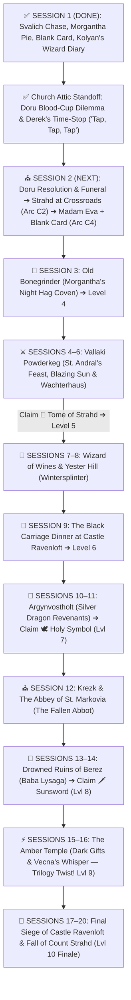

# 🏰 Master DM Screen & Campaign Cheat Sheet — Curse of Strahd (Director's Cut)

> **Quick Glance Reference for the Lead DM**  
> *The 15–20 Session Director's Cut Roadmap, Curated Tarokka Reading, Barovian NPC Directory, Pointy Hat Boss Stat Blocks, World Loot Vault, and Gothic Horror Rules at a glance.*

---

## 🛡️ SECTION 0: PARTY CHARACTER SHEETS & ESCORT VITALS (LEVEL 3 START)

| Slot | Hero / Companion | Class & Level | HP | AC | Init | Key Passive / Resource |
| :--- | :--- | :--- | :--- | :--- | :--- | :--- |
| **PC 1** | 🎭 **Piper ("The Incomparable")** | Level 3 Wild Magic Sorcerer (Fierna Tiefling • Native) | `17/17` | `12 (15)` | `+2` | ✨ `3/3 SP` • 🎲 `Tides` • 💖 `Fierna Charm 0/1` • 🃏 **Blank Tarokka Card** • 💛 `2/2 Help` |
| **PC 2** | 👑 **Jacomir Yulle ("King of Oakenshire")** | Level 3 Battle Master Fighter (Human • Noble) | `31/31` | `17` | `+0` | ⚔️ `4/4 d8` • ☕ `3/3 SW` • 📖 **Kolyan's Wizard Diary** • 🥧 **1x Dream Pastry (Uneaten)** • 💛 `2/2 Help` |
| **PC 3** | 🎯 **Eclipsa "Yvaine" the First** | Level 3 Monster Slayer Ranger (Human • Gunner) | `28/28` | `16` | `+6` | 🔫 *Lament* `+8 (1d12+4)` • 💥 *Mercy & Less* `+8 (1d6+4)` • 👁️ *Hunter's Sense 2/2* • 🎯 *Slayer's Prey (+1d6)* • ⚡ *Alert (+6 Init)* • 💛 `2/2 Help` |
| **Emissary** | ⏳ **Derek ("The Man Between Seconds")** | Avatar / Project Manager of the Dark Powers | `∞` | `--` | `--` | **Froze Time (`Tap, Tap, Tap`) in S1 Church!** Invisible to Strahd • Appears at 3 Future Milestones Only |
| **Companion** | 🌟 **Caelum Jude ("Cael")** | Level 3 Circle of the Stars Druid (Main Companion & Primary Healer) | `38/38` | `14` | `+2` | ✨ Chalice Dual Heals (`1d8+3`) • 🏹 Archer Form (`1d8+3` Rad) • ⚡ Guiding Bolt (`2/2`) • 🐈 Black Cat • 🛡️ *Vow of Dark Powers (Stabilizes at 1 HP)* |
| **Escort** | 🌹 **Ireena Kolyana** | Noble Swordswoman (Tatyana Reborn) | `28/28` | `15` | `+2` | ⚔️ Silvered Rapier `+5 (1d8+2)` • 🛡️ Parry `+2 AC` |
| **Ally** | 🗡️ **Ismark Indirovich** | Veteran Swordsman *(Act I)* | `58/58` | `17` | `+1` | Multiattack: 2x Longsword `+5 (1d10+3)` • ☕ Second Wind |
| **Fated** | ⚔️ **Ezmerelda d'Avenir** | Tarokka Ally *(Act II–IV)* | `82/82` | `17` | `+4` | `+1 Rapier` (`+8, 1d8+5`), 4th-Lvl Wizard Spells, Silvered Prosthetic |

---

## 📜 SECTION 1: THE 15–20 SESSION DIRECTOR'S CUT ROADMAP & TAROKKA ORACLE

### 🔮 1.1 Curated Madam Eva Tarokka Reading (Session 2 — Tser Pool)
*Read these exact card draws during Session 2 so every treasure drives the core 15–20 session plot without dead-end backtracking:*

1. **📜 First Card — The Tome of Strahd (History of the Devil):**
   * **Card Drawn:** *The Master of Stars (Wizard)*
   * **Madam Eva's Prophecy:** *"I see a walled town where smiles are painted over terror. Look to a noble house of cats and whispers, where a widow sleeps beside the dead and bows to the Devil in secret. In her hidden library lies the truth of Strahd's birth."*
   * **DM Location Key:** **Wachterhaus in Vallaki (Lady Fiona Wachter's Secret Cult Library)** — *Sessions 5–6 (Level 5).*
2. **🕊️ Second Card — The Holy Symbol of Ravenkind (Weapon of Faith):**
   * **Card Drawn:** *The Paladin (Justiciar)*
   * **Madam Eva's Prophecy:** *"I see a fallen house of silver wings and broken oaths. Seek the fortress of the dead dragon knight who hates so deeply he refuses to let the Devil die. Light the beacon of the silver wyrm, and the amulet of the sun shall be yours."*
   * **DM Location Key:** **Argynvostholt (Vladimir Horngaard's Sanctum)** — *Sessions 10–11 (Level 7). Directly bridges into Campaign 3's Ancient Dragon Lore!*
3. **🗡️ Third Card — The Sunsword (The Blade of Sunlight):**
   * **Card Drawn:** *The Tempter (Marionette)*
   * **Madam Eva's Prophecy:** *"I see a drowned village in a fetid marsh where no bird dare sing. A rotting hut crawls upon ancient roots, guarded by an old woman who cradles an illusion of youth in a dragon skull. The blade of pure light lies buried in her mire."*
   * **DM Location Key:** **Ruins of Berez (Baba Lysaga's Creeping Hut)** — *Sessions 13–14 (Level 8).*
4. **⚔️ Fourth Card — The Fated Ally (The Swashbuckling Hunter):**
   * **Card Drawn:** *The Mists (Element)*
   * **Madam Eva's Prophecy:** *"A child of our own blood who has walked away from the wagons. She carries the scars of the hunt upon her flesh and steel where bone was shattered. A woman of flashing rapiers and black powder—she waits in the mists to strike at the throat of the beast."*
   * **DM Location Key:** **Ezmerelda d'Avenir** — *Fated Ally joined in Vallaki / Abbey (Act II–III).*
5. **🏰 Fifth Card — The Final Battlefield (Where Strahd Must Die):**
   * **Card Drawn:** *The Executioner (High Deck)*
   * **Madam Eva's Prophecy:** *"I see the spire of black stone piercing a blood-moon. He waits where his brother's blood first touched the stones, beneath the high chapel where stained glass portrays saints with blind eyes. Face him beneath the gaze of the dead saints, and the master shall fall."*
   * **DM Location Key:** **Castle Ravenloft — The Chapel of Saint Andral / Sergei's Crypt** — *Session 19–20.*
6. **🃏 Sixth Card — Piper's Blank Tarokka Card (The 3-Stage Living Omen — Option 2):**
   * **Origin:** Handed to Piper by a deeply concerned Vistani at *Blood on the Vine Tavern* in Session 1 after the painted ink faded off the card in her hand.
   * **Madam Eva's Reaction (No Direct Lore-Dump!):** Eva touches the blank parchment and pulls her hand back as if burned by ice: *"Four hundred years I have read these cards, and never has the fog stood between my eyes and a traveler's road. Something walks in the silence behind you, child—something that hides your ending even from me. Keep this card in your coat. Every time you step closer to what woke the fire in your blood, the ink will bleed higher. Pray you do not recognize the picture when it finishes drawing itself."*
   * **3-Stage Progressive Mist Bleed (Zero Tiefling/Monolith Spoilers):**
     * **Stage 1 (Session 2 — Tser Pool):** Bottom third fills with charcoal ink — *dead pine trees and a pair of empty, upturned palms rising out of black water*.
     * **Stage 2 (Mid-Campaign — Vallaki / Berez):** Middle third bleeds in — *a cracked, faceless glass lantern / pocket watch suspended in midair with threads of silver-gray fog curling into its cracks*.
     * **Stage 3 (Act IV — Amber Temple / Ravenloft):** Top third fills in — *a violent vortex of endless gray Mist pouring inward into the cracked glass, with a faint, unblinking shadow-grin in the smoke above*.

---

### 🗺️ 1.5 Campaign Biomes, Dungeons & Locations Explorer (17 Unbundled Locations Across Acts I–IV)

| # | Act & Session | Location / Dungeon & Book Key | Key Encounters, Room Keys & Hazards | Key Loot & Milestone Rewards |
| :--- | :--- | :--- | :--- | :--- |
| **1** | **Act I • S1** | 🌲 **Old Svalich Road & Gates of Barovia** (`Ch. 2, Areas A & B`) | Choking Mists (`CON DC 12`), headless gates (`B`), corpse letter (`B1`), Dire Wolf pack chase (`S1 Done`) | 🗡️ **Silvered Shortsword**, `8 GP` (`S1 Done`) |
| **2** | **Act I • S1–S2** | 🏚️ **Village of Barovia, Manor & Church Attic** (`Ch. 3, Areas E1–E5`) | Bildrath (`E1`), Blood on the Vine (`E2`), Mad Mary (`E3`), Indirovich Manor (`E4`), **Doru in Church Attic (`E5` — S1/S2 Cliffhanger!)** | 📖 **Kolyan's Wizard Diary**, 🃏 **Blank Tarokka Card**, `2x Holy Water` |
| **3** | **Act I • S2** | ⚖️ **River Ivlis Crossroads & Tser Falls** (`Ch. 2, Areas F & H` / *Reloaded Arc C2*) | Gallows Illusion (`Area F`), **First Face-to-Face with Count Strahd (`Arc C2`)**, **Tser Falls Bridge & Derek's 1st Milestone** | 👑 **Strahd's Formal Dinner Invitation**, 💧 Running Water rule (`20 Acid`) |
| **4** | **Act I • S2** | 🔮 **Tser Pool Vistani Camp** (`Ch. 2, Area G` / *Reloaded Arc C4*) | Safe Long Rest camp, Vistani silver trade, **Madam Eva's 5-Card Tarokka Reading + Piper's 6th Blank Card (Stage 1 Bleed)** | 🩸 **Vistani Bloodwell Vial `+1` (Piper)**, 🧪 Potions, Silvered Ammo |
| **5** | **Act I • S3** | 🥧 **Old Bonegrinder Windmill & Megaliths** (`Ch. 6, Areas O1–O4`) | **Morgantha, Bella & Offalia (Night Hag Coven)**, Caged Children (`O3`), *Bone-Flour Combustion Cloud*, Four Seasons Megaliths (`O4`) | 🧿 **Night Hag Heartstone**, 🌿 **Elixir of Youth**, `3x Spell Scrolls` (**Level 4!**) |
| **6** | **Act II • S4 & S6** | ⚔️ **Town of Vallaki & Blue Water Inn** (`Ch. 5, Areas N2, N3, N7, N8, N9`) | **Blue Water Inn (`N2` — Kolyan's Diary unlocks Keepers!)**, Rictavio's Tiger Wagon (`N2r`), Baron's Mansion & Victor's Attic (`N3t`), Blinsky's (`N7`), Vistani & Dusk Elf Camp (`N9`) | 🐾 **Gray Bag of Tricks**, 🪄 **Victor's Wand**, 🎭 **Hat of Disguise**, 🎯 **Silver Scope (Yvaine)** |
| **7** | **Act II • S5–S6** | ⚰️ **St. Andral's Church, Henrik's Coffin Shop & Wachterhaus** (`Ch. 5, Areas N1, N4, N6`) | **Henrik's Coffin Shop (`N6` — 6 Vampire Spawn + Bride Anastrasya Ambush!)**, St. Andral's Bones Relay (`N1`), **Wachterhaus Cult Cellar (`N4`)** | 📜 **The Tome of Strahd (Tarokka #1 — Level 5!)**, 🦴 **Bones of St. Andral**, 🔥 **Izek's Battleaxe `+1`** |
| **8** | **Act II • S7** | 🍷 **The Wizard of Wines Winery** (`Ch. 12, Areas W1–W20`) | 24 Twig Blights, 6 Needle Blights, 2 Vine Blights, 3 Poisoned Vats (`W9`), **Chief Druid (`W14`) — Snapping the Gulthias Staff kills all Blights within 300 ft!** | 🌿 **The Gulthias Staff**, 🧥 **Wereraven Cloak of Protection `+1`**, 🍷 Vintage Casks |
| **9** | **Act II • S8** | ⛰️ **Yester Hill, Kavan's Cairn & The Gulthias Tree** (`Ch. 14, Areas Y1–Y4`) | Megalith Ring (`Y1`), Wall of Fog (`Y2` — Strahd on Beucephalus), **50-Ft Wintersplinter Ritual**, **Kavan's Cairn (`Y4`)**, **The Gulthias Tree (`Y3`)** | 🩸 **`+2` Blood Spear of Kavan (Jacomir!)**, 🪓 **Treebane Greataxe**, 💚 **1st Winery Life-Gem** |
| **10** | **Act II • S9** | 🍽️ **Castle Ravenloft (Act II Black Carriage Dinner & Heist)** (`Ch. 4, Areas K1–K67`) | **Dining Hall (`K10`)** social chess with Strahd & Brides, Consort Escher (`K42` — reveals Heart of Sorrow), Chapel (`K15`), **Hall of Bones (`K67`)** | 🐉 **Skull of Argynvost**, ☀️ **Icon of Ravenloft**, 🪕 **Mac-Fuirmidh Cittern** (**Level 6!**) |
| **11** | **Act III • S10** | 🐉 **Argynvostholt (Ruined Mansion of the Silver Wyrm)** (`Ch. 7, Areas Q1–Q53`) | **Vladimir Horngaard (`Q36`)** vs. **Sir Godfrey (`Q13`)**, Ancient Star-Mural (Campaign 3 Bridge), **Lighting the Silver Beacon (`Q53`)** | 🕊️ **Holy Symbol of Ravenkind (Tarokka #2!)**, 🐉 **Beacon Boon (`+1 AC & Saves` Party-Wide!)**, ⚔️ **Greatsword `+2`** (**Level 7!**) |
| **12** | **Act III • S12** | ⛪ **Village of Krezk & The Abbey of St. Markovia** (`Ch. 8, Areas S1–S24`) | **Pool of the White Sun (`S4` — Sergei's spirit & Strahd's lightning)**, **The Fallen Abbot (`CR 10 Deva`)**, **Vasilka the Flesh Golem**, Mongrelfolk | ⚔️ **Ezmerelda Joins!**, 🦴 **St. Markovia's Thighbone**, 💚 **Ring of Regeneration**, 📜 **Scroll of Heroes' Feast** |
| **13** | **Act III • S13–S14** | 🌊 **The Drowned Ruins of Berez (Marina's Marsh)** (`Ch. 10, Areas U1–U7`) | Ulrich's Ghost (`U2`), Marina's Monument (`U5`), Scarecrow Marsh, **Baba Lysaga (`CR 11` in Flying Skull) & 140-HP Creeping Walking Hut (`U3`)** | 🗡️ **The Sunsword (Tarokka #3 — Level 8!)**, 🍀 **Luckstone (`+1`)**, 🧪 **Oil of Sharpness (`+3`)**, 📜 **Scroll of Revivify** |
| **14** | **Act III • S11** | 🗼 **Van Richten's Tower, Lake Baratok & Werewolf Den** (`Ch. 11 & 15, Areas V & Z`) | **8th-Lvl Antimagic Field**, Stick-Figure Door Dance (`V2`), Clay Golem (`V4`), **The Mad Mage (`Mordenkainen`)**, **Werewolf Den (`Z1–Z8`: Kiril vs. Emil/Zuleika)** | 💥 **Ezmerelda's Wagon Cache**, ⚡ **Mad Mage's Charm of Heroism**, 🏆 **Shrine of Mother Night Hoard (`Z7`)** |
| **15** | **Act IV • S15** | ❄️ **Tsolenka Pass & The Balinok Mountain Gatehouse** (`Ch. 9, Areas T1–T9`) | Extreme Cold (`CON DC 10`), **Wall of Green Fire (`T2` — `8d6` fire)**, 2 Vrock Statues (`T3`), **Sangzor the Giant Goat**, **The Roc of Mount Ghakis (`CR 11`)** | 🧥 **Bloodhorn's Mountain Pelt**, 🤍 **Silvered Spear**, 💎 Guard Tower Chest (`T6`) |
| **16** | **Act IV • S15–S16** | ⚡ **The Amber Temple (Vault of the Dark Powers)** (`Ch. 13, Areas X1–X42`) | **Neferon the Arcanaloth (`X5`)**, Amber Golem, **Amnesiac Lich Exethanter (`X27` — *Greater Restoration* opens PHB Library `X30`)**, **20+ Amber Sarcophagi & West Vault (`X42`)** | ❄️ **Staff of Frost**, 📖 **Tome of Understanding (`+2 WIS`)**, ⚡ **3 PCs' Supreme Dark Gifts (+30 Max HP & 9th-Lvl Boons — Level 9!)** |
| **17** | **Act IV • S17–S20** | 👑 **Castle Ravenloft (Final Siege, Heart & Catacombs)** (`Ch. 4, Areas K20, K41, K6, K78, K84–K88`) | **Shatter Heart of Sorrow (`K20`)**, Treasury (`K41`), Brazier Room (`K78`), **Final Showdown at The Overlook (`K6`)**, **Rahadin & Catacombs (`K84–K86`)**, **Cael's S20 Root Anchor Ritual** | ⚡ **Khazan's Staff of Power (`+2 AC/Saves/Hit`, Crypt 15!)**, 👑 **Helm of Brilliance (`K41`)**, 🃏 **Deck of Illusions (Crypt 9)** (**Level 10 Finale!**) |

---

## 👥 SECTION 2: MASTER BAROVIAN NPC DIRECTORY (5-COLUMN FORMAT)

| NPC Name & Condition | Live Status | Role & Location | Key Offerings, Services, Quests & Advice | 🎭 Voice & Roleplay Cue |
| :--- | :--- | :--- | :--- | :--- |
| ⏳ **Derek ("Man Between Seconds")** `[Avatar of the Dark Powers]` | 🟢 Met & Active | Time-Stopping Emissary • Frozen Moments | Froze time (`tap, tap, tap`) in S1 Church! Promised Jacomir & Yvaine a way home if they kill Strahd; told Piper to *"take care of herself."* **Strahd cannot perceive him!** | Calm, modernly sharp, transactional: *"I'm the only one giving you a straight deal: kill the vampire, and go home."* |
| 🌟 **Caelum Jude ("Cael")** `[The Scion / Inside Shepherd]` | 🟢 Met & Active | Primary Healer & Companion • Barovia | **Starry Chalice dual-heals 1d8+3**, free Guiding Bolts, Goodberries, scout. *Stabilizes at 1 HP (Plot Armor).* Shrinks in silent terror when Derek freezes time! | Earnest, self-deprecating Percy Jackson warmth: *"I don't want to die out here alone. Let me walk with you."* |
| 👑 **Count Strahd von Zarovich** `[Darklord of Barovia]` | 🟢 Active Overlord | Supreme Ruler • Castle Ravenloft | **First Face-to-Face in Session 2 (`Reloaded Arc C2: River Ivlis Crossroads`)**! Unaware of Derek's time-stops; seeks Ireena & tests the heroes. | Deep aristocratic velvet baritone: *"I am the Ancient. I am the Land."* |
| 🌹 **Ireena Kolyana** `[Twice-Bitten / Tatyana]` | 🟢 Met & Active | Escort Heroine • In Barovia Church | Fights alongside party (**AC 15, 28 HP**, Silvered Rapier `+5`, Parry `+2 AC`). Currently neutral in the Doru attic standoff. | Fierce sleepless noble resolve: *"Give me a blade and tell me where to stand."* |
| 🗡️ **Ismark 'The Lesser' Indirovich** `[New Burgomaster]` | 🟢 Met & Active | Frontline Defender • In Barovia Church | Empathizes with Father Donavich alongside Jacomir in the church attic standoff. AC 17, 58 HP. | Exhausted gravelly baritone: *"They call me the Lesser... but I will die holding the line."* |
| ⛪ **Father Donavich & Doru** `[Priest & Son in Church Attic]` | 🟢 Met & Active | Village Priest • Barovia Church Attic | **Active S1/S2 Cliffhanger:** Doru is hidden in the **church attic**! Jacomir is pouring his own blood into a cup to feed Doru (`Reloaded` lucidity mechanic), while Piper & Yvaine want to kill Doru! | Hoarse weeping prayers: *"He's still my boy! Just one cup of blood to calm his mind!"* |
| 🔮 **Madam Eva** `[Ancient Vistani Seer]` | 🟡 Unmet | Tarokka Oracle • Tser Pool Camp | **5-Card Tarokka Reading + Piper's Blank 6th Card**; safe Long Rest camp; Vistani silver weapon trade. | Ancient woodsmoke-thick voice: *"The cards have waited centuries for your hands."* |
| 🎭 **Bride Volenta Popofsky** `[Porcelain Skull-Mask]` | 🟡 Active Hunter | Youngest Bride • Castle Ravenloft | Stalks Ireena; drops Bone Dagger +1 & Porcelain Skull-Mask Charm (False Life). | High-pitched unhinged giggling: *"Little sister Ireena! Come out and play!"* |
| 🥧 **Morgantha ('Granny')** `[Night Hag Matron]` | 🟢 Met & Wary | Coven Leader • Old Bonegrinder | **Met in S1:** Resisted Piper's *Charm Person* (semi-hostile/wary of Piper) & gifted **1x Dream Pastry to Jacomir** (uneaten). | Sweet grandmotherly cackle hiding iron malice: *"Just one warm pie, dearies!"* |
| 🦅 **Urwin, Danika & Davian Martikov** `[Keepers of the Feather]` | 🟡 Named in Diary | Wereraven Allies • Blue Water Inn & Winery | **Named in Burgomaster Kolyan's Wizard Diary (looted in S1)!** Showing Kolyan's diary to Urwin or Davian unlocks instant Keepers of the Feather trust. | Warm observant hospitality: *"You carry old Kolyan's journal? Then our wings are yours."* |
| ☀️ **Baron Vargas Vallakovich** `[Paranoid Mayor]` | 🟡 Unmet | Burgomaster • Vallaki | Town authority & shelter if party praises his festivals; enforcer Izek Strazni. | Manic booming forced cheer: *"ALL WILL BE WELL!"* |
| 🕯️ **Lady Fiona Wachter** `[Cult Leader]` | 🟡 Unmet | Strahd Loyalist • Wachterhaus | Shelters **The Tome of Strahd**; seeks to overthrow the Baron; cultists. | Cold calculating aristocratic poise: *"Strahd is not a monster. He is a lord."* |
| ⚔️ **Ezmerelda d'Avenir** `[Fated Ally]` | 🟡 Unmet | Vistani Vampire Hunter • Act II–IV | Swashbuckling hunter (AC 17, HP 82, Rapier +8, 4th-level Wizard spells). | Swashbuckling confidence: *"I don't need a prophecy to tell me how to kill a vampire."* |
| 📜 **Rudolph van Richten** `[Monster Scholar / "Rictavio"]` | 🟡 Unmet | Disguised Bard • Blue Water Inn | Legendary vampire hunter; Saber-Toothed Tiger; expert monster tactics. | Scholarly dry wit under a colorful bard disguise. |
| 🐉 **Vladimir Horngaard** `[Revenant Commander]` | 🟡 Unmet | Dragon Knight Leader • Argynvostholt | Guards **The Holy Symbol of Ravenkind**; undead dragon knight order. | Hateful hollow spectral rasp: *"Strahd must suffer eternally in his cage."* |
| 💀 **Baba Lysaga** `[Swamp Witch]` | 🟡 Unmet | Mother of Night • Ruins of Berez | Guards **The Sunsword**; pilots the Creeping Walking Hut; 8th-level spells. | Screeching maternal madness claiming Strahd as her stolen infant son. |

---

## 💀 SECTION 3: MASTER ENEMY FAST REFERENCE & BOSS STAT CARDS

### 🐺 3.1 Master Campaign Enemy Table (Scaled for 3 Level 3 Characters)

| Act / Region | Enemy Name & Role | CR | Init | HP (3 Level 3 PCs) | AC | Speed | Main Attacks (+Hit, Dmg) | Special Mechanics / Pointy Hat |
| :--- | :--- | :--- | :--- | :--- | :--- | :--- | :--- | :--- |
| **🌲 Act I: Svalich Woods & Chase** | 🐺 **Svalich Dire Wolf** *(Chase Flanker)* | 1 | `+2` | **`42`** | 14 | 50 ft | Bite `+5` (`2d6+3` pierc + DC 13 STR Prone) | **Pack Tactics** (Adv with ally) • **Drag Down** (`+1d6` vs Prone) • Fears fire |
| | 🐺 **Svalich Alpha Dire Wolf** *(Roof Breacher)* | 2 | `+2` | **`58`** | 15 | 50 ft | Bite `+6` (`2d6+4`) + Roof Claws `+6` (`2d4+4`) | **Roof Breach:** rips timber ceiling (DC 13 Dex or `1d6` slash) • **Howl** (DC 13 Wis) |
| **🩸 Act I Climax: Indirovich Manor** | 🩸 **The Starved Vampire Spawn** *(3 AM Climax Solo Boss)* | **5** | `+3` | **`82`** | 15 | 35 ft / Climb 35 | 2x Talons `+6` (`2d6+4` / Grapple DC 14) + Throat-Bite `+6` (`2d6+4` + `4d6` Necro) | **Spider Climb** • **Regen 10 HP** • **Apex Drain reduces Max HP** • **3 Pointy Hat Actions** |
| **⛪ Act I–II: Churchyard & Road** | 🧟 **Strahd Zombie** *(Cemetery Hazard)* | 1 | `-2` | **`34`** | 8 | 20 ft | Bite `+3` (`1d4+1`) + 2x Claws `+3` (`1d6+1`) | **Loathsome Limbs:** hits of 5+ sever limbs that attack independently! |
| | 🩸 **Doru (The Starving Son)** *(Church Attic Boss — S1/S2 Cliffhanger)* | 5 | `+3` | **`85`** | 15 | 30 ft / Climb 30 | 2x Claws `+6` (`2d6+4`) + Bite `+6` (`2d6+4` + `4d6` Necro) | **Hidden in Church Attic!** Feeding Jacomir's blood cup (`Reloaded Arc B5`) grants 2 mins of weeping lucidity (reveals Mad Mage & Heart of Sorrow)! |
| **🏰 Act II: Bonegrinder & Vallaki** | 🎭 **Bride Volenta Popofsky** *(Porcelain Bride)* | 5 | `+4` | **`95`** | 16 | 35 ft / Climb 35 | 2x Bone-Dagger `+7` (`1d4+4` + `2d6` Necro) + Bite `+7` (`1d6+4` + `3d6` Necro) | **Pointy Hat Boss:** *Corpse-Puppet Strings* & *Skull-Mask Shriek* |
| | 🥧 **Morgantha, Night Hag Matron** *(Old Bonegrinder Boss)* | 5 | `+2` | **`112`** | 17 | 30 ft | Talons `+7` (`2d8+4` magic slash) • *Magic Missile* / *Ray* | **Pointy Hat Boss:** *Bone-Flour Combustion Cloud* • Magic Resistance |
| | 👑 **Count Strahd von Zarovich** *(Campaign Apex Darklord)* | 15 | `+4` | **`144`** *(+50 Heart)* | 16 | 30 ft / Fly 30 | 2x Strike `+9` (`1d8+4` + `4d6` Necro / Grapple) + Bite `+9` + 5th-Lvl Spells | **Pointy Hat Boss:** *Wrath of Land* • Lair Wall-Phase • **Regen 20 HP** |

---

### 🩸 3.2 The Starved Vampire Spawn — Apex Solo Boss Dossier (Indirovich Manor 3:00 AM)

* **CR:** `5 (1,800 XP)` | **Init:** `+3` | **AC:** `15 (Supernatural Agility)` | **Speed:** `35 ft, Climb 35 ft (Spider Climb)`
* **HP:** **`82 HP`** *(Scaled specifically to challenge 3 Level 3 PCs including Jacomir with 31 HP! 3 PCs: 76–82 HP, 4 PCs: 94 HP)*
* **Saving Throws:** `DEX +6, CON +6, WIS +3` | **Senses:** `Darkvision 60 ft, Passive Perception 13`
* **Damage Resistances:** `Necrotic; Bludgeoning, Piercing, and Slashing from Non-Silvered / Non-Magical Attacks` *(Bypassed by Silver, Fire, Holy Water, Radiant)*
* **Core Traits:**
  * **Supernatural Regeneration:** Regains **10 HP** at the start of its turn unless it took Fire, Radiant, or Holy Water damage since its last turn.
  * **Spider Climb:** Moves effortlessly across walls and wooden ceiling rafters without needing an ability check.
  * **Sunlight & Running Water Hypersensitivity:** Takes 20 Radiant in true sunlight; 20 Acid in running water.
* **Combat Actions:**
  * **Multiattack:** Makes **Three Attacks**: Two with its **Ripping Talons** and one with its **Exsanguinating Throat-Bite**!
  * **Ripping Talons:** `+6 to hit`, reach 5 ft. *Hit:* 11 (`2d6 + 4`) slashing damage. If target is Medium or smaller, it is **Grappled** (Escape DC 14) and **Restrained**! Has two claws, can hold two victims.
  * **Exsanguinating Throat-Bite:** `+6 to hit`, reach 5 ft., against a grappled, incapacitated, or restrained creature. *Hit:* 11 (`2d6 + 4`) piercing PLUS 14 (`4d6`) necrotic damage (**Avg 25 damage**!).
    * **Vampiric Drain:** The target's **Max HP is reduced by the necrotic damage dealt** (lasts until a Long Rest or *Greater Restoration*), and the Spawn **regains HP equal to the necrotic damage dealt**!
    * *Brutal Crit (Nat 20):* 16 (max die) + 1d6 + 4 piercing + 24 (max necrotic) + 4d6 necrotic = **Avg 58 damage**! Instant down!
  * **Ceiling Pounce (Recharge 5-6):** Drops from ceiling rafters; target makes DC 14 STR save or takes 14 (`3d6 + 4`) bludgeoning, slammed Prone, and pinned.
* **Pointy Hat Battlefield Actions (Tell ➔ Counterplay ➔ Resolve):**
  1. **Action 1: Rushing Ceiling Exsanguination (Pin & Drain):**
     * **📢 TELL (End of Turn):** The Spawn scrambles up parlor drapes onto rafters above a hero, foaming with black bile dripping onto their armor, locking onto their jugular!
     * **🛡️ COUNTERPLAY (The Round):** Target moves 15+ ft away, ally uses Action to tackle/shove them out of the drop zone (DC 13 Athletics), or party deals 16+ damage (or Fire/Radiant) to knock Spawn off ceiling!
     * **💥 RESOLUTION (Start of Next Turn):** Plummets onto target: 17 (`3d8 + 4`) bludgeoning, knocked Prone, Spawn gets immediate free Throat-Bite with Advantage!
  2. **Action 2: Frenzied Blood-Mist Leap (Horror Shroud):**
     * **📢 TELL (End of Turn):** Slashes own forearms, exhaling thick black blood-mist that snuffs lamps/hearth, plunging parlor into supernatural darkness!
     * **🛡️ COUNTERPLAY (The Round):** Relight torch/lamp (Action + DC 12 Sleight of Hand), cast Light / Dancing Lights / Faerie Fire / Bonfire, or DC 13 Perception check to track talons!
     * **💥 RESOLUTION (Start of Next Turn):** Blinks behind two closest heroes, raking eyes: DC 14 DEX save or 15 (`3d6 + 4`) slashing + Blinded until end of next turn!
  3. **Action 3: Sanguine Death Rattle (Starvation Frenzy):**
     * *Trigger:* Reduced below 30 HP.
     * **📢 TELL (End of Turn):** With broken fangs and bleeding eyes, lets out a horrific shriek shattering windows, black veins bulging as fresh blood scent drives it berserk!
     * **🛡️ COUNTERPLAY (The Round):** Deal 20+ damage to execute before its turn, cast Calm Emotions / Tasha's Laughter, or hit with Radiant / Holy Water!
     * **💥 RESOLUTION (Start of Next Turn):** Surges: gains **+2 AC (AC 17)**, speed 50 ft, makes 3 Claw attacks with Advantage targeting nearest hero or whoever dealt radiant/fire!

---

## 🎒 SECTION 4: COMPLETE BAROVIAN WORLD LOOT VAULT, OFFICIAL MODULE TREASURES & POSSIBLE LOOTS (63 ITEMS)

> **Sources Cross-Referenced:** Official *Curse of Strahd* 5e Module PDF (`Chapters 2–15`), **[DragnaCarta's *Curse of Strahd: Reloaded*](https://github.com/DragnaCarta/Curse-of-Strahd-Reloaded)** artifact reworks, Session 1 Table Canon, and Possible Character-Tailored Upgrades for **Piper**, **King Jacomir**, **Yvaine**, and **Cael**.

---

### 🎯 4.0 Quick-Finder: Best Loot & Possible Upgrades by Hero & Act

| Hero / Role | Act I (Sessions 1–3) | Act II (Sessions 4–9: Vallaki & Winery) | Act III (Sessions 10–14: Argynvost, Krezk & Berez) | Act IV (Sessions 15–20: Amber Temple & Ravenloft) |
| :--- | :--- | :--- | :--- | :--- |
| 🎭 **Piper** *(Wild Magic Sorcerer)* | • 🃏 **Blank Tarokka Card** *(Claimed S1)* • 🩸 **Vistani Bloodwell Vial (+1)** *(Possible: Tser Pool Wagon S2)* • 💀 **Volenta's Skull-Mask Charm** *(False Life)* | • 🪄 **Victor's Wand of Lightning / Wonder** *(Baron's Attic `N3t`)* • 🎭 **Hat of Disguise** *(Rictavio's Wagon `N2r`)* • 🧥 **Wereraven Feather Cloak (+1 AC/Saves & Glide)** | • 🍀 **Stone of Good Luck (+1 Checks & Saves)** *(Berez Hut `U3`)* • 🎶 **Pipes of Haunting** *(Berez `U3`)* • 🐉 **Silver Dragon Beacon (+1 AC & Saves)** | • ⚡ **Khazan's Staff of Power (+2 AC/Saves/Spell Atk)** *(Crypt 15 `K84`)* • ❄️ **Staff of Frost** *(Amber Temple `X17`)* • 🃏 **Deck of Illusions** *(Crypt 9)* • 🟣 **Supreme Gift of Vecna (+2 CHA)** |
| 👑 **King Jacomir** *(Battle Master Fighter)* | • 📖 **Kolyan's Wizard Diary** *(Claimed S1)* • 🥧 **1x Dream Pastry** *(Claimed S1)* • ⚔️ **Silvered Greatsword Coating** *(Ismark/Vistani)* | • 🩸 **The Blood Spear of Kavan (+2 Spear, +2d6 Temp HP on kill)** *(Yester Hill `Y4`)* • 🔥 **Izek's Hellfire Battleaxe +1 (+1d6 Fire)** *(Vallaki S6)* | • 🗡️ **Vladimir's +2 Silvered Dragon Greatsword (+1d6 Frost/Rad)** *(Argynvostholt `Q36`)* • 🗡️ **The Sunsword (+2 Radiant Sun Blade)** *(Berez `U3`)* • 🛡️ **Silvered Dragonplate +1 (AC 19/20)** | • 🛡️ **+2 Shield of the Silver Wyrm** *(Treasury `K41`)* • 👑 **Helm of Brilliance** *(Treasury `K41`)* • 🩸 **Supreme Gift of Vampyr (+20 Max HP & Vampiric Crits)** |
| 🎯 **Yvaine** *(Monster Slayer Gunner)* | • 💥 **10x Silvered Bullets** *(Ismark's Cache / Vistani)* • 🗡️ **Volenta's Returning Bone Dagger +1** | • 🔫 **Van Richten's Silver-Runed Scope & Barrel (+1 Firearm Upgrade)** *(Rictavio's Wagon `N2r`)* • 🧠 **Ring of Mind Shielding** *(Van Richten)* • 🗡️ **Baal Verzi Dagger +1** | • 💥 **Ezmerelda's Sunburst Cartridges (+1 Hit/Dmg, +1d6 Radiant)** • 🧪 **Oil of Sharpness (+3 Hit/Dmg for 1 hr!)** *(Berez `U3`)* • 🎯 **10x +1 Bullets** *(Berez `U3`)* • 💚 **Ring of Regeneration** *(Abbey `S13`)* | • 🧥 **Bloodhorn's Mountain Pelt** *(Tsolenka Pass `T6`)* • 📖 **Tome of Understanding (+2 Perm WIS)** *(Amber Temple `X30`)* • 👁️ **Supreme Gift of Zhudun (+2 DEX & Truesight)** |
| 🌟 **Cael & Party** *(Stars Druid & Utility)* | • 🧿 **Morgantha's Cracked Heartstone** *(Old Bonegrinder S3)* • 🌿 **Elixir of Youth & Pale Tincture** *(`O3`)* | • 📜 **The Tome of Strahd (Tarokka #1)** *(Wachterhaus `N4`)* • 🌿 **The Gulthias Staff** *(Winery `W14`)* • 🐾 **Gray Bag of Tricks** & ✨ **Elixir of Health** *(`N2q`)* | • 🕊️ **Holy Symbol of Ravenkind (Tarokka #2)** *(Argynvostholt)* • 🛡️ **4x Potions of Invulnerability** *(`Q6`)* • 📜 **Scrolls of Heroes' Feast, Revivify & Mass Cure Wounds** | • 🏰 **Icon of Ravenloft** *(Chapel `K15`)* • 🪄 **Wand of Secrets** *(`X2b`)* • 🔥 **Ring of Warmth** *(`N9a`)* • 🏰 **Daern's Instant Fortress & Alchemy Jug** *(`K41`)* |

---

### 📜 4.1 Fated Tarokka Relics, Session 1 Items & Story Artifacts (10 Items)
1. 🃏 **Piper's Blank Tarokka Card (The 3-Stage Living Omen — S1 Vistani Gift)** *(Unique Omen Relic • Carried by Piper)*:
   * **Location:** Gifted at *Blood on the Vine Tavern* (S1) after the ink faded off the card; read by Madam Eva at *Tser Pool* (S2).
   * **Mechanics (Option 2 — Progressive Mist Bleed):** Bleeds charcoal ink across 3 stages: **Stage 1 (S2 Tser Pool):** *Dead pines & empty upturned palms rising from black water* ➔ **Stage 2 (Vallaki/Berez):** *Cracked faceless glass lantern/pocket watch drinking in silver fog* ➔ **Stage 3 (Amber Temple/Ravenloft):** *Violent vortex of endless Mist pouring inward into the cracked glass*.
2. 📖 **Burgomaster Kolyan's Wizard Diary (Keepers of the Feather VIP Lead — S1 Manor Loot)** *(Unique Quest Tome • Carried by Jacomir)*:
   * **Location:** Looted from Indirovich Manor in Session 1.
   * **Mechanics:** Reveals late Burgomaster Kolyan was a wizard and explicitly names **Davian Martikov** (*Wizard of Wines*) and **the Keepers of the Feather** (*Blue Water Inn*, Vallaki) as secret allies. Showing this diary to Urwin or Davian immediately unlocks the wereravens' trust and secret inn stash!
3. 🧭 **Dalvan Olensky's Spinning Compass & Sealed Letter** *(Story Clue • Claimed S1 at Gates of Barovia)*: Brass needle spins endlessly in the Demiplane; letter reveals Strahd has bitten Ireena twice.
4. 📜 **The Tome of Strahd (Tarokka Relic #1 — RAW + *Reloaded*)** *(Legendary Lore Relic • No Attunement)*:
   * **Location:** Lady Fiona Wachter's Secret Cult Library in Vallaki (`Area N4` — Session 6, Level 5).
   * **Mechanics:** Allies within 30 ft gain **Advantage on saves against Strahd's Charm**. **1/Day Action:** Read aloud Strahd's murder of Sergei; Strahd or any Bride within 30 ft must pass a **DC 15 WIS Save or be Stunned until the end of their next turn**! *(In Reloaded: studying its chapters during Long Rests unlocks memory visions of the Heart of Sorrow and Amber Temple).*
5. 🕊️ **The Holy Symbol of Ravenkind (Tarokka Relic #2 — RAW + *Reloaded*)** *(Legendary Amulet • Attunement)*:
   * **Location:** Argynvostholt Beacon Sanctum (`Area Q53` — Session 11, Level 7).
   * **Official 5e Mechanics (10 Charges, regains `1d6+4` at dawn):** **Hold Vampires (1 Charge):** DC 15 WIS Save or Paralyzed for 1 min; **Turn Undead Boost (1 Charge):** Advantage; **True Sunlight (5 Charges):** Emits **30-ft True Sunlight** for 10 min (20 Radiant dmg/turn to vampires & halts regen).
   * **DragnaCarta *Reloaded* Mechanics (Bonus Option — +1 Spell Focus, 5 Charges):** **Dawn's Embrace (1 Charge, Reaction):** When an ally within 60 ft drops to 0 HP, they drop to **1 HP instead and gain Immunity to ALL damage** until start of their next turn! **Light of Hope (1 Charge, Action):** Ends *Blinded, Charmed, Frightened, Paralyzed, Poisoned,* or *Stunned*. **Sun's Blessing (3 Charges):** 30-ft aura for 1 min granting all allies **`+1d4` Radiant damage** on weapon attacks!
6. 🗡️ **The Sunsword (Tarokka Relic #3 — Sentient Sun Blade)** *(Legendary Blade • Attunement)*:
   * **Location:** Guarded by Baba Lysaga inside her Creeping Hut in Berez (`Area U3` — Session 14, Level 8).
   * **Mechanics:** Sentient crystal hilt that ignites with a blade of pure morning sunlight! **Finesse & Versatile** (`+2 to hit and damage` with STR or DEX); deals **`1d8+2` Radiant** (`1d10+2` two-handed) + **extra `1d8` Radiant vs Undead (`2d8+2` Radiant per hit vs vampires!)**; sheds **15-ft True Sunlight** (expandable to 30 ft) dealing 20 Radiant/turn to vampires!
7. 🏰 **The Icon of Ravenloft** *(Legendary Silver Statuette • Attunement • Book Area K15)*:
   * **Location:** Castle Ravenloft High Chapel Altar (`Area K15` — Session 17).
   * **Mechanics:** Permanent **15-ft *Protection from Evil and Good* aura** against Undead/Fiends; **1/day Action** to heal **`3d8 + 3 HP`** and cure all diseases/poisons/blindness; **1/day *Augury***.
8. 🦴 **Saint Markovia's Thighbone (Mace of Disruption)** *(Rare Holy Relic • Attunement • Book Area K84 / S13)*:
   * **Location:** Castle Ravenloft Crypt 6 (`Area K84`) or Abbey of St. Markovia (`Area S13`).
   * **Mechanics:** `+1 Mace` that sheds 20-ft bright light and deals **extra `2d6` Radiant damage** to Undead/Fiends. Any Undead/Fiend reduced to **25 HP or fewer** must pass a **DC 15 WIS Save or be instantly destroyed** (or Frightened if Strahd)!
9. 💚 **Wizard of Wines Magic Life-Gems (x2)** *(Legendary Primal Seeds • Yester Hill `S8` & Berez Hut `S14`)*: Ripping the gem out of Wintersplinter or Baba Lysaga's Creeping Walking Hut instantly shuts down the boss construct!
10. 🐉 **Skull of Argynvost & Beacon of the Silver Dragon** *(Legendary Dragon Relic • Castle Ravenloft `K67` ➔ Argynvostholt `Q53`)*: Lighting the Silver Beacon grants the **entire party a permanent `+1 to AC and +1 to all Saving Throws`** across Barovia!

---

### ⚔️ 4.2 Magic Weapons, Silvered Arms & Firearm Upgrades (13 Items)
11. ⚔️ **Silvered Weapons & Ammunition (Greatsword / Rapier / 10 Bullets)** *(Uncommon • 5 GP • Ismark's Cache S1 & Vistani Trade S2)*: Bypasses nonmagical B/P/S resistance/immunity of Vampire Spawn, Werewolves, and Night Hags.
12. 🩸 **The Blood Spear of Kavan (`+2 Vampiric Spear`)** *(Rare Magic Spear • Attunement • Book Area Y4)*:
    * **Location:** Yester Hill Burial Cairn (`Area Y4` — Session 8 • **Best for King Jacomir**).
    * **Mechanics:** **`+2 Spear`** (`1d6+2` / `1d8+2` versatile, *Sap Mastery*). Whenever you hit and reduce a hostile creature to 0 HP, you siphon their blood and gain **`2d6` Temporary HP**!
13. 🗡️ **Vladimir Horngaard's `+2 Silvered Dragon Greatsword`** *(Very Rare Magic Greatsword • Book Area Q36)*:
    * **Location:** Wielded by Revenant Commander Vladimir Horngaard in Argynvostholt (`Area Q36` — Session 11 • **Apex Greatsword for King Jacomir**).
    * **Mechanics:** **`+2 Silvered Greatsword`** (`2d6 + STR + 2` slashing, *Graze Mastery*). *Possible Upgrade:* Once per turn on a hit, rimes with silver dragon-frost for an extra **`1d6` Cold or Radiant damage**!
14. 🗡️ **Volenta's Bone-Spiked Returning Dagger `+1`** *(Rare Magic Dagger • Bride Volenta Boss Drop)*: `+1 Dagger` (`1d4+1` piercing + **`1d4` necrotic**); snaps back to the wielder's hand on a crimson blood-thread after being thrown.
15. 🔥 **Izek Strazni's Hellfire Brute Battleaxe `+1`** *(Rare Magic Battleaxe • Vallaki Session 6 Boss Drop • **Best for Jacomir**)*: `+1 Battleaxe` (`1d8+1` / `1d10+1` slashing, *Topple Mastery*) that deals an extra **`1d6` Fire damage** on the first hit each turn.
16. 🌿 **The Gulthias Staff (Vampiric Blight Staff)** *(Rare Magic Staff • Attunement • Book Area W14)*:
    * **Location:** Wizard of Wines Loading Balcony (`Area W14` — Session 7).
    * **Mechanics:** 10 Charges; **Vampiric Strike (1 Charge):** Heals wielder for melee damage dealt; **Blight Ward:** Blights won't attack bearer; **Snapping Scream:** Breaking the staff (AC 12, 10 HP) **instantly kills all Blights within 300 ft**!
17. 🔫 **Van Richten's Silver-Runed Scope & Clockwork Barrel (`+1/+2` Firearm Upgrade)** *(Rare Possible Loot • **Best for Yvaine**)*:
    * **Location:** Rictavio's Carnival Wagon (`Area N2r`, Vallaki) or Ezmerelda's Wagon (`Session 12`).
    * **Mechanics:** Upgrades Yvaine's rifle *Lament* (or *Mercy & Less*) to a **`+1` Magical Silvered Firearm** in Act II (and **`+2`** in Act III); crystal scope ignores light fog up to 120 ft and lets *Hunter's Sense* spot invisible/ethereal foes within 30 ft!
18. 💥 **Ezmerelda's Sunburst & Silver Alchemical Cartridges (x10)** *(Rare Possible Ammo • **Best for Yvaine**)*: 10 firearm rounds granting **`+1 to hit/dmg`**, dealing **extra `+1d6` Radiant damage**, and **halting Vampire Regeneration for 1 round**!
19. 🧪 **Oil of Sharpness (`+3` Weapon / Ammo Coating)** *(Very Rare Consumable • Book Area U3)*:
    * **Location:** Baba Lysaga's Creeping Hut in Berez (`Area U3` — Session 14).
    * **Mechanics:** Coats 1 bladed weapon or 5 firearm bullets for **1 hour**, granting a massive **`+3 bonus to attack and damage rolls`**!
20. 🗡️ **Baal Verzi Assassin's Mirror Dagger `+1`** *(Rare Magic Dagger • Book Area N3/N4 in Vallaki)*: `+1 Dagger` that deals an extra **`2d6` Necrotic damage** on a surprise hit or Critical Hit.
21. 🔨 **Gustav Herrenghast's Mace of Terror** *(Rare Magic Mace • Attunement • Book Area K84 Crypt 7)*: 3 Charges; Action (1 Charge) unleashes a 30-ft wave of terror (**DC 15 WIS Save or Frightened for 1 minute**).
22. 🎯 **Baba Lysaga's `+1` Magical Sling / Firearm Bullets (x10)** *(Uncommon Ammo • Book Area U3 in Berez • **Yvaine**)*: 10 bullets granting `+1 to hit and damage`.
23. 💣 **Alchemical Phosphor & Smoke Flash-Bombs (x3)** *(Uncommon Tactical Gear • Ezmerelda's Wagon / Blinsky's)*: Throw 30 ft (10-ft radius); **DC 13 DEX Save or `2d6` Fire/Radiant damage + Blinded for 1 round** (dispels blood-mist!).

---

### 🔮 4.3 Arcane Staves, Wands, Spellbooks & Caster Relics (12 Items — For Piper & Cael)
24. 🩸 **Vistani Bloodwell Vial (`+1` / `+2` Sorcerer Focus)** *(Rare Possible Relic • Attunement • **Best for Piper**)*:
    * **Location:** Tser Pool Vistani Treasure Wagon (`Session 2`) or Wachterhaus Cult Treasury (`Session 6`).
    * **Mechanics:** Grants **Piper** **`+1 to Spell Attack Rolls and Spell Save DC`** (`DC 15, +7 Hit`), and once per day when using Short Rest healing/Hit Dice, she regains **5 Sorcery Points**!
25. ❄️ **Staff of Frost** *(Very Rare Magic Staff • Attunement • Book Area X17)*:
    * **Location:** The Amber Temple Upper West Hall (`Area X17` — Session 15 • **Piper / Cael**).
    * **Mechanics:** Grants **Cold Resistance** and holds **10 Charges** (*Fog Cloud* [1], *Ice Storm* [4], *Wall of Ice* [4], *Cone of Cold* [`8d8` cold, 5 charges]). *Book Flaw:* *"I crave power above all else."*
26. ⚡ **Khazan's Staff of Power (`+2 AC, Saves & Spell Attack!`)** *(Very Rare Apex Staff • Attunement • Book Area K84 Crypt 15)*:
    * **Location:** Castle Ravenloft Catacombs — Crypt 15 of Archmage Khazan (`Area K84` — Session 18 • **Apex Endgame Staff for Piper!**).
    * **Mechanics:** Grants **`+2 to Armor Class, +2 to all Saving Throws, and +2 to Spell Attack Rolls`**! Holds **20 Charges** for 5th-level *Fireball* (`10d6`), 5th-level *Lightning Bolt* (`10d6`), *Cone of Cold*, *Hold Monster*, *Wall of Force*, and *Globe of Invulnerability*!
27. 🪄 **Wand of Secrets** *(Uncommon Wand • Book Area X2b in Amber Temple)*: 3 Charges; Action (1 Charge) points to the nearest **secret door or trap within 60 ft**.
28. 🪄 **Victor Vallakovich's Crackling Wand of Wonder / Lightning** *(Rare Possible Wand • Attunement • Baron's Attic `N3t` • **Best for Piper**)*: 7 Charges; Action (1 Charge) casts *Lightning Bolt* (`8d6`, DC 15) or triggers a chaotic **Wild Magic Surge** (recharging Piper's *Tides of Chaos*!).
29. 🎭 **Rictavio's Hat of Disguise** *(Uncommon Wondrous Item • Attunement • Book Area N2r in Vallaki)*: Cast ***Disguise Self* at will**!
30. 🧠 **Van Richten's Ring of Mind Shielding** *(Uncommon Ring • Attunement • Book Chapter 5 in Vallaki)*: Immune to magic that reads thoughts, discerns lies, or detects alignment (blocks Strahd's telepathic probing!).
31. 🎶 **Pipes of Haunting** *(Uncommon Instrument • Book Area U3 in Berez)*: 3 Charges; Action (1 Charge) forces all enemies within 30 ft to pass a **DC 15 WIS Save or be Frightened for 1 minute**.
32. 🪕 **Mac-Fuirmidh Cittern / Doss Lute of Ravenloft** *(Uncommon Instrument • Book Area K37 in Castle Ravenloft)*: Casts *Fly, Invisibility, Levitate,* and *Protection from Evil and Good* 1/day each.
33. 🃏 **Tarokka Deck of Illusions** *(Uncommon Wondrous Deck • Book Area K84 Crypt 9 • **Best for Piper**)*: 34 cards; throw a card up to 30 ft to conjure a lifelike, moving illusion of a monster, dragon, or knight under your control!
34. 📖 **The Four Master Spellbooks of Barovia** *(Book Locations: Kolyan's Diary `E4`, Victor's Spellbook `N3t`, Kasimir's Spellbook `N9a`, & Amber Temple Library `X30` containing every Wizard spell in the PHB!)*.
35. 📜 **Barovian Master Spell Scrolls Cache** *(Book Locations)*:
    * **Rictavio's Wagon (`N2r`):** *Scrolls of Protection from Undead & Fiends*.
    * **Baba Lysaga's Hut (`U3`):** *Spell Scroll of Revivify* (3rd-Lvl) & *Spell Scroll of Mass Cure Wounds* (5th-Lvl).
    * **Abbey of St. Markovia (`S13`):** *Spell Scroll of Heroes' Feast* (6th-Lvl — grants the entire party **`+2d10` Max HP, Poison/Fear Immunity, and Advantage on ALL WIS Saves for 24 hours**!).

---

### 🛡️ 4.4 Magic Armor, Rings, Cloaks & Defensive Relics (12 Items)
36. 🛡️ **Silvered Dragonplate / Strahd's Animated Plate (`+1 Heavy Armor`)** *(Rare/Very Rare Armor • Argynvostholt `Q36` / Ravenloft `K41` • **Best for Jacomir**)*: `+1 Plate Armor` (**AC 19 — or AC 20 with Jacomir's Defense Style!**) with Cold or Lightning resistance.
37. 🛡️ **`+2` Heraldic Shield of the Silver Wyrm** *(Rare Magic Shield • Book Area K41)*: Grants **+4 AC total** (`+2` shield base + `+2` magical bonus).
38. 🍀 **Stone of Good Luck (Luckstone)** *(Uncommon Wondrous Item • Attunement • Book Area U3 in Berez)*: Grants a **`+1 bonus to all Ability Checks and +1 bonus to all Saving Throws`**!
39. 💚 **Ring of Regeneration** *(Very Rare Ring • Attunement • Book Chapter 8 Abbey `S13` / Ravenloft)*: Regains **`1d6 HP every 10 minutes`** (6d6 HP/hour) and regrows lost body parts!
40. 🔥 **Ring of Warmth** *(Uncommon Ring • Attunement • Kasimir `N9a` / Tsolenka Pass)*: **Resistance to Cold damage** and immunity to freezing weather down to -50°F on Mount Ghakis.
41. 👑 **Helm of Brilliance** *(Very Rare Crown • Attunement • Book Area K41 Ravenloft Treasury)*: Sheds 30-ft light dealing `1d6` Radiant to Undead; ignites wielded weapons for **`+1d6` Fire damage**; grants Fire Resistance; casts *Daylight, Fireball, Prismatic Spray,* and *Wall of Fire*!
42. 🧥 **Wereraven Feather Cloak of Protection (`+1 AC & Saves`)** *(Rare Possible Faction Reward • Wizard of Wines Session 7)*: Gifted by Davian/Urwin Martikov after saving the Winery & presenting Kolyan's Wizard Diary; grants **`+1 AC, +1 to all Saving Throws`**, and Reaction **Feather Fall glide (60 ft/round, zero fall damage)**!
43. 🧥 **Bloodhorn's Mountain Goat Pelt** *(Uncommon Cloak • Book Area T6 in Tsolenka Pass)*: Immunity to extreme cold weather and Advantage on Stealth/Athletics in rocky or snowy mountain terrain.
44. 💀 **Volenta's Porcelain Skull-Mask Charm** *(Uncommon Boss Drop • Bride Volenta)*: 1/day Bonus Action cast 2nd-level *False Life* (**`1d4 + 9` Temp HP**) and Advantage on Intimidation checks.
45. 🧿 **Morgantha's Cracked Night Hag Heartstone** *(Rare Boss Drop • Old Bonegrinder Session 3)*: 1/day Action touch to **cure any 1 disease, poison, or nightmare curse**, and grants the carrier **Advantage on Death Saving Throws**!
46. 🐾 **Martikov Gray Bag of Tricks** *(Uncommon Wondrous Item • Book Area N2q Blue Water Inn Loft)*: Up to 3/day Action toss a fuzzy ball to summon a friendly beast companion (*Dire Wolf, Panther, Giant Elk, Boar*, etc.) until dawn!
47. 🏰 **Daern's Instant Fortress & Alchemy Jug** *(Rare Wondrous Vault Relics • Book Area K41 Ravenloft Treasury)*: Expands into a 30-ft adamantine tower; Jug pours wine, oil, acid, or fresh water on command.

---

### 🧪 4.5 Potions, Elixirs, Holy Water & Barovian Vintages (10 Items)
48. 🧪 **Potion of Healing** *(Common • 5 GP)*: **Bonus Action** self (`2d6 + 1 HP`, overflow becomes Temp HP!) | **Action** ally.
49. 🧪 **Potion of Greater Healing** *(Uncommon • 15 GP • Book Area N2q)*: Restores **`4d4 + 4 HP`**.
50. 🧪 **Potion of Superior Healing** *(Rare • 45 GP • Book Area S13 Abbey)*: Restores **`8d4 + 8 HP (Avg 28 HP)`**.
51. 🛡️ **Potion of Invulnerability (x4)** *(Rare Consumable • Book Area Q6 in Argynvostholt)*: For **1 minute**, grants **Resistance to ALL damage types**!
52. ✨ **Elixir of Health** *(Rare Consumable • Book Area N2q Blue Water Inn)*: Cures all diseases and removes *Blinded, Deafened, Paralyzed,* and *Poisoned* conditions.
53. 💧 **Flask of St. Andral's Holy Water** *(Uncommon • 2 GP 5 SP)*: Ranged splash (20 ft); deals **`2d6` Radiant damage** to Undead/Fiends and **halts Vampire Regeneration for 1 round**!
54. 🍷 **Wizard of Wines — Purple Grapemash No. 3** *(Common Table Wine • 5 SP)*: Restores `+1` extra HP during a Short Rest.
55. 🍷 **Wizard of Wines — Red Dragon Crush** *(Fine Ruby Vintage • 1 GP)*: Drinking during a Short Rest grants **`+1d4` Temp HP** and **Advantage on next save vs Frightened** for 2 hours.
56. 🍾 **Wizard of Wines — Champagne du le Stomp (Lost Vintage)** *(Rare Sparkling Vintage • Winery `W16` / Ravenloft `K63`)*: Grants **`+2d4` Temp HP**, removes **1 level of Exhaustion**, and grants Advantage vs Charm/Fear for 4 hours!
57. 🌿 **Old Bonegrinder Hag Brews (Elixir of Youth & Pale Tincture Poison)** *(Book Area O3 — Session 3)*: *Elixir of Youth* makes drinker look `1d6+4` years younger + `2d6` Temp HP; *Pale Tincture* coats a blade/3 bullets (`DC 16 CON Save` or `1d6` Poison + Poisoned condition).

---

### ⚡ 4.6 Amber Temple Dark Gifts, Cursed Delicacies & Boons (6 Items)
58. 🥧 **Morgantha's Dream Pastry (1x Uneaten in Jacomir's Pack!)** *(Cursed Consumable • 1 GP • Session 1 & 3)*: Action to eat; grants **`1d6` Temp HP**, cures **1 level of Exhaustion**, and induces 8 hours of blissful dreams. DC 13 CON Save at dawn or `-1d4` to Wisdom checks until eating another pie!
59. 📖 **Tome of Understanding (`+2 Permanent Wisdom!`)** *(Very Rare Tome • Book Area X30 in Amber Temple)*: Studying for 48 hours permanently increases **Wisdom score and maximum by +2**!
60. 🩸 **Supreme Dark Gift of Vampyr (Undying Bloodlord — Tailored for Jacomir)** *(Amber Temple Vault `X42` — Session 16)*: **`+20 Max HP`**, Critical Hits/Kills heal HP equal to damage dealt, and 1/day *Misty Escape* at 0 HP; binds soul as the Martial Vanguard of the Mists for Campaign 3.
61. 🟣 **Supreme Dark Gift of the Whispering Hand (Vecna's Monolith — Tailored for Piper)** *(Amber Temple Vault `X42` — Session 16)*: **`+2 Charisma (up to 22)`**, Necrotic Immunity, and 1 free 5th/6th-level devastating spell per Long Rest; completes Stage 3 of Piper's Blank Tarokka Card for Campaign 3.
62. 👁️ **Supreme Dark Gift of Zhudun & Sykane (The Corpse Star — Tailored for Yvaine)** *(Amber Temple Vault `X33` — Session 16)*: **`+2 Dexterity (up to 22)`**, 1/day *True Seeing* (120 ft), 1/day component-free *Raise Dead / Revivify*, and `+1d8` Necrotic/Radiant on first firearm hit each turn; binds Yvaine's *Hunter's Sense* for Campaign 3.
63. 🪽 **The 20 Official Amber Temple Sarcophagi Gifts (`Book Areas X33a–f`)**: Includes **Tarakamedes** (*50-ft Skeletal Bat Wings Fly Speed*), **Drizlash** (*Permanent Spider Climb*), **Zantras** (*+4 Charisma up to 22*), **Great Taar Haak** (*25 Strength*), **Savnok** (*3x Mind Blank*), **Delban** (*7x Cone of Cold*), **Norganas** (*3x Finger of Death*), **Dahlver-Nar** (*3x Auto-Reincarnation*), and **Yrrga** (*120-ft Truesight*).

---

## 🏛️ SECTION 4.5: BAROVIAN FACTIONS, VILLAGES, SANCTUMS, HISTORY, VITAL SECRETS & COSMIC LORE CODEX (26 DOSSIERS)

> **Cross-Referenced Sources:** Official *Curse of Strahd* 5e Rulebook PDF (`Chapters 1–15`), **[DragnaCarta's *Curse of Strahd: Reloaded*](https://github.com/DragnaCarta/Curse-of-Strahd-Reloaded)**, Session 1 Table Canon, and **[`THE_COSMIC_KNOT_MASTER_LORE.md`](file:///D:/Dungeons%20and%20Dragons%20Campaigns/CURSE%20OF%20STRAHD/THE_COSMIC_KNOT_MASTER_LORE.md)**.

---

### 🛡️ 4.5A: Barovian Factions, Secret Orders & Covens (8 Factions)

1. 🔮 **The Vistani (Nomads of the Mists & Madam Eva's Secret Royal Bloodline):**
   * **History & Strahd's Blood-Oath:** Centuries ago, a clan of wandering Vistani saved a wounded mortal Prince Strahd von Zarovich from dying in the snow. In eternal gratitude, Strahd swore a royal blood-oath: **all Vistani are forever safe from the beasts of Barovia and alone possess the power to travel freely through the border Mists**.
   * **Madam Eva's Secret Identity (`Book p. 233`):** Madam Eva is secretly **Katarina von Zarovich**—Count Strahd's half-sister (daughter of King Barov and a Vistani woman). She forged a pact with **Mother Night** for ageless foresight to free her brother from his curse, though Strahd has no idea of her royal blood.
   * **Two Very Different Clans:**
     * **Madam Eva's Clan (`Tser Pool, Area G` — Session 2):** Honorable storytellers and silver-merchants who guide the party via the **5-Card Tarokka Reading + Piper's 6th Blank Omen Card** (*Reloaded Arc C4*).
     * **Luvash & Arrigal's Clan (`Vallaki Camp, Area N9` — Act II):** Ruthless mercenaries who actively serve Strahd as spies, couriers, and assassins (and guard the surviving Dusk Elves).
   * **Tabletop Powers:** *Mist Navigation*, *The Evil Eye* (Action: Wisdom Save vs. Blindness/Charm/Fear), and *Vistani Blood Curses* (Reaction at 0 HP or when gravely wronged).

2. 🦅 **The Keepers of the Feather (Wereraven Intelligence Network & Martikov Clan):**
   * **Who They Are:** A clandestine society of **Lawful Good Wereravens** led by the **Martikov family**—patriarch **Davian Martikov** (*Wizard of Wines Winery, Chapter 12*) and his estranged son **Urwin Martikov** & wife **Danika** (*Blue Water Inn, Vallaki Area N2*).
   * **How It Plays Out in Campaign:**
     * **Session 1 Diary Unlock:** In Session 1, **King Jacomir** looted **📖 Burgomaster Kolyan's Wizard Diary**, which explicitly names Davian Martikov and the Keepers of the Feather as trusted allies against Strahd. Presenting this diary to Urwin in Session 4 (`Vallaki`) or Davian in Session 7 (`Winery`) immediately unlocks their trust, free rooms, and secret inn loft cache!
     * **Silent Rooftop Watch:** In raven form, they perch atop the Gates of Barovia, Old Bonegrinder (`Session 3`), and Vallaki roofs to caw warnings of traps and ambushes before revealing their lycanthropy once the Winery is saved in Session 7.

3. 🐉 **The Order of the Silver Dragon (Revenants of Argynvostholt):**
   * **History & Secret Mission (`Chapter 7`):** Centuries ago, the noble silver dragon **Lord Argynvost** disguised himself as a human nobleman and founded a knightly order in the valley. Their secret mission was to **guard the Amber Temple on Mount Ghakis** so the Dark Powers could never escape—and to protect the ancient draconic star-chart connecting to Campaign 3's **Lost Dragon Lands**.
   * **The Revenant Paradox (`Sessions 10–11`):** Strahd's army slaughtered the knights, slew Argynvost, and mounted the dragon's skull inside Castle Ravenloft (`Area K67`). Reborn as immortal **Revenants** under **Commander Vladimir Horngaard (`Area Q36`)**, they hate Strahd so deeply that they **refuse to let anyone kill him**—believing Barovia is Strahd's eternal torture chamber!
   * **How It Plays Out:** Vladimir's beloved husband **Sir Godfrey Gwilym** pleads with the party to restore the Order's honor. Lighting the **Beacon of Argynvost (`Area Q53`)** puts the Revenants to rest, rewards 🕊️ **The Holy Symbol of Ravenkind (Tarokka #2)**, and grants the entire party a permanent **`+1 to AC and +1 to all Saving Throws`** across Barovia!

4. 🧝‍♂️ **The Dusk Elves (Rahadin's Genocide & Kasimir's Amber Pact):**
   * **History (`Book Area N9a`):** Ancient shadow-wood elves native to Barovia. Five centuries ago, the traitor Dusk Elf **Rahadin** helped King Barov conquer his own kin. Later, the Dusk Elf archmage **Patrina Velikovna** studied at the Amber Temple and sought to become Strahd's vampire bride. To save her soul, her brother **Kasimir Velikov** led the Dusk Elves in stoning Patrina to death.
   * **Strahd's Retaliation:** Enraged, Strahd ordered Rahadin to **slaughter every single female Dusk Elf in existence** so the race would slowly go extinct, and sliced off Kasimir's ears. The phantom screams of those slaughtered women permanently surround Rahadin as his **Deathly Choir (`3d10` psychic aura)**.
   * **How It Plays Out:** Only a few dozen immortal male Dusk Elves survive in hovels outside Vallaki. **Kasimir Velikov** haunts the party in Act III–IV, begging to guide them to the **Amber Temple (`Session 15`)** to claim the Dark Gift of *Zhudun* and resurrect his sister Patrina.

5. ⛰️ **The Mountain Folk (Yester Hill Druids, Berserkers & Kavan's Legacy):**
   * **History & Belief (`Chapter 14`):** Mud-and-blood-painted descendants of the original Balinok Mountain tribes (once led by Chieftain **Kavan**). Rather than viewing Strahd as a monster, they worship him as a literal **Nature God of Storm, Wolf, and Winter** (*"He is the Ancient, He is the Land"*).
   * **How It Plays Out (`Sessions 7–8`):** They poison the vats at the **Wizard of Wines** (`Session 7`) and carry a stolen Winery Life-Gem up to **Yester Hill** (`Session 8`), where the blood-drinking **Gulthias Tree** grows. Under Strahd's watchful gaze on Bucephalus, they embed the gem into a 30-foot effigy of dead roots to awaken **Wintersplinter**—while Kavan's spirit whispers from a stone cairn (`Area Y4`), offering **King Jacomir** **🩸 The Blood Spear of Kavan (`+2 Spear`)**.

6. 🥧 **The Night Hag Coven of Old Bonegrinder (Morgantha, Bella & Offalia):**
   * **The Despair Economy (`Chapter 6` & *Reloaded Arc D*):** Led by "Granny" **Morgantha** and her daughters **Bella Sunbane** and **Offalia Wormwiggle**, this fiendish coven operates out of the four-story **Old Bonegrinder Windmill**. They sell **Dream Pastries** (1 GP) that grant 8 hours of euphoric dreams of sunlit paradise. Once hopeless Barovians are addicted and out of coin, the hags demand their **children** as payment—pricking them with needles to test if they have souls, then grinding their bones into flour to bake more pies!
   * **How It Plays Out (`Session 1 & Session 3`):** In Session 1, **Piper** cast *Charm Person* on Morgantha; her Night Hag *Magic Resistance* shrugged it off, leaving her semi-hostile toward Piper before gifting **1x Dream Pastry to King Jacomir** (currently stored **uneaten**). In **Session 3**, the party storms the windmill to rescue two caged children (**Myrtle & Lucian**), dodge the *Bone-Flour Combustion Cloud*, and shatter the coven before they slip into the Ethereal Plane to haunt the party's Long Rests.

7. 🩸 **The Court of Castle Ravenloft (The Three Brides, Rahadin & Escher):**
   * **Strahd's Inner Circle (*DragnaCarta Reloaded* & `Chapter 4`):** Rather than waiting passively in crypts (`K84`), Strahd's court actively executes his plots across Barovia:
     * 🎭 **Volenta Popofsky (The Porcelain Sadist — Act I–II):** Youngest bride in a bone-woven gown and cracked skull-mask; stalks the party and Ireena with corpse-puppet strings in Act I–II.
     * 🩸 **Anastrasya Karelova (The Vallaki Conspirator — Act II):** Aristocratic Vallakian noblewoman who orchestrates the theft of St. Andral's Bones and leads the **Feast of St. Andral** vampire ambush (`Session 5`).
     * ❄️ **Ludmilla Vilisevic (The Archmage Bride — Act III–IV):** Cold, brilliant spellcaster who engineered the Werewolf Pack schism (imprisoning Emil) and guards the road to Tsolenka Pass / Amber Temple.
     * 🎻 **Escher (The Melancholy Consort — Session 9 Dinner):** A charming vampire bard terrified that Strahd has grown bored of him and will lock him in the catacombs once Ireena arrives; secretly slips the party hints about the **Heart of Sorrow** during the Session 9 Dinner!
     * 🗡️ **Rahadin (The Dusk Elf Chamberlain):** Strahd's fiercely loyal right hand (`CR 10`), who drives the Black Carriage in Session 9 and guards the stairs to Sergei's Crypt in the finale.

8. 🐺 **The Children of Mother Night (The Werewolf Pack Schism):**
   * **History & Civil War (`Chapter 15`):** Savage lycanthropes in the northern cliffs who serve as Strahd's long-range hunting hounds. Split between Strahd's sadistic alpha **Kiril Stoyanovich** (backed by Bride Ludmilla, who forces kidnapped children to fight to the death) and the imprisoned former alpha **Emil Toranescu** (whose mate **Zuleika** will ally with heroes who free Emil from Ravenloft's dungeons).

---

### 🏘️ 4.5B: Villages, Towns, Sanctums & Iconic Locations of Barovia (10 Dossiers)

9. 🏚️ **The Village of Barovia (Shadow of the Pillarstone — Act I, Sessions 1–2):**
   * **Geography & Atmosphere (`Chapter 3` & *Reloaded Arc B*):** Huddled directly beneath the 1,000-foot black rock spire of Castle Ravenloft. Because it has no walls and sits in Strahd's immediate shadow, it is the most broken, mist-choked settlement in the valley—barricaded with spiked timber against nightly wolf and zombie sieges.
   * **Key Locations & Campaign Payoffs:**
     * **Indirovich Manor (`Area E4`):** Home of **Ismark ("The Lesser")** and **Ireena Kolyana** (twice-bitten incarnation of Tatyana). Late Burgomaster **Kolyan Indirovich** was secretly a former wizard whose heart gave out during Strahd's siege; **King Jacomir** recovered **📖 Kolyan's Wizard Diary** here in Session 1!
     * **Church of the Morninglord (`Area E5` — Active S1/S2 Cliffhanger):** Broken priest **Father Donavich** has locked his starving vampire spawn son **Doru** in the **church attic** (`Reloaded Arc B5`). Feeding Doru **Jacomir's cup of willing blood** in Session 2 grants 2 minutes of weeping lucidity (revealing the Mad Mage's uprising & Strahd's *Heart of Sorrow*).
     * **Blood on the Vine Tavern (`Area E2`):** Owned by three Vistani sisters (Alenka, Mirabel, Sorvia); where a deeply concerned Vistani handed **Piper** **🃏 The Blank Tarokka Card** after its ink faded off in Session 1.
     * **Bildrath's Mercantile (`Area E1`) & Mad Mary's Townhouse (`Area E3`):** Bildrath gouges prices 10x alongside his hulking nephew **Parriwimple**; Mad Mary weeps over a Blinsky doll for her missing daughter **Gertruda** (who wandered into Castle Ravenloft).

10. ⚔️ **The Walled Town of Vallaki (The Political Powderkeg — Act II, Sessions 4–6):**
    * **Geography & Atmosphere (`Chapter 5` & *Reloaded Arc E–H*):** The largest settlement in Barovia, ringed by a 15-foot wooden palisade bristling with wolf skulls on iron pikes. Located centrally along the Old Svalich Road beside cold Lake Zarovich.
    * **The Two Warring Factions:**
      * ☀️ **Baron Vargas Vallakovich (`Area N3`):** Delusional authoritarian mayor who believes forced positivity (*"ALL WILL BE WELL!"*) literally keeps Strahd at bay. Enforces weekly rain-soaked festivals; locks anyone who frowns or says the name *"Strahd"* into plaster donkey-head stocks; backed by his demon-armed captain **Izek Strazni** (who is secretly **Ireena's biological brother** and commissions creepy dolls of her from **Gadof Blinsky** at `Area N7`). Upstairs in the Baron's attic (`N3t`), his teenage son **Victor Vallakovich** is building a defective *Teleportation Circle* that disintegrates servants.
      * 🕯️ **Lady Fiona Wachter (`Wachterhaus, Area N4`):** Sharp, aristocratic matriarch whose family has served the Zarovich crown for centuries. She sleeps beside the magically preserved corpse of her husband Nikolai, runs a secret devil-cult ("Book Club") in her cellar, guards **📜 The Tome of Strahd (Tarokka #1)** in her locked library, and plots to assassinate Izek and overthrow the Baron during the **Festival of the Blazing Sun (`Session 6`)**.
    * **The Ticking Time-Bomb — St. Andral's Feast (`Session 5`):** **St. Andral's Church (`Area N1`)** is normally consecrated ground where vampires cannot step—until coffin maker **Henrik van der Voort (`Area N6`)** was coerced by Bride **Anastrasya** into paying orphan gravedigger **Milivoj** to steal the **Bones of St. Andral**, hiding 6 Vampire Spawn in crates upstairs!

11. ⛪ **The Fortified Commune of Krezk & The Abbey of Saint Markovia (Act III, Session 12):**
    * **Geography & Governance (`Chapter 8`):** A quiet, snow-dusted pine commune perched on the western cliffs beneath the **Abbey of Saint Markovia**. Governed by **Burgomaster Dmitri Krezkov** and his wife Anna (whose four children all died tragically). Strictly isolationist: Dmitri refuses entry to armed outsiders unless they first bring a wagonload of wine from the **Wizard of Wines** (`Session 7`).
    * **The Pool of the White Sun (`Area S4`):** A miraculous sunlit spring in the trees that Strahd has never been able to corrupt. If **Ireena** approaches the water, the spirit of **Prince Sergei** reaches up to whisk her soul to peace—or the party can pull her back to fight beside them, provoking Strahd to strike the pool with crimson lightning!
    * **The Abbey of Saint Markovia (`Areas S13–S24`):** Once a hospital and convent led by **Saint Markovia** before she marched on Ravenloft and was entombed in Crypt 6 (`K84`). A century ago, a radiant **Deva angel (The Abbot)** descended from the heavens to heal Krezk. Disguised as the charming nobleman **"Vasili von Holtz"**, Strahd slowly corrupted the Abbot's pride—convincing the angel that the only way to lift Barovia's curse is to stitch together a "perfect bride" of harvested body parts (**Vasilka the Flesh Golem**, wearing Tatyana's red hair) while turning the deformed **Belview family into Mongrelfolk**!

12. 🌊 **The Drowned Ruins of Berez (Marina's Tragedy & Baba Lysaga — Act III, Sessions 13–14):**
    * **History of the Flood (`Chapter 10`):** Four centuries ago, Berez was a prosperous town on the Luna River—until Tatyana's soul reincarnated there as a peasant girl named **Marina**. Strahd seduced Marina at night, but before he could turn her into a vampire, Burgomaster **Lazlo Ulrich** and priest **Brother Grigor** drove a wooden stake through Marina's heart to "save" her soul. Driven mad with grief, Count Strahd slaughtered the priests and **diverted the Luna River to drown the entire town into a fetid, black bog**.
    * **How It Plays Out (`Sessions 13–14`):** Today, only rotting foundations, the spectral ghost of Burgomaster Ulrich (`Area U2`), and Strahd's white marble **Monument to Marina (`Area U5`)** remain—ruled by **Baba Lysaga (`CR 11`)**, the ancient midwife who delivered infant Strahd, cursed Queen Ravenovia, and delusionally believes she is Strahd's true mother. She flies inside a giant hill giant skull while piloting her colossal **Creeping Walking Hut (`Area U3`)**, which is animated by the second stolen **Winery Life-Gem** and guards **🗡️ The Sunsword (Tarokka #3)**!

13. ⚡ **The Amber Temple (Vault of the Dark Powers, Lich Exethanter & The Vestiges — Act IV, Sessions 15–16):**
    * **Origins of the Dawn Wizards (`2,000+ Years Ago • Chapter 13`):** Built two millennia before Strahd by a secret council of good-aligned archmages high in freezing **Mount Ghakis** to imprison disembodied remnants of ancient evil entities (**The Vestiges of the Dark Powers**) inside 20+ blocks of solid golden amber (`AC 16, 80 HP`). Over centuries, the vestiges whispered telepathically into the dreams of their wardens, driving the wizards to slaughter one another until only the amnesiac lich **Exethanter (`Area X27`)** and the arcanaloth fiend **Neferon (`Area X5`, hiding inside the head of the 40-ft faceless statue)** remained.
    * **Lich Exethanter & The PHB Spell Library (`Areas X27 & X30`):** Because Exethanter's memory has decayed into senility, he greets the party peacefully. **Vital Secret:** Casting *Greater Restoration* on Exethanter restores his memory (and `CR 21` spells), causing him to share the **command words to every sealed Amber Vault** and unlock the **Complete PHB Wizard Library (`Area X30`)** (containing every Wizard spell in the Player's Handbook!). Meanwhile, Strahd's chamberlain **Rahadin** visits `Area X33e` to swallow a live frog as a prayer to free Strahd from Tatyana's curse.
    * **The Blood-Stained West Vault (`Area X42`) & The 3 PCs' Supreme Dark Gifts:** Contains the sarcophagi of **🩸 Vampyr** (where Strahd sealed his pact in 351 BC), **💀 Zhudun the Corpse Star** (sought by Kasimir to resurrect Patrina), and **🟣 Tenebrous / Whispering Hand of Vecna**—where **Cael & Derek** reveal the truth of Domain Zero and offer Piper, Jacomir, and Yvaine their **Supreme Dark Gifts (+30 Max HP & 3x/Long Rest 9th-Level Powers)** so they can serve as Vecna's Surge Protectors in Session 20!

14. 🏰 **Castle Ravenloft (The Living Spire, Architect Artimus & The Catacombs — Acts II & IV, Sessions 9 & 17–20):**
    * **Raised atop the 1,000-Foot Pillarstone (`347–350 BC • Chapter 4`):** Built by master architect **Artimus** (whose 10-ft stone scale model stands in the Amber Temple `Area X24`, and whose body rests in Ravenloft Crypt 5) in honor of Strahd's mother, **Queen Ravenovia**.
    * **Why the Castle Is Alive (Lair Actions & The Heart of Sorrow `K20`):** Fused metaphysically to Strahd's soul since 351 BC. On **Initiative Count 20**, Strahd can **phase through any solid stone wall, floor, or ceiling** in the castle, slam/lock doors (`DC 20 STR`), or rip shadows off the walls. High inside the 190-ft North Tower beats **💎 The Heart of Sorrow (`Area K20`, AC 15, 50 HP)**—forged from the stolen *Champagne du le Stomp* Winery Life-Gem—which absorbs the first **50 damage** Strahd takes anywhere in Barovia until shattered!
    * **Key Sanctums:** **The Dining Hall (`K10`)** (Act II Dinner), **The Chapel (`K15`)** (holds the ☀️ *Icon of Ravenloft*), **The Overlook (`K6`)** (where Tatyana leaped 1,000 ft to her death & our Tarokka Final Battlefield!), **The Brazier Room (`K78`)** (teleportation fire guarded by 2 Iron Golems), and **The Catacombs (`K84–K88`)** (40 crypts including Sergei's Tomb `K85`, Khazan's Crypt 15 with the *Staff of Power*, and Strahd's Coffin `K86`).

15. 🐉 **Argynvostholt (Fortress of the Silver Wyrm & Campaign 3 Star-Mural — Act III, Session 10):**
    * **Why Argynvost Came to Barovia (`~450 Years Ago • Chapter 7`):** Discovering the Amber Temple in Mount Ghakis, the ancient silver dragon **Argynvost** disguised himself as a human lord, built the limestone manor of **Argynvostholt**, and founded the **Order of the Silver Dragon** to keep the Dark Powers sealed.
    * **The Dragon's Bones & The Silver Beacon (`Area Q53`):** After slaying Argynvost in 347 BC, Strahd hacked the dragon's corpse apart and mounted his **Giant Dragon Skull** in Castle Ravenloft (`Area K67`)—cursing **Vladimir Horngaard (`Q36`)** and his knights into undying Revenants. Returning the skull from Ravenloft (`Session 9 Heist`) to the mausoleum (`Q16`) ignites the **Beacon of Argynvostholt (`Q53`)**, granting the party a permanent **`+1 to AC and +1 to ALL Saving Throws`** across Barovia and revealing the **Ancient Star-Mural of the Lost Dragon Lands (Campaign 3 Bridge)**!

16. 🍷 **The Wizard of Wines, Yester Hill & The Gulthias Tree (Act II, Sessions 7–8):**
    * **The Archdruid's 3 Life-Gems (`Chapter 12`):** Over 500 years ago, an ancient archdruid planted **Three Magic Life-Gems** to grow grapes without sunlight for the Martikov clan: (1) *Champagne du le Stomp Gem* (stolen 10 years ago by Strahd to forge the **Heart of Sorrow `K20`**), (2) *Red Dragon Crush Gem* (stolen by **Baba Lysaga** to animate her Creeping Hut in Berez `U3`), and (3) *Purple Grapemash Gem* (stolen by Yester Hill Druids to animate **Wintersplinter `Y4`**).
    * **Yester Hill, Kavan's Cairn & The Gulthias Tree (`Chapter 14, Areas Y1–Y4`):** Pre-Zarovich stone ring of Chieftain **Kavan** (whose spirit grants **Jacomir** the **`+2` Blood Spear of Kavan** at `Y4`). At the **Wall of Fog (`Y2`)**, Strahd gazes into the mist at an illusion of his lost homeland. On the southern slope grows the blood-oozing **Gulthias Tree (`Y3`)**, sprouted from an ancient vampire stake—source of all Blights and controlled by the **Gulthias Staff** (snapping it kills all Blights within 300 ft!).

17. 🗼 **Khazan's Tower (Van Richten's Tower), Lake Baratok & The Mad Mage (Act III, Session 11):**
    * **Archmage Khazan's Legacy (`Chapter 11 & Crypt 15`):** Strahd's former court wizard who shattered the crystal blade of Sergei's *Sunsword* (though his apprentice stole the hilt!). Khazan built this four-story island spire on **Lake Baratok** and attempted to ascend as a demilich to escape the Mists—destroying his body and leaving his **🪄 Staff of Power (`+2 AC/Saves/Spell Hit`)** in **Ravenloft Crypt 15 (`K84`)**.
    * **The Antimagic Spire & The Mad Mage (`Areas V1–V7`):** Shielded by a permanent **8th-level Antimagic Field** (blocking Strahd's scrying and suppressing all spells/magic items inside) and a **Stick-Figure Door Dance Puzzle (`V2`)** that unleashes `12d6` lightning + a Young Blue Dragon if failed. Used as a safehouse by **Rudolph van Richten & Ezmerelda**, while across the lake wanders **Mordenkainen (The Mad Mage)**, whose mind can be healed to grant a *Charm of Heroism*.

18. ❄️ **Tsolenka Pass, The Balinok Gatehouse & Mount Ghakis (Act IV, Session 15):**
    * **The Dawn Wizards' Mountain Gate (`Chapter 9, Areas T1–T9`):** Carved along a 1,000-ft sheer cliff above the freezing Luna River canyon to block mortal armies from reaching the Amber Temple. Guarded by the **Wall of Green Fire (`T2` — `8d6` fire damage unless dispelled `DC 16`)**, two animating **Vrock demon statues (`T3`)**, the demonic giant goat **Sangzor (`Bloodhorn`)**, and the colossal **Roc of Mount Ghakis (`CR 11`, 248 HP)** diving onto the 500-ft stone bridge (`T8`).

---

### ⏳ 4.5C: Barovian History, Souls & Vital Campaign Secrets (4 Core Pillars)

19. 📜 **The Five-Era Chronological History of Barovia (Master Timeline):**
    * **Era I — The Dawn Wizards & The Amber Temple (`2,000+ Years Ago`):** A secret society of good archmages constructs the **Amber Temple** high on freezing Mount Ghakis (`Chapter 13`) to imprison primordial evil vestiges (**The Dark Powers**, including *Vampyr*, *Zhudun*, and the *Whispering Hand of Vecna*) inside blocks of amber. Over centuries, the vestiges corrupt their jailers; only the lich **Exethanter (`Area X27`)** and arcanaloth **Neferon (`Area X5`)** remain.
    * **Era II — The Watch of the Silver Wyrm (`~450 Years Ago`):** The silver dragon **Lord Argynvost** builds **Argynvostholt** (`Chapter 7`) and founds the **Order of the Silver Dragon** to guard the Amber Temple and protect the ancient draconic star-routes linking to Campaign 3's **Lost Dragon Lands**.
    * **Era III — The Conquest of General Strahd (`347 Barovian Calendar`):** Mortal warlord **Strahd von Zarovich** conquers the valley from the Balinok Mountain tribes (Chieftain Kavan) and slaughters Argynvost's Order. Naming the valley **Barovia** after his father King Barov, he commissions architect Artimus to build **Castle Ravenloft** atop the 1,000-foot Pillarstone (named after his mother, **Queen Ravenovia**).
    * **Era IV — The Amber Pact & The Wedding Massacre (`351 BC — 400 Years Ago`):** Queen Ravenovia dies traveling to Barovia; Strahd's radiant younger brother **Prince Sergei** arrives and falls in love with a young Barovian woman named **Tatyana**. Consumed by jealousy and fear of aging, Strahd is guided by **Rahadin** and **Patrina Velikovna** to the **Amber Temple**, forging a blood pact with **Vampyr**. On Sergei and Tatyana's wedding day, Strahd murders Sergei (scattering the hilt of Sergei's crystal *Sunsword*), drinks his brother's blood, and chases a horrified Tatyana onto the **Overlook Balcony (`K6`)**, where she flings herself 1,000 feet into the abyss. Castle guards shoot Strahd full of arrows, awakening him as the first vampire—as the **Mists of Ravenloft** rip Barovia out of the world as **Domain Zero**.
    * **Era V — Four Centuries of Failed Rebellions (`352–735 BC`):** Saint Markovia's doomed crusade (`~380 BC`), the Dusk Elf genocide (`~400 BC`), the drowning of Berez (`~450 BC`), and **One Year Ago (`734 BC`)**: Archmage **Mordenkainen (The Mad Mage)** leads **Doru** and a peasant army against Castle Ravenloft; Strahd's **Heart of Sorrow** absorbs Mordenkainen's spells, shattering the archmage's mind on Mount Baratok and turning Doru into a starving vampire spawn sent back to torment Father Donavich!

20. 👻 **Souls, Soulless Shells & Tatyana's Reincarnation Curse (Why Strahd Plays a Slow Game):**
    * **The Reincarnation Trap (`Book p. 24–26`):** The Choking Mists block not only physical travel, but **every mortal soul**. When an ensouled Barovian dies, their spirit cannot pass to the afterlife; it drifts in cold agony through the fog for decades until reborn into a newborn infant.
    * **9 in 10 Are "Soulless Shells":** Because Barovia's population exceeds the finite pool of trapped souls, **9 out of 10 Barovians are "Soulless Shells"** spawned by the Mists—wearing monochrome gray rags, speaking in flat monotones, incapable of genuine laughter, tears, or rebellion, with watery blood that tastes like ash to vampires. Only **1 in 10 Barovians are Ensouled** (wearing small splashes of color, capable of terror, hope, and heroism—and possessing rich blood that vampires crave).
    * **Tatyana's Curse & Strahd's Psychological Strategy (*Reloaded*):** Every few decades, Tatyana's soul reincarnates (most recently as **Ireena Kolyana**). Whenever Strahd tries to take her by brute force, the Dark Powers engineer a tragedy that kills her before the wedding (Marina staked in Berez, others bitten by snakes or thrown from cliffs). Having already bitten Ireena twice, **Strahd knows a hasty third bite will trigger the Dark Powers' curse**—so in Acts I–III, he plays a calculated psychological siege: burning down every sanctuary (Barovia Village, St. Andral's Church in Vallaki, Krezk) to prove no one can protect her until Ireena walks into Castle Ravenloft of her own "free will."

21. 💎 **Vital Campaign Secrets: The Heart of Sorrow, The 3 Gems & The Monster Hunters:**
    * 🩸 **The Heart of Sorrow (`Castle Ravenloft North Tower, Area K20`):** Revealed to the party in Session 2 if **Jacomir** feeds **Doru** his blood cup (`Reloaded Arc B5`)! A colossal, 10-foot crimson crystal beating like a living heart high inside the North Tower, held aloft by iron chains. So long as Strahd is linked to it, **the Heart absorbs the first 50 HP of damage Strahd takes** (regenerating completely at dawn!). In Act IV (`Session 17`), the party must climb the swaying spiral stair of the North Tower and shatter the Heart (AC 15, 50 HP, defended by flying halberds & vampire spawn) before facing Strahd in his crypt!
    * 💚 **The Three Magic Winery Gems & The Gulthias Tree:** Three pine-cone-sized emeralds buried centuries ago at the **Wizard of Wines** (`Chapter 12`) to grow grapes without sunlight:
      1. *Gem #1 (Champagne du le Stomp):* Stolen 10 years ago on Urwin Martikov's watch by Strahd to forge the **Heart of Sorrow (`K20`)**.
      2. *Gem #2:* Stolen weeks ago by Yester Hill Druids to animate **Wintersplinter** (`Session 8`)—ripping it out kills the tree colossus!
      3. *Gem #3:* Stolen by **Baba Lysaga** in Berez to animate her **Creeping Walking Hut** (`Session 14`)—wrenching it from the hut's floor cavity (`DC 15`) immediately shuts down the 140-HP Gargantuan construct!
    * 🗡️ **The Three Legendary Monster Hunters in Barovia:**
      * **Rudolph van Richten ("Rictavio" — `Area N2`):** Aging scholar who killed the Vistani clan that sold his son Erasmus to a vampire; cursed by a dying Vistani woman (*"Live among monsters, and see everyone you love die by their claws!"*), he hides in Vallaki disguised as the half-elf ringmaster **Rictavio** (with an armored Saber-Toothed Tiger in his wagon `N2r`) so his curse won't get heroes killed!
      * **Ezmerelda d'Avenir (Tarokka Fated Ally — `Act II–IV`):** Van Richten's former Vistani protégé (whose family actually kidnapped Erasmus; she lost her lower leg to a werewolf and wears a silvered prosthetic). Fearless, carrying a wagon rigged with alchemical fire and silvered munitions for **Yvaine**!
      * **Mordenkainen (The Mad Mage of Mount Baratok):** Legendary archmage whose mind broke after losing his spellbook and staff against Strahd's *Heart of Sorrow* a year ago (`Doru's uprising`).

22. ☀️ **The Morninglord, Mother Night & The Priests of Osybus (Barovian Theology):**
    * **The Morninglord (Lathander Remembered):** Rose-gold god of dawn and renewal worshipped in Barovia (`Donavich`), Vallaki (`Father Lucian`), and Krezk (`The Abbot`). Because no true sunlight has pierced the clouds in 400 years, villagers believe he has abandoned them.
    * **Mother Night:** Primal goddess of darkness, fate, and curses revered by the **Vistani**, **Baba Lysaga**, and the **Werewolf Pack**.
    * **The Priests of Osybus & Secret of St. Andral's Bones:** Ancient death-cultists (`Van Richten's Guide / Reloaded`) who whispered to mortal Strahd and laid the foundations of the Wachterhaus cult. Meanwhile, only the **Bones of St. Andral** keep Vallaki's church consecrated (`Hallow` effect) against Strahd!

---

### 🌌 4.5D: The Cosmic Knot, The Dark Powers & Grand Trilogy Lore (4 Dossiers)

23. 🌑 **Domain Zero & The Dark Powers (Ravenloft as an Autonomous Despair Reactor):**
    * **Decoupled Primordial Cosmology ([`THE_COSMIC_KNOT_MASTER_LORE.md`](file:///D:/Dungeons%20and%20Dragons%20Campaigns/CURSE%20OF%20STRAHD/THE_COSMIC_KNOT_MASTER_LORE.md)):** Ravenloft is **not** a normal region of the Shadowfell—it is an isolated, hermetic cosmic quarantine and **dark-energy reactor** built before mortal history by primordial **Dawn-Entities (The Dark Powers)**. By locking irredeemable monsters like Strahd into bespoke domains and torturing them with endless cycles of **false hope (Tatyana reborn) and absolute despair (Tatyana dying)**, the Dark Powers harvest immense metaphysical energy.
    * **Barovia as "Domain Zero" (The Root Anchor):** Barovia was the **very first domain** woven into existence. Count Strahd's misery and iron will serve as the **primary load-bearing Keystone** locking the entire Demiplane of Dread in place.
    * **The Session 20 Inward Collapse:** Mortals cannot swallow the infinite ocean of the Mists—instead, when the party slays and stakes Strahd in Session 20, **the cornerstone snaps**, and the localized **Root Anchor (the master key and tuning frequency of the Mists)** condenses violently into the party's souls!

24. 🟣 **The Unholy Covenant: Lord Vecna, The Amber Temple & The Non-Linear Loop:**
    * **Why Vecna Needs the Party (Mortal Surge Protectors):** In the deepest vaults of the **Amber Temple (`Area X42`)**, **Lord Vecna (The Whispered One)** forged a mutually parasitic pact with the Dark Powers: Vecna scales their despair harvest from a handful of pocket domains to **entire conquered universes**, and in exchange, the Dark Powers hand Vecna command of the Mists. However, an immortal deity's rigid divine anatomy would be **torn apart by touching the volatile rot of Ravenloft directly**—so Vecna needed **three mortal champions of extraordinary willpower and volatility (Piper, Jacomir, and Yvaine)** to serve as his **Living Conduits and Surge Protectors**!
    * **The Non-Linear Temporal Loop (Connection to *Stormwreck Isle* & *Mal'Goroth*):** Because time inside the Mists is decoupled from the Prime Material Plane, the moment the party is destined to kill Strahd in Session 20, the causal ripple radiates **backward and forward across time simultaneously**. That is why, in **Campaign 1 (*Dragons of Stormwreck Isle*)**, when Eflein, Sylvar Link, and Father Flubs encountered the dying god **Moros** and saw Vecna's weeping **Obsidian Monoliths** rising as *The Asflumph* set sail, **Vecna had already razed Moros's pantheon using the *Curse of Strahd* party as his living battery**—even while Piper, Jacomir, and Yvaine are still fighting through Barovia right now!

25. ⏳ **The Dual Operatives: Derek ("The Man Between Seconds") & Cael ("The Mortal Scion"):**
    * **⏳ Derek (Avatar of the Dark Powers / Project Manager Outside of Time):**
      * **Session 1 Debut (`Tap, Tap, Tap`):** Stepped into Father Donavich's church in Session 1 by **freezing time completely** right in the middle of the Doru blood-cup standoff.
      * **Why Strahd Doesn't Know Derek Exists:** Because Derek walks strictly **between the ticks of the clock**, **Count Strahd, his bats, wolves, scrying sensors, and Barovian NPCs (Donavich, Ismark, Ireena) have ZERO knowledge that Derek exists!**
      * **Role & 3 Future Milestones:** Cold, modernly sharp corporate overseer who promised **Jacomir & Yvaine** a way home if they kill Strahd and looked at **Piper** in astonishment (recognizing her as the Wild Magic detonator/vessel) before warning her to *"take care of herself."* Appears only at **3 future Milestone Crossroads**: (1) *Tser Falls* (`Session 2`), (2) *The Amber Temple* (`Session 15`), and (3) *Castle Ravenloft Gates* (`Session 17`).
    * **🌟 Caelum Jude ("Cael" — The Mortal Scion / Inside Shepherd):**
      * Bound from birth by the Dark Powers (*Vow of the Dark Powers: stabilizes at 1 HP*) to walk beside the party in real time as their Circle of the Stars Druid healer, keep them alive, and love them genuinely.
      * **Terror of Derek & Session 20 Tragedy:** Unlike Strahd, Cael **is aware** when Derek freezes time and shrinks back in silent, sweating terror of his overseer. In **Session 20**, as Strahd turns to ash, Cael is compelled against his own weeping heart to channel the collapsing **Barovian Root Anchor** into Piper, Jacomir, and Yvaine!

26. 🃏 **The Three Chosen Vessels, The Grim Smile & Piper's 3-Stage Blank Tarokka Card:**
    * **The Recurring Horror Signature (*The Grim Smile*):** Across every PC's backstory runs the exact same Dark Power harvesting motif: *a sudden ringing in the ears, distant carriage hooves echoing in the skull, creeping fog, and someone in the room staring dead at them with an unblinking look... before slowly, unnervingly smiling.*
    * **🎭 Vessel 1 — Piper ("The Chaotic Battery" & The 3-Stage Blank Card):**
      * **Secret Origin:** Handpicked by the Dark Powers because her suppressed Fierna Wild Magic naturally conducts chaotic planar energy. Her mentor **Barnaby** was a Dark Power handler; her nightmare two weeks ago was a psychic beacon from the Amber Temple that deliberately triggered her Wild Magic awakening.
      * **🃏 Piper's Blank Tarokka Card (*Option 2 — 3-Stage Progressive Mist Bleed*):** In Session 1 at *Blood on the Vine Tavern*, the ink faded off a Vistani's card in Piper's hand. At Tser Pool (`Session 2`), Madam Eva recoils in cold dread as the card begins drawing Piper's fate in **3 progressive stages (with zero early Vecna spoilers)**:
        1. **Stage 1 (`Session 2 — Tser Pool`):** Bottom third bleeds charcoal ink — *dead Barovian pines and a pair of empty, upturned palms rising out of black water*.
        2. **Stage 2 (`Mid-Campaign — Vallaki / Berez`):** Middle third bleeds in — *a cracked, faceless glass lantern / pocket watch suspended in midair, drinking in threads of silver fog*.
        3. **Stage 3 (`Act IV — Amber Temple / Ravenloft`):** Top third fills in — *a violent vortex of endless gray Mist pouring inward into the cracked glass, with an unblinking shadow-grin in the smoke above*.
    * **👑 Vessel 2 — King Jacomir Yulle ("The Vanguard General"):** His kingdom of **Oakenshire** was swallowed by the Mists during his throneroom victory speech (amid the *Grim Smile*). Lured by the false hope that slaying Strahd will release Oakenshire from Mist-quarantine—only for his royal oath to be bound in Session 20 as the frontline general of Vecna's dread legion.
    * **🔫 Vessel 3 — Eclipsa "Yvaine" the First ("The Multiversal Crosshairs"):** Her palace of **Solmere** was betrayed from within and her sisters **Vesper & Liora** vanished; snatched into the Mists right before learning the traitor's name. In Barovia, she discovers her sisters are **alive and safe back home**—inflating her hope to its peak right before Session 20 locks the Mists' targeting frequency into her *Hunter's Sense* eyes!

---

## ⚖️ SECTION 5: DM RULES, BAROVIAN LAWS & QUICK REFERENCE

### 📜 5.1 The Four Sacred Laws of Barovia
1. **The Law of Forbiddance (Invitation Rule):** Neither Count Strahd nor any Vampire Spawn can cross the threshold of a private home/residence unless **explicitly invited inside by a living occupant**. *(Public taverns, shops, churches, and ruined manors do not count as private homes.)*
2. **The Law of the Overcast Sky:** Barovia's natural daytime light is filtered through perpetual storm clouds and mist—it **never** triggers Vampire *Sunlight Hypersensitivity*. Only magical true sunlight (*Sunsword*, *Holy Symbol of Ravenkind*, *Dawn*) burns vampires.
3. **The Law of Running Water:** Vampires taking a turn in running river water (such as the Ivlis River or Tser Falls) take **20 Acid damage** at the end of their turn and cannot regenerate.
4. **The Law of the Mists (Death Save Whisper):** Under our **2-Strike / 1-Success Death Save Rule**, if a character fails 2 Death Saves in Act I–II (Levels 3–5), time freezes for a split second and a voice in the Mists offers to breathe life back into their lungs at **1 HP**—in exchange for accepting a **Dark Power Touched Mark** (stepping one rung closer to the Campaign 3 corruption!).
5. **The Law of the Frozen Second (Derek's Time-Stop Blind Spot):** Whenever **Derek (Avatar of the Dark Powers)** visits the party (`tap, tap, tap`), **time freezes completely** across the room. Because Derek operates strictly between the ticks of the clock, **Count Strahd, his spies, bats, wolves, and Barovian NPCs (like Donavich, Ismark, and Ireena) have ZERO knowledge that Derek exists!** Meanwhile, **Cael (The Scion)** is aware of Derek and shrinks back in silent terror whenever time freezes.

### 🎲 5.2 Standard Table House Rules
* **Brutal Critical Hits:** `Max Base Die + 1 Rolled Die + Modifier`.
* **Combat Ability Checks:** Perception, Insight, Investigation, or Arcana checks in combat require **1 Action**.
* **Cover:** Partial Cover = **`+2 AC`** | Total Cover = Untargetable.
* **2-Coin Economy:** `10 Silver Pieces (SP) = 1 Gold Piece (GP)`.
