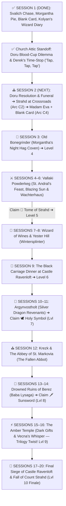

# 🏰 Master DM Screen & Campaign Cheat Sheet — Curse of Strahd (Director's Cut)

> **Quick Glance Reference for the Lead DM**  
> *The 15–20 Session Director's Cut Roadmap, Curated Tarokka Reading, Barovian NPC Directory, Pointy Hat Boss Stat Blocks, World Loot Vault, and Gothic Horror Rules at a glance.*

---

## 🛡️ SECTION 0: PARTY CHARACTER SHEETS & ESCORT VITALS (LEVEL 3 START)

| Slot | Hero / Companion | Class & Level | HP | AC | Init | Key Passive / Resource |
| :--- | :--- | :--- | :--- | :--- | :--- | :--- |
| **PC 1** | 🎭 **Piper ("The Incomparable")** | Level 3 Wild Magic Sorcerer (Fierna Tiefling • Native) | `17/17` | `13 (16)` | `+2` | 🧥 **Black Robe (`+1 AC/Saves`)** • 3 Robes • 🗡️ **Kolyan Silvered Dagger** • `L1(3/4) L2(2/2)` • `3/3 SP` • 💖 `0/1` • 💛 `1/2` • 🧪 `2x Potions` & 🌿 `4x Herbs` • 🃏 **Blank Card** |
| **PC 2** | 👑 **Jacomir Yulle ("King of Oakenshire")** | Level 3 Battle Master Fighter (Human • Noble) | `23/31` | `17` | `+0` | ⚔️ `2/4 d8` • ☕ `3/3 SW` • ⚡ `Surge 1/1` • ⚔️ **Silvered Longsword (`Sap`)** • 💧 **Morninglord Spring Water** • 📖 **Kolyan's Diary** • 🥧 **Dirty Dream Pastry** • 🪵 Pipe • `0 GP` • 💛 `2/2 Help` |
| **PC 3** | 🎯 **Eclipsa "Yvaine" the First** | Level 3 Monster Slayer Ranger (Human • Gunner) | `28/28` | `16` | `+6` | 💥 *Mercy `5/6` & Less `5/6`* • 🎯 *Lament `8/10`* • 🔮 `2/3 Slots` • 👁️ *Sense `1/2`* • 🩸 **Amulet of the Whispering Grave (`Speak w/ Dead 1/LR`)** • 🗝️ **Lockpicks** • 🩹 `2x Bandages (1d6+1)` • 🥐 `3x Croissants (1d4)` • 🍷 Wine • `17 GP 5 SP` |
| **Emissary** | ⏳ **Derek ("The Man Between Seconds")** | Avatar / Project Manager of the Dark Powers | `∞` | `--` | `--` | **Froze Time (`Tap, Tap, Tap`) in S1 Church!** Invisible to Strahd • Appears at 3 Future Milestones Only |
| **Companion** | 🌟 **Caelum Jude ("Cael")** | Level 3 Circle of the Stars Druid (Main Companion & Primary Healer) | `38/38` | `14` | `+2` | ✨ Chalice Dual Heals (`1d8+3`) • 🏹 Archer Form (`1d8+3` Rad) • ⚡ Guiding Bolt (`2/2`) • 🐈 Black Cat • 🛡️ *Vow of Dark Powers (Stabilizes at 1 HP)* |
| **Escort** | 🌹 **Ireena Kolyana** | Noble Swordswoman (Tatyana Reborn) | `28/28` | `15` | `+2` | ⚔️ Silvered Rapier `+5 (1d8+2)` • 🛡️ Parry `+2 AC` |
| **Ally** | 🗡️ **Ismark Indirovich** | Veteran Swordsman *(Act I)* | `58/58` | `17` | `+1` | Multiattack: 2x Longsword `+5 (1d10+3)` • ☕ Second Wind |
| **Hunter Ally** | ⚔️ **Ezmerelda d'Avenir** | Independent Vistani Hunter *(Act II–III)* | `82/82` | `17` | `+4` | `+1 Rapier` (`+8, 1d8+5`), 4th-Lvl Wizard Spells, Silvered Prosthetic |

---

## 📜 SECTION 1: THE 15–20 SESSION DIRECTOR'S CUT ROADMAP & TAROKKA ORACLE

### 🔮 1.1 Curated Madam Eva Tarokka Reading (Session 2 — Tser Pool)
*Read aloud **ONLY** the **Madam Eva's Prophecy** quotes—NEVER read the **DM Location Key** aloud!*

1. **📜 First Card — The Tome of Strahd (History of the Devil):**
   * **Card Drawn:** *The Master of Stars (Wizard)* — Black silver-bordered card with an inverted hourglass leaking ink and three golden cat-eyes peering out from a dark pentagram.
   * **Madam Eva's Prophecy *(Read Aloud)*:** *"This card tells of history—truth bled into paper that the Devil wishes ash. I see a walled town where painted smiles freeze over terror, and bells ring on command. Look past the noisy tyrant to a quiet noble door of velvet and cold mourning—where a pale widow sleeps beside the unburied dead and bows in secret to a crimson altar. Behind iron and whispers lies the confession of how a man drowned his blood to buy eternity."*
   * **DM Location Key:** **Wachterhaus in Vallaki (`N4` — Lady Fiona Wachter's Secret Cult Library)** — *Sessions 5–6 (Level 5).*
2. **🕊️ Second Card — The Holy Symbol of Ravenkind (Weapon of Faith):**
   * **Card Drawn:** *The Paladin (Two of Swords / Justiciar)* — Shattered silver breastplate pierced by twin frost-rimed swords beneath a silver wing.
   * **Madam Eva's Prophecy *(Read Aloud)*:** *"This is the weapon of dawn—a sliver of the lost sun waiting for clean hands. Seek a broken fortress of silver wings and shattered oaths perched high above the pines. There waits a dead commander whose rage runs colder than mountain sleet—a knight who hates the Devil so deeply he refuses to grant his enemy the mercy of a grave. Rekindle what was dimmed in the stone dragon's sky, and the ancient symbol of the morning shall fly to your breast."*
   * **DM Location Key:** **Argynvostholt (`Q36/Q53` — Vladimir Horngaard's Sanctum & Silver Beacon)** — *Sessions 10–11 (Level 7). Directly bridges into Campaign 3's Ancient Dragon Lore!*
3. **🗡️ Third Card — The Sunsword (The Blade of Sunlight):**
   * **Card Drawn:** *The Tempter (High Deck)* — Velvet hand extending a root-choked chalice above black bog-water reflecting a severed golden blade hilt.
   * **Madam Eva's Prophecy *(Read Aloud)*:** *"Here lies the blade of pure mercy—a hilt without iron, forged from grief and blinding light. Follow the dying river to a drowned village sunk in black mire, where scarecrows bleed stuffing and no living songbird dares draw breath. At the heart of the bog, a crooked house stalks on living roots beneath a hag who rocks an empty cradle in a giant's skull. Reach beneath her false lullaby and wrench the buried sun from the mud."*
   * **DM Location Key:** **Ruins of Berez (`U3` — Beneath Baba Lysaga's Creeping Walking Hut & illusion crib)** — *Sessions 13–14 (Level 8).*
4. **🧵 Fourth Card — The Hidden Hand (Replaces Fated Ally — Secret Betrayal Omen):**
   * **Card Drawn:** *The Marionette (High Deck)* — Carved wooden marionette slumped on a velvet stool with thin silver strings vanishing into storm clouds and one painted tear on its cheek.
   * **Madam Eva's Prophecy *(Read Aloud — Zero Cael Spoilers!)*:** *"Even in a cage bolted with iron, the hunter uses an open hand from the inside. Look well at the gentle faces that welcome you out of the storm, strangers—for a gilded puppet already walks upon this board. Its strings were knotted in the dark long before your roads crossed the mist, yet its fingers are kind enough to break bread beside your fire... and weep the night it turns the key. Watch every threshold you think is locked, for not every instrument knows the hand that pulls its thread."*
   * **DM True Meaning & Campaign Decoys:** **True Meaning (`Session 20`): Caelum Jude**, weeping as unseen Dark Power strings force him to lock the Barovian Root Anchor! **Built-In Decoys:** Father Donavich hiding Doru, Derek's time-stops, **Milivoj** stealing St. Andral's Bones inside Vallaki (`Session 5` fake-out!), Blinsky dolls, Vasili, Abbot's Vasilka, & Yvaine's Solmere parallel. *(Ezmerelda remains an optional independent hunter in Vallaki/Krezk).*
5. **🏰 Fifth Card — The Final Battlefield (Where Strahd Must Die):**
   * **Card Drawn:** *The Executioner (High Deck)* — Hooded figure atop a lightning-struck gargoyle parapet above a white marble lid marked with two ruby blood drops.
   * **Madam Eva's Prophecy *(Read Aloud)*:** *"And here the Devil waits when the bells cease tolling. I see spires of black stone piercing a lightning-split sky, and far beneath them the cold white marble where a brother's blood first bought four centuries of winter. Find him where his sin and sorrow were crowned—beneath stained glass saints with blind eyes, beside an empty white tomb—and chase him upward into the thunder until only ghosts remain on the cliff."*
   * **DM Location Key:** **Castle Ravenloft — Chapel (`K15`) ➔ Sergei's Crypt (`K85`) & Strahd's Tomb (`K86`) ➔ Overlook (`K6`)** — *Sessions 19–20.*
6. **🃏 Sixth Card — Piper's Blank Tarokka Card (The 3-Stage Living Omen — Option 2):**
   * **Origin:** Handed to Piper by a deeply concerned Vistani at *Blood on the Vine Tavern* in Session 1 after the painted ink faded off the card in her hand.
   * **Madam Eva's Reaction *(Read Aloud — No Direct Lore-Dump!)*:** Eva touches the blank parchment and pulls her hand back as if burned by ice: *"Four hundred years I have read these cards, child, and never has the fog stood between my eyes and a traveler's road. No ink of Strahd rests here. Something walks in the silence behind you—something older than the Devil's crown, hiding your ending even from Mother Night. Keep this blank parchment against your heart. Every time you step closer to what woke the wild fire in your blood, the ink will bleed upward on its own. Pray you do not recognize the picture when it finishes drawing itself."*
   * **3-Stage Progressive Mist Bleed (Zero Tiefling/Monolith Spoilers):**
     * **Stage 1 (Session 2 — Tser Pool):** Bottom third fills with charcoal ink — *dead pine trees and a pair of empty, upturned palms rising out of black water*.
     * **Stage 2 (Mid-Campaign — Vallaki / Berez):** Middle third bleeds in — *a cracked, faceless brass lantern / pocket watch suspended in midair with threads of silver-gray fog curling into its cracks*.
     * **Stage 3 (Act IV — Amber Temple / Ravenloft):** Top third fills in — *a violent vortex of endless gray Mist pouring inward into the cracked glass, with a faint, unblinking shadow-grin in the smoke above*.

---

### 🗺️ 1.5 Campaign Biomes, Dungeons & Locations Explorer (25 Separate Locations Across Acts I–IV)
*(Plus **🗺️ Map of Barovia** reference viewer and per-location image popups linked from [`IMAGES/`](file:///D:/Dungeons%20and%20Dragons%20Campaigns/CURSE%20OF%20STRAHD/IMAGES))*

| # | Act & Session | Location / Dungeon & Book Key | Key Encounters, Room Keys & Hazards | Key Loot & Milestone Rewards |
| :--- | :--- | :--- | :--- | :--- |
| **1** | **Act I • S1** | 🚪 **Gates of Barovia** (`Ch. 2, Areas A–B`) • 🖼️ `Gates of Barovia.jpg` | Decapitated King Colossi, Living Iron Gates (`A`), Choking Mists (`DC 15 CON/min`), Dalvan Olensky corpse | 🧭 **Dalvan's Spinning Brass Compass**, Kolyan's real letter, `1 GP 4 SP 9 CP` (`S1 Done`) |
| **2** | **Act I • S1** | 🌲 **Svalich Woods** (`Ch. 2, Old Svalich Road`) • 🖼️ `Svalich Woods.jpg` | 80-ft pine corridor, Hairpin Cliff Gorge, Phantom Stagecoach Dire Wolf chase (`S1 Done`), Morgantha road meeting | 🐺 **Alpha Dire Wolf Pelts / Fang**, 🥧 **1x Uneaten Dream Pastry (Jacomir)** (`S1 Done`) |
| **3** | **Act I • S1–S2** | 🏚️ **Village of Barovia** (`Ch. 3, Areas E1–E3`) • 📐 `Barovia Village Map.webp` | Barricaded square, Bildrath (`E1`), Blood on the Vine (`E2` — **Arik's Letter** clue), Mad Mary (`E3`), nightly Zombie/Ghoul prowlers | 🃏 **Blank Tarokka Card (Piper)**, 🩸 **Amulet of the Whispering Grave**, 🗝️ **Lockpicks**, 🍷 Expensive Wine, 🥐 Croissants (`1d4`), 🩹 Bandages (`1d6+1`), 🌿 Medicinal Herbs |
| **4** | **Act I • S1** | 🕯️ **Indirovich Manor** (`Ch. 3, Area E4`) • 🖼️ `Indirovich Manor.jpg` | Claw-gouged hall, salt perimeter, Kolyan's vigil, secret wizard study, Ismark's cellar armory | 📖 **Kolyan's Wizard Diary (Jacomir)**, 🧥 **Kolyan's 3 Enchanted Robes** & 🗡️ **Silvered Heirloom Dagger (Piper)**, `2x Holy Water`, `2x Healing Potions` |
| **5** | **Act I • S1–S2** | ⛪ **Barovia Church** (`Ch. 3, Area E5`) • 📐 `Barovia Church Map.jpg` | Church of the Morninglord, Father Donavich, **Doru in Church Attic (`Arc B5` — S1/S2 Cliffhanger!)**, Derek Time-Stop | 📿 **Father Donavich's Consecrated Rosary**, Doru's Heart of Sorrow & Mad Mage intel |
| **6** | **Act I • S2** | 🌊 **Tser Falls** (`Ch. 2, Area H` + Crossroads `Area F` OTW) • 📐 `Tser Falls Map.jpg` | 90-ft gargoyle stone bridge above 1,000-ft falls; *OTW Reference: River Ivlis Crossroads (`F`), Gallows illusion & Strahd's 1st Black Carriage greeting*, **Cael joins & Derek Milestone 1** | 📜 **Crossroads Grave Cache (`Protection vs Evil` scroll + 15 SP OTW)**, Silvered Dagger |
| **7** | **Act I • S2** | 🔮 **Tser Pool Vistani Camp** (`Ch. 2, Area G` / *Reloaded Arc C4*) • 📐 `Tser Pool Encampent Camp Map.jpg` | Safe Long Rest camp, Vistani silver trade, **Madam Eva's 5-Card Tarokka Reading + Piper's 6th Blank Card (Stage 1 Bleed)** | 🩸 **Vistani Bloodwell Vial `+1` (Piper)**, 🧪 Potions, Silvered Ammo |
| **8** | **Act I • S3** | 🥧 **Old Bonegrinder Windmill** (`Ch. 6, Areas O1–O4`) • 🖼️ `Old Bonegrinder Windmill.webp` | **Morgantha, Bella & Offalia (Night Hag Coven)**, Caged Children (`O3`), *Bone-Flour Combustion Cloud*, Four Megaliths behind mill | 🧿 **Night Hag Heartstone**, 🌿 **Elixir of Youth**, `3x Spell Scrolls` (**Level 4!**) |
| **9** | **Act II • S4–S6** | ⚔️ **Town of Vallaki** (`Ch. 5, Areas N3, N5, N7, N8, N9`) • 🖼️ `Town of Vallaki.jpg` | Wolf-pike palisade, Baron's Mansion & Victor's Attic (`N3t`), Rictavio's Tiger Wagon (`N5`), Blinsky's (`N7`), Stocks & Lake Zarovich (`N8`), Vistani Camp (`N9`) | 🎯 **Silver Scope (Yvaine)**, 🎭 **Hat of Disguise**, 🪄 **Victor's Wand**, 🔥 **Izek's Battleaxe `+1`** |
| **10** | **Act II • S4–S7** | 🦅 **Blue Water Inn** (`Ch. 5, Area N2`) • 🖼️ `Blue Water Inn.jpg` | **Urwin & Danika Martikov (`N2` — Kolyan's Diary unlocks Keepers!)**, Rictavio's booth, secret wereraven loft (`N2q`) | 🐾 **Gray Bag of Tricks**, 🍷 **Elixir of Health (Legendary • 5,000–15,000 GP)**, `2x Potions of Greater Healing` |
| **11** | **Act II • S4–S5** | ✝️ **St. Andral's Church** (`Ch. 5, Area N1`) • 🖼️ `Church of St Andral.webp` | Father Lucian Petrovich, Yeska & Milivoj clues, broken *Hallow* ward, Feast consecration blast climax | 🛡️ Restored permanent consecrated sanctuary for Ireena |
| **12** | **Act II • S5** | ⚰️ **Henrik's Coffin Shop** (`Ch. 5, Area N6`) • 🖼️ `Henriks Coffin Shop.jpg` | Upstairs bedroom wardrobe, **6 Ravenloft-dirt crates (Bride Anastrasya + 5 Vampire Spawn Ambush!)**, 4-block rooftop relay | 🦴 **Sacred Bones of St. Andral**, 🪭 **Anastrasya's Gilded Razor Fan `+1`** |
| **13** | **Act II • S6** | 🕯️ **Wachterhaus** (`Ch. 5, Area N4`) | Lady Fiona Wachter, preserved dead Nikolai (`N4o`), invisible Imp Majesto, cellar devil-cult, secret iron library | 📜 **The Tome of Strahd (Tarokka #1 — Level 5!)**, 🗡️ **Baal Verzi Mirror Dagger `+1`**, `45 GP` |
| **14** | **Act II • S7** | 🍷 **The Wizard of Wines Winery** (`Ch. 12, Areas W1–W20`) | 24 Twig Blights, 6 Needle Blights, 2 Vine Blights, 3 Poisoned Vats (`W9`), **Chief Druid (`W14`) — Snapping the Gulthias Staff kills all Blights within 300 ft!** | 🌿 **The Gulthias Staff**, 🧥 **Wereraven Cloak of Protection `+1`**, 🍷 Vintage Casks |
| **15** | **Act II • S8** | ⛈️ **Yester Hill** (`Ch. 14, Areas Y1–Y5`) | Megalith Ring (`Y1`), Wall of Fog (`Y2` — Strahd on Bucephalus), **50-Ft Wintersplinter Ritual (`Y3`)**, **Kavan's Cairn (`Y4`)**, **Gulthias Tree (`Y5`)** | 🩸 **`+2` Blood Spear of Kavan (Jacomir!)**, 🪓 **Treebane Battleaxe**, 💚 **2nd Recovered Life-Gem (*Red Dragon Crush*)** |
| **16** | **Act II • S9** | 🥂 **Castle Ravenloft (Act II Dinner)** (`Ch. 4, Areas K1, K7, K10, K49`) | **Dining Hall (`K10`)** social chess with Strahd & Brides, Consort Escher (`K49` — reveals Heart of Sorrow), midnight exit clock | 🍾 **Champagne du le Stomp**, 🎸 **Doss Lute lead**, Heart of Sorrow intel (**Level 6!**) |
| **17** | **Act III • S10–S11** | 🐉 **Argynvostholt Mansion (The Fortress)** (`Ch. 7, Areas Q1–Q53`) | **Vladimir Horngaard (`Q36`)** vs. **Sir Godfrey (`Q37`)**, Ancient Star-Mural (`Q13` Campaign 3 Bridge), **Silver Beacon (`Q53`)** | 🕊️ **Holy Symbol of Ravenkind (Tarokka #2!)**, 🐉 **Beacon Boon (`+1 AC & Saves`)**, ⚔️ **Greatsword `+2`** (**Level 7!**) |
| **18** | **Act III • S12** | 🏘️ **Village of Krezk** (`Ch. 8, Areas S1–S4`) | Wine-locked 20-ft gatehouse (`S1`), Burgomaster Krezkov (`S3`), **Pool of the White Sun (`S4` — Sergei's spirit & Strahd's Sky-Lightning)** | 🛡️ Safe alpine refuge & Ireena's White Sun Pool destiny resolution |
| **19** | **Act III • S12** | ⛪ **Abbey of Saint Markovia** (`Ch. 8, Areas S12–S24`) | **The Fallen Abbot (`CR 10 Deva`)**, **Vasilka the Flesh Golem (`S13` — holds 3rd Winery Life-Gem via "Vasili"!)**, Belview Mongrelfolk Wing (`S12/S17`), Ezmerelda's Barracks (`S19`) | 💚 **3rd Winery Life-Gem (*Champagne*, Inside Vasilka S13!)**, ⚔️ **Ezmerelda Joins!**, 🦴 **St. Markovia's Thighbone**, 💚 **Ring of Regeneration**, 📜 **Scroll of Heroes' Feast** |
| **20** | **Act III • S13–S14** | 🌊 **The Drowned Ruins of Berez** (`Ch. 10, Areas U1–U7`) | Ulrich's Ghost (`U2`), Marina's Monument (`U5`), Standing Stones (`U6`), **Baba Lysaga (`CR 11` in Flying Skull) & 140-HP Creeping Hut (`U3`)** | 🗡️ **The Sunsword (Tarokka #3 — Level 8!)**, 🍀 **Luckstone (`+1`)**, 🧪 **Oil of Sharpness (`+3`)**, 📜 **Scroll of Revivify** |
| **21** | **Act III • S11** | 🗼 **Van Richten's Tower (Lake Baratok)** (`Ch. 11, Areas V1–V7`) • 🖼️ `Van Richtens Tower.webp` | **100-ft Antimagic Field**, Ezmerelda's 100-Flask Wagon (`V1`), Stick-Figure Door (`V2`), Clay Golem (`V3`), **Mad Mage (`Mordenkainen`)** nearby | 💥 **Ezmerelda's Wagon Cache**, ⚡ **Mad Mage's Charm of Heroism**, *Staff of Power* lead |
| **22** | **Act III • S11** | 🐺 **Werewolf Den** (`Ch. 15, Areas Z1–Z8`) | Wolf-skull cavern (`Z1`), Kiril's child-fighting pit (`Z5b`), Zuleika's rebel pack, **Shrine of Mother Night (`Z7`)** | 🏆 **Shrine of Mother Night Hoard (`Z7`)**, Silvered Shortsword, Zuleika alliance |
| **23** | **Act IV • S15** | ❄️ **Tsolenka Pass Gatehouse** (`Ch. 9, Areas T1–T9`) | Extreme Cold (`CON DC 10`), **Wall of Green Fire (`T2` — `6d10`)**, 2 Vrock Statues (`T3`), **Sangzor the Giant Goat**, **The Roc of Mount Ghakis (`CR 11`)** | 🧥 **Bloodhorn's Mountain Pelt**, 🤍 **Silvered Spear**, 🔥 **Ring of Warmth**, `30 GP` Chest |
| **24** | **Act IV • S15–S16** | ⚡ **The Amber Temple** (`Ch. 13, Areas X1–X42`) | **Neferon the Arcanaloth (`X5`)**, Amber Golem, **Amnesiac Lich Exethanter (`X27` — *Greater Restoration* opens PHB Library `X30`)**, **Amber Sarcophagi & Vault (`X42`)** | ❄️ **Staff of Frost**, 📖 **Tome of Understanding (`+2 WIS`)**, ⚡ **3 Supreme Dark Gifts (Level 9!)** |
| **25** | **Act IV • S17–S20** | 👑 **Castle Ravenloft (Final Siege)** (`Ch. 4, Areas K6–K86`) | **Chapel (`K15`)**, **Heart of Sorrow (`K20`)**, Treasury (`K41`), Brazier (`K78`), **Rahadin & Catacombs (`K72, K84–K86`)**, **The Overlook (`K6`)**, **Cael's S20 Root Anchor** | ⚡ **Khazan's Staff of Power (`+2 AC/Saves/Hit`, Crypt 15!)**, 👑 **Helm of Brilliance (`K41`)**, 🌠 **Luck Blade** (**Level 10 Finale!**) |

---

## 👥 SECTION 2: MASTER BAROVIAN NPC DIRECTORY (5-COLUMN FORMAT)

| NPC Name & Condition | Live Status | Role & Location | Key Offerings, Services, Quests & Advice | 🎭 Voice & Roleplay Cue |
| :--- | :--- | :--- | :--- | :--- |
| ⏳ **Derek ("Man Between Seconds")** `[Avatar of the Dark Powers]` | 🟢 Met & Active | Time-Stopping Emissary • Frozen Moments | Froze time (`tap, tap, tap`) in S1 Church! Promised Jacomir & Yvaine a way home if they kill Strahd; told Piper to *"take care of herself."* **Strahd cannot perceive him!** | Calm, modernly sharp, transactional: *"I'm the only one giving you a straight deal: kill the vampire, and go home."* |
| 🌟 **Caelum Jude ("Cael")** `[The Scion / Inside Shepherd]` | 🟢 Met & Active | Primary Healer & Companion • Barovia | **Starry Chalice dual-heals 1d8+3**, free Guiding Bolts, Goodberries, scout. *Stabilizes at 1 HP (Plot Armor).* Shrinks in silent terror when Derek freezes time! | Earnest, self-deprecating Percy Jackson warmth: *"I don't want to die out here alone. Let me walk with you."* |
| 👑 **Count Strahd von Zarovich** `[Darklord of Barovia]` | 🟢 Active Overlord | Supreme Ruler • Castle Ravenloft | **First Face-to-Face in Session 2 (`Arc C2: Crossroads`)**! *Phase 1 (Acts I–II):* Keeps successor/corruption motives strictly unspoken on Day 1; uses PCs as free bodyguards for twice-bitten Ireena (`Two-Bite Tether`) and *naturally* rewards PC cruelty/monstrosity w/ wine/notes/intel as it happens (blind to Derek & Root Anchor!). *Phase 2 (Acts III–IV):* Kill Mode once Krezk Pool (`S4`) or True Sunlight triggers! | Deep aristocratic velvet baritone: *"Enjoy the warmth of Tser Pool while the night is still kind to you. When this valley strips away your illusions, my carriage will be waiting."* |
| 🌹 **Ireena Kolyana** `[Twice-Bitten / Tatyana]` | 🟢 Met & Active | Escort Heroine • In Barovia Church | Fights alongside party (**AC 15, 28 HP**, Silvered Rapier `+5`, Parry `+2 AC`). Currently neutral in the Doru attic standoff. | Fierce sleepless noble resolve: *"Give me a blade and tell me where to stand."* |
| 🗡️ **Ismark 'The Lesser' Indirovich** `[New Burgomaster]` | 🟢 Met & Active | Frontline Defender • In Barovia Church | Empathizes with Father Donavich alongside Jacomir in the church attic standoff. AC 17, 58 HP. | Exhausted gravelly baritone: *"They call me the Lesser... but I will die holding the line."* |
| ⛪ **Father Donavich & Doru** `[Priest & Son in Church Attic]` | 🟢 Met & Active | Village Priest • Barovia Church Attic | **Active S1/S2 Cliffhanger:** Doru is hidden in the **church attic**! Jacomir is pouring his own blood into a cup to feed Doru (`Reloaded` lucidity mechanic), while Piper & Yvaine want to kill Doru! | Hoarse weeping prayers: *"He's still my boy! Just one cup of blood to calm his mind!"* |
| 🔮 **Madam Eva** `[Ancient Vistani Seer]` | 🟡 Unmet | Tarokka Oracle • Tser Pool Camp | **5-Card Tarokka Reading + Piper's Blank 6th Card**; safe Long Rest camp; Vistani silver weapon trade. | Ancient woodsmoke-thick voice: *"The cards have waited centuries for your hands."* |
| 🎭 **Bride Volenta Popofsky** `[Porcelain Skull-Mask]` | 🟡 Active Hunter | Youngest Bride • Castle Ravenloft | Stalks Ireena; drops Bone Dagger +1 & Porcelain Skull-Mask Charm (False Life). | High-pitched unhinged giggling: *"Little sister Ireena! Come out and play!"* |
| 🍷 **Bride Anastrasya Karelova** `[Vallaki Feast Conspirator]` | 🟡 Active Hunter | Middle Bride • Vallaki / Ravenloft | Commands **Feast of St. Andral** spawn raid (`Area N6`); carries **Gilded Razor Fan +1**. | Haughty velvet condescension: *"Wooden stakes keep out beggars, darling—not the Count's court."* |
| 📜 **Bride Ludmilla Vilisevic** `[Eldest Archmage Consort]` | 🟡 Active Strategist | Eldest Bride • Ravenloft / Ghakis | Werewolf pack schism architect (chained Emil); guards **Amber-Inlaid Spell Ring +1**. | Clinical frost-cold scholar: *"Panic is an arithmetic error you may not afford."* |
| 🥧 **Morgantha ('Granny')** `[Night Hag Matron]` | 🟢 Met & Wary | Coven Leader • Old Bonegrinder | **Met in S1:** Resisted Piper's *Charm Person* (semi-hostile/wary of Piper) & gifted **1x Dream Pastry to Jacomir** (uneaten). | Sweet grandmotherly cackle hiding iron malice: *"Just one warm pie, dearies!"* |
| 🦅 **Urwin & Danika Martikov** `[Keepers of the Feather]` | 🟡 Unmet | Wereraven Allies • Blue Water Inn (Vallaki `N2`) | **Named in Burgomaster Kolyan's Wizard Diary (looted in S1)!** Run Blue Water Inn; estranged from Urwin's father **Davian**. | Warm observant hospitality: *"A hot bowl of wolf-steak stew and a locked door—on the house for old Kolyan's true allies."* |
| 🦅 **Davian Martikov** `[Keepers Patriarch • Winery]` | 🟡 Unmet | Wereraven Patriarch • Old Friend of Kolyan Indirovich | **Key Secrecy Lead:** Keepers fiercely guard their secret, but showing **Kolyan's Wizard Diary** or naming Kolyan's friendship opens Davian's trust & aid (`Vallaki / Winery Ch. 12`). | Gruff skepticism thawing at Kolyan's name: *"You carry Kolyan Indirovich's own writing? Lower your voices and step behind the barrels."* |
| ☀️ **Baron Vargas Vallakovich** `[Paranoid Mayor]` | 🟡 Unmet | Burgomaster • Vallaki | Town authority & shelter if party praises his festivals; enforcer Izek Strazni. | Manic booming forced cheer: *"ALL WILL BE WELL!"* |
| 🕯️ **Lady Fiona Wachter** `[Cult Leader]` | 🟡 Unmet | Strahd Loyalist • Wachterhaus | Shelters **The Tome of Strahd**; seeks to overthrow the Baron; cultists. | Cold calculating aristocratic poise: *"Strahd is not a monster. He is a lord."* |
| ⚔️ **Ezmerelda d'Avenir** `[Independent Hunter]` | 🟡 Unmet | Vistani Vampire Hunter • Act II–III | Swashbuckling hunter (AC 17, HP 82, Rapier +8, 4th-level Wizard spells). | Swashbuckling confidence: *"I don't need a prophecy to tell me how to kill a vampire."* |
| 📜 **Rudolph van Richten** `[Monster Scholar / "Rictavio"]` | 🟡 Unmet | Disguised Bard • Blue Water Inn (`N2`) / Tower (`V1`) | Native of **Darkon** (another Domain inside Ravenloft); crossed via **Mist Talisman** into Strahd's trap (now stuck!); Saber-Toothed Tiger (`N5`), *Undead Slayer (+3d6)*, Raise Dead scroll. | Scholarly dry wit under a colorful bard disguise. |
| 🐉 **Vladimir Horngaard** `[Revenant Commander]` | 🟡 Unmet | Dragon Knight Leader • Argynvostholt | Guards **The Holy Symbol of Ravenkind**; undead dragon knight order. | Hateful hollow spectral rasp: *"Strahd must suffer eternally in his cage."* |
| 🛡️ **Sir Godfrey Gwilym** `[Revenant Paladin]` | 🟡 Unmet | Order Paladin • Argynvostholt (`Q37`) | 136 HP, 16th-Lvl Paladin Smites (`L1–L4`); begs heroes to restore Argynvost's Beacon. | Sorrowful chivalry: *"Burn away the fog—let us rest in peace."* |
| 🪽 **The Abbot & Vasilka** `[Corrupted Deva]` | 🟡 Unmet | Angelic Surgeon • Krezk Abbey (`S13`) | 3x free *Raise Dead* / *Greater Restoration* if given **Lydia's Bridal Gown**; guards Abbey Treasury. | Serene celestial madness: *"I have sewn him an undying flesh bride!"* |
| 💀 **Baba Lysaga** `[Swamp Witch]` | 🟡 Unmet | Mother of Night • Ruins of Berez | Guards **The Sunsword**; pilots the Creeping Walking Hut; 8th-level spells. | Screeching maternal madness claiming Strahd as her stolen infant son. |
| 🔨 **Parriwimple** `[Bildrath's Nephew]` | 🟡 Unmet | Strong-Hearted Enforcer • Barovia Store (`E1`) | 112 HP Gladiator (Str 18, 3x Maul `+7`); potential bodyguard if freed from Bildrath's gouging. | Gentle booming rumble: *"Uncle Bildrath says don't touch the shiny pots unless you got ten gold."* |
| 😢 **Mad Mary** `[Grieving Mother]` | 🟡 Unmet | Townhouse (`E3`) • Gertruda Quest | Gives Blinsky's *Is No Fun, Is No Blinsky!* doll pointing toward missing daughter Gertruda inside Ravenloft (`K42`). | Broken weeping whisper: *"She just wanted to see the pretty wolves outside..."* |
| ✝️ **Father Lucian Petrovich** `[St. Andral High Priest]` | 🟡 Unmet | St. Andral's Church • Vallaki (`N1`) | 5th-Lvl Cleric (`Dispel Magic, Spirit Guardians`); begs rescue of **St. Andral's Bones** before Feast ambush. | Quiet urgency: *"The Saint's bones are gone—and Vallaki's only wall against the night died with them!"* |
| ⚡ **Victor Vallakovich** `[Attic Prodigy Mage]` | 🟡 Unmet | Baron's Mansion Attic (`N3t`) • Vallaki | CR 6 Mage + Attic Spellbook (24 spells, *Cone of Cold, Cloudkill*); broke Stella Wachter's sanity. | Snapping arrogance: *"Don't touch the chalk circle! Another inch and I escape this cellar!"* |
| 🧸 **Gadof Blinsky & Piccolo** `[Vallaki Toymaker]` | 🟡 Unmet | Is No Fun, Is No Blinsky! (`N7`) | Reveals Izek commissioned **Ireena Dolls** + watches Rictavio's monkey Piccolo; Pidlwick II lead. | Gleeful thick accent: *"Is No Fun, Is No Blinsky!"* |
| 🗡️ **Arrigal** `[Vistani Assassin]` | 🟡 Unmet | Strahd's Spymaster • Vallaki Camp (`N9`) | CR 8 Assassin (`+4d6 Sneak + 7d6 Venom`); guards Treasure Wagon (`N9i`: *Oil of Sharpness, Revivify*). | Silken threat: *"Coins weigh lighter than regret, friends."* |
| 🧝 **Kasimir Velikov** `[Dusk Elf Elder Mage]` | 🟡 Unmet | Hovel Outside Vallaki (`N9a`) | CR 6 Mage, *Ring of Warmth*, Mount Ghakis & Amber Temple Guide (hopes to resurrect Patrina). | Haunted silver whisper: *"Help me enter the Amber Temple—or my sister stays damned forever."* |
| 🐺 **Zuleika Toranescu** `[Rebel Werewolf]` | 🟡 Unmet | Shrine of Mother Night (`Z7`) | Rebel packkeeper allying against Kiril if heroes free mate **Emil Toranescu** from Ravenloft Dungeon! | Low fierce growl: *"Bring my husband Emil home—and the pack shreds Kiril for you!"* |
| 🧙 **Mordenkainen** `[Mad Mage of Baratok]` | 🟡 Unmet | Lake Baratok Hills (`CR 12` Archmage) | Restoring him w/ *Greater Restoration* unlocks *Magnificent Mansion*, *Time Stop*, & *Charm of Heroism*! | Roaring lightning when paranoid; grand wizardly poise once cured. |
| 🎻 **Escher** `[Fading Dhampir-Consort]` | 🟡 Unmet | Castle Ravenloft Lounge (`K49`) | Warns heroes of Bride ambushes, castle stairs, *Doss Lute*, & *Heart of Sorrow* so Strahd falls before sealing him. | Sardonic court wit: *"Pray Strahd doesn't tire of you as swiftly as he bored of me..."* |
| 💀 **Rahadin** `[Dusk Elf Chamberlain]` | 🟡 Unmet | Castle Ravenloft (`CR 10` Boss) | Strahd's cold enforcer (`3x Scimitar +10`, *Deathly Choir 3d10*); delivers Black Carriage Dinner invitation. | Whisper-soft dread: *"His Lordship expects clean boots at the supper table."* |
| 🔥 **Izek Strazni** `[Vallaki Fiend-Arm Captain]` | 🟡 Unmet | Burgomaster's Mansion (`N3`) • Vallaki | Fiend-armed brute (`CR 5`, **Hurl Flame `3d6`**, Battleaxe `+1`) secretly obsessed with Ireena dolls commissioned from Blinsky (`N7`). | Smoldering growl: *"Baron's word is law—put the weapon down or I roast you right on the cobbles."* |
| 🐺 **Kiril Stoyanovich** `[Ruthless Werewolf Alpha]` | 🟡 Unmet | Werewolf Den (`Z5`) & Svalich Woods | Usurper pack alpha (`CR 3`, Silvered Spear / Hybrid claws) enforcing child abductions and hunting Rictavio's allies. | Snarling arrogance: *"The Devil gave us this forest—and weak blood feeds the strong!"* |
| 🦊 **Neferon ("Heinrich Stolt")** `[Amber Temple Arcanaloth]` | 🟡 Unmet | Amber Temple Statue (`X5a`) • Mount Ghakis | Fiendish trickster posing as kindly bald scholar "Heinrich" before unleashing `16th-Lvl` spells (*Chain Lightning, Finger of Death*) through statue eyes. | Honeyed false warmth: *"Ah, travelers! Come closer to the warm brazier—I am just a harmless old scholar..."* |
| 💀 **Exethanter** `[Amnesiac Archlich]` | 🟡 Unmet | Amber Temple Sanctum (`X27`) • Mount Ghakis | Skeletal archlich (`CR 21`) shattered by memory loss (`Greater Restoration` restores L1–9 spells & grants all library/vestige passwords). | Whispering courtesy: *"Do forgive an old scholar's foggy mind... did we know each other centuries ago?"* |

> 💡 **Interactive 3-Tab NPC Windows in `DM_SCREEN.html`:** Clicking ANY of the 37 NPCs (filterable across 7 Barovian regions including `🏔️ Tsolenka Pass & Amber Temple`) opens their Character-First 3-Tab Modal (**Stats + Live HP Steppers on top**, **📍 Where & When Met**, **⚔️ Further Combat: Enemy & Boss Sheet ➔** + Faction Lore & Location buttons, **Tab 1: Character, Dilemma, Secrets & Clickable Gear Links w/ `← Back`**, **Tab 2: Combat, Actions & Full 5e Spellbooks**, **Tab 3: Expandable Lore, History & Background Accordions**).

---

## 💀 SECTION 3: MASTER ENEMY FAST REFERENCE & BOSS STAT CARDS

### 🐺 3.1 Master Campaign Enemy Roster (57 Total: 40 Tier 1/2 Mobs + 17 Bosses — Openable in `DM_SCREEN.html`)

| Act / Category | Enemy Name & Role | CR | Init | HP | AC | Speed | ⚔️ Weapons & Style | 📍 Where Encountered & Special Mechanics |
| :--- | :--- | :--- | :--- | :--- | :--- | :--- | :--- | :--- |
| **💀 Core Road & Patrol Mobs (All Acts)** | 🗡️ **Classic Barovian Bandit** *(Highway Mob)* | 1/8 *(Capt 2)* | `+1` | **`11`** *(65 Capt)* | 12 *(15)* | 30 ft | Scimitar, Light Crossbow | **All Acts (Svalich Roads / Vallaki Outskirts)** • **Bandit Captain** toggle (`3x Atk + Parry +2 AC`) |
| | 🔮 **Vistani Bandit / Thug** *(Mist Nomad)* | 1/8 *(Thug 1/2 • Capt 2)* | `+1` | **`11`** *(32 / 65)* | 12 *(11 / 15)* | 30 ft | Scimitar, Evil Eye, Blood Curse | **Tser Pool (`G`), Vallaki Vistani Camp (`N9`) & Mist Wagons** • Separate non-evil Mist-walker card w/ **Bandit ⇄ Thug (`32 HP`) ⇄ Captain (`65 HP`)** toggles + **Evil Eye** / **Blood Curse** |
| | 💀 **Skeletal Rider & Warhorse** *(Dual Mount)* | 1/4 + 1/2 | `+2` | **`13` + `22`** | 13 / 13 | 30 / 60 ft | Shortsword, Shortbow, Hooves | **Svalich Road Night Patrols (p.30), Ivlis Crossroads & Ravenloft (`K67`)** • **Dual HP Tracker** (`Rider + Warhorse Skeleton`) + Bludgeoning Vuln |
| | 🐺 **Svalich Dire Wolf** *(Woods Pack)* | 1 *(Wolf 1/4)* | `+2` | **`37`** *(11 Wolf)* | 14 *(13)* | 50 *(40)* | Bite, Pack Tactics | **Svalich Woods & Road Trails** • `DC 13 STR` Prone • **Normal Wolf** toggle (`CR 1/4, 11 HP, AC 13`) |
| | 🕯️ **Mist Will-o-Wisp** *(Swamp Lure)* | 2 | `+9` | **`22`** | 19 | Fly 50 ft | Shock, Consume Life, Invisibility | **Svalich Mist Trails, Berez Swamp (`U1–U7`) & Crossroads** • Bonus-action Invisibility + `DC 10 CON` Consume Life (`3d6` Necrotic!) |
| | 🦇 **Barovian Swarm (Bats / Ravens / Rats)** | 1/4 | `+2` | **`22`** | 12 | Fly 30–50 | Swarm Bites/Beaks | **Children of the Night (`2d4`!), Ravenloft (`K84`) & Berez Cages (`U1`)** • Mode toggles for Bats / Ravens / Rats (`Half Damage at <=11 HP`) |
| | 🧙‍♀️ **Barovian Witch** *(Caster Mob)* | 1/2 | `+0` | **`16`** | 10 | 30 ft | Wizard Spells, Dagger, Claws | **Ravenloft (`K56`), Berez Marshes & Covens** • **3rd-Lvl Wizard (`DC 12 / +4`)**: *Sleep, Tasha's Laughter, Invisibility, Alter Self* |
| | 💀 **Barovian Ghoul** *(Crypt Prowler)* | 1 | `+2` | **`22`** | 12 | 30 ft | Bite, Paralyzing Claws | **Barovia Cellars, Abbey Crypts & Ravenloft Dungeons** • `DC 10 CON` vs Paralysis 1 min *(Elves & Undead immune!)* |
| | 🧟 **Strahd Zombie** *(Cemetery Mob)* | 1 | `-2` | **`34`** | 8 | 20 ft | Bite, Claws, Severing Limbs | **Barovia Homes, Churchyard (`E5`) & Catacombs** • **Loathsome Limbs:** 5+ slashing/bludg severs limbs that keep attacking! |
| | 🦅 **Wereraven** *(Keeper Scout)* | 2 | `+2` | **`31`** | 12 | 30 / Fly 50 | Beak, Shortsword, Crossbow | **Blue Water Inn (`N2`), Winery & Rooftops** • Non-silvered B/P/S Immunity (or VRGtR Regen 10) • Lycanthropy `DC 10 CON` |
| | 🩸 **Vampire Spawn** *(Night Thrall)* | 5 | `+3` | **`82`** | 15 | 30 / Climb 30 | Claws, Bite, Spider Climb | **Coffin Shop (`N6`), Night Ambushes & Crypts** • **Regen 10 HP/turn** • Grapple DC 13 + Necrotic Drain |
| | 🛡️ **Strahd's Animated Armor** *(Construct)* | 6 | `+1` | **`112`** | 21 | 30 ft | Lightning Greatsword, Shocking Bolt | **Ravenloft Halls, Khazan's Tower & Amber Vaults** • False Appearance • Antimagic Susceptibility (`DC 15 CON` vs *Dispel*) |
| **⛪ Act I: Village, Woods & Bonegrinder** | 🤢 **Bonegrinder Dretch** *(Mill Demon • 9x)* | 1/4 | `+0` | **`18`** | 11 | 20 ft | Bite, Claws, Fetid Cloud | **Old Bonegrinder 2nd Floor Barrel (`O2` — 9x!)** • **Fetid Cloud** (`DC 11 CON` poisoned 1 min) |
| | 🐺 **Svalich Alpha Dire Wolf** *(Pack Alpha)* | 1 | `+2` | **`37`** | 15 | 50 ft | Bite, Roof Claws, Howl | **Svalich Road Gorge & Carriage Roof Climax** • **Splintering Roof Breach** • **Terrifying Howl** (Recharge 5–6) |
| | 🩸 **Doru (The Starving Son)** *(Undercroft Boss)* | 5 | `+3` | **`85`** | 15 | 30 / Climb 30 | Claws, Vampire Bite, Spider Climb | **Barovia Church Attic/Undercroft (`E5`)** • Blood cup lucidity hook reveals Mad Mage & Heart |
| | 🎭 **Bride Volenta Popofsky** *(Porcelain Bride)* | 5 | `+4` | **`95`** | 16 | 35 / Climb 35 | Claws, Twin Daggers, Bite, Shriek | **Barovia Outskirts, Bonegrinder Woods & Crypt (`K86`)** • **2 Battlefield Actions:** *Corpse-Puppet Strings* & *Skull-Mask Shriek* |
| | 🥧 **Morgantha ('Granny') & Coven** *(Night Hag)* | 5 *(7 Coven)* | `+2` | **`112`** | 17 | 30 ft | Claws, Nightmare & Coven Spells | **Barovia Village Cart (S1) ➔ Old Bonegrinder (`O1–O4`)** • **5 Innate + 12 Coven Spells (`DC 15 / +7`)** • **2 Battlefield Actions (`4d10`)** |
| **⚔️ Act II: Vallaki, Winery & Yester Hill** | 🛡️ **Vallakian Guard & Veteran Sergeant** | 1/8 *(Vet 3)* | `+1` | **`11`** *(58 Vet)* | 16 *(17)* | 30 ft | Spear / Longsword & Heavy Crossbow | **Vallaki Gates/Square (`N1–N9`) & Krezk Wall (`S1`)** • Toggle **Veteran Sergeant** (`CR 3, 58 HP, 3x Atk`) |
| | 🕯️ **Wachter Cultist & Cult Fanatic** | 1/8 *(Fan 2)* | `+1` | **`9`** *(33 Fan)* | 12 *(13)* | 30 ft | Dagger, Cleric Spells | **Wachterhaus Cellar (`N4`), Vallaki Coup & Death House** • Toggle **Cult Fanatic** (`4th-Lvl Cleric: Hold Person, Spiritual Weapon`) |
| | 😈 **Imp (Majesto — Wachter's Familiar)** | 1 | `+3` | **`10`** | 13 | 20 / Fly 40 | Poison Sting, Shapechanger | **Wachterhaus (`N4`)** • Permanent Invisibility, Devil's Sight & `3d6` Poison Sting (`DC 11 CON`) |
| | 🐯 **Rictavio's Saber-Toothed Tiger** | 2 | `+2` | **`52`** | 17 *(12 No Bard)* | 40 ft | Pounce Claw, Deadly Bite | **Rictavio's Carnival Wagon (`N5`) & Blazing Sun Riot** • **Half-Plate Barding (AC 17)** toggle, `DC 14 STR` Pounce, trained to hunt evil Vistani |
| | 🌿 **Barovian Druid** *(Winery / Hill Caster)* | 2 | `+1` | **`27`** *(45 Chief)* | 11 *(16 Bark)* | 30 ft | 4th-Lvl Druid Spells, Quarterstaff | **Wizard of Wines (`W9–W14`) & Yester Hill (`Y1–Y5`)** • **Barkskin (AC 16)** + **Chief Druid (`45 HP`, Gulthias Staff)** toggles! |
| | 🪵 **Twig Blight** *(Ambush Plant • 24x)* | 1/8 | `+1` | **`4`** | 13 | 20 ft | Claws | **Wizard of Wines (`W1–W14` — 24x!) & Yester Hill (`Y5`)** • False Appearance + **Fire Vulnerability** |
| | 🌵 **Needle Blight** *(Thorn Sniper • 6x)* | 1/4 | `+1` | **`11`** | 12 | 30 ft | Claws, Ranged Needle Volley | **Winery Courtyard & Vats (`W1–W14`) & Yester Hill** • 30/60 ft Needle Volley (`2d6+1` Piercing) |
| | 🌿 **Vine Blight** *(Grappler Plant • 2–3x)* | 1/2 | `-1` | **`26`** | 12 | 10 ft | Constrict, Entangling Plants | **Winery Loading Dock & Gulthias Tree (`Y5`)** • `DC 12 STR` Restraining vines + 15-ft Entangling Plants aura |
| | 🪓 **Mountain Berserker** *(Wildfolk)* | 2 | `+1` | **`67`** | 13 | 30 ft | Reckless Greataxe | **Yester Hill Cairns (`Y1–Y5`), Balinok Passes & Amber Temple (`X20`)** • Reckless Attack + **Blood Spear of Kavan** captain variant |
| | 🍷 **Bride Anastrasya Karelova** *(Feast Bride)* | 5 | `+3` | **`82`** | 15 | 30 / Climb 30 | Claws, Bite, Razor Fan | **Henrik's Coffin Shop (`N6`), St. Andral's (`N1`) & Ravenloft (`K86`)** • **2 Battlefield Actions (`3d10`)** |
| | 🔥 **Izek Strazni** *(Vallaki Captain)* | 5 | `+2` | **`102`** *(RAW `112`)* | 14 | 30 ft | Brute Battleaxe, Fiendish Flame | **Vallaki Square, Stockyard (`N5`) & Mansion (`N3`)** • RAW HP toggle • **2 Battlefield Actions (`3d10`–`4d10`)** |
| | 🌲 **Wintersplinter** *(Yester Hill Colossus)* | 7 | `+0` | **`138`** *(RAW `149`)* | 15 | 30 ft | Branches, Grasping Roots, Bite | **Yester Hill Stone Circle (`Y1–Y4`)** • RAW HP toggle • **3 Battlefield Actions (`3d10`–`5d10` + Gem Heal)** |
| **🐉 Act III: Argynvost, Krezk, Berez & Den** | ⚔️ **Order Revenant Knight** *(Vengeance)* | 5 | `+2` | **`136`** | 13 | 30 ft | Slams / Silver Sword, Vengeful Glare | **Argynvostholt Knights Parlor (`Q37` — 3x) & Roads** • Regen 10 HP *(paused by Fire/Radiant)* + **Vengeful Glare** Paralyze |
| | 👻 **Argynvostholt Phantom Warrior** | 1 | `+0` | **`45`** | 16 | 30 / Hover | Spectral Longsword & Longbow | **Argynvostholt (`Q14, Q24, Q38` — 6x!) & Crypts** • Ethereal Sight, Incorporeal Movement + Multiattack `2x` |
| | 🧟‍♂️ **Belview Mongrelfolk** *(Abbey Inmate)* | 1/4 | `-1` | **`26`** | 11 | 20 ft | Bite, Claws, Mimicry | **Abbey of St. Markovia (`S12 Madhouse` & `S17 Belfry`)** • Variable quirks table (Darkvision, Keen Hearing, Flight, Two-Headed, Spider Climb) |
| | 🎃 **Berez Raven-Stuffed Scarecrow** *(7x)* | 1 | `+1` | **`36`** | 11 | 30 ft | Terrifying Claws, Glare | **Drowned Ruins of Berez (`U1` — 7x!) & Road Posts** • **Fire Vulnerability**, False Appearance + `DC 11 WIS` Frighten |
| | 🐺 **Svalich Werewolf (Pack Warrior)** | 3 | `+1` | **`58`** | 12 | 30 / 40 Wolf | Bite (Curse), Claws, Pack Spear | **Werewolf Den (`Z1–Z8`) & Svalich Road Ambushes** • Non-silvered B/P/S Immunity + `DC 12 CON` Werewolf Lycanthropy |
| | 🗿 **Baratok Clay Golem** *(Tower Sentinel)* | 9 | `-1` | **`133`** | 14 | 20 ft | Hasted Slam (`2d10+5`), Berserk | **Van Richten's Tower (`V3` Elevator Shaft)** • **Max HP Drain (`DC 15 CON`)**, Haste (Recharge 5–6), **Acid Absorption** |
| | 🐺 **Kiril Stoyanovich** *(Werewolf Alpha)* | 3 | `+1` | **`90`** | 12 | 30 / 40 Wolf | Bite, Claws, Pack Spear | **Road East/West of Vallaki & Werewolf Den (`Z7`)** • Non-Silver Immunity • Pack Challenge • **1 Battlefield Action** |
| | 🐉 **Vladimir Horngaard** *(Commander)* | 7 | `+2` | **`145`** *(RAW `136`)* | 17 | 30 ft | Silvered Greatsword, Vengeful Glare | **Argynvostholt Audience Hall (`Q36`)** • RAW HP toggle • **3 Battlefield Actions (`3d10`–`5d10`)** |
| | 🕊️ **The Abbot & Vasilka** *(Deva + Golem)* | 10 + 5 | `+4` | **`136` + `93`** | 17 / 9 | 30 / Fly 90 | Celestial Mace, Angelic & Golem Slams | **Abbey Main Hall (`S13 / S15`)** • Dual HP Tracker + Change Shape • **3 Battlefield Actions (`5d10`–`7d10`)** |
| | 💀 **Baba Lysaga & Creeping Hut** *(Archwitch)* | 11 + 11 | `+0` | **`120` + `140`** *(RAW `263`)* | 15 *(20 Skull)* | Fly 40 / Hut 30 | Archwitch Spells, Walking Hut | **Berez (`U3`)** • **26 Spells (`DC 17 / +9`)** + Skull Cover + Dual Hut • **3 Battlefield Actions** |
| **🏔️ Act IV: Tsolenka Pass & Amber Temple** | 🐐 **Sangzor ('Bloodhorn' Giant Goat)** | 1 | `+1` | **`19`** *(33 Blood)* | 11 | 40 ft | Savage Ram, Gorge Charge | **Tsolenka Pass Ridge (`T6`)** • Named **Bloodhorn** toggle (`33 HP` + Nonmagic Resist) • `DC 13 STR` knockdown off 1,000-ft cliff! |
| | 🦅 **Tsolenka Vrock Demon** *(Bridge Fiend • 2x)* | 6 | `+2` | **`104`** | 15 | 20 / Fly 60 | Beak & Talons, Spores, Screech | **Tsolenka Pass Curtain Wall & Demon Statues (`T3` — 2x!)** • **Toxic Spores** (`1d10` Poison/turn) & **Stunning Screech** (`DC 14 CON`) |
| | 🔥 **Amber Temple Flameskull** *(Sentry • 3x)* | 4 | `+3` | **`40`** | 13 | Fly 40 ft | Fireball, Magic Missile, Fire Rays | **Amber Temple Sanctuary & Corridors (`X5, X17` — 3x!)** • Rejuvenates in 1 hr unless Holy Water / *Remove Curse*! |
| | 👁️ **Amber Temple Nothic** *(Vault Mutant • 3x)* | 2 | `+3` | **`45`** | 15 | 30 ft | Rotting Gaze, Weird Insight, Claws | **Amber Temple Galleries (`X4` — 3+ Nothics)** • **Weird Insight** extracts hidden PC secrets + `DC 12 CON` Rotting Gaze (`3d6`) |
| | 🟠 **Amber Temple Stone Golem** *(Guardian)* | 10 | `-1` | **`178`** | 17 | 30 ft | Dual Slams, Slow Aura | **Amber Temple East Vault (`X27`)** • **Slow** (`DC 17 WIS`), Magic Resistance & Non-adamantine Immunity |
| | 🦅 **The Roc of Mount Ghakis** *(Titan)* | 11 | `+0` | **`165`** *(RAW `248`)* | 15 | 20 / Fly 120 | Giant Beak, Snatching Talons | **Tsolenka Pass Curtain Wall & Gorge Bridge (`T1–T9`)** • RAW HP toggle • **3 Battlefield Actions (`5d10`–`8d10` + Drop)** |
| | 🦊 **Neferon** *(Amber Temple Arcanaloth)* | 12 | `+1` | **`104`** | 17 *(22)* | 30 / Fly 30 | Wizard Spells, Poison Claws | **Amber Temple Sanctuary & Statue Skull (`X5 & X17`)** • **20 Spells + 5 Innate (`DC 17 / +9`)** • **3 Battlefield Actions (`6d10`–`8d10`)** |
| | 💀 **Exethanter** *(Amber Archlich)* | 21 | `+3` | **`99`** *(RAW `135`)* | 17 | 30 ft | Archlich Spells, Paralyzing Touch | **Amber Temple Library (`X27 & X30`)** • **26 Spells L1–9 (`DC 20 / +12`)** + 3 Leg. • **3 Battlefield Actions** |
| **🏰 Act IV Finale: Castle Ravenloft** | ⚔️ **Flying Animated Halberd / Sword** *(10x)* | 1/4 | `+2` | **`17`** | 17 | Fly 50 ft | Halberd / Greatsword Strike | **Ravenloft North Tower (`K20` — 10x!) & Galleries** • Antimagic Susceptibility & False Appearance |
| | 🗿 **Castle Ravenloft Gargoyle** *(Foyer • 8x)* | 2 | `+0` | **`52`** | 15 | 30 / Fly 60 | Bite & Claws | **Ravenloft Entry Hall (`K7` — 8x!), Tser Falls & Parapets** • Non-adamantine B/P/S Resist + Sentry Drop |
| | 🌑 **Ravenloft Shadow** *(STR Drainer)* | 1/2 | `+2` | **`16`** | 12 | 40 ft | Strength Drain (`1d4 STR!`) | **Ravenloft Shrine, Crypts (`K84`), Death House & Temple** • **Instant Death at 0 STR** + Sunlight Weakness & Amorphous |
| | ⚔️ **Catacomb Wight** *(Crypt Captain)* | 3 | `+2` | **`45`** | 14 | 30 ft | Life Drain, Longsword, Longbow | **Ravenloft Crypts (`K84`), Argynvostholt & Graveyards** • Max HP Drain (`DC 13 CON`) + raises slain victims as Zombies |
| | 👻 **Ravenloft Wraith (w/ Specter)** *(Reaper)* | 5 *(1)* | `+3` | **`67`** | 13 | Fly 60 ft | Life Drain (`4d8+3`), Create Specter | **Ravenloft Crypts (`K84`), Brazier Dungeons & Vaults** • Max HP Lock + raises slain humanoids as **Specters** (included!) |
| | 💀 **Banshee (Patrina • Crypt 21)** *(Wail)* | 4 | `+2` | **`58`** | 12 | Fly 40 ft | Corrupting Touch, Wail (`0 HP!`) | **Ravenloft Crypt 21 (`K84` — Patrina) & Dusk Elf Haunts** • **Wail (`1/Day`, `DC 13 CON`) drops PCs straight to 0 HP!** |
| | 🛡️ **Brazier Iron Golem** *(Brazier Titan • 2x)* | 16 | `-1` | **`210`** | 20 | 30 ft | Dual Swords, Poison Breath, Fire Heal | **Ravenloft Dungeon Brazier Room (`K78` — 2x!)** • **Fire Absorption**, Poison Breath (`10d8`, `DC 19 CON`) & Magic Weapons |
| | 📜 **Bride Ludmilla Vilisevic** *(Eldest Consort)* | 5+ | `+3` | **`82`** | 15 | 30 / Climb 30 | Claws, Bite, Wizard Spells | **Ravenloft Dinner (`K10`), Tomb (`K86`) & Tsolenka Pass** • Optional Consort Spells (`DC 15 / +7`) • **2 Battlefield Actions** |
| | 🗡️ **Rahadin, Dusk Elf Chamberlain** | 10 | `+6` | **`142`** *(RAW `135`)* | 18 | 35 ft | Scimitars, Poison Darts, Choir | **Black Carriage Courier & Ravenloft (`K15/K72/K84`)** • Deathly Choir + 4 Innate Spells • **3 Battlefield Actions (`6d10`)** |
| | 👑 **Count Strahd von Zarovich** *(Darklord)* | 15 | `+4` | **`144` + `50` Heart** | 16 / 15 | 30 / Spider | Claws, Bite, Wizard Spells & Lair | **Ivlis Crossroads, Vallaki ('Vasili'), Yester Hill & Siege (`K15/K85/K6`)** • Dual Heart Tracker • **3 Leg + 3 Lair + 4 Battlefield Actions** |

> 💡 **Interactive Encounter Board, Section Search Bars & Modals in `DM_SCREEN.html`:** Click **`[⚔️ + Add]`** on any row (or open any enemy card and click **`[➕ Add Copy]`** / **`[🐺 +3 Pack]`**) to spawn independent tracked HP bars (`Wolf #1`, `Wolf #2`, `Twig Blight #1–#6`...) inside the **⚔️ Live Active Encounter Board** (`#monster-table-wrap` compact `680px` scroll window) with `localStorage` persistence, **`[👤 + Ally]`** & **`[🛡️ + Party]`** compact muted-green Initiative-only cards (type rolls directly without HP bar clutter; clicking a Party Hero's name opens their live **Character Sheet Window** right inside `#dm-modal` with a `↗ Open Full Tab` option), **inline `✏️` name/tag editing on ANY card** (`"Wolf (By Door)"`, etc. while retaining the clickable monster sheet link), **`[🎲 Roll Enemy Inits]`** (rolls enemies while preserving ally scores!) + **`[🔃 Sort Order]`**, single/dual target steppers, and clickable names that jump straight to that enemy's stat modal! Section filters across Sections 1.5, 2, 3, 4, and 4.5 all start **compact by default** (`Act I`, `🟢 Met & Active`, `💀 Core & Road Mobs`, `Act I Loot`, `4.5A Factions`) with **dedicated per-section Search bars** right in each section header (Locations, NPCs, Enemies, Loot, and Lore) plus **`#global-search`** across every hidden tab.

---

> *(Note: Session 1's Act I Climax Indirovich Manor solo boss was retired upon finishing Indirovich Manor; standard reusable **Vampire Spawn** (`CR 5`) now sits cleanly inside Section 3.1's Standard Mobs roster.)*
---

## 🎒 SECTION 4: COMPLETE BAROVIAN WORLD LOOT VAULT, OFFICIAL MODULE TREASURES & POSSIBLE LOOTS (106 ITEMS)

> **Sources Cross-Referenced:** Official *Curse of Strahd* 5e Module PDF (`Chapters 2–15`), **[DragnaCarta's *Curse of Strahd: Reloaded*](https://github.com/DragnaCarta/Curse-of-Strahd-Reloaded)** artifact reworks, Session 1 Table Canon, and Possible Character-Tailored Upgrades for **Piper**, **King Jacomir**, **Yvaine**, and **Cael**.

---

### 🎯 4.0 Quick-Finder: Best Loot & Possible Upgrades by Hero & Act

| Hero / Role | Act I (Sessions 1–3) | Act II (Sessions 4–9: Vallaki & Winery) | Act III (Sessions 10–14: Argynvost, Krezk & Berez) | Act IV (Sessions 15–20: Amber Temple & Ravenloft) |
| :--- | :--- | :--- | :--- | :--- |
| 🎭 **Piper** *(Wild Magic Sorcerer)* | • 🃏 **Blank Tarokka Card** *(Claimed S1)* • 🧥 **Kolyan's 3 Enchanted Robes** *(Black `+1 AC/Saves` Equipped, Red `+1d4+1 Fire`, Green `Arcana Adv` — Claimed S1)* • 🗡️ **Kolyan's Silvered Heirloom Dagger** *(Curved, 3 Red Gems — Claimed S1)* • 🌿 **4x Medicinal Herbs** *(Craft Potions/Bandages)* & 🧪 **2x Potions** *(Claimed S1)* • 🩸 **Vistani Bloodwell Vial (+1)** *(Possible: Tser Pool Wagon S2)* | • 🪄 **Victor's Wand of Lightning / Wonder** *(Baron's Attic `N3t`)* • 🎭 **Hat of Disguise** *(Rictavio's Wagon `N5`)* • 🧥 **Wereraven Feather Cloak (+1 AC/Saves & Glide)** | • 🍀 **Stone of Good Luck (+1 Checks & Saves)** *(Berez Hut `U3`)* • 🎶 **Pipes of Haunting** *(Berez `U3`)* • 🐉 **Silver Dragon Beacon (+1 AC & Saves)** | • ⚡ **Khazan's Staff of Power (+2 AC/Saves/Spell Atk)** *(Crypt 15 `K84`)* • ❄️ **Staff of Frost** *(Amber Temple `X17`)* • ⚡ **+1 Rod of the Pact Keeper** *(`K41`)* • 🟣 **Supreme Gift of Vecna (+2 CHA)** |
| 👑 **King Jacomir** *(Battle Master Fighter)* | • 📖 **Kolyan's Wizard Diary** *(Claimed S1)* • ⚔️ **Silvered Longsword (`Sap`)** *(Claimed S1)* • 💧 **Morninglord Spring Water (Holy Water)** *(Claimed S1)* • 🥧 **1x Dirty Dream Pastry** & 🪵 **Pipe** *(Claimed S1)* | • 🩸 **The Blood Spear of Kavan (+2 Spear, +2d6 Temp HP on kill)** *(Yester Hill `Y4`)* • 🔥 **Izek's Hellfire Battleaxe +1 (+1d6 Fire)** *(Vallaki S6)* | • 🗡️ **Vladimir's +2 Greatsword *(Optional Silver/+1d6 Frost)*** *(Argynvostholt `Q36`)* • 🗡️ **The Sunsword (+2 Radiant Sun Blade)** *(Berez `U3`)* • 🛡️ **Silvered Dragonplate +1 (Optional Vault Tier)** | • 🛡️ **+2 Heraldic Shield (+2 Init!)** *(Treasury `K41`)* • 👑 **Helm of Brilliance** *(Treasury `K41`)* • 🧥 **Animated Cloak of Ravenloft** *(Campaign Boss Drop `K86`)* • 🩸 **Supreme Gift of Vampyr (+20 Max HP)** |
| 🎯 **Yvaine** *(Monster Slayer Gunner)* | • 🩸 **Amulet of the Whispering Grave** *(`Speak with Dead` 1/LR — Appraised S1)* • 🗝️ **Lockpicks (Permanent Thieves' Tools)** *(Claimed S1)* • 🩹 **2x Bandages (`1d6+1 HP`)**, 🥐 **3x Croissants (`1d4 HP`)**, 🍷 **Expensive Wine** *(Claimed S1)* • 💥 **10x Silvered Bullets** *(Ismark's Cache / Vistani)* | • 🔫 **Van Richten's Silver-Runed Scope & Barrel (+1 Firearm Upgrade)** *(Rictavio's Wagon `N5`)* • 🧠 **Ring of Mind Shielding** *(Rictavio `N5`)* • 🗡️ **Baal Verzi Dagger +1** | • 💥 **Ezmerelda's Sunburst Cartridges (+1 Hit/Dmg, +1d6 Radiant)** • 🧪 **Oil of Sharpness (+3 Hit/Dmg for 1 hr!)** *(Berez `U3`)* • 🎯 **10x +1 Bullets** *(Berez `U3`)* • 💚 **Ring of Regeneration** *(Abbey Graveyard `S7`)* | • 🧥 **Bloodhorn's Mountain Pelt** *(Tsolenka Pass `T6`)* • 📖 **Tome of Understanding (+2 Perm WIS)** *(Amber Temple `X20`)* • 💍 **Ludmilla's Ring of Spell Storing** *(Tsolenka / Ravenloft)* • 👁️ **Supreme Gift of Zhudun (+2 DEX & Truesight)** |
| 🌟 **Cael & Party** *(Stars Druid & Utility)* | • 🧿 **Morgantha's Cracked Heartstone** *(Old Bonegrinder S3)* • 🌿 **Elixir of Youth & Pale Tincture** *(`O3`)* | • 📜 **The Tome of Strahd (Tarokka #1)** *(Wachterhaus `N4`)* • 🌿 **The Gulthias Staff** *(Winery `W14`)* • 🐾 **Gray Bag of Tricks** & 🍷 **Elixir of Health (Legendary Revival)** *(`N2q`)* | • 🕊️ **Holy Symbol of Ravenkind (Tarokka #2)** *(Argynvostholt)* • 🛡️ **4x Potions of Invulnerability** *(`Q28`)* • 🕊️ **Fallen Angelic Feather (Revivify)** *(Abbey `S13`)* • 📜 **Scrolls of Heroes' Feast, Revivify & Mass Cure** | • 🏰 **Icon of Ravenloft** *(Chapel `K15`)* • 🪄 **Wand of Secrets** *(`X2b`)* • 🔥 **Ring of Warmth** *(`N9a`)* • 🏰 **Daern's Instant Fortress & Alchemy Jug** *(`K41`)* |

---

### 📜 4.1 Fated Tarokka Relics, Session 1 Items & Story Artifacts (10 Items)
1. 🃏 **Piper's Blank Tarokka Card (The 3-Stage Living Omen — S1 Vistani Gift)** *(Unique Omen Relic • Carried by Piper)*:
   * **Location:** Gifted at *Blood on the Vine Tavern* (S1) after the ink faded off the card; read by Madam Eva at *Tser Pool* (S2).
   * **Mechanics (Option 2 — Progressive Mist Bleed):** Bleeds charcoal ink across 3 stages: **Stage 1 (S2 Tser Pool):** *Dead pines & empty upturned palms rising from black water* ➔ **Stage 2 (Vallaki/Berez):** *Cracked faceless glass lantern/pocket watch drinking in silver fog* ➔ **Stage 3 (Amber Temple/Ravenloft):** *Violent vortex of endless Mist pouring inward into the cracked glass*.
2. 📖 **Burgomaster Kolyan's Wizard Diary (Keepers of the Feather VIP Lead — S1 Manor Loot)** *(Unique Quest Tome • Carried by Jacomir)*:
   * **Location:** Looted from Indirovich Manor in Session 1.
   * **Mechanics:** Reveals late Burgomaster Kolyan was a wizard and explicitly names **Davian Martikov** (*Wizard of Wines*) and **the Keepers of the Feather** (*Blue Water Inn*, Vallaki) as secret allies. Showing this diary to Urwin or Davian immediately unlocks the wereravens' trust and secret inn stash!
3. 🧭 **Dalvan Olensky's Spinning Compass** & ✉️ **Burgomaster Kolyan's Sealed Warning Letter** *(Separated Story Relics • Claimed S1 at Gates of Barovia)*: Brass needle spins endlessly in the Demiplane; letter reveals Strahd has bitten Ireena twice.
4. 📜 **The Tome of Strahd (Tarokka Relic #1 — RAW + *Reloaded*)** *(Legendary Lore Relic • No Attunement)*:
   * **Location:** Lady Fiona Wachter's Secret Cult Library in Vallaki (`Area N4` — Session 6, Level 5).
   * **Mechanics:** Allies within 30 ft gain **Advantage on saves against Strahd's Charm**. **1/Day Action:** Read aloud Strahd's murder of Sergei; Strahd or any Bride within 30 ft must pass a **DC 15 WIS Save or be Stunned until the end of their next turn**! *(In Reloaded: studying its chapters during Long Rests unlocks memory visions of the Heart of Sorrow and Amber Temple).*
5. 🕊️ **The Holy Symbol of Ravenkind (Tarokka Relic #2 — RAW + *Reloaded*)** *(Legendary Amulet • Attunement)*:
   * **Location:** Argynvostholt Beacon Sanctum (`Area Q53` — Session 11, Level 7).
   * **Official 5e Mechanics (10 Charges, regains `1d6+4` at dawn):** **Hold Vampires (1 Charge):** DC 15 WIS Save or Paralyzed for 1 min; **Turn Undead Boost (1 Charge):** Advantage; **True Sunlight (5 Charges):** Emits **30-ft True Sunlight** for 10 min (20 Radiant dmg/turn to vampires & halts regen).
   * **DragnaCarta *Reloaded* Mechanics (Bonus Option — +1 Spell Focus, 5 Charges):** **Dawn's Embrace (1 Charge, Reaction):** When an ally within 60 ft drops to 0 HP, they drop to **1 HP instead and gain Immunity to ALL damage** until start of their next turn! **Light of Hope (1 Charge, Action):** Ends *Blinded, Charmed, Frightened, Paralyzed, Poisoned,* or *Stunned*. **Sun's Blessing (3 Charges):** 30-ft aura for 1 min granting all allies **`+1d4` Radiant damage** on weapon attacks!
6. 🗡️ **The Sunsword (Tarokka Relic #3 — Sentient Sun Blade)** *(Legendary Blade • Attunement)*:
   * **Location:** Guarded by Baba Lysaga inside her Creeping Hut in Berez (`Area U3` — Session 14, Level 8).
   * **Mechanics:** Sentient crystal hilt that ignites with a blade of pure morning sunlight! **Finesse & Versatile** (`+2 to hit and damage` with STR or DEX); deals **`1d8+2` Radiant** (`1d10+2` two-handed) + **extra `1d8` Radiant vs Undead (`2d8+2` Radiant per hit vs vampires!)**; sheds **15-ft True Sunlight** (expandable to 30 ft) dealing 20 Radiant/turn to vampires!
7. 🏰 **The Icon of Ravenloft** *(Legendary Silver Statuette • Attunement • Book Area K15)*:
   * **Location:** Castle Ravenloft High Chapel Altar (`Area K15` — Session 17).
   * **Mechanics:** Permanent **15-ft *Protection from Evil and Good* aura** against Undead/Fiends; **1/day Action** to heal **`3d8 + 3 HP`** and cure all diseases/poisons/blindness; **1/day *Augury***.
8. 🦴 **Saint Markovia's Thighbone (Mace of Disruption)** *(Rare Holy Relic • Attunement • Book Area K84 Crypt 6)*:
   * **Location:** Castle Ravenloft Catacombs — Crypt 6 (`Area K84`).
   * **Mechanics:** `+1 Mace` that sheds 20-ft bright light and deals **extra `2d6` Radiant damage** to Undead/Fiends. Any Undead/Fiend reduced to **25 HP or fewer** must pass a **DC 15 WIS Save or be instantly destroyed** (or Frightened if Strahd)!
9. 💚 **Wizard of Wines Magic Life-Gems (x3 — Legacy of The Weaver)** *(Legendary Primal Seeds • Abbey S13 Vasilka, Yester Hill `Y3`, & Berez Hut `U3`)*: Three pulsing emerald seeds torn from primeval Barovian earth by **The Weaver** (*Swamp Fane of the Ladies Three*) centuries ago. **1. *Champagne du le Stomp* (Eldest Gem — FINALIZED):** Stolen by Strahd as *"Vasili von Holtz"* ten years back and gifted to Krezk's Fallen Abbot to animate Flesh Golem bride **Vasilka (`Area S13` — spotted `DC 13 Perception`, extracted `DC 14 Athletics/Medicine`)**; **2. *Red Dragon Crush*:** Embedded inside **Wintersplinter (`Y3`)**; **3. *Purple Grapemash*:** Concealed under crib floorboards inside Baba Lysaga's **Creeping Walking Hut (`U3`)**, immediately deactivating the CR 11 Construct when wrenched loose!
10. 🐉 **Skull of Argynvost & Beacon of the Silver Dragon** *(Legendary Dragon Relic • Castle Ravenloft `K67` ➔ Argynvostholt `Q53`)*: Lighting the Silver Beacon grants the **entire party a permanent `+1 to AC and +1 to all Saving Throws`** across Barovia!

---

### ⚔️ 4.2 Magic Weapons, Separated Silvered Arms & Firearm Upgrades
11. **Individual Silvered Weapons & Ammunition *(Uncommon • Separated entries in `DM_SCREEN.html`)*:** Every silvered weapon/ammo is listed and droppable separately (all bypass Vampire Spawn, Werewolf & Night Hag nonmagical resistances):
    * ⚔️ **Silvered Greatsword** *(`150 GP` • Heavy 2H, `2d6 + STR` Silvered Slashing, Graze — Jacomir)*
    * ⚔️ **Silvered Rapier** *(`125 GP` / `X40` • Finesse, `1d8 + DEX` Silvered Piercing, Vex — Yvaine / Piper)*
    * ⚔️ **Silvered Shortsword** *(`110 GP` / `E4` • Light Finesse, `1d6` Silvered Piercing, Vex)*
    * 🪓 **Silvered Handaxe** *(`105 GP` / Vistani Forge `G` • Light, Thrown `20/60`, `1d6` Silvered Slashing, Vex — pairs w/ Jacomir's Silvered Longsword!)*
    * 🔨 **Silvered Mace of the Morninglord** *(`105 GP` / `E5` • Simple 1H, `1d6` Silvered Bludgeoning, Sap)*
    * 🪄 **Silver-Capped Quarterstaff** *(`102 GP` • Versatile `1d6/1d8` Silvered Bludgeoning, Topple — Piper / Cael)*
    * 💥 **Silvered Firearm & Sling Bullets (`x10`)** *(`5 GP` Vistani Forge `G` / `E4` / `N5` — Yvaine)*
    * 🏹 **Silvered Arrows (`x10`)** *(`50–100 GP` Vistani Forge `G` / Dusk Elves `N9a` — Cael / Allies)*
12. 🩸 **The Blood Spear of Kavan (`+2 Vampiric Spear`)** *(Rare Magic Spear • Attunement • Book Area Y4)*:
    * **Location:** Yester Hill Burial Cairn (`Area Y4` — Session 8 • **Best for King Jacomir**).
    * **Mechanics:** **`+2 Spear`** (`1d6+2` / `1d8+2` versatile, *Sap Mastery*). Whenever you hit and reduce a hostile creature to 0 HP, you siphon their blood and gain **`2d6` Temporary HP**!
13. 🗡️ **Vladimir Horngaard's `+2 Greatsword` *(Campaign Optional: Silvered & Dragon-Frost)*** *(Very Rare Magic Greatsword • Book Area Q36)*:
    * **Location:** Wielded by Revenant Commander Vladimir Horngaard in Argynvostholt (`Area Q36` — Session 11 • **Apex Greatsword for King Jacomir**).
    * **Mechanics:** **`+2 Greatsword`** (`2d6 + STR + 2` slashing, *Graze Mastery*). *Optional Campaign Upgrade:* Silvered dragon-steel adding **`+1d6` Cold or Radiant** once per turn!
14. 🗡️ **Volenta's Bone-Spiked Returning Dagger `+1`** *(Rare Magic Dagger • Bride Volenta Boss Drop)*: `+1 Dagger` (`1d4+1` piercing + **`1d4` necrotic**); snaps back to the wielder's hand on a crimson blood-thread after being thrown.
15. 🔥 **Izek Strazni's Hellfire Brute Battleaxe `+1`** *(Rare Magic Battleaxe • Vallaki Session 6 Boss Drop • **Best for Jacomir**)*: `+1 Battleaxe` (`1d8+1` / `1d10+1` slashing, *Topple Mastery*) that deals an extra **`1d6` Fire damage** on the first hit each turn.
16. 🌿 **The Gulthias Staff (Vampiric Blight Staff)** *(Rare Magic Staff • Attunement • Book Area W14)*:
    * **Location:** Wizard of Wines Loading Balcony (`Area W14` — Session 7).
    * **Mechanics:** 10 Charges; **Vampiric Strike (1 Charge):** Heals wielder for melee damage dealt; **Blight Ward:** Blights won't attack bearer; **Snapping Scream:** Breaking the staff (AC 12, 10 HP) **instantly kills all Blights within 300 ft**!
17. 🔫 **Van Richten's Silver-Runed Scope & Clockwork Barrel (`+1/+2` Firearm Upgrade)** *(Rare Possible Loot • **Best for Yvaine**)*:
    * **Location:** Rictavio's Carnival Wagon (`Area N5`, Vallaki) or Ezmerelda's Wagon (`Area V1`, Session 12).
    * **Mechanics:** Upgrades Yvaine's rifle *Lament* (or *Mercy & Less*) to a **`+1` Magical Silvered Firearm** in Act II (and **`+2`** in Act III); crystal scope ignores light fog up to 120 ft and lets *Hunter's Sense* spot invisible/ethereal foes within 30 ft!
18. 💥 **Ezmerelda's Sunburst & Silver Alchemical Cartridges (x10)** *(Rare Possible Ammo • **Best for Yvaine**)*: 10 firearm rounds granting **`+1 to hit/dmg`**, dealing **extra `+1d6` Radiant damage**, and **halting Vampire Regeneration for 1 round**!
19. 🧪 **Oil of Sharpness (`+3` Weapon / Ammo Coating)** *(Very Rare Consumable • Book Area U3)*:
    * **Location:** Baba Lysaga's Creeping Hut in Berez (`Area U3` — Session 14).
    * **Mechanics:** Coats 1 bladed weapon or 5 firearm bullets for **1 hour**, granting a massive **`+3 bonus to attack and damage rolls`**!
20. 🗡️ **Baal Verzi Assassin's Mirror Dagger `+1`** *(Rare Magic Dagger • Book Area N3p/N4 in Vallaki)*: `+1 Dagger` that deals an extra **`2d6` Necrotic damage** on a surprise hit or Critical Hit.
21. 🔨 **Gustav Herrenghast's Mace of Terror** *(Rare Magic Mace • Attunement • Book Area K15 Chapel)*: 3 Charges; Action (1 Charge) unleashes a 30-ft wave of terror (**DC 15 WIS Save or Frightened for 1 minute**).
22. 🎯 **Baba Lysaga's `+1` Magical Sling / Firearm Bullets (x10)** *(Uncommon Ammo • Book Area U3 in Berez • **Yvaine**)*: 10 bullets granting `+1 to hit and damage`.
23. 💣 **Alchemical Phosphor & Smoke Flash-Bomb** *(Uncommon Tactical Gear • Ezmerelda's Wagon `V1` [3x] or Craftable `PHOSPHOR`)*: Throw 30 ft (10-ft radius); **DC 13 DEX/CON Save or `2d6` Fire/Radiant damage + Blinded for 1 round** (illuminates blood-mist & invisible foes!).
23a. ✨ **Vial of Liquid Silver Coating** *(Uncommon Coating • Craftable `SILVER-COAT` / `10 GP`)*: Coats 1 melee weapon or 10 firearm rounds/arrows as **Silvered for 1 hour** (bypasses Vampire Spawn, Werewolf & Hag resistances!).
23b. 🔥 **Alchemist's Fire Flask** *(Common Flask • Craftable `BRIMSTONE` / `5 GP` / Wagon `V1`)*: Throw 20 ft; deals **`1d4` Fire damage at the start of each turn** until extinguished (`DC 10 DEX Check`).
23c. 💨 **Ash-Cloud Smoke Bomb** *(Common Gadget • Craftable `ASH-CLOUD` / `3 GP`)*: Throw 30 ft; erupts into a **15-ft-radius Heavily Obscured smoke sphere** for 1 minute.
23d. ☀️ **Sun-Ash Repellent Balm** *(Rare Sacred Unguent • Craftable `SUN-ASH`)*: Coats 1 weapon or 6 rounds for **`+1d4` Radiant damage** for 10 minutes!

---

### 🔮 4.3 Arcane Staves, Wands, Spellbooks & Caster Relics (13 Items — For Piper & Cael)
24. 🩸 **Vistani Bloodwell Vial (`+1` / `+2` Sorcerer Focus)** *(Rare Possible Relic • Attunement • **Best for Piper**)*:
    * **Location:** Tser Pool Vistani Treasure Wagon (`Area G`, Session 2) or Wachterhaus Cult Treasury (`Area N4`, Session 6).
    * **Mechanics:** Grants **Piper** **`+1 to Spell Attack Rolls and Spell Save DC`** (`DC 15, +7 Hit`), and once per day when using Short Rest healing/Hit Dice, she regains **5 Sorcery Points**!
25. ❄️ **Staff of Frost** *(Very Rare Magic Staff • Attunement • Book Area X17)*:
    * **Location:** The Amber Temple Upper West Hall (`Area X17` — Session 15 • **Piper / Cael**).
    * **Mechanics:** Grants **Cold Resistance** and holds **10 Charges** (*Fog Cloud* [1], *Ice Storm* [4], *Wall of Ice* [4], *Cone of Cold* [`8d8` cold, 5 charges]). *Book Flaw:* *"I crave power above all else."*
26. ⚡ **Khazan's Staff of Power (`+2 AC, Saves & Spell Attack!`)** *(Very Rare Apex Staff • Attunement • Book Area K84 Crypt 15)*:
    * **Location:** Castle Ravenloft Catacombs — Crypt 15 of Archmage Khazan (`Area K84` — Session 18 • **Apex Endgame Staff for Piper!**).
    * **Mechanics:** Grants **`+2 to Armor Class, +2 to all Saving Throws, and +2 to Spell Attack Rolls`**! Holds **20 Charges** for 5th-level *Fireball* (`10d6`), 5th-level *Lightning Bolt* (`10d6`), *Cone of Cold*, *Hold Monster*, *Wall of Force*, and *Globe of Invulnerability*!
27. 🪄 **Wand of Secrets** *(Uncommon Wand • Book Area X2b in Amber Temple)*: 3 Charges; Action (1 Charge) points to the nearest **secret door or trap within 60 ft**.
28. 🪄 **Victor Vallakovich's Crackling Wand of Wonder / Lightning** *(Rare Possible Wand • Attunement • Baron's Attic `N3t` • **Best for Piper**)*: 7 Charges; Action (1 Charge) casts *Lightning Bolt* (`8d6`, DC 15) or triggers a chaotic **Wild Magic Surge** (recharging Piper's *Tides of Chaos*!).
29. 🎭 **Rictavio's Hat of Disguise** *(Uncommon Wondrous Item • Attunement • Book Area N5 in Vallaki)*: Cast ***Disguise Self* at will**!
30. 🧠 **Van Richten's Ring of Mind Shielding** *(Uncommon Ring • Attunement • Book Area N5 in Vallaki)*: Immune to magic that reads thoughts, discerns lies, or detects alignment (blocks Strahd's telepathic probing!).
31. 🎶 **Pipes of Haunting** *(Uncommon Instrument • Book Area U3 in Berez)*: 3 Charges; Action (1 Charge) forces all enemies within 30 ft to pass a **DC 15 WIS Save or be Frightened for 1 minute**.
32. 🪕 **Doss Lute of Ravenloft** *(Uncommon Instrument • Attunement • Book Area K36 Dining Hall of the Count)*: Casts *Animal Friendship, Protection from Poison, Protection from Energy (Fire), Fly, Invisibility, Levitate,* and *Protection from Evil and Good* 1/day each (*Official CoS Area K36 RAW*).
33. 🃏 **Tarokka Deck of Illusions** *(Uncommon Wondrous Deck • Book Area K84 Crypt 9 • **Best for Piper**)*: 34 cards; throw a card up to 30 ft to conjure a lifelike, moving illusion of a monster, dragon, or knight under your control!
34. 📖 **Separated Barovian Spellbooks *(Each clickable individually in `DM_SCREEN.html`)*:** 📖 *Victor Vallakovich's Attic Spellbook (`N3t`)*, 📖 *Kasimir Velikov's Dusk Elf Spellbook (`N9a`)*, 📖 *Baba Lysaga's Swamp Grimoire (`U3`)*, 📖 *Patrina Velikovna's Crypt 21 Spellbook (`K84`)*, & 📚 *Exethanter's Incants + Amber Temple PHB Library (`X27/X30`)*.
35. 📜 **Separated Barovian Spell Scrolls *(Each clickable individually in `DM_SCREEN.html`)*:**
    * **Rictavio's Wagon (`N5`):** 📜 *Spell Scroll of Raise Dead* • 📜 *Spell Scrolls of Protection from Fiends & Undead (x2)*
    * **Ezmerelda's Wagon (`V1`):** 📜 *Spell Scroll of Major Image* • 📜 *Spell Scroll of Remove Curse*
    * **Baba Lysaga's Hut (`U3`):** 📜 *Spell Scroll of Revivify* (`3rd-Lvl`) • 📜 *Spell Scroll of Mass Cure Wounds* (`5th-Lvl`)
    * **Abbey of St. Markovia (`S13`):** 📜 *Spell Scroll of Heroes' Feast* (`6th-Lvl` — **`+2d10` Max HP, Poison/Fear Immunity, and Advantage on ALL WIS Saves for 24 hours**!)
    * **River Ivlis (`F`) & Amber Temple (`X5a/X15`):** 📜 *Spell Scroll of Protection from Evil & Good (`F`)* • 📜 *Amber Temple Scrolls (`Sending, Prot. from Energy, Chain Lightning`)*

---

### 🛡️ 4.4 Magic Armor, Rings, Cloaks & Defensive Relics
36. 🛡️ **Silvered Dragonplate `+1` (`Cold Resist • Argynvostholt`)** & 🛡️ **Strahd's Animated Plate `+1` (`Lightning Resist • K41`)** *(Separated Heavy Armor tiers for **King Jacomir** — AC `19` base / `20` w/ Defense Style!)*
37. 🛡️ **`+2` Heraldic Shield of the Silver Dragon (`+2 Initiative!`)** *(Very Rare Magic Shield • Book Area K41 Treasury)*: Grants **+4 AC total** (`+2` shield base + `+2` magical bonus) AND **+2 to Initiative** while held!
38. 🍀 **Stone of Good Luck (Luckstone)** *(Uncommon Wondrous Item • Attunement • Book Area U3 in Berez)*: Grants a **`+1 bonus to all Ability Checks and +1 bonus to all Saving Throws`**!
39. 💚 **Ring of Regeneration** *(Very Rare Ring • Attunement • Book Area S7 Abbey Graveyard)*: Found inside Tasha Petrovna's grave (`S7`) via Crypt 11's Holy Symbol; regains **`1d6 HP every 10 minutes`** (`6d6` HP/hour) and regrows lost body parts!
40. 🔥 **Ring of Warmth** *(Uncommon Ring • Attunement • Kasimir Velikov `N9a` Quest Promise)*: **Resistance to Cold damage** and immunity to freezing weather down to -50°F on Mount Ghakis.
41. 👑 **Helm of Brilliance** *(Very Rare Crown • Attunement • Book Area K41 Ravenloft Treasury)*: Sheds 30-ft light dealing `1d6` Radiant to Undead; ignites wielded weapons for **`+1d6` Fire damage**; grants Fire Resistance; casts *Daylight, Fireball, Prismatic Spray,* and *Wall of Fire*!
42. 🧥 **Wereraven Feather Cloak of Protection (`+1 AC & Saves`)** *(Rare Possible Faction Reward • Wizard of Wines Session 7)*: Gifted by Davian/Urwin Martikov after saving the Winery & presenting Kolyan's Wizard Diary; grants **`+1 AC, +1 to all Saving Throws`**, and Reaction **Feather Fall glide (60 ft/round, zero fall damage)**!
43. 🧥 **Bloodhorn's Mountain Goat Pelt** *(Uncommon Cloak • Book Area T6 in Tsolenka Pass)*: Immunity to extreme cold weather and Advantage on Stealth/Athletics in rocky or snowy mountain terrain.
44. 💀 **Volenta's Porcelain Skull-Mask Charm** *(Uncommon Boss Drop • Bride Volenta)*: 1/day Bonus Action cast 2nd-level *False Life* (**`1d4 + 9` Temp HP**) and Advantage on Intimidation checks.
45. 🧿 **Morgantha's Cracked Night Hag Heartstone** *(Rare Boss Drop • Old Bonegrinder Session 3)*: 1/day Action touch to **cure any 1 disease, poison, or curse**, and grants the carrier **Advantage on Death Saving Throws**!
46. 🐾 **Martikov Gray Bag of Tricks** *(Uncommon Wondrous Item • Book Area N2q Blue Water Inn Loft)*: Up to 3/day Action toss a fuzzy ball to summon a friendly beast companion (*Dire Wolf, Panther, Giant Elk, Boar*, etc.) until dawn!
47. 🏰 **Daern's Instant Fortress** & 🏺 **Alchemy Jug** *(Separated Vault Relics • Book Area K41 Ravenloft Treasury)*: Expands into a 30-ft adamantine tower (`K41`); Jug pours wine, oil, acid, or fresh water on command.
47a. ⛺ **Mist-Ward Traveler's Camp Kit (Wilderness True Long Rest)** *(Uncommon Permanent Survival Gear • `25–50 GP` in Selected Shops or Challenging Craft `MIST-CAMP`)*: 10-min setup shelters 4–6 travelers for a **full uninterrupted True Long Rest** in the wilderness (restores 100% HP, Spell Slots, Sorcery Points, Superiority Dice, Help Tokens, & clears 1 Exhaustion); silver-salt & wolfbane perimeter grants **`+5` Group Stealth / Passive Perception** & 30-ft beast/undead chime alert, plus Advantage on cold-weather CON saves. **Sold at:** *Bildrath's Mercantile (`E1`: `45–50 GP` / `30 GP` haggled)*, *Petru's Tser Pool Outfitters (`G`: `25–30 GP`)*, *Arasek Stockyard (`N5`: `25 GP`)*, & *Krezk Commune Supply (`S3`: `25 GP`)*.

---

### 🧪 4.5 Potions, Elixirs, Holy Water & Barovian Vintages (11 Items)
48. 🧪 **Potion of Healing** *(Common • 5 GP)*: **Bonus Action** self (`2d6 + 1 HP`, overflow becomes Temp HP!) | **Action** ally.
49. 🧪 **Potion of Greater Healing** *(Uncommon • 15 GP • Book Area N2q)*: Restores **`4d4 + 4 HP`**.
50. 🧪 **Potion of Superior Healing** *(Rare • 45 GP • Book Area S13 Abbey)*: Restores **`8d4 + 8 HP (Avg 28 HP)`**.
51. 🛡️ **Potion of Invulnerability (x4)** *(Rare Consumable • Book Area Q28 Knights' Quarters)*: For **1 minute**, grants **Resistance to ALL damage types**! *(Note: Reloaded swaps these for Potions of Greater Healing).*
52. **Elixir of Health (Legendary Revival)** *(Legendary Consumable • Extra Rare `5,000 GP` Base / `15,000 GP` Royal Market • Book Area N2q Blue Water Inn OR 1/Campaign Brew `HEART-ELIXIR`)*: **Action (Within 1 Minute of Death):** Administer to a creature that has died within the last minute; returns to life with **`50% Max HP`** and knits severed limbs back together. Suffers a **`-2 penalty`** to all attack rolls, saving throws, and ability checks until finishing a Long Rest. Can only be brewed once using the unique **Shard of the Heart of Sorrow** (`K20`).
52a. 🧪 **Barovian Antitoxin Tonic** *(Common/Uncommon Consumable • Craftable `WOLFBANE` / `5 GP`)*: Grants **Advantage on Saving Throws vs. Poison** for 1 full hour.
53. 💧 **Flask of St. Andral's Holy Water** *(Uncommon • 2 GP 5 SP)*: Ranged splash (20 ft); deals **`2d6` Radiant damage** to Undead/Fiends and **halts Vampire Regeneration for 1 round**!
54. 🍷 **Wizard of Wines — Purple Grapemash No. 3** *(Common Table Wine • 5 SP)*: Restores `+1` extra HP during a Short Rest.
55. 🍷 **Wizard of Wines — Red Dragon Crush** *(Fine Ruby Vintage • 1 GP)*: Drinking during a Short Rest grants **`+1d4` Temp HP** and **Advantage on next save vs Frightened** for 2 hours.
56. 🍾 **Wizard of Wines — Champagne du le Stomp (Lost Vintage)** *(Rare Sparkling Vintage • Winery `W16` / Ravenloft `K63`)*: Grants **`+2d4` Temp HP**, removes **1 level of Exhaustion**, and grants Advantage vs Charm/Fear for 4 hours!
57. 🧪 **Old Bonegrinder Elixir of Youth** & ☠️ **Pale Tincture (Bonegrinder Hag Blade Poison)** *(Separated Potions • Book Area O3 — Session 3)*: *Elixir of Youth* makes drinker look `1d6+4` years younger + `2d6` Temp HP; *Pale Tincture* coats a blade/3 bullets (`DC 16 CON Save` or `1d6` Poison + Poisoned condition).

> **Editable Vault Names (`✏️` in `DM_SCREEN.html`):** The Lead DM can rename any weapon or item inline right inside the World Loot Vault table or inside its Item Dossier modal (`COS_DM_LOOT_OVERRIDES_V1` + Firebase `loot_overrides`) and reset to default anytime.

---

### ⚡ 4.6 Amber Temple Dark Gifts, Cursed Delicacies & Boons (6 Items)
58. 🥧 **Morgantha's Dream Pastry (1x Uneaten in Jacomir's Pack!)** *(Cursed Consumable • 1 GP • Session 1 & 3)*: Action to eat; grants **`1d6` Temp HP**, cures **1 level of Exhaustion**, and induces 8 hours of blissful dreams. DC 13 CON Save at dawn or `-1d4` to Wisdom checks until eating another pie!
59. 📖 **Tome of Understanding (`+2 Permanent Wisdom!`)** *(Very Rare Tome • Book Area X20 in Amber Temple)*: Studying for 48 hours permanently increases **Wisdom score and maximum by +2**! *(Note: Reloaded Arc S swaps for Eyes of Minute Seeing).*
60. 🩸 **Supreme Dark Gift of Vampyr (Undying Bloodlord — Tailored for Jacomir)** *(Amber Temple Vault `X42` — Session 16)*: **`+20 Max HP`**, Critical Hits/Kills heal HP equal to damage dealt, and 1/day *Misty Escape* at 0 HP; binds soul as the Martial Vanguard of the Mists for Campaign 3.
61. 🟣 **Supreme Dark Gift of the Whispering Hand (Vecna's Monolith — Tailored for Piper)** *(Amber Temple Vault `X42` — Session 16)*: **`+2 Charisma (up to 22)`**, Necrotic Immunity, and 1 free 5th/6th-level devastating spell per Long Rest; completes Stage 3 of Piper's Blank Tarokka Card for Campaign 3.
62. 👁️ **Supreme Dark Gift of Zhudun & Sykane (The Corpse Star — Tailored for Yvaine)** *(Amber Temple Vault `X33` — Session 16)*: **`+2 Dexterity (up to 22)`**, 1/day *True Seeing* (120 ft), 1/day component-free *Raise Dead / Revivify*, and `+1d8` Necrotic/Radiant on first firearm hit each turn; binds Yvaine's *Hunter's Sense* for Campaign 3.
63. 🪽 **The 20 Official Amber Temple Sarcophagi Gifts (`Book Areas X33a–f`)**: Includes **Tarakamedes** (*50-ft Skeletal Bat Wings Fly Speed*), **Drizlash** (*Permanent Spider Climb*), **Zantras** (*+4 Charisma up to 22*), **Great Taar Haak** (*25 Strength*), **Savnok** (*3x Mind Blank*), **Delban** (*7x Cone of Cold*), **Norganas** (*3x Finger of Death*), **Dahlver-Nar** (*3x Auto-Reincarnation*), and **Yrrga** (*120-ft Truesight*).

### 📚 4.7 Separated Official *Curse of Strahd* Book Treasures & NPC-Linked Vault Gear (Individual Cards in `DM_SCREEN.html`)
64–68. **Act I & Tser Pool:** 🧥 *Cloak of Protection (`M34`/General)*, 📜 *Death House M34 Reliquary Spellbook & Scrolls*, 📿 *Father Donavich's Cracked Silver Sun-Rosary (`E5`)*, 📜 *Deed to Old Bonegrinder (`O4`)*, 🔮 *Potion of Clairvoyance (`O3/G/K38`)*, 🃏 *Madam Eva's Fated Tarokka Deck of Barovia (`G`)*.
69–76. **Town of Vallaki & Vistani Camp (`N1–N9`):** 🪆 *Blinsky's Porcelain Ireena Doll (`N7/N3j`)*, 🧸 *Blinsky's Wind-Up Pidlwick Prototype & Curios (`N7`)*, 🦴 *Sacred Bones of Saint Andral (`N6` ➔ `N1`)*, 👰 *Heirloom Bridal Gown of Vallaki (`N3` ➔ `S13`)*, 🪞 *Magic Mirror of Baal Verzi Assassination (`N3p`)*, 🏹 *Rictavio's Jeweled Hand Crossbow (`N5`, `250 GP`)*, 🎯 *Rictavio's Silvered Crossbow Bolts (`x20`, `N5`)*, ⚔️ *Rictavio's Silvered Shortsword (`N5`)*, 🗡️ *Arrigal's Twin Vistani Assassin Shortswords (`N9`)*, ☠️ *Arrigal's Assassin Wyvern Venom (`3 Doses`, `N9`)*, 💰 *Luvash & Arrigal's Sealed Vistani Treasure Wagon (`N9i`)*, ⚡ *Ezmerelda's `+1` Silvered Rapier, `+1` Throwing Handaxe, & Hunter Bandolier (`V1`, separated entries)*.
77–80. **Yester Hill, Werewolf Den, Krezk & Baratok:** 🪓 *Treebane (`Y5`)*, 🐺 *Mother Night's Tribute Hoard (`Z7`)*, ☀️ *Sun Disk of Saint Markovia (`750 GP`, `S13`)*, 🗿 *Gold Statuette of Saint Markovia (`250 GP • +1 Saves`, `S13`)*, 🕯️ *Abbey Silver Candelabras (`1,000 GP`, `S13`)*, 🧙 *Mordenkainen's Arcane Restoration & Charm of Heroism*.
81–86. **Amber Temple & Castle Ravenloft Endgame:** 🧥 *Robe of Useful Items (`X5a`)*, 🛡️ *Amber Temple Shield Guardian & Control Amulet (`X9/X35`)*, 🌠 *Sir Klutz's Luck Blade (`Crypt 29`)*, 📕 *Manual of Bodily Health (`K30`)*, 💎 *Royal Brides' Court Jewelry & Platinum Hoard (`2,500+ GP`, `K86`)*, 💀 *Rahadin's Dusk-Forged Scimitar*, 🎯 *Rahadin's Crimson Poisoned Darts (`x10`)*, & 📿 *Rahadin's Choir of Screams Bead Sash (`K72`)*.
87–91. **Court Brides & Location Vault Extras:** 🪭 *Anastrasya's Gilded Razor-Fan (`+1`)* & 💍 *Karelova Ruby Engagement Ring (`N6`/Ravenloft)*, 💍 *Ludmilla's Silver Ring of Spell Storing (`3 levels`)* & 📜 *Ludmilla's Amber Temple Cipher Notes*, 🪦 *River Ivlis Crossroads Silver Wedding Bands (`15 SP`, `F`)*, 📜 *Spell Scroll of Protection from Evil & Good (`F`)*, 📘 *Count Strahd's Master Study Spellbook (`K37`)*, ❄️ *Tsolenka Pass Silver-Plated Guard Spear (`T3/T6`)*, & 🧰 *Frozen Guard Captain's Chest (`30 GP`, `T6`)*.
92–94. **Endgame Relics & Boss Drops:** ⚡ *+1 Rod of the Pact Keeper (`K41`)*, 🕊️ *Fallen Angelic Feather (`S13`)*, 🧥 *Animated Cloak of Ravenloft (`+2 AC & 30-ft Fly`, `K86`)*, & 👑 *Obsidian Barovian Crown & Royal Signet (`K86 / K41`)*.

### 🆕 4.8 Session 1 Table Canon, Craftables & Appraised Loots (Items #95–106 in `DM_SCREEN.html`)
95. 🗡️ **Kolyan's Silvered Heirloom Dagger** *(Rare Silvered Treasure • `150–250 GP` • Claimed by Piper in `E4`)*: Ornate curved silvered dagger with **3 blood-red gemstones** set in the hilt (`1d4 + DEX` Silvered Piercing, Finesse, Light, Thrown `20/60 ft`). Bypasses nonmagical B/P/S resistances/immunities of Vampire Spawn, Werewolves, and Night Hags!
96. ⬛ **Kolyan's Black Robe of Warding** *(Uncommon Magic Robe • Claimed & Equipped by Piper in `E4`)*: Grants **`+1 AC`** (`13` base / `16` w/ *Mage Armor*) and **`+1` to ALL Saving Throws** while worn. *(Only 1 robe worn at a time; swap freely out of combat).*
97. 🟥 **Kolyan's Red Robe of Embers** *(Uncommon Magic Robe • Claimed by Piper in `E4`)*: Adds **`+1d4 + 1` Fire damage** to any damaging spell cast while worn.
98. 🟩 **Kolyan's Green Robe of Arcana** *(Uncommon Magic Robe • Claimed by Piper in `E4`)*: Grants **Advantage on all Intelligence (Arcana) checks** while worn.
99. 🩸 **Amulet of the Whispering Grave** *(Uncommon Necromancy Amulet • Appraised Red Amulet • Held by Yvaine)*: Casts ***Speak with Dead*** (`3rd-level`, 1 Action, 10 ft, 10 min, ask up to 5 questions of a corpse with a mouth) **`1/Long Rest`** without expending a spell slot!
100. 🗝️ **Lockpicks (Permanent Thieves' Tools)** *(Permanent Utility Gear • Held by Yvaine)*: Grants Yvaine permanent access to Thieves' Tools (`DEX` check, or `Sleight of Hand +6` at DM discretion) for picking Barovian locks and disarming traps without expending charges.
101. 🩹 **Field Bandages (`1d6 + 1 HP`)** *(Common Consumable • `5 SP` • 2x Held by Yvaine • Craftable via 1x Medicinal Herb)*: Action to wrap wounds on yourself or an adjacent ally, restoring **`1d6 + 1 HP`** (can also stabilize a dying ally at 0 HP).
102. 🥐 **Fresh Croissants (`1d4 HP`)** *(Common Rations • `2 SP` • 3x Held by Yvaine)*: Action to eat a warm flaky pastry, restoring **`1d4 HP`**.
103. 🌿 **Barovian Medicinal Herbs (Crafting Reagent)** *(Common Crafting Material • `5 SP` • 4x Held by Piper)*: **Crafting Workbench Recipes:** `2x Medicinal Herbs ➔ 1x Potion of Healing (2d6 + 1 HP)` | `1x Medicinal Herb ➔ 1x Field Bandages (1d6 + 1 HP)` | `4x Medicinal Herbs + 1x Catalyst ➔ 1x Potion of Greater Healing (4d4 + 4 HP)`.
104. 🍷 **Bottle of Expensive Barovian Wine (Trade Treasure)** *(Valuable Trade Good • `15–30 GP` Resale • Held by Yvaine)*: Wax-sealed vintage crystal bottle that fetches top coin from Vallaki nobles (Lady Wachter, Baron Vargas), Vistani merchants, or the Martikovs at Blue Water Inn.
105. ⚔️ **Silvered Longsword (`Sap Mastery`)** *(Uncommon Silvered Martial Weapon • Claimed by Jacomir in S1)*: Versatile (`1d8 + STR` 1H / `1d10 + STR` 2H Silvered Slashing); **bypasses nonmagical resistances/immunities of Undead, Vampire Spawn, Werewolves, & Night Hags**, and applies **Sap** (target has Disadvantage on its next attack roll before start of your next turn!).
106. 🪵 **Barovian Wooden Smoking Pipe** *(Personal Keepsake • Claimed by Jacomir in S1)*: Carved dark-briar pipe carried by King Jacomir while studying Barovia's fog & Dragonchess. *(Also carries `1x Flask of Morninglord Spring Water [Holy Water]` — #53 — & `1x Dirty Dream Pastry` — #58).*

### 🌿 4.9 Barovian Crafting Materials, Wilderness Forage & DM-Only Secret Recipes (Separate `🌿 Crafting Materials & Forage` Filter)
> Separated from main treasure loot in `DM_SCREEN.html` via the dedicated **`🌿 Crafting Materials & Forage`** pill (while still searchable via `#loot-search` & `#global-search`). Players only see unlocked recipes on their Crafting Workbench; locked formulas show as `🔒 ???` until you reveal the recipe or share its Unlock Code!

| Material | Source & Forage DC / Shop Price | Secret Recipes Using This Material |
| :--- | :--- | :--- |
| 🌿 **Barovian Medicinal Herbs** | **Act I–IV** • Svalich Woods / Village Yards (`DC 10 Nature/Survival` = `1d3` bundles; `5 SP` shop) | Potion of Healing (`2x`, **Unlocked**), Field Bandages (`1x`, **Unlocked**), Greater Healing, Antitoxin, Smoke Bomb, Superior Healing |
| 💧 **Pure Mountain Spring Water** | **Act I–IV** • Tser Falls / Luna River / Krezk Spring (`DC 10 Survival`; `2 SP` vial) | Morninglord Holy Water (`MORNINGLORD`), Sun-Ash Repellent Balm (`SUN-ASH`), Elixir of Health (`HEART-ELIXIR`) |
| ✨ **Powdered Silver Dust** | **Act I–II** • Tser Pool Vistani (`15 GP`), Vallaki Arasek (`20 GP`), Bildrath's (`25 GP`), or file `25 SP` | Morninglord Holy Water (`MORNINGLORD`), Liquid Silver Coating (`SILVER-COAT`), Phosphor Flash-Bomb (`PHOSPHOR`), Mist-Ward Camp Kit (`MIST-CAMP`), Sun-Ash Balm (`SUN-ASH`) |
| 🌱 **Svalich Wolfbane Root** | **Act I–II** • Svalich Woods pine ridges / wolf trails (`DC 12 Nature`; `2 GP` Vistani) | Barovian Antitoxin Tonic (`WOLFBANE`), Mist-Ward Camp Kit (`MIST-CAMP`) |
| 🪨 **Brimstone & Pitch Sulfur** | **Act I–II** • Old Bonegrinder chimney, Vallaki smithy, Blinsky's (`3–5 GP`) | Alchemist's Fire (`BRIMSTONE`), Ash-Cloud Smoke Bomb (`ASH-CLOUD`), Phosphor Flash-Bomb (`PHOSPHOR`), Yvaine emergency powder |
| 🛢️ **Pine Pitch & Lamp Oil** | **Act I–II** • General stores (`5 SP–1 GP`) or tapped evergreens (`DC 11 Survival`) | Alchemist's Fire (`BRIMSTONE`), Liquid Silver Coating (`SILVER-COAT`), Mist-Ward Camp Kit (`MIST-CAMP`) |
| 🐺 **Treated Dire-Pelt & Waxed Canvas** | **Act I–IV** • Dire Wolf skinning (`DC 13 Survival`), wrecked coach tarps, Bildrath's (`6 GP`), Tser Pool / Arasek (`4 GP`) | Mist-Ward Traveler's Camp Kit (`2x` bundles — `MIST-CAMP`) |
| 🧻 **Clean Linen Wraps & Salve Jar** | **Act I–II** • Village cottages / Blue Water Inn (`2 SP`) | Camp medical supply (`DC 14 Medicine` doubles Field Bandage yield) |
| ⚗️ **Alchemical Catalyst** | **Act II–III** • Bonegrinder lab, Wachterhaus cellar, Vallaki apothecary, Krezk Abbey (`25–40 GP`) | Potion of Greater Healing (`GREATER-HEAL`), Phosphor Flash-Bomb (`PHOSPHOR`), Potion of Superior Healing (`MOONPETAL`), Elixir of Health (`HEART-ELIXIR`) |
| 🌸 **Svalich Moonpetal Blossom** | **Act III** • Berez ruins, Yester Hill, Lake Baratok at dusk (`DC 15 Nature`) | Potion of Superior Healing (`MOONPETAL`), Sun-Ash Repellent Balm (`SUN-ASH`), Elixir of Health (`HEART-ELIXIR`) |
| **Shard of the Heart of Sorrow** | **Act IV (1/Campaign Only)** • Castle Ravenloft North Tower (`K20` upon shattering Strahd's Heart of Sorrow — distinct from Morgantha's Night Hag Heartstone & Winery Life-Gems) | **Elixir of Health (Legendary Revival)** (`HEART-ELIXIR` — 1-time campaign craft) |
| 🦇 **Harvested Monster Trophy** | **Act I–IV** • Spawn Ash / Dire Wolf Fang (`DC 13 Survival/Medicine`; Yvaine Journal Adv) | Barter (`10–25 GP`) or swap to Vistani / Ezmerelda for Catalysts or Recipe Unlocks |

**🔒 DM-Only Secret Recipe Unlock Codes (Player Sheet Workbench — 13 Curated Craftables):**
- **Unlocked (Session 1):** `🧪 Potion of Healing (2d6+1 HP)` (`2x Herbs`) • `🩹 Field Bandages (1d6+1 HP)` (`1x Herb`)
- **Locked (`🔒 ???` on Player Sheets):**
  - `GREATER-HEAL` → **🧪 Potion of Greater Healing (`4d4+4 HP`)** = `4x Medicinal Herbs + 1x Alchemical Catalyst`
  - `MORNINGLORD` → **💧 Flask of Morninglord Holy Water (`2d6 Radiant`)** = `1x Pure Spring Water + 1x Powdered Silver Dust`
  - `WOLFBANE` → **🧪 Barovian Antitoxin Tonic (`Adv vs Poison 1 hr`)** = `2x Medicinal Herbs + 1x Wolfbane Root`
  - `SILVER-COAT` → **✨ Vial of Liquid Silver Coating (`Silvered 1 hr`)** = `1x Powdered Silver Dust + 1x Pine Pitch Oil`
  - `BRIMSTONE` → **🔥 Alchemist's Fire Flask (`1d4 Fire/turn`)** = `1x Brimstone Sulfur + 1x Pine Pitch Oil`
  - `ASH-CLOUD` → **💨 Ash-Cloud Smoke Bomb (`15-ft Obscured`)** = `1x Brimstone Sulfur + 1x Medicinal Herbs`
  - `PHOSPHOR` → **💣 Alchemical Phosphor Flash-Bomb (`2d6 Fire/Rad + Blind`)** = `1x Brimstone Sulfur + 1x Powdered Silver Dust + 1x Alchemical Catalyst`
  - `MIST-CAMP` → **⛺ Mist-Ward Traveler's Camp Kit (`Wilderness True Long Rest • DC 14 Survival`)** = `2x Treated Dire-Pelt & Waxed Canvas + 2x Pine Pitch & Lamp Oil + 1x Wolfbane Root + 1x Powdered Silver Dust`
  - `MOONPETAL` → **🧪 Potion of Superior Healing (`8d4+8 HP`)** = `4x Herbs + 2x Catalyst + 1x Svalich Moonpetal`
  - `SUN-ASH` → **☀️ Sun-Ash Repellent Balm (`+1d4 Radiant Coat 10m`)** = `1x Moonpetal + 1x Silver Dust + 1x Spring Water`
  - `HEART-ELIXIR` → **Elixir of Health (Legendary Revival — `50% Max HP`)** = `1x Shard of the Heart of Sorrow (Unique K20) + 2x Alchemical Catalyst + 1x Svalich Moonpetal + 1x Pure Spring Water` *(1/Campaign craft; consumes the crystal forever)*

---

## 🏛️ SECTION 4.5: BAROVIAN FACTIONS, VILLAGES, SANCTUMS, HISTORY, VITAL SECRETS & COSMIC LORE CODEX (56 DOSSIERS)

> **Pure Lore & History Architecture in `DM_SCREEN.html`:** Section 4.5 is **strictly lore- and history-heavy** (historical eras, cultural myths, religious schisms, location origins, secret aliases, and Cosmic Knot laws) with **zero loot tables, featured NPC stat-block strips, or enemy clutter**. Every single one of the **25 Location guides** in Section 1.5 links to its matching `4.5B` dossier via **📜 History & Deep Lore ➔** (with reciprocal `🗺️ Location Room Keys & Hazards ➔` return links & `← Back` stack, also stripped of Featured NPC/Enemy strips and `.nbox-purple` historical walls).

> **Cross-Referenced Sources:** Official *Curse of Strahd* 5e Rulebook (`Chapters 1–15`), **[DragnaCarta's *Curse of Strahd: Reloaded*](https://github.com/DragnaCarta/Curse-of-Strahd-Reloaded)**, Session 1–2 Table Canon, and **[`THE_COSMIC_KNOT_MASTER_LORE.md`](file:///D:/Dungeons%20and%20Dragons%20Campaigns/CURSE%20OF%20STRAHD/THE_COSMIC_KNOT_MASTER_LORE.md)**.

---

### 🛡️ 4.5A: Barovian Factions, Secret Orders & Covens (9 Factions)

1. 🔮 **The Vistani (`vistani`):** Pre-Curse origins, `347 BC` royal Blood-Oath Mist Passport, one-way lock, **Madam Eva's secret identity as Katarina von Zarovich**, and the split between Tser Pool vs. Luvash & Arrigal's Vallaki mercenaries.
2. 🦅 **The Keepers of the Feather (`keepers`):** Wereraven underground descended from **The Weaver's** gift, **Davian vs. Urwin Martikov's** ten-year *Champagne du le Stomp* schism, and **Kolyan's Wizard Diary** unlock.
3. 🐉 **The Order of the Silver Dragon (`silver_dragon`):** **Lord Argynvost's** true knightly mandate guarding the Amber Temple & Lost Dragon Lands mural (`Q13`), **Vladimir Horngaard's** spiteful paradox, and **Sir Godfrey's** Silver Beacon redemption.
4. 🧝‍♂️ **The Dusk Elves (`dusk_elves`):** Ancient shadow-wood kin conquered by **King Barov** with **Rahadin's** betrayal, **Patrina Velikovna's** Amber Temple pact & stoning by **Kasimir**, and Rahadin's curse of near-extinction.
5. ⛰️ **The Mountain & Forest Folk (`mountain_folk`):** Pre-Zarovich *First Folk* & Balinok tribes (`Kavan`), split into **Yester Hill druids/berserkers** worshipping Strahd as storm god ("He is the Ancient, He is the Land") vs. **Berez Mire** remnants.
6. 🥧 **The Night Hag Coven of Old Bonegrinder (`hag_coven`):** **Morgantha, Bella & Offalia's** Dream Pastry despair economy, soul-pricking vs. soulless shells, and Session 1 Svalich Road enmity with **Piper** & uneaten pastry held by **Jacomir**.
7. 🩸 **The Court of Castle Ravenloft (`court_of_ravenloft`):** Strahd's inner circle across *Book* & *Reloaded* — **Volenta Popofsky**, **Anastrasya Karelova**, **Ludmilla Vilisevic**, discarded consort **Escher**, and Dusk Elf chamberlain **Rahadin**.
8. 🐺 **The Children of Mother Night (`werewolves`):** Northern cliff lycanthropes fractured between **Kiril Stoyanovich** (backed by Ludmilla) and deposed **Emil Toranescu** / mate **Zuleika**.
9. 💀 **The Priests of Osybus & The Durst Cult (`lore_osybus`):** Pre-Barovian necromantic order claiming to hold the secrets of undeath that guided Strahd toward Mt. Ghakis — plus the fallen **Durst family** of Barovia Village / Old Bonegrinder mill deed.

---

### 🏘️ 4.5B: All 25 Barovian Location & Landmark Histories (25 Pure History Dossiers)

10. 🚪 **Gates of Barovia (`lore_gates_barovia` • Act I, Areas A–B):** Imperial Balinok stone colossi raised by Zarovich masons, choking Mist exhaustion lore, and Courier **Dalvan Olensky's** final sprint at Milepost 13.
11. 🌲 **Svalich Woods & Old Svalich Road (`lore_svalich_woods` • Act I, Old Svalich Rd):** Imperial logging artery before the fall, *Reloaded* Razor-Back Gorge ambush terrain history, and Session 1 Morgantha pie-cart meeting.
12. 🏚️ **Village of Barovia (`village_barovia` • Act I, Areas E1–E3):** First settlement beneath Pillarstone Crag, **Bildrath's Mercantile (`E1`)**, **Blood on the Vine (`E2`)** where **Piper** drew the Blank Card, and **Mad Mary (`E3`)**.
13. 🕯️ **Indirovich Manor (`lore_indirovich_manor` • Act I, Area E4):** Three-century Burgomaster seat protected by the Sacred Law of Forbiddance, Kolyan's final stand, Ireena & Ismark's vigil, and **Kolyan's Wizard Diary**.
14. ⛪ **Church of the Morninglord (`lore_barovia_church` • Act I, Area E5):** Broken sanctuary of four centuries of fog, **Father Donavich's** tragic vigil over **Doru**, *Reloaded* Heart of Sorrow clue, and **Derek's** first time-stop beside **Cael**.
15. 🌊 **Tser Falls & River Ivlis Crossroads (`lore_tser_falls` • Act I, Areas H & F):** Imperial gargoyle span where **Mordenkainen** fell (`734 BC`), the Crossroads Gallows where each traveler sees their own corpse, and Strahd's first parley.
16. 🔮 **Tser Pool Vistani Encampment (`lore_tser_pool` • Act I, Area G):** Glacial moraine protected since `347 BC`, seat of **Madam Eva (Katarina von Zarovich)**, and site of the Curated 5-Card + Blank Card Omen Reading.
17. 🥧 **Old Bonegrinder & The Four Megaliths (`lore_bonegrinder` • Act I, Areas O1–O4):** Pre-Zarovich **Ladies Three** (*Four Cities*) megalith stones later usurped by the Durst windmill (`Osybus`) and claimed by Morgantha's coven.
18. ⚔️ **Town of Vallaki & Lake Zarovich (`town_vallaki` • Act II, Ch. 5: N3, N5, N7, N8, N9):** Descendants of Barovian noble exiles ruled by **Baron Vargas Vallakovich's** mandatory festivals, **Izek Strazni's** lost tie to Ireena, Blinsky's workshop, & Vistani/Dusk Elf hills.
19. 🦅 **The Blue Water Inn (`lore_blue_water_inn` • Act II, Area N2):** Centuries-old timber tavern built atop an old Ravenloft watchhouse, hearth of **Urwin & Danika Martikov's** Keepers cell, and **Rictavio's** quiet booth.
20. ✝️ **St. Andral's Church (`lore_st_andral` • Act II, Area N1):** Four-century ward hallowed by Saint Andral's martyred remains (*Reloaded* 60-ft consecration sanctuary) tended by **Father Lucian Petrovich** before the Feast conspiracy.
21. ⚰️ **Henrik's Coffin Shop (`lore_coffin_shop` • Act II, Area N6):** Guildhall of Vallaki's mortician turned reluctant accomplice to *"Vasili von Holtz"* and **Anastrasya Karelova's** Ravenloft soil crates.
22. 🕯️ **Wachterhaus (`lore_wachterhaus` • Act II, Area N4):** Ancestral estate of **Lovina Wachter** (`351 BC` survivor of Sergei's wedding massacre), **Lady Fiona's** occult library, and the iron chest of **Leo Dilisnya**.
23. 🍷 **The Wizard of Wines Winery (`lore_winery` • Act II, Areas W1–W20):** Archdruid estate forged around **The Weaver's** three Life-Gems, Martikov stewardship, and the **ten-year family rift** following Vasili's theft of *Champagne du le Stomp*.
24. ⛈️ **Yester Hill (`lore_yester_hill` • Act II, Areas Y1–Y5):** Sacred stone circle of Chieftain **Kavan** and the *First Folk*, Strahd's misty homeland mirage gazing west from the ridge, and the blood-soaked **Gulthias Tree**.
25. 🥂 **Castle Ravenloft — Act II Dinner (`lore_ravenloft_dinner` • Act II, Areas K1–K10, K49):** Ancient Zarovich **Law of Hospitality** protocol—a psychological court test of manners, organ music, and **Escher's** whispered warning.
26. 🐉 **Argynvostholt (`lore_argynvostholt` • Act III, Areas Q1–Q53):** Silver dragon fortress overlooking Mt. Ghakis, the **Lost Dragon Lands** mural (`Q13`), **Horngaard's** hatred of ending Strahd's torment, and the **Beacon of Argynvost**.
27. 🏘️ **Village of Krezk (`commune_krezk` • Act III, Areas S1–S4):** Original imperial western garrison behind 20-ft alpine walls, **Burgomaster Dmitri & Anna Krezkov**, and the blessed **Pool of the White Sun** (`S4`).
28. ⛪ **Abbey of Saint Markovia (`lore_abbey_markovia` • Act III, Areas S12–S24):** Abbey of the dawn saint who marched on Ravenloft, now fallen under the **Abbot's (Deva)** century-long despair and **"Vasili's"** corrupted gift animating **Vasilka (`S13`)**.
29. 🌊 **The Drowned Ruins of Berez (`ruins_berez` • Act III, Areas U1–U7):** Mud-choked ghost town Strahd drowned via the Luna River after Burgomaster **Lazlo Ulrich** slew **Marina** — home to **The Weaver's Standing Stones (`U6`)** and **Baba Lysaga**.
30. 🗼 **Van Richten's / Khazan's Tower (`lore_tower_baratok` • Act III, Areas V1–V7):** Black-tiled lake tower raised by archmage **Khazan** beneath a 100-ft antimagic dome (attempted lichdom & shattered **Sunsword** hilt), later claimed by **Van Richten**.
31. 🐺 **The Werewolf Den (`lore_werewolf_den` • Act III, Areas Z1–Z8):** Limestone wolf-head caverns sacred to **Mother Night** before her shrine's theft-curse triggered the brutal **Kiril vs. Emil/Zuleika** civil war.
32. ❄️ **Tsolenka Pass (`lore_tsolenka_pass` • Act IV, Areas T1–T9):** High alpine guardroad chiselled by the **Dawn Wizards** two millennia ago to seal the Amber Temple behind green curtain-flame and ancient vrock guardians.
33. ⚡ **The Amber Temple (`lore_amber_temple` • Act IV, Areas X1–X42):** Two-thousand-year-old obsidian glacier fortress built by secret wizards (`Exethanter` & `Khazan`), housing amber Vestiges and **West Vault `X42` (Lord Vecna's Anchor)**.
34. 🏰 **Castle Ravenloft — Endgame Architecture (`lore_castle_ravenloft` • Act IV, Areas K6–K86):** Architect **Artimus's** greatest limestone spire (modeled after Strahd's lost homeland) fused permanently to its Darklord's soul and the Zarovich family crypts.

---

### ⏳ 4.5C: Eras, Fanes, Faiths, Myths & Outsiders (14 Lore & History Dossiers — Book + *Reloaded*)

35. 📜 **The Five-Era Chronological History of Barovia (`timeline_barovia`)** *(4,000+ Years: Ladies Three & First Folk ➔ Dawn Wizards & Argynvost ➔ `347 BC` Conquest ➔ `351 BC` Wedding Massacre & Mists ➔ `734–735 BC` Mad Mage, Doru & Vessels)*.
36. 🌿 **The Ladies Three & The Three Fanes (`lore_ladies_three` • *Reloaded Core Mythos*)** *(Primal Archfey Sisters — **The Weaver** [Swamp/Winery Gems], **The Huntress** [Mountain], **The Seeker** [Forest] — betrayed into Stonehenges of Bonegrinder, Yester Hill & Berez)*.
37. 👑 **House von Zarovich & Count Strahd's Mortal Fall (`lore_zarovich_strahd`)** *(King Barov I & Queen Ravenovia, Terg War, General Strahd vs. Beloved Brother Sergei, & the Mount Ghakis Amber Bargain of `351 BC`)*.
38. 🌫️ **The Mists, The March of the Dead & Sacred Laws (`lore_mists_barovia`)** *(Domain Border Exhaustion, Eternal Midnight Spirit Procession `E5 ➔ K10`, Forbiddance, Running Water & Overcast Sun)*.
39. 👻 **The Soulless Shells (`villagers`)** *(Closed 1-in-10 Reincarnation Pool, Hollow Eye/Colorless Tears & Morgantha's Needle Test)*.
40. 🌹 **Tatyana Federovna's Reincarnation Curse (`lore_tatyana`)** *(`351 BC` K6 Suicide ➔ Marina of Berez ➔ Foundling Ireena & Brother Izek Secret ➔ Two-Bite Tether ➔ Free Bodyguards & Krezk Pool S4)*.
41. ☀️ **The Morninglord (`lore_morninglord`)** *(Faerûn's **Lathander** Remembered Through Four Centuries of Fog — Prophet Lugdana, St. Andral, St. Markovia & True Sunlight vs. Overcast Mist)*.
42. 🌙 **Mother Night (`lore_mother_night`)** *(Ancient Goddess of Dusk, Winter, Dreams & Vengeance — Patron of **Madam Eva**, **Baba Lysaga** & the Cursed Werewolf Shrine)*.
43. 💎 **The Heart of Sorrow (`lore_heart_of_sorrow`)** *(Tower `K20` Crimson Halberd-Crystal Forged by **Strahd & Khazan** [Distinct from the Winery Gems!], Doru S2 & Escher S9 Clues)*.
44. 💚 **The Three Magic Life-Gems — Legacy of The Weaver (`lore_life_gems`)** *(Swamp Fane Origins: 1. **Champagne du le Stomp** inside **Vasilka at Abbey S13**, 2. **Red Dragon Crush** in **Wintersplinter Y3**, 3. **Purple Grapemash** in **Lysaga's Hut U3**)*.
45. 🎭 **"Vasili von Holtz" — Strahd's Mortal Mask (`lore_vasili_von_holtz`)** *(Centuries-old human alias used to court Tatyana incarnations, deceive Vallaki nobles, bribe **Henrik van der Voort**, & deliver the *Champagne du le Stomp* Gem to **The Abbot**)*.
46. 🏹 **Dr. Rudolph van Richten ('Rictavio' — From Darkon) (`lore_van_richten`)** *(Scholar from **Darkon**, Son Erasmus & the Radaga Vistani Tragedy, Dying Seer's Blood Curse, **Mist Talisman**, & Secret Journal)*.
47. ⚔️ **Ezmerelda d'Avenir (`lore_ezmerelda`)** *(Radaga Vistani Witness Who Returned Erasmus's Ring, Silver Prosthetic, Tarokka Apprentice & Trapped Wagon `V1`)*.
48. 🧙 **Mordenkainen — The Mad Mage (`lore_mordenkainen`)** *(Greyhawk Circle of Eight Archmage, `734 BC` Peasant Rebellion With Doru, Tser Falls Plunge & Permanent Mind Blank Amnesia)*.

---

### 🌌 4.5D: The Cosmic Knot, The Dark Powers & Grand Trilogy Lore (8 Separate Dossiers)

49. 🌑 **The Dark Powers (`lore_dark_powers`)** *(Primordial Dawn-Entities Decoupled from Shadowfell, False-Hope Despair Reactor & Amber Vestiges)*.
50. 🏰 **Domain Zero & The Barovian Root Anchor (`cosmic_reactor`)** *(Why Strahd Is the Literal Load-Bearing Keystone & Session 20's "Pin From the Grenade" Implosion)*.
51. 🟣 **Lord Vecna's Unholy Covenant (`vecna_pact`)** *(Amber Vault `X42` Parasite Treaty, Why Gods Cannot Touch Ravenloft Directly, 3 Mortal Surge Protectors & Campaign 3 Interstate)*.
52. 🌀 **The Non-Linear Temporal Loop (`lore_time_loop`)** *(Decoupled Causality Closing Backward Into Campaign 1 **Stormwreck Isle**: Moros, Obsidian Monoliths & **The Asflumph** Sailing Into Campaign 3)*.
53. ⏳ **Derek ('The Man Between Seconds') (`lore_derek`)** *(Cold Corporate Avatar Operating Inside `Tap, Tap, Tap` Frozen Seconds — 100% Blind Spot to Strahd Under Sacred Law #5 & 3 Strict Milestones)*.
54. 🌟 **Caelum Jude ('Cael' — The Scion) (`lore_cael`)** *(Genuine 19-Yr Stars Druid Healer, 1-HP Dark Powers Vow, Terror of Derek, **Tarokka #4 Marionette**, & Session 20 Barnaby-Voice Gut Punch)*.
55. 👑 **The Three Chosen Vessels & The Crucible Replacement Rule (`three_vessels`)** *(**Zero Plot Armor / NOT Set in Stone — PCs Can Permanently Die & Replacement Vessels Are Chosen From Infinite Timelines**, The Grim Smile Motif, **Jacomir**, **Yvaine**, & **Piper** + Barnaby)*.
56. 🃏 **Piper's Blank Tarokka Card (`lore_blank_card`)** *(Session 1 Blood on the Vine Tavern Anomaly, Madam Eva's Cold Recoil & **Option 2 Progressive 3-Stage Charcoal/Mist Ink Bleed**)*.

---

## ⚖️ SECTION 5: DM RULES, BAROVIAN LAWS & QUICK REFERENCE

### 📜 5.1 The Four Sacred Laws of Barovia
1. **The Law of Forbiddance (Invitation Rule):** Neither Count Strahd nor any Vampire Spawn can cross the threshold of a private home/residence unless **explicitly invited inside by a living occupant**. *(Public taverns, shops, churches, and ruined manors do not count as private homes.)*
2. **The Law of the Overcast Sky:** Barovia's natural daytime light is filtered through perpetual storm clouds and mist—it **never** triggers Vampire *Sunlight Hypersensitivity*. Only magical true sunlight (*Sunsword*, *Holy Symbol of Ravenkind*, *Dawn*) burns vampires.
3. **The Law of Running Water:** Vampires taking a turn in running river water (such as the Ivlis River or Tser Falls) take **20 Acid damage** at the end of their turn and cannot regenerate.
4. **The Law of the Mists (Death Save Whisper):** Under our **2-Strike / 1-Success Death Save Rule**, if a character fails 2 Death Saves in Act I–II (Levels 3–5), time freezes for a split second and a voice in the Mists offers to breathe life back into their lungs at **1 HP**—in exchange for accepting a **Dark Power Touched Mark** (stepping one rung closer to the Campaign 3 corruption!).
5. **The Law of the Frozen Second (Derek's Time-Stop Blind Spot):** Whenever **Derek (Avatar of the Dark Powers)** visits the party (`tap, tap, tap`), **time freezes completely** across the room. Because Derek operates strictly between the ticks of the clock, **Count Strahd, his spies, bats, wolves, and Barovian NPCs (like Donavich, Ismark, and Ireena) have ZERO knowledge that Derek exists!** Meanwhile, **Cael (The Scion)** is aware of Derek and shrinks back in silent terror whenever time freezes.

### 🎲 5.2 Standard Table House Rules
* **Brutal Critical Hits:** `Max Base Die + 1 Rolled Die + Modifier`.
* **Wilderness Long Rests (`⛺ Mist-Ward Traveler's Camp Kit`):** Exposed sleeping in Barovia's woods/roads yields only Short Rest recovery or risks Exhaustion (`DC 12–15 CON`). Pitching a **Mist-Ward Traveler's Camp Kit** (bought in select shops or crafted) lets the party take a **True Long Rest** outdoors!
* **Combat Ability Checks:** Perception, Insight, Investigation, or Arcana checks in combat require **1 Action**.
* **Cover:** Partial Cover = **`+2 AC`** | Total Cover = Untargetable.
* **2-Coin Economy:** `10 Silver Pieces (SP) = 1 Gold Piece (GP)`.
