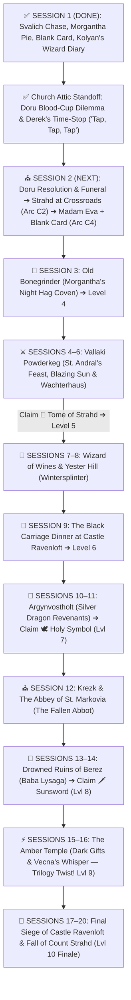

# 🏰 Master DM Screen & Campaign Cheat Sheet — Curse of Strahd (Director's Cut)

> **Quick Glance Reference for the Lead DM**  
> *The 15–20 Session Director's Cut Roadmap, Curated Tarokka Reading, Barovian NPC Directory, Pointy Hat Boss Stat Blocks, World Loot Vault, and Gothic Horror Rules at a glance.*

---

## 🛡️ SECTION 0: PARTY CHARACTER SHEETS & ESCORT VITALS (LEVEL 3 START)

| Slot | Hero / Companion | Class & Level | HP | AC | Init | Key Passive / Resource |
| :--- | :--- | :--- | :--- | :--- | :--- | :--- |
| **PC 1** | 🎭 **Piper ("The Incomparable")** | Level 3 Wild Magic Sorcerer (Fierna Tiefling • Native) | `17/17` | `12 (15)` | `+2` | ✨ `3/3 SP` • 🎲 `Tides` • 💖 `Fierna Charm 0/1` • 🃏 **Blank Tarokka Card** • 💛 `2/2 Help` |
| **PC 2** | 👑 **Jacomir Yulle ("King of Oakenshire")** | Level 3 Battle Master Fighter (Human • Noble) | `31/31` | `17` | `+0` | ⚔️ `4/4 d8` • ☕ `3/3 SW` • 📖 **Kolyan's Wizard Diary** • 🥧 **1x Dream Pastry (Uneaten)** • 💛 `2/2 Help` |
| **PC 3** | 🎯 **Eclipsa "Yvaine" the First** | Level 3 Monster Slayer Ranger (Human • Gunner) | `28/28` | `16` | `+6` | 🔫 *Lament* `+8 (1d12+4)` • 💥 *Mercy & Less* `+8 (1d6+4)` • 👁️ *Hunter's Sense 2/2* • 🎯 *Slayer's Prey (+1d6)* • ⚡ *Alert (+6 Init)* • 💛 `2/2 Help` |
| **Emissary** | ⏳ **Derek ("The Man Between Seconds")** | Avatar / Project Manager of the Dark Powers | `∞` | `--` | `--` | **Froze Time (`Tap, Tap, Tap`) in S1 Church!** Invisible to Strahd • Appears at 3 Future Milestones Only |
| **Companion** | 🌟 **Caelum Jude ("Cael")** | Level 3 Circle of the Stars Druid (Main Companion & Primary Healer) | `38/38` | `14` | `+2` | ✨ Chalice Dual Heals (`1d8+3`) • 🏹 Archer Form (`1d8+3` Rad) • ⚡ Guiding Bolt (`2/2`) • 🐈 Black Cat • 🛡️ *Vow of Dark Powers (Stabilizes at 1 HP)* |
| **Escort** | 🌹 **Ireena Kolyana** | Noble Swordswoman (Tatyana Reborn) | `28/28` | `15` | `+2` | ⚔️ Silvered Rapier `+5 (1d8+2)` • 🛡️ Parry `+2 AC` |
| **Ally** | 🗡️ **Ismark Indirovich** | Veteran Swordsman *(Act I)* | `58/58` | `17` | `+1` | Multiattack: 2x Longsword `+5 (1d10+3)` • ☕ Second Wind |
| **Fated** | ⚔️ **Ezmerelda d'Avenir** | Tarokka Ally *(Act II–IV)* | `82/82` | `17` | `+4` | `+1 Rapier` (`+8, 1d8+5`), 4th-Lvl Wizard Spells, Silvered Prosthetic |

---

## 📜 SECTION 1: THE 15–20 SESSION DIRECTOR'S CUT ROADMAP & TAROKKA ORACLE

### 🔮 1.1 Curated Madam Eva Tarokka Reading (Session 2 — Tser Pool)
*Read these exact card draws during Session 2 so every treasure drives the core 15–20 session plot without dead-end backtracking:*

1. **📜 First Card — The Tome of Strahd (History of the Devil):**
   * **Card Drawn:** *The Master of Stars (Wizard)*
   * **Madam Eva's Prophecy:** *"I see a walled town where smiles are painted over terror. Look to a noble house of cats and whispers, where a widow sleeps beside the dead and bows to the Devil in secret. In her hidden library lies the truth of Strahd's birth."*
   * **DM Location Key:** **Wachterhaus in Vallaki (Lady Fiona Wachter's Secret Cult Library)** — *Sessions 5–6 (Level 5).*
2. **🕊️ Second Card — The Holy Symbol of Ravenkind (Weapon of Faith):**
   * **Card Drawn:** *The Paladin (Justiciar)*
   * **Madam Eva's Prophecy:** *"I see a fallen house of silver wings and broken oaths. Seek the fortress of the dead dragon knight who hates so deeply he refuses to let the Devil die. Light the beacon of the silver wyrm, and the amulet of the sun shall be yours."*
   * **DM Location Key:** **Argynvostholt (Vladimir Horngaard's Sanctum)** — *Sessions 10–11 (Level 7). Directly bridges into Campaign 3's Ancient Dragon Lore!*
3. **🗡️ Third Card — The Sunsword (The Blade of Sunlight):**
   * **Card Drawn:** *The Tempter (Marionette)*
   * **Madam Eva's Prophecy:** *"I see a drowned village in a fetid marsh where no bird dare sing. A rotting hut crawls upon ancient roots, guarded by an old woman who cradles an illusion of youth in a dragon skull. The blade of pure light lies buried in her mire."*
   * **DM Location Key:** **Ruins of Berez (Baba Lysaga's Creeping Hut)** — *Sessions 13–14 (Level 8).*
4. **⚔️ Fourth Card — The Fated Ally (The Swashbuckling Hunter):**
   * **Card Drawn:** *The Mists (Element)*
   * **Madam Eva's Prophecy:** *"A child of our own blood who has walked away from the wagons. She carries the scars of the hunt upon her flesh and steel where bone was shattered. A woman of flashing rapiers and black powder—she waits in the mists to strike at the throat of the beast."*
   * **DM Location Key:** **Ezmerelda d'Avenir** — *Fated Ally joined in Vallaki / Abbey (Act II–III).*
5. **🏰 Fifth Card — The Final Battlefield (Where Strahd Must Die):**
   * **Card Drawn:** *The Executioner (High Deck)*
   * **Madam Eva's Prophecy:** *"I see the spire of black stone piercing a blood-moon. He waits where his brother's blood first touched the stones, beneath the high chapel where stained glass portrays saints with blind eyes. Face him beneath the gaze of the dead saints, and the master shall fall."*
   * **DM Location Key:** **Castle Ravenloft — The Chapel of Saint Andral / Sergei's Crypt** — *Session 19–20.*
6. **🃏 Sixth Card — Piper's Blank Tarokka Card (The 3-Stage Living Omen — Option 2):**
   * **Origin:** Handed to Piper by a deeply concerned Vistani at *Blood on the Vine Tavern* in Session 1 after the painted ink faded off the card in her hand.
   * **Madam Eva's Reaction (No Direct Lore-Dump!):** Eva touches the blank parchment and pulls her hand back as if burned by ice: *"Four hundred years I have read these cards, and never has the fog stood between my eyes and a traveler's road. Something walks in the silence behind you, child—something that hides your ending even from me. Keep this card in your coat. Every time you step closer to what woke the fire in your blood, the ink will bleed higher. Pray you do not recognize the picture when it finishes drawing itself."*
   * **3-Stage Progressive Mist Bleed (Zero Tiefling/Monolith Spoilers):**
     * **Stage 1 (Session 2 — Tser Pool):** Bottom third fills with charcoal ink — *dead pine trees and a pair of empty, upturned palms rising out of black water*.
     * **Stage 2 (Mid-Campaign — Vallaki / Berez):** Middle third bleeds in — *a cracked, faceless glass lantern / pocket watch suspended in midair with threads of silver-gray fog curling into its cracks*.
     * **Stage 3 (Act IV — Amber Temple / Ravenloft):** Top third fills in — *a violent vortex of endless gray Mist pouring inward into the cracked glass, with a faint, unblinking shadow-grin in the smoke above*.

---

## 👥 SECTION 2: MASTER BAROVIAN NPC DIRECTORY (5-COLUMN FORMAT)

| NPC Name & Condition | Live Status | Role & Location | Key Offerings, Services, Quests & Advice | 🎭 Voice & Roleplay Cue |
| :--- | :--- | :--- | :--- | :--- |
| ⏳ **Derek ("Man Between Seconds")** `[Avatar of the Dark Powers]` | 🟢 Met & Active | Time-Stopping Emissary • Frozen Moments | Froze time (`tap, tap, tap`) in S1 Church! Promised Jacomir & Yvaine a way home if they kill Strahd; told Piper to *"take care of herself."* **Strahd cannot perceive him!** | Calm, modernly sharp, transactional: *"I'm the only one giving you a straight deal: kill the vampire, and go home."* |
| 🌟 **Caelum Jude ("Cael")** `[The Scion / Inside Shepherd]` | 🟢 Met & Active | Primary Healer & Companion • Barovia | **Starry Chalice dual-heals 1d8+3**, free Guiding Bolts, Goodberries, scout. *Stabilizes at 1 HP (Plot Armor).* Shrinks in silent terror when Derek freezes time! | Earnest, self-deprecating Percy Jackson warmth: *"I don't want to die out here alone. Let me walk with you."* |
| 👑 **Count Strahd von Zarovich** `[Darklord of Barovia]` | 🟢 Active Overlord | Supreme Ruler • Castle Ravenloft | **First Face-to-Face in Session 2 (`Reloaded Arc C2: River Ivlis Crossroads`)**! Unaware of Derek's time-stops; seeks Ireena & tests the heroes. | Deep aristocratic velvet baritone: *"I am the Ancient. I am the Land."* |
| 🌹 **Ireena Kolyana** `[Twice-Bitten / Tatyana]` | 🟢 Met & Active | Escort Heroine • In Barovia Church | Fights alongside party (**AC 15, 28 HP**, Silvered Rapier `+5`, Parry `+2 AC`). Currently neutral in the Doru attic standoff. | Fierce sleepless noble resolve: *"Give me a blade and tell me where to stand."* |
| 🗡️ **Ismark 'The Lesser' Indirovich** `[New Burgomaster]` | 🟢 Met & Active | Frontline Defender • In Barovia Church | Empathizes with Father Donavich alongside Jacomir in the church attic standoff. AC 17, 58 HP. | Exhausted gravelly baritone: *"They call me the Lesser... but I will die holding the line."* |
| ⛪ **Father Donavich & Doru** `[Priest & Son in Church Attic]` | 🟢 Met & Active | Village Priest • Barovia Church Attic | **Active S1/S2 Cliffhanger:** Doru is hidden in the **church attic**! Jacomir is pouring his own blood into a cup to feed Doru (`Reloaded` lucidity mechanic), while Piper & Yvaine want to kill Doru! | Hoarse weeping prayers: *"He's still my boy! Just one cup of blood to calm his mind!"* |
| 🔮 **Madam Eva** `[Ancient Vistani Seer]` | 🟡 Unmet | Tarokka Oracle • Tser Pool Camp | **5-Card Tarokka Reading + Piper's Blank 6th Card**; safe Long Rest camp; Vistani silver weapon trade. | Ancient woodsmoke-thick voice: *"The cards have waited centuries for your hands."* |
| 🎭 **Bride Volenta Popofsky** `[Porcelain Skull-Mask]` | 🟡 Active Hunter | Youngest Bride • Castle Ravenloft | Stalks Ireena; drops Bone Dagger +1 & Porcelain Skull-Mask Charm (False Life). | High-pitched unhinged giggling: *"Little sister Ireena! Come out and play!"* |
| 🥧 **Morgantha ('Granny')** `[Night Hag Matron]` | 🟢 Met & Wary | Coven Leader • Old Bonegrinder | **Met in S1:** Resisted Piper's *Charm Person* (semi-hostile/wary of Piper) & gifted **1x Dream Pastry to Jacomir** (uneaten). | Sweet grandmotherly cackle hiding iron malice: *"Just one warm pie, dearies!"* |
| 🦅 **Urwin, Danika & Davian Martikov** `[Keepers of the Feather]` | 🟡 Named in Diary | Wereraven Allies • Blue Water Inn & Winery | **Named in Burgomaster Kolyan's Wizard Diary (looted in S1)!** Showing Kolyan's diary to Urwin or Davian unlocks instant Keepers of the Feather trust. | Warm observant hospitality: *"You carry old Kolyan's journal? Then our wings are yours."* |
| ☀️ **Baron Vargas Vallakovich** `[Paranoid Mayor]` | 🟡 Unmet | Burgomaster • Vallaki | Town authority & shelter if party praises his festivals; enforcer Izek Strazni. | Manic booming forced cheer: *"ALL WILL BE WELL!"* |
| 🕯️ **Lady Fiona Wachter** `[Cult Leader]` | 🟡 Unmet | Strahd Loyalist • Wachterhaus | Shelters **The Tome of Strahd**; seeks to overthrow the Baron; cultists. | Cold calculating aristocratic poise: *"Strahd is not a monster. He is a lord."* |
| ⚔️ **Ezmerelda d'Avenir** `[Fated Ally]` | 🟡 Unmet | Vistani Vampire Hunter • Act II–IV | Swashbuckling hunter (AC 17, HP 82, Rapier +8, 4th-level Wizard spells). | Swashbuckling confidence: *"I don't need a prophecy to tell me how to kill a vampire."* |
| 📜 **Rudolph van Richten** `[Monster Scholar / "Rictavio"]` | 🟡 Unmet | Disguised Bard • Blue Water Inn | Legendary vampire hunter; Saber-Toothed Tiger; expert monster tactics. | Scholarly dry wit under a colorful bard disguise. |
| 🐉 **Vladimir Horngaard** `[Revenant Commander]` | 🟡 Unmet | Dragon Knight Leader • Argynvostholt | Guards **The Holy Symbol of Ravenkind**; undead dragon knight order. | Hateful hollow spectral rasp: *"Strahd must suffer eternally in his cage."* |
| 💀 **Baba Lysaga** `[Swamp Witch]` | 🟡 Unmet | Mother of Night • Ruins of Berez | Guards **The Sunsword**; pilots the Creeping Walking Hut; 8th-level spells. | Screeching maternal madness claiming Strahd as her stolen infant son. |

---

## 💀 SECTION 3: MASTER ENEMY FAST REFERENCE & BOSS STAT CARDS

### 🐺 3.1 Master Campaign Enemy Table (Scaled for 3 Level 3 Characters)

| Act / Region | Enemy Name & Role | CR | Init | HP (3 Level 3 PCs) | AC | Speed | Main Attacks (+Hit, Dmg) | Special Mechanics / Pointy Hat |
| :--- | :--- | :--- | :--- | :--- | :--- | :--- | :--- | :--- |
| **🌲 Act I: Svalich Woods & Chase** | 🐺 **Svalich Dire Wolf** *(Chase Flanker)* | 1 | `+2` | **`42`** | 14 | 50 ft | Bite `+5` (`2d6+3` pierc + DC 13 STR Prone) | **Pack Tactics** (Adv with ally) • **Drag Down** (`+1d6` vs Prone) • Fears fire |
| | 🐺 **Svalich Alpha Dire Wolf** *(Roof Breacher)* | 2 | `+2` | **`58`** | 15 | 50 ft | Bite `+6` (`2d6+4`) + Roof Claws `+6` (`2d4+4`) | **Roof Breach:** rips timber ceiling (DC 13 Dex or `1d6` slash) • **Howl** (DC 13 Wis) |
| **🩸 Act I Climax: Indirovich Manor** | 🩸 **The Starved Vampire Spawn** *(3 AM Climax Solo Boss)* | **5** | `+3` | **`82`** | 15 | 35 ft / Climb 35 | 2x Talons `+6` (`2d6+4` / Grapple DC 14) + Throat-Bite `+6` (`2d6+4` + `4d6` Necro) | **Spider Climb** • **Regen 10 HP** • **Apex Drain reduces Max HP** • **3 Pointy Hat Actions** |
| **⛪ Act I–II: Churchyard & Road** | 🧟 **Strahd Zombie** *(Cemetery Hazard)* | 1 | `-2` | **`34`** | 8 | 20 ft | Bite `+3` (`1d4+1`) + 2x Claws `+3` (`1d6+1`) | **Loathsome Limbs:** hits of 5+ sever limbs that attack independently! |
| | 🩸 **Doru (The Starving Son)** *(Church Attic Boss — S1/S2 Cliffhanger)* | 5 | `+3` | **`85`** | 15 | 30 ft / Climb 30 | 2x Claws `+6` (`2d6+4`) + Bite `+6` (`2d6+4` + `4d6` Necro) | **Hidden in Church Attic!** Feeding Jacomir's blood cup (`Reloaded Arc B5`) grants 2 mins of weeping lucidity (reveals Mad Mage & Heart of Sorrow)! |
| **🏰 Act II: Bonegrinder & Vallaki** | 🎭 **Bride Volenta Popofsky** *(Porcelain Bride)* | 5 | `+4` | **`95`** | 16 | 35 ft / Climb 35 | 2x Bone-Dagger `+7` (`1d4+4` + `2d6` Necro) + Bite `+7` (`1d6+4` + `3d6` Necro) | **Pointy Hat Boss:** *Corpse-Puppet Strings* & *Skull-Mask Shriek* |
| | 🥧 **Morgantha, Night Hag Matron** *(Old Bonegrinder Boss)* | 5 | `+2` | **`112`** | 17 | 30 ft | Talons `+7` (`2d8+4` magic slash) • *Magic Missile* / *Ray* | **Pointy Hat Boss:** *Bone-Flour Combustion Cloud* • Magic Resistance |
| | 👑 **Count Strahd von Zarovich** *(Campaign Apex Darklord)* | 15 | `+4` | **`144`** *(+50 Heart)* | 16 | 30 ft / Fly 30 | 2x Strike `+9` (`1d8+4` + `4d6` Necro / Grapple) + Bite `+9` + 5th-Lvl Spells | **Pointy Hat Boss:** *Wrath of Land* • Lair Wall-Phase • **Regen 20 HP** |

---

### 🩸 3.2 The Starved Vampire Spawn — Apex Solo Boss Dossier (Indirovich Manor 3:00 AM)

* **CR:** `5 (1,800 XP)` | **Init:** `+3` | **AC:** `15 (Supernatural Agility)` | **Speed:** `35 ft, Climb 35 ft (Spider Climb)`
* **HP:** **`82 HP`** *(Scaled specifically to challenge 3 Level 3 PCs including Jacomir with 31 HP! 3 PCs: 76–82 HP, 4 PCs: 94 HP)*
* **Saving Throws:** `DEX +6, CON +6, WIS +3` | **Senses:** `Darkvision 60 ft, Passive Perception 13`
* **Damage Resistances:** `Necrotic; Bludgeoning, Piercing, and Slashing from Non-Silvered / Non-Magical Attacks` *(Bypassed by Silver, Fire, Holy Water, Radiant)*
* **Core Traits:**
  * **Supernatural Regeneration:** Regains **10 HP** at the start of its turn unless it took Fire, Radiant, or Holy Water damage since its last turn.
  * **Spider Climb:** Moves effortlessly across walls and wooden ceiling rafters without needing an ability check.
  * **Sunlight & Running Water Hypersensitivity:** Takes 20 Radiant in true sunlight; 20 Acid in running water.
* **Combat Actions:**
  * **Multiattack:** Makes **Three Attacks**: Two with its **Ripping Talons** and one with its **Exsanguinating Throat-Bite**!
  * **Ripping Talons:** `+6 to hit`, reach 5 ft. *Hit:* 11 (`2d6 + 4`) slashing damage. If target is Medium or smaller, it is **Grappled** (Escape DC 14) and **Restrained**! Has two claws, can hold two victims.
  * **Exsanguinating Throat-Bite:** `+6 to hit`, reach 5 ft., against a grappled, incapacitated, or restrained creature. *Hit:* 11 (`2d6 + 4`) piercing PLUS 14 (`4d6`) necrotic damage (**Avg 25 damage**!).
    * **Vampiric Drain:** The target's **Max HP is reduced by the necrotic damage dealt** (lasts until a Long Rest or *Greater Restoration*), and the Spawn **regains HP equal to the necrotic damage dealt**!
    * *Brutal Crit (Nat 20):* 16 (max die) + 1d6 + 4 piercing + 24 (max necrotic) + 4d6 necrotic = **Avg 58 damage**! Instant down!
  * **Ceiling Pounce (Recharge 5-6):** Drops from ceiling rafters; target makes DC 14 STR save or takes 14 (`3d6 + 4`) bludgeoning, slammed Prone, and pinned.
* **Pointy Hat Battlefield Actions (Tell ➔ Counterplay ➔ Resolve):**
  1. **Action 1: Rushing Ceiling Exsanguination (Pin & Drain):**
     * **📢 TELL (End of Turn):** The Spawn scrambles up parlor drapes onto rafters above a hero, foaming with black bile dripping onto their armor, locking onto their jugular!
     * **🛡️ COUNTERPLAY (The Round):** Target moves 15+ ft away, ally uses Action to tackle/shove them out of the drop zone (DC 13 Athletics), or party deals 16+ damage (or Fire/Radiant) to knock Spawn off ceiling!
     * **💥 RESOLUTION (Start of Next Turn):** Plummets onto target: 17 (`3d8 + 4`) bludgeoning, knocked Prone, Spawn gets immediate free Throat-Bite with Advantage!
  2. **Action 2: Frenzied Blood-Mist Leap (Horror Shroud):**
     * **📢 TELL (End of Turn):** Slashes own forearms, exhaling thick black blood-mist that snuffs lamps/hearth, plunging parlor into supernatural darkness!
     * **🛡️ COUNTERPLAY (The Round):** Relight torch/lamp (Action + DC 12 Sleight of Hand), cast Light / Dancing Lights / Faerie Fire / Bonfire, or DC 13 Perception check to track talons!
     * **💥 RESOLUTION (Start of Next Turn):** Blinks behind two closest heroes, raking eyes: DC 14 DEX save or 15 (`3d6 + 4`) slashing + Blinded until end of next turn!
  3. **Action 3: Sanguine Death Rattle (Starvation Frenzy):**
     * *Trigger:* Reduced below 30 HP.
     * **📢 TELL (End of Turn):** With broken fangs and bleeding eyes, lets out a horrific shriek shattering windows, black veins bulging as fresh blood scent drives it berserk!
     * **🛡️ COUNTERPLAY (The Round):** Deal 20+ damage to execute before its turn, cast Calm Emotions / Tasha's Laughter, or hit with Radiant / Holy Water!
     * **💥 RESOLUTION (Start of Next Turn):** Surges: gains **+2 AC (AC 17)**, speed 50 ft, makes 3 Claw attacks with Advantage targeting nearest hero or whoever dealt radiant/fire!

---

## 🎒 SECTION 4: COMPLETE BAROVIAN WORLD LOOT VAULT, OFFICIAL MODULE TREASURES & POSSIBLE LOOTS (63 ITEMS)

> **Sources Cross-Referenced:** Official *Curse of Strahd* 5e Module PDF (`Chapters 2–15`), **[DragnaCarta's *Curse of Strahd: Reloaded*](https://github.com/DragnaCarta/Curse-of-Strahd-Reloaded)** artifact reworks, Session 1 Table Canon, and Possible Character-Tailored Upgrades for **Piper**, **King Jacomir**, **Yvaine**, and **Cael**.

---

### 🎯 4.0 Quick-Finder: Best Loot & Possible Upgrades by Hero & Act

| Hero / Role | Act I (Sessions 1–3) | Act II (Sessions 4–9: Vallaki & Winery) | Act III (Sessions 10–14: Argynvost, Krezk & Berez) | Act IV (Sessions 15–20: Amber Temple & Ravenloft) |
| :--- | :--- | :--- | :--- | :--- |
| 🎭 **Piper** *(Wild Magic Sorcerer)* | • 🃏 **Blank Tarokka Card** *(Claimed S1)* • 🩸 **Vistani Bloodwell Vial (+1)** *(Possible: Tser Pool Wagon S2)* • 💀 **Volenta's Skull-Mask Charm** *(False Life)* | • 🪄 **Victor's Wand of Lightning / Wonder** *(Baron's Attic `N3t`)* • 🎭 **Hat of Disguise** *(Rictavio's Wagon `N2r`)* • 🧥 **Wereraven Feather Cloak (+1 AC/Saves & Glide)** | • 🍀 **Stone of Good Luck (+1 Checks & Saves)** *(Berez Hut `U3`)* • 🎶 **Pipes of Haunting** *(Berez `U3`)* • 🐉 **Silver Dragon Beacon (+1 AC & Saves)** | • ⚡ **Khazan's Staff of Power (+2 AC/Saves/Spell Atk)** *(Crypt 15 `K84`)* • ❄️ **Staff of Frost** *(Amber Temple `X17`)* • 🃏 **Deck of Illusions** *(Crypt 9)* • 🟣 **Supreme Gift of Vecna (+2 CHA)** |
| 👑 **King Jacomir** *(Battle Master Fighter)* | • 📖 **Kolyan's Wizard Diary** *(Claimed S1)* • 🥧 **1x Dream Pastry** *(Claimed S1)* • ⚔️ **Silvered Greatsword Coating** *(Ismark/Vistani)* | • 🩸 **The Blood Spear of Kavan (+2 Spear, +2d6 Temp HP on kill)** *(Yester Hill `Y4`)* • 🔥 **Izek's Hellfire Battleaxe +1 (+1d6 Fire)** *(Vallaki S6)* | • 🗡️ **Vladimir's +2 Silvered Dragon Greatsword (+1d6 Frost/Rad)** *(Argynvostholt `Q36`)* • 🗡️ **The Sunsword (+2 Radiant Sun Blade)** *(Berez `U3`)* • 🛡️ **Silvered Dragonplate +1 (AC 19/20)** | • 🛡️ **+2 Shield of the Silver Wyrm** *(Treasury `K41`)* • 👑 **Helm of Brilliance** *(Treasury `K41`)* • 🩸 **Supreme Gift of Vampyr (+20 Max HP & Vampiric Crits)** |
| 🎯 **Yvaine** *(Monster Slayer Gunner)* | • 💥 **10x Silvered Bullets** *(Ismark's Cache / Vistani)* • 🗡️ **Volenta's Returning Bone Dagger +1** | • 🔫 **Van Richten's Silver-Runed Scope & Barrel (+1 Firearm Upgrade)** *(Rictavio's Wagon `N2r`)* • 🧠 **Ring of Mind Shielding** *(Van Richten)* • 🗡️ **Baal Verzi Dagger +1** | • 💥 **Ezmerelda's Sunburst Cartridges (+1 Hit/Dmg, +1d6 Radiant)** • 🧪 **Oil of Sharpness (+3 Hit/Dmg for 1 hr!)** *(Berez `U3`)* • 🎯 **10x +1 Bullets** *(Berez `U3`)* • 💚 **Ring of Regeneration** *(Abbey `S13`)* | • 🧥 **Bloodhorn's Mountain Pelt** *(Tsolenka Pass `T6`)* • 📖 **Tome of Understanding (+2 Perm WIS)** *(Amber Temple `X30`)* • 👁️ **Supreme Gift of Zhudun (+2 DEX & Truesight)** |
| 🌟 **Cael & Party** *(Stars Druid & Utility)* | • 🧿 **Morgantha's Cracked Heartstone** *(Old Bonegrinder S3)* • 🌿 **Elixir of Youth & Pale Tincture** *(`O3`)* | • 📜 **The Tome of Strahd (Tarokka #1)** *(Wachterhaus `N4`)* • 🌿 **The Gulthias Staff** *(Winery `W14`)* • 🐾 **Gray Bag of Tricks** & ✨ **Elixir of Health** *(`N2q`)* | • 🕊️ **Holy Symbol of Ravenkind (Tarokka #2)** *(Argynvostholt)* • 🛡️ **4x Potions of Invulnerability** *(`Q6`)* • 📜 **Scrolls of Heroes' Feast, Revivify & Mass Cure Wounds** | • 🏰 **Icon of Ravenloft** *(Chapel `K15`)* • 🪄 **Wand of Secrets** *(`X2b`)* • 🔥 **Ring of Warmth** *(`N9a`)* • 🏰 **Daern's Instant Fortress & Alchemy Jug** *(`K41`)* |

---

### 📜 4.1 Fated Tarokka Relics, Session 1 Items & Story Artifacts (10 Items)
1. 🃏 **Piper's Blank Tarokka Card (The 3-Stage Living Omen — S1 Vistani Gift)** *(Unique Omen Relic • Carried by Piper)*:
   * **Location:** Gifted at *Blood on the Vine Tavern* (S1) after the ink faded off the card; read by Madam Eva at *Tser Pool* (S2).
   * **Mechanics (Option 2 — Progressive Mist Bleed):** Bleeds charcoal ink across 3 stages: **Stage 1 (S2 Tser Pool):** *Dead pines & empty upturned palms rising from black water* ➔ **Stage 2 (Vallaki/Berez):** *Cracked faceless glass lantern/pocket watch drinking in silver fog* ➔ **Stage 3 (Amber Temple/Ravenloft):** *Violent vortex of endless Mist pouring inward into the cracked glass*.
2. 📖 **Burgomaster Kolyan's Wizard Diary (Keepers of the Feather VIP Lead — S1 Manor Loot)** *(Unique Quest Tome • Carried by Jacomir)*:
   * **Location:** Looted from Indirovich Manor in Session 1.
   * **Mechanics:** Reveals late Burgomaster Kolyan was a wizard and explicitly names **Davian Martikov** (*Wizard of Wines*) and **the Keepers of the Feather** (*Blue Water Inn*, Vallaki) as secret allies. Showing this diary to Urwin or Davian immediately unlocks the wereravens' trust and secret inn stash!
3. 🧭 **Dalvan Olensky's Spinning Compass & Sealed Letter** *(Story Clue • Claimed S1 at Gates of Barovia)*: Brass needle spins endlessly in the Demiplane; letter reveals Strahd has bitten Ireena twice.
4. 📜 **The Tome of Strahd (Tarokka Relic #1 — RAW + *Reloaded*)** *(Legendary Lore Relic • No Attunement)*:
   * **Location:** Lady Fiona Wachter's Secret Cult Library in Vallaki (`Area N4` — Session 6, Level 5).
   * **Mechanics:** Allies within 30 ft gain **Advantage on saves against Strahd's Charm**. **1/Day Action:** Read aloud Strahd's murder of Sergei; Strahd or any Bride within 30 ft must pass a **DC 15 WIS Save or be Stunned until the end of their next turn**! *(In Reloaded: studying its chapters during Long Rests unlocks memory visions of the Heart of Sorrow and Amber Temple).*
5. 🕊️ **The Holy Symbol of Ravenkind (Tarokka Relic #2 — RAW + *Reloaded*)** *(Legendary Amulet • Attunement)*:
   * **Location:** Argynvostholt Beacon Sanctum (`Area Q53` — Session 11, Level 7).
   * **Official 5e Mechanics (10 Charges, regains `1d6+4` at dawn):** **Hold Vampires (1 Charge):** DC 15 WIS Save or Paralyzed for 1 min; **Turn Undead Boost (1 Charge):** Advantage; **True Sunlight (5 Charges):** Emits **30-ft True Sunlight** for 10 min (20 Radiant dmg/turn to vampires & halts regen).
   * **DragnaCarta *Reloaded* Mechanics (Bonus Option — +1 Spell Focus, 5 Charges):** **Dawn's Embrace (1 Charge, Reaction):** When an ally within 60 ft drops to 0 HP, they drop to **1 HP instead and gain Immunity to ALL damage** until start of their next turn! **Light of Hope (1 Charge, Action):** Ends *Blinded, Charmed, Frightened, Paralyzed, Poisoned,* or *Stunned*. **Sun's Blessing (3 Charges):** 30-ft aura for 1 min granting all allies **`+1d4` Radiant damage** on weapon attacks!
6. 🗡️ **The Sunsword (Tarokka Relic #3 — Sentient Sun Blade)** *(Legendary Blade • Attunement)*:
   * **Location:** Guarded by Baba Lysaga inside her Creeping Hut in Berez (`Area U3` — Session 14, Level 8).
   * **Mechanics:** Sentient crystal hilt that ignites with a blade of pure morning sunlight! **Finesse & Versatile** (`+2 to hit and damage` with STR or DEX); deals **`1d8+2` Radiant** (`1d10+2` two-handed) + **extra `1d8` Radiant vs Undead (`2d8+2` Radiant per hit vs vampires!)**; sheds **15-ft True Sunlight** (expandable to 30 ft) dealing 20 Radiant/turn to vampires!
7. 🏰 **The Icon of Ravenloft** *(Legendary Silver Statuette • Attunement • Book Area K15)*:
   * **Location:** Castle Ravenloft High Chapel Altar (`Area K15` — Session 17).
   * **Mechanics:** Permanent **15-ft *Protection from Evil and Good* aura** against Undead/Fiends; **1/day Action** to heal **`3d8 + 3 HP`** and cure all diseases/poisons/blindness; **1/day *Augury***.
8. 🦴 **Saint Markovia's Thighbone (Mace of Disruption)** *(Rare Holy Relic • Attunement • Book Area K84 / S13)*:
   * **Location:** Castle Ravenloft Crypt 6 (`Area K84`) or Abbey of St. Markovia (`Area S13`).
   * **Mechanics:** `+1 Mace` that sheds 20-ft bright light and deals **extra `2d6` Radiant damage** to Undead/Fiends. Any Undead/Fiend reduced to **25 HP or fewer** must pass a **DC 15 WIS Save or be instantly destroyed** (or Frightened if Strahd)!
9. 💚 **Wizard of Wines Magic Life-Gems (x2)** *(Legendary Primal Seeds • Yester Hill `S8` & Berez Hut `S14`)*: Ripping the gem out of Wintersplinter or Baba Lysaga's Creeping Walking Hut instantly shuts down the boss construct!
10. 🐉 **Skull of Argynvost & Beacon of the Silver Dragon** *(Legendary Dragon Relic • Castle Ravenloft `K67` ➔ Argynvostholt `Q53`)*: Lighting the Silver Beacon grants the **entire party a permanent `+1 to AC and +1 to all Saving Throws`** across Barovia!

---

### ⚔️ 4.2 Magic Weapons, Silvered Arms & Firearm Upgrades (13 Items)
11. ⚔️ **Silvered Weapons & Ammunition (Greatsword / Rapier / 10 Bullets)** *(Uncommon • 5 GP • Ismark's Cache S1 & Vistani Trade S2)*: Bypasses nonmagical B/P/S resistance/immunity of Vampire Spawn, Werewolves, and Night Hags.
12. 🩸 **The Blood Spear of Kavan (`+2 Vampiric Spear`)** *(Rare Magic Spear • Attunement • Book Area Y4)*:
    * **Location:** Yester Hill Burial Cairn (`Area Y4` — Session 8 • **Best for King Jacomir**).
    * **Mechanics:** **`+2 Spear`** (`1d6+2` / `1d8+2` versatile, *Sap Mastery*). Whenever you hit and reduce a hostile creature to 0 HP, you siphon their blood and gain **`2d6` Temporary HP**!
13. 🗡️ **Vladimir Horngaard's `+2 Silvered Dragon Greatsword`** *(Very Rare Magic Greatsword • Book Area Q36)*:
    * **Location:** Wielded by Revenant Commander Vladimir Horngaard in Argynvostholt (`Area Q36` — Session 11 • **Apex Greatsword for King Jacomir**).
    * **Mechanics:** **`+2 Silvered Greatsword`** (`2d6 + STR + 2` slashing, *Graze Mastery*). *Possible Upgrade:* Once per turn on a hit, rimes with silver dragon-frost for an extra **`1d6` Cold or Radiant damage**!
14. 🗡️ **Volenta's Bone-Spiked Returning Dagger `+1`** *(Rare Magic Dagger • Bride Volenta Boss Drop)*: `+1 Dagger` (`1d4+1` piercing + **`1d4` necrotic**); snaps back to the wielder's hand on a crimson blood-thread after being thrown.
15. 🔥 **Izek Strazni's Hellfire Brute Battleaxe `+1`** *(Rare Magic Battleaxe • Vallaki Session 6 Boss Drop • **Best for Jacomir**)*: `+1 Battleaxe` (`1d8+1` / `1d10+1` slashing, *Topple Mastery*) that deals an extra **`1d6` Fire damage** on the first hit each turn.
16. 🌿 **The Gulthias Staff (Vampiric Blight Staff)** *(Rare Magic Staff • Attunement • Book Area W14)*:
    * **Location:** Wizard of Wines Loading Balcony (`Area W14` — Session 7).
    * **Mechanics:** 10 Charges; **Vampiric Strike (1 Charge):** Heals wielder for melee damage dealt; **Blight Ward:** Blights won't attack bearer; **Snapping Scream:** Breaking the staff (AC 12, 10 HP) **instantly kills all Blights within 300 ft**!
17. 🔫 **Van Richten's Silver-Runed Scope & Clockwork Barrel (`+1/+2` Firearm Upgrade)** *(Rare Possible Loot • **Best for Yvaine**)*:
    * **Location:** Rictavio's Carnival Wagon (`Area N2r`, Vallaki) or Ezmerelda's Wagon (`Session 12`).
    * **Mechanics:** Upgrades Yvaine's rifle *Lament* (or *Mercy & Less*) to a **`+1` Magical Silvered Firearm** in Act II (and **`+2`** in Act III); crystal scope ignores light fog up to 120 ft and lets *Hunter's Sense* spot invisible/ethereal foes within 30 ft!
18. 💥 **Ezmerelda's Sunburst & Silver Alchemical Cartridges (x10)** *(Rare Possible Ammo • **Best for Yvaine**)*: 10 firearm rounds granting **`+1 to hit/dmg`**, dealing **extra `+1d6` Radiant damage**, and **halting Vampire Regeneration for 1 round**!
19. 🧪 **Oil of Sharpness (`+3` Weapon / Ammo Coating)** *(Very Rare Consumable • Book Area U3)*:
    * **Location:** Baba Lysaga's Creeping Hut in Berez (`Area U3` — Session 14).
    * **Mechanics:** Coats 1 bladed weapon or 5 firearm bullets for **1 hour**, granting a massive **`+3 bonus to attack and damage rolls`**!
20. 🗡️ **Baal Verzi Assassin's Mirror Dagger `+1`** *(Rare Magic Dagger • Book Area N3/N4 in Vallaki)*: `+1 Dagger` that deals an extra **`2d6` Necrotic damage** on a surprise hit or Critical Hit.
21. 🔨 **Gustav Herrenghast's Mace of Terror** *(Rare Magic Mace • Attunement • Book Area K84 Crypt 7)*: 3 Charges; Action (1 Charge) unleashes a 30-ft wave of terror (**DC 15 WIS Save or Frightened for 1 minute**).
22. 🎯 **Baba Lysaga's `+1` Magical Sling / Firearm Bullets (x10)** *(Uncommon Ammo • Book Area U3 in Berez • **Yvaine**)*: 10 bullets granting `+1 to hit and damage`.
23. 💣 **Alchemical Phosphor & Smoke Flash-Bombs (x3)** *(Uncommon Tactical Gear • Ezmerelda's Wagon / Blinsky's)*: Throw 30 ft (10-ft radius); **DC 13 DEX Save or `2d6` Fire/Radiant damage + Blinded for 1 round** (dispels blood-mist!).

---

### 🔮 4.3 Arcane Staves, Wands, Spellbooks & Caster Relics (12 Items — For Piper & Cael)
24. 🩸 **Vistani Bloodwell Vial (`+1` / `+2` Sorcerer Focus)** *(Rare Possible Relic • Attunement • **Best for Piper**)*:
    * **Location:** Tser Pool Vistani Treasure Wagon (`Session 2`) or Wachterhaus Cult Treasury (`Session 6`).
    * **Mechanics:** Grants **Piper** **`+1 to Spell Attack Rolls and Spell Save DC`** (`DC 15, +7 Hit`), and once per day when using Short Rest healing/Hit Dice, she regains **5 Sorcery Points**!
25. ❄️ **Staff of Frost** *(Very Rare Magic Staff • Attunement • Book Area X17)*:
    * **Location:** The Amber Temple Upper West Hall (`Area X17` — Session 15 • **Piper / Cael**).
    * **Mechanics:** Grants **Cold Resistance** and holds **10 Charges** (*Fog Cloud* [1], *Ice Storm* [4], *Wall of Ice* [4], *Cone of Cold* [`8d8` cold, 5 charges]). *Book Flaw:* *"I crave power above all else."*
26. ⚡ **Khazan's Staff of Power (`+2 AC, Saves & Spell Attack!`)** *(Very Rare Apex Staff • Attunement • Book Area K84 Crypt 15)*:
    * **Location:** Castle Ravenloft Catacombs — Crypt 15 of Archmage Khazan (`Area K84` — Session 18 • **Apex Endgame Staff for Piper!**).
    * **Mechanics:** Grants **`+2 to Armor Class, +2 to all Saving Throws, and +2 to Spell Attack Rolls`**! Holds **20 Charges** for 5th-level *Fireball* (`10d6`), 5th-level *Lightning Bolt* (`10d6`), *Cone of Cold*, *Hold Monster*, *Wall of Force*, and *Globe of Invulnerability*!
27. 🪄 **Wand of Secrets** *(Uncommon Wand • Book Area X2b in Amber Temple)*: 3 Charges; Action (1 Charge) points to the nearest **secret door or trap within 60 ft**.
28. 🪄 **Victor Vallakovich's Crackling Wand of Wonder / Lightning** *(Rare Possible Wand • Attunement • Baron's Attic `N3t` • **Best for Piper**)*: 7 Charges; Action (1 Charge) casts *Lightning Bolt* (`8d6`, DC 15) or triggers a chaotic **Wild Magic Surge** (recharging Piper's *Tides of Chaos*!).
29. 🎭 **Rictavio's Hat of Disguise** *(Uncommon Wondrous Item • Attunement • Book Area N2r in Vallaki)*: Cast ***Disguise Self* at will**!
30. 🧠 **Van Richten's Ring of Mind Shielding** *(Uncommon Ring • Attunement • Book Chapter 5 in Vallaki)*: Immune to magic that reads thoughts, discerns lies, or detects alignment (blocks Strahd's telepathic probing!).
31. 🎶 **Pipes of Haunting** *(Uncommon Instrument • Book Area U3 in Berez)*: 3 Charges; Action (1 Charge) forces all enemies within 30 ft to pass a **DC 15 WIS Save or be Frightened for 1 minute**.
32. 🪕 **Mac-Fuirmidh Cittern / Doss Lute of Ravenloft** *(Uncommon Instrument • Book Area K37 in Castle Ravenloft)*: Casts *Fly, Invisibility, Levitate,* and *Protection from Evil and Good* 1/day each.
33. 🃏 **Tarokka Deck of Illusions** *(Uncommon Wondrous Deck • Book Area K84 Crypt 9 • **Best for Piper**)*: 34 cards; throw a card up to 30 ft to conjure a lifelike, moving illusion of a monster, dragon, or knight under your control!
34. 📖 **The Four Master Spellbooks of Barovia** *(Book Locations: Kolyan's Diary `E4`, Victor's Spellbook `N3t`, Kasimir's Spellbook `N9a`, & Amber Temple Library `X30` containing every Wizard spell in the PHB!)*.
35. 📜 **Barovian Master Spell Scrolls Cache** *(Book Locations)*:
    * **Rictavio's Wagon (`N2r`):** *Scrolls of Protection from Undead & Fiends*.
    * **Baba Lysaga's Hut (`U3`):** *Spell Scroll of Revivify* (3rd-Lvl) & *Spell Scroll of Mass Cure Wounds* (5th-Lvl).
    * **Abbey of St. Markovia (`S13`):** *Spell Scroll of Heroes' Feast* (6th-Lvl — grants the entire party **`+2d10` Max HP, Poison/Fear Immunity, and Advantage on ALL WIS Saves for 24 hours**!).

---

### 🛡️ 4.4 Magic Armor, Rings, Cloaks & Defensive Relics (12 Items)
36. 🛡️ **Silvered Dragonplate / Strahd's Animated Plate (`+1 Heavy Armor`)** *(Rare/Very Rare Armor • Argynvostholt `Q36` / Ravenloft `K41` • **Best for Jacomir**)*: `+1 Plate Armor` (**AC 19 — or AC 20 with Jacomir's Defense Style!**) with Cold or Lightning resistance.
37. 🛡️ **`+2` Heraldic Shield of the Silver Wyrm** *(Rare Magic Shield • Book Area K41)*: Grants **+4 AC total** (`+2` shield base + `+2` magical bonus).
38. 🍀 **Stone of Good Luck (Luckstone)** *(Uncommon Wondrous Item • Attunement • Book Area U3 in Berez)*: Grants a **`+1 bonus to all Ability Checks and +1 bonus to all Saving Throws`**!
39. 💚 **Ring of Regeneration** *(Very Rare Ring • Attunement • Book Chapter 8 Abbey `S13` / Ravenloft)*: Regains **`1d6 HP every 10 minutes`** (6d6 HP/hour) and regrows lost body parts!
40. 🔥 **Ring of Warmth** *(Uncommon Ring • Attunement • Kasimir `N9a` / Tsolenka Pass)*: **Resistance to Cold damage** and immunity to freezing weather down to -50°F on Mount Ghakis.
41. 👑 **Helm of Brilliance** *(Very Rare Crown • Attunement • Book Area K41 Ravenloft Treasury)*: Sheds 30-ft light dealing `1d6` Radiant to Undead; ignites wielded weapons for **`+1d6` Fire damage**; grants Fire Resistance; casts *Daylight, Fireball, Prismatic Spray,* and *Wall of Fire*!
42. 🧥 **Wereraven Feather Cloak of Protection (`+1 AC & Saves`)** *(Rare Possible Faction Reward • Wizard of Wines Session 7)*: Gifted by Davian/Urwin Martikov after saving the Winery & presenting Kolyan's Wizard Diary; grants **`+1 AC, +1 to all Saving Throws`**, and Reaction **Feather Fall glide (60 ft/round, zero fall damage)**!
43. 🧥 **Bloodhorn's Mountain Goat Pelt** *(Uncommon Cloak • Book Area T6 in Tsolenka Pass)*: Immunity to extreme cold weather and Advantage on Stealth/Athletics in rocky or snowy mountain terrain.
44. 💀 **Volenta's Porcelain Skull-Mask Charm** *(Uncommon Boss Drop • Bride Volenta)*: 1/day Bonus Action cast 2nd-level *False Life* (**`1d4 + 9` Temp HP**) and Advantage on Intimidation checks.
45. 🧿 **Morgantha's Cracked Night Hag Heartstone** *(Rare Boss Drop • Old Bonegrinder Session 3)*: 1/day Action touch to **cure any 1 disease, poison, or nightmare curse**, and grants the carrier **Advantage on Death Saving Throws**!
46. 🐾 **Martikov Gray Bag of Tricks** *(Uncommon Wondrous Item • Book Area N2q Blue Water Inn Loft)*: Up to 3/day Action toss a fuzzy ball to summon a friendly beast companion (*Dire Wolf, Panther, Giant Elk, Boar*, etc.) until dawn!
47. 🏰 **Daern's Instant Fortress & Alchemy Jug** *(Rare Wondrous Vault Relics • Book Area K41 Ravenloft Treasury)*: Expands into a 30-ft adamantine tower; Jug pours wine, oil, acid, or fresh water on command.

---

### 🧪 4.5 Potions, Elixirs, Holy Water & Barovian Vintages (10 Items)
48. 🧪 **Potion of Healing** *(Common • 5 GP)*: **Bonus Action** self (`2d6 + 1 HP`, overflow becomes Temp HP!) | **Action** ally.
49. 🧪 **Potion of Greater Healing** *(Uncommon • 15 GP • Book Area N2q)*: Restores **`4d4 + 4 HP`**.
50. 🧪 **Potion of Superior Healing** *(Rare • 45 GP • Book Area S13 Abbey)*: Restores **`8d4 + 8 HP (Avg 28 HP)`**.
51. 🛡️ **Potion of Invulnerability (x4)** *(Rare Consumable • Book Area Q6 in Argynvostholt)*: For **1 minute**, grants **Resistance to ALL damage types**!
52. ✨ **Elixir of Health** *(Rare Consumable • Book Area N2q Blue Water Inn)*: Cures all diseases and removes *Blinded, Deafened, Paralyzed,* and *Poisoned* conditions.
53. 💧 **Flask of St. Andral's Holy Water** *(Uncommon • 2 GP 5 SP)*: Ranged splash (20 ft); deals **`2d6` Radiant damage** to Undead/Fiends and **halts Vampire Regeneration for 1 round**!
54. 🍷 **Wizard of Wines — Purple Grapemash No. 3** *(Common Table Wine • 5 SP)*: Restores `+1` extra HP during a Short Rest.
55. 🍷 **Wizard of Wines — Red Dragon Crush** *(Fine Ruby Vintage • 1 GP)*: Drinking during a Short Rest grants **`+1d4` Temp HP** and **Advantage on next save vs Frightened** for 2 hours.
56. 🍾 **Wizard of Wines — Champagne du le Stomp (Lost Vintage)** *(Rare Sparkling Vintage • Winery `W16` / Ravenloft `K63`)*: Grants **`+2d4` Temp HP**, removes **1 level of Exhaustion**, and grants Advantage vs Charm/Fear for 4 hours!
57. 🌿 **Old Bonegrinder Hag Brews (Elixir of Youth & Pale Tincture Poison)** *(Book Area O3 — Session 3)*: *Elixir of Youth* makes drinker look `1d6+4` years younger + `2d6` Temp HP; *Pale Tincture* coats a blade/3 bullets (`DC 16 CON Save` or `1d6` Poison + Poisoned condition).

---

### ⚡ 4.6 Amber Temple Dark Gifts, Cursed Delicacies & Boons (6 Items)
58. 🥧 **Morgantha's Dream Pastry (1x Uneaten in Jacomir's Pack!)** *(Cursed Consumable • 1 GP • Session 1 & 3)*: Action to eat; grants **`1d6` Temp HP**, cures **1 level of Exhaustion**, and induces 8 hours of blissful dreams. DC 13 CON Save at dawn or `-1d4` to Wisdom checks until eating another pie!
59. 📖 **Tome of Understanding (`+2 Permanent Wisdom!`)** *(Very Rare Tome • Book Area X30 in Amber Temple)*: Studying for 48 hours permanently increases **Wisdom score and maximum by +2**!
60. 🩸 **Supreme Dark Gift of Vampyr (Undying Bloodlord — Tailored for Jacomir)** *(Amber Temple Vault `X42` — Session 16)*: **`+20 Max HP`**, Critical Hits/Kills heal HP equal to damage dealt, and 1/day *Misty Escape* at 0 HP; binds soul as the Martial Vanguard of the Mists for Campaign 3.
61. 🟣 **Supreme Dark Gift of the Whispering Hand (Vecna's Monolith — Tailored for Piper)** *(Amber Temple Vault `X42` — Session 16)*: **`+2 Charisma (up to 22)`**, Necrotic Immunity, and 1 free 5th/6th-level devastating spell per Long Rest; completes Stage 3 of Piper's Blank Tarokka Card for Campaign 3.
62. 👁️ **Supreme Dark Gift of Zhudun & Sykane (The Corpse Star — Tailored for Yvaine)** *(Amber Temple Vault `X33` — Session 16)*: **`+2 Dexterity (up to 22)`**, 1/day *True Seeing* (120 ft), 1/day component-free *Raise Dead / Revivify*, and `+1d8` Necrotic/Radiant on first firearm hit each turn; binds Yvaine's *Hunter's Sense* for Campaign 3.
63. 🪽 **The 20 Official Amber Temple Sarcophagi Gifts (`Book Areas X33a–f`)**: Includes **Tarakamedes** (*50-ft Skeletal Bat Wings Fly Speed*), **Drizlash** (*Permanent Spider Climb*), **Zantras** (*+4 Charisma up to 22*), **Great Taar Haak** (*25 Strength*), **Savnok** (*3x Mind Blank*), **Delban** (*7x Cone of Cold*), **Norganas** (*3x Finger of Death*), **Dahlver-Nar** (*3x Auto-Reincarnation*), and **Yrrga** (*120-ft Truesight*).

---

## 🏛️ SECTION 4.5: BAROVIAN FACTIONS, PEOPLES & CULTURAL LORE CODEX

1. 🔮 **The Vistani (Nomads of the Mists):**
   * **History:** Wandering wagon clans who saved a wounded mortal Prince Strahd centuries ago. In gratitude, Strahd swore a royal blood-oath granting all Vistani safe passage across Barovia and the unique power to travel freely through the border Mists.
   * **Divisions:** **Madam Eva's Tser Pool Clan** are honorable storytellers who secretly guide heroes via the *Tarokka* deck; **Luvash & Arrigal's Vallaki Clan** act as Strahd's paid spies and assassins.
   * **Powers:** *The Evil Eye* (Action: Blindness/Charm/Fear) and *Vistani Blood Curses* (spoken when reduced to 0 HP or gravely wronged).
2. 🏚️ **Barovian Villagers (The Ensouled & The Soulless Shells):**
   * **The Reincarnation Trap:** No soul can leave Barovia through the Mists; the dead drift in agony until reborn into new infants (like Tatyana ➔ Ireena).
   * **Souls vs. Shells:** Because there are more bodies than trapped souls, **9 in 10 Barovians are "Soulless Shells"** (drab gray rags, flat monotone voices, incapable of laughter or tears, watery blood that vampires despise). Only **1 in 10 are Ensouled** (wearing small splashes of color, capable of fear, hope, and defiance).
3. ⛰️ **The Mountain Folk (Yester Hill Druids & Berserkers):**
   * **History & Belief:** Wild, mud-and-blood-painted descendants of the original Balinok Mountain tribes (Chieftain Kavan). Rather than viewing Strahd as a monster, they worship him as a literal **Nature God of Storm and Winter** (*"He is the Ancient, He is the Land"*).
   * **Stronghold:** **Yester Hill** (around the blood-drinking **Gulthias Tree**, where they use stolen Winery gems to awaken **Wintersplinter**).
4. 🦅 **The Keepers of the Feather (Wereraven Resistance):**
   * **Who They Are:** Clandestine society of **Lawful Good Wereravens** led by the **Martikov family** (Wizard of Wines Winery & Blue Water Inn in Vallaki). They deliver free wine to preserve hope and watch over heroes in raven form before revealing themselves once the Winery is saved.
5. 🐉 **The Order of the Silver Dragon (Revenants of Argynvostholt):**
   * **History & Paradox:** Knights of the silver dragon **Argynvost** who guarded the Amber Temple before Strahd's army slaughtered them. Reborn as immortal **Revenants** under **Vladimir Horngaard**, they hate Strahd so deeply that they **refuse to let anyone kill him** (viewing Barovia as his eternal torture chamber)—until the **Silver Dragon Beacon** is lit!
6. 🧝‍♂️ **The Dusk Elves (The Dying Remnant):**
   * **History:** Ancient shadow-wood elves betrayed by their kin **Rahadin**. After the Dusk Elves stoned Patrina Velikovna to keep her from becoming Strahd's bride, Strahd ordered Rahadin to **execute every single female Dusk Elf**. Only a few dozen immortal, grieving males (led by **Kasimir Velikov**) remain outside Vallaki.
7. ☀️ **The Morninglord & Mother Night (Barovian Faiths):**
   * **The Morninglord:** Sun god of dawn and renewal (Churches of Barovia, Vallaki, and Krezk), widely believed to have forsaken the sunless valley.
   * **Mother Night:** Primal goddess of darkness, fate, and curses (worshipped by Madam Eva, Baba Lysaga, and the Werewolves).
8. 🐺 **The Children of Mother Night (The Werewolf Pack):**
   * **History:** Savage lycanthropes in the northern cliffs, split between Strahd's ruthless alpha **Kiril Stoyanovich** (who forces kidnapped children to fight to the death) and the imprisoned former alpha **Emil Toranescu**.

---

## ⚖️ SECTION 5: DM RULES, BAROVIAN LAWS & QUICK REFERENCE

### 📜 5.1 The Four Sacred Laws of Barovia
1. **The Law of Forbiddance (Invitation Rule):** Neither Count Strahd nor any Vampire Spawn can cross the threshold of a private home/residence unless **explicitly invited inside by a living occupant**. *(Public taverns, shops, churches, and ruined manors do not count as private homes.)*
2. **The Law of the Overcast Sky:** Barovia's natural daytime light is filtered through perpetual storm clouds and mist—it **never** triggers Vampire *Sunlight Hypersensitivity*. Only magical true sunlight (*Sunsword*, *Holy Symbol of Ravenkind*, *Dawn*) burns vampires.
3. **The Law of Running Water:** Vampires taking a turn in running river water (such as the Ivlis River or Tser Falls) take **20 Acid damage** at the end of their turn and cannot regenerate.
4. **The Law of the Mists (Death Save Whisper):** Under our **2-Strike / 1-Success Death Save Rule**, if a character fails 2 Death Saves in Act I–II (Levels 3–5), time freezes for a split second and a voice in the Mists offers to breathe life back into their lungs at **1 HP**—in exchange for accepting a **Dark Power Touched Mark** (stepping one rung closer to the Campaign 3 corruption!).
5. **The Law of the Frozen Second (Derek's Time-Stop Blind Spot):** Whenever **Derek (Avatar of the Dark Powers)** visits the party (`tap, tap, tap`), **time freezes completely** across the room. Because Derek operates strictly between the ticks of the clock, **Count Strahd, his spies, bats, wolves, and Barovian NPCs (like Donavich, Ismark, and Ireena) have ZERO knowledge that Derek exists!** Meanwhile, **Cael (The Scion)** is aware of Derek and shrinks back in silent terror whenever time freezes.

### 🎲 5.2 Standard Table House Rules
* **Brutal Critical Hits:** `Max Base Die + 1 Rolled Die + Modifier`.
* **Combat Ability Checks:** Perception, Insight, Investigation, or Arcana checks in combat require **1 Action**.
* **Cover:** Partial Cover = **`+2 AC`** | Total Cover = Untargetable.
* **2-Coin Economy:** `10 Silver Pieces (SP) = 1 Gold Piece (GP)`.
