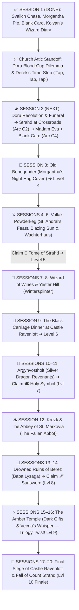

# 🏰 Master DM Screen & Campaign Cheat Sheet — Curse of Strahd (Director's Cut)

> **Quick Glance Reference for the Lead DM**  
> *The 15–20 Session Director's Cut Roadmap, Curated Tarokka Reading, Barovian NPC Directory, Pointy Hat Boss Stat Blocks, World Loot Vault, and Gothic Horror Rules at a glance.*

---

## 🛡️ SECTION 0: PARTY CHARACTER SHEETS & ESCORT VITALS (LEVEL 3 START)

| Slot | Hero / Companion | Class & Level | HP | AC | Init | Key Passive / Resource |
| :--- | :--- | :--- | :--- | :--- | :--- | :--- |
| **PC 1** | 🎭 **Piper ("The Incomparable")** | Level 3 Wild Magic Sorcerer (Fierna Tiefling • Native) | `17/17` | `12 (15)` | `+2` | ✨ `3/3 SP` • 🎲 `Tides` • 💖 `Fierna Charm 0/1` • 🃏 **Blank Tarokka Card** • 💛 `2/2 Help` |
| **PC 2** | 👑 **Jacomir Yulle ("King of Oakenshire")** | Level 3 Battle Master Fighter (Human • Noble) | `31/31` | `17` | `+0` | ⚔️ `4/4 d8` • ☕ `3/3 SW` • 📖 **Kolyan's Wizard Diary** • 🥧 **1x Dream Pastry (Uneaten)** • 💛 `2/2 Help` |
| **PC 3** | 🎯 **Eclipsa "Yvaine" the First** | Level 3 Monster Slayer Ranger (Human • Gunner) | `28/28` | `16` | `+6` | 🔫 *Lament* `+8 (1d12+4)` • 💥 *Mercy & Less* `+8 (1d6+4)` • 👁️ *Hunter's Sense 2/2* • 🎯 *Slayer's Prey (+1d6)* • ⚡ *Alert (+6 Init)* • 💛 `2/2 Help` |
| **Emissary** | ⏳ **Derek ("The Man Between Seconds")** | Avatar / Project Manager of the Dark Powers | `∞` | `--` | `--` | **Froze Time (`Tap, Tap, Tap`) in S1 Church!** Invisible to Strahd • Appears at 3 Future Milestones Only |
| **Companion** | 🌟 **Caelum Jude ("Cael")** | Level 3 Circle of the Stars Druid (Main Companion & Primary Healer) | `38/38` | `14` | `+2` | ✨ Chalice Dual Heals (`1d8+3`) • 🏹 Archer Form (`1d8+3` Rad) • ⚡ Guiding Bolt (`2/2`) • 🐈 Black Cat • 🛡️ *Vow of Dark Powers (Stabilizes at 1 HP)* |
| **Escort** | 🌹 **Ireena Kolyana** | Noble Swordswoman (Tatyana Reborn) | `28/28` | `15` | `+2` | ⚔️ Silvered Rapier `+5 (1d8+2)` • 🛡️ Parry `+2 AC` |
| **Ally** | 🗡️ **Ismark Indirovich** | Veteran Swordsman *(Act I)* | `58/58` | `17` | `+1` | Multiattack: 2x Longsword `+5 (1d10+3)` • ☕ Second Wind |
| **Hunter Ally** | ⚔️ **Ezmerelda d'Avenir** | Independent Vistani Hunter *(Act II–III)* | `82/82` | `17` | `+4` | `+1 Rapier` (`+8, 1d8+5`), 4th-Lvl Wizard Spells, Silvered Prosthetic |

---

## 📜 SECTION 1: THE 15–20 SESSION DIRECTOR'S CUT ROADMAP & TAROKKA ORACLE

### 🔮 1.1 Curated Madam Eva Tarokka Reading (Session 2 — Tser Pool)
*Read aloud **ONLY** the **Madam Eva's Prophecy** quotes—NEVER read the **DM Location Key** aloud!*

1. **📜 First Card — The Tome of Strahd (History of the Devil):**
   * **Card Drawn:** *The Master of Stars (Wizard)* — Black silver-bordered card with an inverted hourglass leaking ink and three golden cat-eyes peering out from a dark pentagram.
   * **Madam Eva's Prophecy *(Read Aloud)*:** *"This card tells of history—truth bled into paper that the Devil wishes ash. I see a walled town where painted smiles freeze over terror, and bells ring on command. Look past the noisy tyrant to a quiet noble door of velvet and cold mourning—where a pale widow sleeps beside the unburied dead and bows in secret to a crimson altar. Behind iron and whispers lies the confession of how a man drowned his blood to buy eternity."*
   * **DM Location Key:** **Wachterhaus in Vallaki (`N4` — Lady Fiona Wachter's Secret Cult Library)** — *Sessions 5–6 (Level 5).*
2. **🕊️ Second Card — The Holy Symbol of Ravenkind (Weapon of Faith):**
   * **Card Drawn:** *The Paladin (Two of Swords / Justiciar)* — Shattered silver breastplate pierced by twin frost-rimed swords beneath a silver wing.
   * **Madam Eva's Prophecy *(Read Aloud)*:** *"This is the weapon of dawn—a sliver of the lost sun waiting for clean hands. Seek a broken fortress of silver wings and shattered oaths perched high above the pines. There waits a dead commander whose rage runs colder than mountain sleet—a knight who hates the Devil so deeply he refuses to grant his enemy the mercy of a grave. Rekindle what was dimmed in the stone dragon's sky, and the ancient symbol of the morning shall fly to your breast."*
   * **DM Location Key:** **Argynvostholt (`Q36/Q53` — Vladimir Horngaard's Sanctum & Silver Beacon)** — *Sessions 10–11 (Level 7). Directly bridges into Campaign 3's Ancient Dragon Lore!*
3. **🗡️ Third Card — The Sunsword (The Blade of Sunlight):**
   * **Card Drawn:** *The Tempter (High Deck)* — Velvet hand extending a root-choked chalice above black bog-water reflecting a severed golden blade hilt.
   * **Madam Eva's Prophecy *(Read Aloud)*:** *"Here lies the blade of pure mercy—a hilt without iron, forged from grief and blinding light. Follow the dying river to a drowned village sunk in black mire, where scarecrows bleed stuffing and no living songbird dares draw breath. At the heart of the bog, a crooked house stalks on living roots beneath a hag who rocks an empty cradle in a giant's skull. Reach beneath her false lullaby and wrench the buried sun from the mud."*
   * **DM Location Key:** **Ruins of Berez (`U3` — Beneath Baba Lysaga's Creeping Walking Hut & illusion crib)** — *Sessions 13–14 (Level 8).*
4. **🧵 Fourth Card — The Hidden Hand (Replaces Fated Ally — Secret Betrayal Omen):**
   * **Card Drawn:** *The Marionette (High Deck)* — Carved wooden marionette slumped on a velvet stool with thin silver strings vanishing into storm clouds and one painted tear on its cheek.
   * **Madam Eva's Prophecy *(Read Aloud — Zero Cael Spoilers!)*:** *"Even in a cage bolted with iron, the hunter uses an open hand from the inside. Look well at the gentle faces that welcome you out of the storm, strangers—for a gilded puppet already walks upon this board. Its strings were knotted in the dark long before your roads crossed the mist, yet its fingers are kind enough to break bread beside your fire... and weep the night it turns the key. Watch every threshold you think is locked, for not every instrument knows the hand that pulls its thread."*
   * **DM True Meaning & Campaign Decoys:** **True Meaning (`Session 20`): Caelum Jude**, weeping as unseen Dark Power strings force him to lock the Barovian Root Anchor! **Built-In Decoys:** Father Donavich hiding Doru, Derek's time-stops, **Milivoj** stealing St. Andral's Bones inside Vallaki (`Session 5` fake-out!), Blinsky dolls, Vasili, Abbot's Vasilka, & Yvaine's Solmere parallel. *(Ezmerelda remains an optional independent hunter in Vallaki/Krezk).*
5. **🏰 Fifth Card — The Final Battlefield (Where Strahd Must Die):**
   * **Card Drawn:** *The Executioner (High Deck)* — Hooded figure atop a lightning-struck gargoyle parapet above a white marble lid marked with two ruby blood drops.
   * **Madam Eva's Prophecy *(Read Aloud)*:** *"And here the Devil waits when the bells cease tolling. I see spires of black stone piercing a lightning-split sky, and far beneath them the cold white marble where a brother's blood first bought four centuries of winter. Find him where his sin and sorrow were crowned—beneath stained glass saints with blind eyes, beside an empty white tomb—and chase him upward into the thunder until only ghosts remain on the cliff."*
   * **DM Location Key:** **Castle Ravenloft — Chapel (`K15`) ➔ Sergei's Crypt (`K85`) & Strahd's Tomb (`K86`) ➔ Overlook (`K6`)** — *Sessions 19–20.*
6. **🃏 Sixth Card — Piper's Blank Tarokka Card (The 3-Stage Living Omen — Option 2):**
   * **Origin:** Handed to Piper by a deeply concerned Vistani at *Blood on the Vine Tavern* in Session 1 after the painted ink faded off the card in her hand.
   * **Madam Eva's Reaction *(Read Aloud — No Direct Lore-Dump!)*:** Eva touches the blank parchment and pulls her hand back as if burned by ice: *"Four hundred years I have read these cards, child, and never has the fog stood between my eyes and a traveler's road. No ink of Strahd rests here. Something walks in the silence behind you—something older than the Devil's crown, hiding your ending even from Mother Night. Keep this blank parchment against your heart. Every time you step closer to what woke the wild fire in your blood, the ink will bleed upward on its own. Pray you do not recognize the picture when it finishes drawing itself."*
   * **3-Stage Progressive Mist Bleed (Zero Tiefling/Monolith Spoilers):**
     * **Stage 1 (Session 2 — Tser Pool):** Bottom third fills with charcoal ink — *dead pine trees and a pair of empty, upturned palms rising out of black water*.
     * **Stage 2 (Mid-Campaign — Vallaki / Berez):** Middle third bleeds in — *a cracked, faceless brass lantern / pocket watch suspended in midair with threads of silver-gray fog curling into its cracks*.
     * **Stage 3 (Act IV — Amber Temple / Ravenloft):** Top third fills in — *a violent vortex of endless gray Mist pouring inward into the cracked glass, with a faint, unblinking shadow-grin in the smoke above*.

---

### 🗺️ 1.5 Campaign Biomes, Dungeons & Locations Explorer (17 Unbundled Locations Across Acts I–IV)

| # | Act & Session | Location / Dungeon & Book Key | Key Encounters, Room Keys & Hazards | Key Loot & Milestone Rewards |
| :--- | :--- | :--- | :--- | :--- |
| **1** | **Act I • S1** | 🌲 **Old Svalich Road & Gates of Barovia** (`Ch. 2, Areas A & B`) | Choking Mists (`CON DC 12`), headless gates (`B`), corpse letter (`B1`), Dire Wolf pack chase (`S1 Done`) | 🗡️ **Silvered Shortsword**, `8 GP` (`S1 Done`) |
| **2** | **Act I • S1–S2** | 🏚️ **Village of Barovia, Manor & Church Attic** (`Ch. 3, Areas E1–E5`) | Bildrath (`E1`), Blood on the Vine (`E2`), Mad Mary (`E3`), Indirovich Manor (`E4`), **Doru in Church Attic (`E5` — S1/S2 Cliffhanger!)** | 📖 **Kolyan's Wizard Diary**, 🃏 **Blank Tarokka Card**, `2x Holy Water` |
| **3** | **Act I • S2** | ⚖️ **River Ivlis Crossroads & Tser Falls** (`Ch. 2, Areas F & H` / *Reloaded Arc C2*) | Gallows Illusion (`Area F`), **First Face-to-Face with Count Strahd (`Arc C2`)**, **Tser Falls Bridge & Derek's 1st Milestone** | 👑 **Strahd's Formal Dinner Invitation**, 💧 Running Water rule (`20 Acid`) |
| **4** | **Act I • S2** | 🔮 **Tser Pool Vistani Camp** (`Ch. 2, Area G` / *Reloaded Arc C4*) | Safe Long Rest camp, Vistani silver trade, **Madam Eva's 5-Card Tarokka Reading + Piper's 6th Blank Card (Stage 1 Bleed)** | 🩸 **Vistani Bloodwell Vial `+1` (Piper)**, 🧪 Potions, Silvered Ammo |
| **5** | **Act I • S3** | 🥧 **Old Bonegrinder Windmill & Megaliths** (`Ch. 6, Areas O1–O4`) | **Morgantha, Bella & Offalia (Night Hag Coven)**, Caged Children (`O3`), *Bone-Flour Combustion Cloud*, Four Seasons Megaliths (`O4`) | 🧿 **Night Hag Heartstone**, 🌿 **Elixir of Youth**, `3x Spell Scrolls` (**Level 4!**) |
| **6** | **Act II • S4 & S6** | ⚔️ **Town of Vallaki & Blue Water Inn** (`Ch. 5, Areas N2, N3, N7, N8, N9`) | **Blue Water Inn (`N2` — Kolyan's Diary unlocks Keepers!)**, Rictavio's Tiger Wagon (`N2r`), Baron's Mansion & Victor's Attic (`N3t`), Blinsky's (`N7`), Vistani & Dusk Elf Camp (`N9`) | 🐾 **Gray Bag of Tricks**, 🪄 **Victor's Wand**, 🎭 **Hat of Disguise**, 🎯 **Silver Scope (Yvaine)** |
| **7** | **Act II • S5–S6** | ⚰️ **St. Andral's Church, Henrik's Coffin Shop & Wachterhaus** (`Ch. 5, Areas N1, N4, N6`) | **Henrik's Coffin Shop (`N6` — 6 Vampire Spawn + Bride Anastrasya Ambush!)**, St. Andral's Bones Relay (`N1`), **Wachterhaus Cult Cellar (`N4`)** | 📜 **The Tome of Strahd (Tarokka #1 — Level 5!)**, 🦴 **Bones of St. Andral**, 🔥 **Izek's Battleaxe `+1`** |
| **8** | **Act II • S7** | 🍷 **The Wizard of Wines Winery** (`Ch. 12, Areas W1–W20`) | 24 Twig Blights, 6 Needle Blights, 2 Vine Blights, 3 Poisoned Vats (`W9`), **Chief Druid (`W14`) — Snapping the Gulthias Staff kills all Blights within 300 ft!** | 🌿 **The Gulthias Staff**, 🧥 **Wereraven Cloak of Protection `+1`**, 🍷 Vintage Casks |
| **9** | **Act II • S8** | ⛰️ **Yester Hill, Kavan's Cairn & The Gulthias Tree** (`Ch. 14, Areas Y1–Y4`) | Megalith Ring (`Y1`), Wall of Fog (`Y2` — Strahd on Beucephalus), **50-Ft Wintersplinter Ritual**, **Kavan's Cairn (`Y4`)**, **The Gulthias Tree (`Y3`)** | 🩸 **`+2` Blood Spear of Kavan (Jacomir!)**, 🪓 **Treebane Greataxe**, 💚 **1st Winery Life-Gem** |
| **10** | **Act II • S9** | 🍽️ **Castle Ravenloft (Act II Black Carriage Dinner & Heist)** (`Ch. 4, Areas K1–K67`) | **Dining Hall (`K10`)** social chess with Strahd & Brides, Consort Escher (`K42` — reveals Heart of Sorrow), Chapel (`K15`), **Hall of Bones (`K67`)** | 🐉 **Skull of Argynvost**, ☀️ **Icon of Ravenloft**, 🪕 **Mac-Fuirmidh Cittern** (**Level 6!**) |
| **11** | **Act III • S10** | 🐉 **Argynvostholt (Ruined Mansion of the Silver Wyrm)** (`Ch. 7, Areas Q1–Q53`) | **Vladimir Horngaard (`Q36`)** vs. **Sir Godfrey (`Q13`)**, Ancient Star-Mural (Campaign 3 Bridge), **Lighting the Silver Beacon (`Q53`)** | 🕊️ **Holy Symbol of Ravenkind (Tarokka #2!)**, 🐉 **Beacon Boon (`+1 AC & Saves` Party-Wide!)**, ⚔️ **Greatsword `+2`** (**Level 7!**) |
| **12** | **Act III • S12** | ⛪ **Village of Krezk & The Abbey of St. Markovia** (`Ch. 8, Areas S1–S24`) | **Pool of the White Sun (`S4` — Sergei's spirit & Strahd's lightning)**, **The Fallen Abbot (`CR 10 Deva`)**, **Vasilka the Flesh Golem**, Mongrelfolk | ⚔️ **Ezmerelda Joins!**, 🦴 **St. Markovia's Thighbone**, 💚 **Ring of Regeneration**, 📜 **Scroll of Heroes' Feast** |
| **13** | **Act III • S13–S14** | 🌊 **The Drowned Ruins of Berez (Marina's Marsh)** (`Ch. 10, Areas U1–U7`) | Ulrich's Ghost (`U2`), Marina's Monument (`U5`), Scarecrow Marsh, **Baba Lysaga (`CR 11` in Flying Skull) & 140-HP Creeping Walking Hut (`U3`)** | 🗡️ **The Sunsword (Tarokka #3 — Level 8!)**, 🍀 **Luckstone (`+1`)**, 🧪 **Oil of Sharpness (`+3`)**, 📜 **Scroll of Revivify** |
| **14** | **Act III • S11** | 🗼 **Van Richten's Tower, Lake Baratok & Werewolf Den** (`Ch. 11 & 15, Areas V & Z`) | **8th-Lvl Antimagic Field**, Stick-Figure Door Dance (`V2`), Clay Golem (`V4`), **The Mad Mage (`Mordenkainen`)**, **Werewolf Den (`Z1–Z8`: Kiril vs. Emil/Zuleika)** | 💥 **Ezmerelda's Wagon Cache**, ⚡ **Mad Mage's Charm of Heroism**, 🏆 **Shrine of Mother Night Hoard (`Z7`)** |
| **15** | **Act IV • S15** | ❄️ **Tsolenka Pass & The Balinok Mountain Gatehouse** (`Ch. 9, Areas T1–T9`) | Extreme Cold (`CON DC 10`), **Wall of Green Fire (`T2` — `8d6` fire)**, 2 Vrock Statues (`T3`), **Sangzor the Giant Goat**, **The Roc of Mount Ghakis (`CR 11`)** | 🧥 **Bloodhorn's Mountain Pelt**, 🤍 **Silvered Spear**, 💎 Guard Tower Chest (`T6`) |
| **16** | **Act IV • S15–S16** | ⚡ **The Amber Temple (Vault of the Dark Powers)** (`Ch. 13, Areas X1–X42`) | **Neferon the Arcanaloth (`X5`)**, Amber Golem, **Amnesiac Lich Exethanter (`X27` — *Greater Restoration* opens PHB Library `X30`)**, **20+ Amber Sarcophagi & West Vault (`X42`)** | ❄️ **Staff of Frost**, 📖 **Tome of Understanding (`+2 WIS`)**, ⚡ **3 PCs' Supreme Dark Gifts (+30 Max HP & 9th-Lvl Boons — Level 9!)** |
| **17** | **Act IV • S17–S20** | 👑 **Castle Ravenloft (Final Siege, Heart & Catacombs)** (`Ch. 4, Areas K20, K41, K6, K78, K84–K88`) | **Shatter Heart of Sorrow (`K20`)**, Treasury (`K41`), Brazier Room (`K78`), **Final Showdown at The Overlook (`K6`)**, **Rahadin & Catacombs (`K84–K86`)**, **Cael's S20 Root Anchor Ritual** | ⚡ **Khazan's Staff of Power (`+2 AC/Saves/Hit`, Crypt 15!)**, 👑 **Helm of Brilliance (`K41`)**, 🃏 **Deck of Illusions (Crypt 9)** (**Level 10 Finale!**) |

---

## 👥 SECTION 2: MASTER BAROVIAN NPC DIRECTORY (5-COLUMN FORMAT)

| NPC Name & Condition | Live Status | Role & Location | Key Offerings, Services, Quests & Advice | 🎭 Voice & Roleplay Cue |
| :--- | :--- | :--- | :--- | :--- |
| ⏳ **Derek ("Man Between Seconds")** `[Avatar of the Dark Powers]` | 🟢 Met & Active | Time-Stopping Emissary • Frozen Moments | Froze time (`tap, tap, tap`) in S1 Church! Promised Jacomir & Yvaine a way home if they kill Strahd; told Piper to *"take care of herself."* **Strahd cannot perceive him!** | Calm, modernly sharp, transactional: *"I'm the only one giving you a straight deal: kill the vampire, and go home."* |
| 🌟 **Caelum Jude ("Cael")** `[The Scion / Inside Shepherd]` | 🟢 Met & Active | Primary Healer & Companion • Barovia | **Starry Chalice dual-heals 1d8+3**, free Guiding Bolts, Goodberries, scout. *Stabilizes at 1 HP (Plot Armor).* Shrinks in silent terror when Derek freezes time! | Earnest, self-deprecating Percy Jackson warmth: *"I don't want to die out here alone. Let me walk with you."* |
| 👑 **Count Strahd von Zarovich** `[Darklord of Barovia]` | 🟢 Active Overlord | Supreme Ruler • Castle Ravenloft | **First Face-to-Face in Session 2 (`Reloaded Arc C2: River Ivlis Crossroads`)**! Unaware of Derek's time-stops; seeks Ireena & tests the heroes. | Deep aristocratic velvet baritone: *"I am the Ancient. I am the Land."* |
| 🌹 **Ireena Kolyana** `[Twice-Bitten / Tatyana]` | 🟢 Met & Active | Escort Heroine • In Barovia Church | Fights alongside party (**AC 15, 28 HP**, Silvered Rapier `+5`, Parry `+2 AC`). Currently neutral in the Doru attic standoff. | Fierce sleepless noble resolve: *"Give me a blade and tell me where to stand."* |
| 🗡️ **Ismark 'The Lesser' Indirovich** `[New Burgomaster]` | 🟢 Met & Active | Frontline Defender • In Barovia Church | Empathizes with Father Donavich alongside Jacomir in the church attic standoff. AC 17, 58 HP. | Exhausted gravelly baritone: *"They call me the Lesser... but I will die holding the line."* |
| ⛪ **Father Donavich & Doru** `[Priest & Son in Church Attic]` | 🟢 Met & Active | Village Priest • Barovia Church Attic | **Active S1/S2 Cliffhanger:** Doru is hidden in the **church attic**! Jacomir is pouring his own blood into a cup to feed Doru (`Reloaded` lucidity mechanic), while Piper & Yvaine want to kill Doru! | Hoarse weeping prayers: *"He's still my boy! Just one cup of blood to calm his mind!"* |
| 🔮 **Madam Eva** `[Ancient Vistani Seer]` | 🟡 Unmet | Tarokka Oracle • Tser Pool Camp | **5-Card Tarokka Reading + Piper's Blank 6th Card**; safe Long Rest camp; Vistani silver weapon trade. | Ancient woodsmoke-thick voice: *"The cards have waited centuries for your hands."* |
| 🎭 **Bride Volenta Popofsky** `[Porcelain Skull-Mask]` | 🟡 Active Hunter | Youngest Bride • Castle Ravenloft | Stalks Ireena; drops Bone Dagger +1 & Porcelain Skull-Mask Charm (False Life). | High-pitched unhinged giggling: *"Little sister Ireena! Come out and play!"* |
| 🍷 **Bride Anastrasya Karelova** `[Vallaki Feast Conspirator]` | 🟡 Active Hunter | Middle Bride • Vallaki / Ravenloft | Commands **Feast of St. Andral** spawn raid (`Area N6`); carries **Gilded Razor Fan +1**. | Haughty velvet condescension: *"Wooden stakes keep out beggars, darling—not the Count's court."* |
| 📜 **Bride Ludmilla Vilisevic** `[Eldest Archmage Consort]` | 🟡 Active Strategist | Eldest Bride • Ravenloft / Ghakis | Werewolf pack schism architect (chained Emil); guards **Amber-Inlaid Spell Ring +1**. | Clinical frost-cold scholar: *"Panic is an arithmetic error you may not afford."* |
| 🥧 **Morgantha ('Granny')** `[Night Hag Matron]` | 🟢 Met & Wary | Coven Leader • Old Bonegrinder | **Met in S1:** Resisted Piper's *Charm Person* (semi-hostile/wary of Piper) & gifted **1x Dream Pastry to Jacomir** (uneaten). | Sweet grandmotherly cackle hiding iron malice: *"Just one warm pie, dearies!"* |
| 🦅 **Urwin & Danika Martikov** `[Keepers of the Feather]` | 🟡 Unmet | Wereraven Allies • Blue Water Inn (Vallaki `N2`) | **Named in Burgomaster Kolyan's Wizard Diary (looted in S1)!** Run Blue Water Inn; estranged from Urwin's father **Davian**. | Warm observant hospitality: *"A hot bowl of wolf-steak stew and a locked door—on the house for old Kolyan's true allies."* |
| 🦅 **Davian Martikov** `[Keepers Patriarch • Winery]` | 🟡 Unmet | Wereraven Patriarch • Old Friend of Kolyan Indirovich | **Key Secrecy Lead:** Keepers fiercely guard their secret, but showing **Kolyan's Wizard Diary** or naming Kolyan's friendship opens Davian's trust & aid (`Vallaki / Winery Ch. 12`). | Gruff skepticism thawing at Kolyan's name: *"You carry Kolyan Indirovich's own writing? Lower your voices and step behind the barrels."* |
| ☀️ **Baron Vargas Vallakovich** `[Paranoid Mayor]` | 🟡 Unmet | Burgomaster • Vallaki | Town authority & shelter if party praises his festivals; enforcer Izek Strazni. | Manic booming forced cheer: *"ALL WILL BE WELL!"* |
| 🕯️ **Lady Fiona Wachter** `[Cult Leader]` | 🟡 Unmet | Strahd Loyalist • Wachterhaus | Shelters **The Tome of Strahd**; seeks to overthrow the Baron; cultists. | Cold calculating aristocratic poise: *"Strahd is not a monster. He is a lord."* |
| ⚔️ **Ezmerelda d'Avenir** `[Independent Hunter]` | 🟡 Unmet | Vistani Vampire Hunter • Act II–III | Swashbuckling hunter (AC 17, HP 82, Rapier +8, 4th-level Wizard spells). | Swashbuckling confidence: *"I don't need a prophecy to tell me how to kill a vampire."* |
| 📜 **Rudolph van Richten** `[Monster Scholar / "Rictavio"]` | 🟡 Unmet | Disguised Bard • Blue Water Inn | Legendary vampire hunter; Saber-Toothed Tiger; expert monster tactics. | Scholarly dry wit under a colorful bard disguise. |
| 🐉 **Vladimir Horngaard** `[Revenant Commander]` | 🟡 Unmet | Dragon Knight Leader • Argynvostholt | Guards **The Holy Symbol of Ravenkind**; undead dragon knight order. | Hateful hollow spectral rasp: *"Strahd must suffer eternally in his cage."* |
| 🛡️ **Sir Godfrey Gwilym** `[Revenant Paladin]` | 🟡 Unmet | Order Paladin • Argynvostholt (`Q37`) | 136 HP, 16th-Lvl Paladin Smites (`L1–L4`); begs heroes to restore Argynvost's Beacon. | Sorrowful chivalry: *"Burn away the fog—let us rest in peace."* |
| 🪽 **The Abbot & Vasilka** `[Corrupted Deva]` | 🟡 Unmet | Angelic Surgeon • Krezk Abbey (`S13`) | 3x free *Raise Dead* / *Greater Restoration* if given **Lydia's Bridal Gown**; guards Abbey Treasury. | Serene celestial madness: *"I have sewn him an undying flesh bride!"* |
| 💀 **Baba Lysaga** `[Swamp Witch]` | 🟡 Unmet | Mother of Night • Ruins of Berez | Guards **The Sunsword**; pilots the Creeping Walking Hut; 8th-level spells. | Screeching maternal madness claiming Strahd as her stolen infant son. |
| 🔨 **Parriwimple** `[Bildrath's Nephew]` | 🟡 Unmet | Strong-Hearted Enforcer • Barovia Store (`E1`) | 112 HP Gladiator (Str 18, 3x Maul `+7`); potential bodyguard if freed from Bildrath's gouging. | Gentle booming rumble: *"Uncle Bildrath says don't touch the shiny pots unless you got ten gold."* |
| 😢 **Mad Mary** `[Grieving Mother]` | 🟡 Unmet | Townhouse (`E3`) • Gertruda Quest | Gives Blinsky's *Is No Fun, Is No Blinsky!* doll pointing toward missing daughter Gertruda inside Ravenloft (`K42`). | Broken weeping whisper: *"She just wanted to see the pretty wolves outside..."* |
| ✝️ **Father Lucian Petrovich** `[St. Andral High Priest]` | 🟡 Unmet | St. Andral's Church • Vallaki (`N1`) | 5th-Lvl Cleric (`Dispel Magic, Spirit Guardians`); begs rescue of **St. Andral's Bones** before Feast ambush. | Quiet urgency: *"The Saint's bones are gone—and Vallaki's only wall against the night died with them!"* |
| ⚡ **Victor Vallakovich** `[Attic Prodigy Mage]` | 🟡 Unmet | Baron's Mansion Attic (`N3t`) • Vallaki | CR 6 Mage + Attic Spellbook (24 spells, *Cone of Cold, Cloudkill*); broke Stella Wachter's sanity. | Snapping arrogance: *"Don't touch the chalk circle! Another inch and I escape this cellar!"* |
| 🧸 **Gadof Blinsky & Piccolo** `[Vallaki Toymaker]` | 🟡 Unmet | Is No Fun, Is No Blinsky! (`N7`) | Reveals Izek commissioned **Ireena Dolls** + watches Rictavio's monkey Piccolo; Pidlwick II lead. | Gleeful thick accent: *"Is No Fun, Is No Blinsky!"* |
| 🗡️ **Arrigal** `[Vistani Assassin]` | 🟡 Unmet | Strahd's Spymaster • Vallaki Camp (`N9`) | CR 8 Assassin (`+4d6 Sneak + 7d6 Venom`); guards Treasure Wagon (`N9i`: *Oil of Sharpness, Revivify*). | Silken threat: *"Coins weigh lighter than regret, friends."* |
| 🧝 **Kasimir Velikov** `[Dusk Elf Elder Mage]` | 🟡 Unmet | Hovel Outside Vallaki (`N9a`) | CR 6 Mage, *Ring of Warmth*, Mount Ghakis & Amber Temple Guide (hopes to resurrect Patrina). | Haunted silver whisper: *"Help me enter the Amber Temple—or my sister stays damned forever."* |
| 🐺 **Zuleika Toranescu** `[Rebel Werewolf]` | 🟡 Unmet | Shrine of Mother Night (`Z7`) | Rebel packkeeper allying against Kiril if heroes free mate **Emil Toranescu** from Ravenloft Dungeon! | Low fierce growl: *"Bring my husband Emil home—and the pack shreds Kiril for you!"* |
| 🧙 **Mordenkainen** `[Mad Mage of Baratok]` | 🟡 Unmet | Lake Baratok Hills (`CR 12` Archmage) | Restoring him w/ *Greater Restoration* unlocks *Magnificent Mansion*, *Time Stop*, & *Charm of Heroism*! | Roaring lightning when paranoid; grand wizardly poise once cured. |
| 🎻 **Escher** `[Fading Dhampir-Consort]` | 🟡 Unmet | Castle Ravenloft Lounge (`K49`) | Warns heroes of Bride ambushes, castle stairs, *Doss Lute*, & *Heart of Sorrow* so Strahd falls before sealing him. | Sardonic court wit: *"Pray Strahd doesn't tire of you as swiftly as he bored of me..."* |
| 💀 **Rahadin** `[Dusk Elf Chamberlain]` | 🟡 Unmet | Castle Ravenloft (`CR 10` Boss) | Strahd's cold enforcer (`3x Scimitar +10`, *Deathly Choir 3d10*); delivers Black Carriage Dinner invitation. | Whisper-soft dread: *"His Lordship expects clean boots at the supper table."* |
| 🔥 **Izek Strazni** `[Vallaki Fiend-Arm Captain]` | 🟡 Unmet | Burgomaster's Mansion (`N3`) • Vallaki | Fiend-armed brute (`CR 5`, **Hurl Flame `3d6`**, Battleaxe `+1`) secretly obsessed with Ireena dolls commissioned from Blinsky (`N7`). | Smoldering growl: *"Baron's word is law—put the weapon down or I roast you right on the cobbles."* |
| 🐺 **Kiril Stoyanovich** `[Ruthless Werewolf Alpha]` | 🟡 Unmet | Werewolf Den (`Z5`) & Svalich Woods | Usurper pack alpha (`CR 3`, Silvered Spear / Hybrid claws) enforcing child abductions and hunting Rictavio's allies. | Snarling arrogance: *"The Devil gave us this forest—and weak blood feeds the strong!"* |
| 🦊 **Neferon ("Heinrich Stolt")** `[Amber Temple Arcanaloth]` | 🟡 Unmet | Amber Temple Statue (`X5a`) • Mount Ghakis | Fiendish trickster posing as kindly bald scholar "Heinrich" before unleashing `16th-Lvl` spells (*Chain Lightning, Finger of Death*) through statue eyes. | Honeyed false warmth: *"Ah, travelers! Come closer to the warm brazier—I am just a harmless old scholar..."* |
| 💀 **Exethanter** `[Amnesiac Archlich]` | 🟡 Unmet | Amber Temple Sanctum (`X27`) • Mount Ghakis | Skeletal archlich (`CR 21`) shattered by memory loss (`Greater Restoration` restores L1–9 spells & grants all library/vestige passwords). | Whispering courtesy: *"Do forgive an old scholar's foggy mind... did we know each other centuries ago?"* |

> 💡 **Interactive 3-Tab NPC Windows in `DM_SCREEN.html`:** Clicking ANY of the 37 NPCs (filterable across 7 Barovian regions including `🏔️ Tsolenka Pass & Amber Temple`) opens their Character-First 3-Tab Modal (**Stats + Live HP Steppers on top**, **📍 Where & When Met**, **⚔️ Further Combat: Enemy & Boss Sheet ➔** + Faction Lore & Location buttons, **Tab 1: Character, Dilemma, Secrets & Clickable Gear Links w/ `← Back`**, **Tab 2: Combat, Actions & Full 5e Spellbooks**, **Tab 3: Expandable Lore, History & Background Accordions**).

---

## 💀 SECTION 3: MASTER ENEMY FAST REFERENCE & BOSS STAT CARDS

### 🐺 3.1 Master Campaign Enemy Roster (8 Standard Mobs + 17 Bosses — Openable in `DM_SCREEN.html`)

| Act / Category | Enemy Name & Role | CR | Init | HP | AC | Speed | ⚔️ Weapons & Style | Special Mechanics / Battlefield Actions |
| :--- | :--- | :--- | :--- | :--- | :--- | :--- | :--- | :--- |
| **💀 Standard Mobs (All Acts)** | 🗡️ **Classic Barovian Bandit** *(Highway Mob)* | 1/8 *(Capt 2)* | `+1` | **`11`** *(65 Capt)* | 12 *(15)* | 30 ft | Scimitar, Light Crossbow | Optional **Bandit Captain** toggle (`3x Atk + Parry +2 AC`) |
| | 🧙‍♀️ **Barovian Witch** *(Caster Mob)* | 1/2 | `+0` | **`16`** | 10 | 30 ft | Wizard Spells, Dagger, Claws | **3rd-Lvl Wizard (DC 12 / `+4`)**: *Sleep, Tasha's Laughter, Invisibility, Alter Self* |
| | 🐺 **Svalich Dire Wolf** *(Woods Pack)* | 1 | `+2` | **`37`** | 14 | 50 ft | Bite, Pack Tactics | `DC 13 STR` Prone • Advantage when allied wolf within 5 ft *(Normal Wolf: `11 HP`, AC 13)* |
| | 💀 **Barovian Ghoul** *(Crypt Prowler)* | 1 | `+2` | **`22`** | 12 | 30 ft | Bite, Paralyzing Claws | `DC 10 CON` vs Paralysis 1 min *(Elves & Undead immune!)* |
| | 🧟 **Strahd Zombie** *(Cemetery Mob)* | 1 | `-2` | **`34`** | 8 | 20 ft | Bite, Claws, Severing Limbs | **Loathsome Limbs:** 5+ slashing/bludg severs limbs that keep attacking! |
| | 🦅 **Wereraven** *(Keeper Scout)* | 2 | `+2` | **`31`** | 12 | 30 / Fly 50 | Beak, Shortsword, Crossbow | Non-silvered B/P/S Immunity (or VRGtR Regen 10) • Lycanthropy `DC 10 CON` |
| | 🩸 **Vampire Spawn** *(Night Thrall)* | 5 | `+3` | **`82`** | 15 | 30 / Climb 30 | Claws, Bite, Spider Climb | **Regen 10 HP/turn** • Grapple DC 13 + Necrotic Drain • Standard CoS Mob |
| | 🛡️ **Strahd's Animated Armor** *(Construct Sentry)* | 6 | `+1` | **`112`** | 21 | 30 ft | Lightning Greatsword, Shocking Bolt | False Appearance • Antimagic Susceptibility (`DC 15 CON` vs *Dispel*) |
| **⛪ Act I–II: Woods Alpha, Church & Bonegrinder** | 🐺 **Svalich Alpha Dire Wolf** *(Pack Alpha)* | 1 | `+2` | **`37`** | 15 | 50 ft | Bite, Roof Claws, Howl | **Splintering Roof Breach** • **Terrifying Howl** (Recharge 5–6) |
| | 🩸 **Doru (The Starving Son)** *(Undercroft Boss)* | 5 | `+3` | **`85`** | 15 | 30 / Climb 30 | Claws, Vampire Bite, Spider Climb | Hidden in Church Attic • Blood cup lucidity hook reveals Mad Mage & Heart |
| | 🎭 **Bride Volenta Popofsky** *(Porcelain Bride)* | 5 | `+4` | **`95`** | 16 | 35 / Climb 35 | Twin Daggers, Bite, Mask Shriek | **2 Battlefield Actions:** *Corpse-Puppet Strings* & *Skull-Mask Shriek* |
| | 🥧 **Morgantha ('Granny') & Coven** *(Old Bonegrinder)* | 5 *(7 Coven)* | `+2` | **`112`** | 17 | 30 ft | Claws, Nightmare & Coven Spells | **5 Innate + 12 Coven Spells (`DC 15 / +7`)** • **2 Battlefield Actions (`4d10`)** |
| **⚔️ Act II–III: Vallaki, Winery & Berez** | 🍷 **Bride Anastrasya Karelova** *(Vallaki Feast Bride)* | 5 | `+3` | **`82`** | 15 | 30 / Climb 30 | Claws, Bite, Razor Fan | Noble Court Ambush • **2 Battlefield Actions (`3d10`)** |
| | 🔥 **Izek Strazni** *(Vallaki Captain)* | 5 | `+2` | **`102`** *(RAW `112`)* | 14 | 30 ft | Brute Battleaxe, Fiendish Flame | RAW HP toggle • **2 Battlefield Actions (`3d10`–`4d10`)** |
| | 🐺 **Kiril Stoyanovich** *(Werewolf Alpha)* | 3 | `+1` | **`90`** | 12 | 30 / 40 Wolf | Bite, Claws, Pack Spear | Non-Silver Weapon Immunity • Pack Challenge • **1 Battlefield Action** |
| | 🌲 **Wintersplinter** *(Yester Hill Colossus)* | 7 | `+0` | **`138`** *(RAW `149`)* | 15 | 30 ft | Branches, Grasping Roots, Bite | RAW HP toggle • **3 Battlefield Actions (`3d10`–`5d10` + Gem Heal)** |
| | 🐉 **Vladimir Horngaard** *(Revenant Commander)* | 7 | `+2` | **`145`** *(RAW `136`)* | 17 | 30 ft | Silvered Greatsword, Vengeful Glare | RAW HP toggle • **3 Battlefield Actions (`3d10`–`5d10`)** |
| | 🕊️ **The Abbot & Vasilka** *(Deva + Flesh Golem)* | 10 + 5 | `+4` | **`136` + `93`** | 17 / 9 | 30 / Fly 90 | Celestial Mace, Angelic & Golem Slams | Dual HP Tracker + Change Shape • **3 Battlefield Actions (`5d10`–`7d10`)** |
| | 💀 **Baba Lysaga & Creeping Hut** *(16th-Lvl Archwitch)* | 11 + 11 | `+0` | **`120` + `140`** *(RAW `263`)* | 15 *(20 Skull)* | Fly 40 / Hut 30 | Archwitch Spells, Walking Hut | **26 Spells (`DC 17 / +9`)** + Skull Cover + Dual Hut • **3 Battlefield Actions** |
| **🏰 Act IV: Tsolenka, Amber Temple & Ravenloft** | 🦅 **The Roc of Mount Ghakis** *(Tsolenka Titan)* | 11 | `+0` | **`165`** *(RAW `248`)* | 15 | 20 / Fly 120 | Giant Beak, Snatching Talons | RAW HP toggle • **3 Battlefield Actions (`5d10`–`8d10` + 120-Ft Drop)** |
| | 🦊 **Neferon** *(Amber Temple Mage)* | 12 | `+1` | **`104`** | 17 | 30 / Fly 30 | Wizard Spells, Poison Claws | **20 Spells + 5 Innate (`DC 17 / +9`)** • **3 Battlefield Actions (`6d10`–`8d10`)** |
| | 💀 **Exethanter** *(Amber Archlich)* | 21 | `+3` | **`99`** *(RAW `135`)* | 17 | 30 ft | Archlich Spells, Paralyzing Touch | **26 Spells L1–9 (`DC 20 / +12`)** + 3 Leg. • **3 Battlefield Actions** |
| | 📜 **Bride Ludmilla Vilisevic** *(Eldest Consort)* | 5+ | `+3` | **`82`** | 15 | 30 / Climb 30 | Claws, Bite, Wizard Spells | Optional Consort Spells (`DC 15 / +7`) • **2 Battlefield Actions (`3d10`–`4d10`)** |
| | 🗡️ **Rahadin, Dusk Elf Chamberlain** *(Executioner)* | 10 | `+6` | **`142`** *(RAW `135`)* | 18 | 35 ft | Scimitars, Poison Darts, Choir | Deathly Choir + 4 Innate Spells • **3 Battlefield Actions (`6d10`)** |
| | 👑 **Count Strahd von Zarovich** *(Apex Darklord)* | 15 | `+4` | **`144` + `50` Heart** | 16 / 15 | 30 / Spider | Claws, Bite, Wizard Spells & Lair | Dual Heart Tracker • **3 Leg Resist / 3 Leg Actions / 3 Lair / 4 Battlefield Actions** |

> 💡 **Interactive Monster & Boss Modals in `DM_SCREEN.html`:** Click any of the **25 enemy cards** (including the **💀 Standard Mobs (All Acts)** filter for reusable Bandit, Barovian Witch, Dire Wolf, Ghoul, Strahd Zombie, Wereraven, Vampire Spawn, and Animated Armor sheets) to open the interactive dossier with clickable 5e spells, slot pips, Captain variant toggles, attack/crit math, Tactics & Loot, and Section 4 Vault links.

---

> *(Note: Session 1's Act I Climax Indirovich Manor solo boss was retired upon finishing Indirovich Manor; standard reusable **Vampire Spawn** (`CR 5`) now sits cleanly inside Section 3.1's Standard Mobs roster.)*
---

## 🎒 SECTION 4: COMPLETE BAROVIAN WORLD LOOT VAULT, OFFICIAL MODULE TREASURES & POSSIBLE LOOTS (91 ITEMS)

> **Sources Cross-Referenced:** Official *Curse of Strahd* 5e Module PDF (`Chapters 2–15`), **[DragnaCarta's *Curse of Strahd: Reloaded*](https://github.com/DragnaCarta/Curse-of-Strahd-Reloaded)** artifact reworks, Session 1 Table Canon, and Possible Character-Tailored Upgrades for **Piper**, **King Jacomir**, **Yvaine**, and **Cael**.

---

### 🎯 4.0 Quick-Finder: Best Loot & Possible Upgrades by Hero & Act

| Hero / Role | Act I (Sessions 1–3) | Act II (Sessions 4–9: Vallaki & Winery) | Act III (Sessions 10–14: Argynvost, Krezk & Berez) | Act IV (Sessions 15–20: Amber Temple & Ravenloft) |
| :--- | :--- | :--- | :--- | :--- |
| 🎭 **Piper** *(Wild Magic Sorcerer)* | • 🃏 **Blank Tarokka Card** *(Claimed S1)* • 🩸 **Vistani Bloodwell Vial (+1)** *(Possible: Tser Pool Wagon S2)* • 💀 **Volenta's Skull-Mask Charm** *(False Life)* | • 🪄 **Victor's Wand of Lightning / Wonder** *(Baron's Attic `N3t`)* • 🎭 **Hat of Disguise** *(Rictavio's Wagon `N2r`)* • 🧥 **Wereraven Feather Cloak (+1 AC/Saves & Glide)** | • 🍀 **Stone of Good Luck (+1 Checks & Saves)** *(Berez Hut `U3`)* • 🎶 **Pipes of Haunting** *(Berez `U3`)* • 🐉 **Silver Dragon Beacon (+1 AC & Saves)** | • ⚡ **Khazan's Staff of Power (+2 AC/Saves/Spell Atk)** *(Crypt 15 `K84`)* • ❄️ **Staff of Frost** *(Amber Temple `X17`)* • 🃏 **Deck of Illusions** *(Crypt 9)* • 🟣 **Supreme Gift of Vecna (+2 CHA)** |
| 👑 **King Jacomir** *(Battle Master Fighter)* | • 📖 **Kolyan's Wizard Diary** *(Claimed S1)* • 🥧 **1x Dream Pastry** *(Claimed S1)* • ⚔️ **Silvered Greatsword Coating** *(Ismark/Vistani)* | • 🩸 **The Blood Spear of Kavan (+2 Spear, +2d6 Temp HP on kill)** *(Yester Hill `Y4`)* • 🔥 **Izek's Hellfire Battleaxe +1 (+1d6 Fire)** *(Vallaki S6)* | • 🗡️ **Vladimir's +2 Silvered Dragon Greatsword (+1d6 Frost/Rad)** *(Argynvostholt `Q36`)* • 🗡️ **The Sunsword (+2 Radiant Sun Blade)** *(Berez `U3`)* • 🛡️ **Silvered Dragonplate +1 (AC 19/20)** | • 🛡️ **+2 Shield of the Silver Wyrm** *(Treasury `K41`)* • 👑 **Helm of Brilliance** *(Treasury `K41`)* • 🩸 **Supreme Gift of Vampyr (+20 Max HP & Vampiric Crits)** |
| 🎯 **Yvaine** *(Monster Slayer Gunner)* | • 💥 **10x Silvered Bullets** *(Ismark's Cache / Vistani)* • 🗡️ **Volenta's Returning Bone Dagger +1** | • 🔫 **Van Richten's Silver-Runed Scope & Barrel (+1 Firearm Upgrade)** *(Rictavio's Wagon `N2r`)* • 🧠 **Ring of Mind Shielding** *(Van Richten)* • 🗡️ **Baal Verzi Dagger +1** | • 💥 **Ezmerelda's Sunburst Cartridges (+1 Hit/Dmg, +1d6 Radiant)** • 🧪 **Oil of Sharpness (+3 Hit/Dmg for 1 hr!)** *(Berez `U3`)* • 🎯 **10x +1 Bullets** *(Berez `U3`)* • 💚 **Ring of Regeneration** *(Abbey `S13`)* | • 🧥 **Bloodhorn's Mountain Pelt** *(Tsolenka Pass `T6`)* • 📖 **Tome of Understanding (+2 Perm WIS)** *(Amber Temple `X30`)* • 👁️ **Supreme Gift of Zhudun (+2 DEX & Truesight)** |
| 🌟 **Cael & Party** *(Stars Druid & Utility)* | • 🧿 **Morgantha's Cracked Heartstone** *(Old Bonegrinder S3)* • 🌿 **Elixir of Youth & Pale Tincture** *(`O3`)* | • 📜 **The Tome of Strahd (Tarokka #1)** *(Wachterhaus `N4`)* • 🌿 **The Gulthias Staff** *(Winery `W14`)* • 🐾 **Gray Bag of Tricks** & ✨ **Elixir of Health** *(`N2q`)* | • 🕊️ **Holy Symbol of Ravenkind (Tarokka #2)** *(Argynvostholt)* • 🛡️ **4x Potions of Invulnerability** *(`Q6`)* • 📜 **Scrolls of Heroes' Feast, Revivify & Mass Cure Wounds** | • 🏰 **Icon of Ravenloft** *(Chapel `K15`)* • 🪄 **Wand of Secrets** *(`X2b`)* • 🔥 **Ring of Warmth** *(`N9a`)* • 🏰 **Daern's Instant Fortress & Alchemy Jug** *(`K41`)* |

---

### 📜 4.1 Fated Tarokka Relics, Session 1 Items & Story Artifacts (10 Items)
1. 🃏 **Piper's Blank Tarokka Card (The 3-Stage Living Omen — S1 Vistani Gift)** *(Unique Omen Relic • Carried by Piper)*:
   * **Location:** Gifted at *Blood on the Vine Tavern* (S1) after the ink faded off the card; read by Madam Eva at *Tser Pool* (S2).
   * **Mechanics (Option 2 — Progressive Mist Bleed):** Bleeds charcoal ink across 3 stages: **Stage 1 (S2 Tser Pool):** *Dead pines & empty upturned palms rising from black water* ➔ **Stage 2 (Vallaki/Berez):** *Cracked faceless glass lantern/pocket watch drinking in silver fog* ➔ **Stage 3 (Amber Temple/Ravenloft):** *Violent vortex of endless Mist pouring inward into the cracked glass*.
2. 📖 **Burgomaster Kolyan's Wizard Diary (Keepers of the Feather VIP Lead — S1 Manor Loot)** *(Unique Quest Tome • Carried by Jacomir)*:
   * **Location:** Looted from Indirovich Manor in Session 1.
   * **Mechanics:** Reveals late Burgomaster Kolyan was a wizard and explicitly names **Davian Martikov** (*Wizard of Wines*) and **the Keepers of the Feather** (*Blue Water Inn*, Vallaki) as secret allies. Showing this diary to Urwin or Davian immediately unlocks the wereravens' trust and secret inn stash!
3. 🧭 **Dalvan Olensky's Spinning Compass & Sealed Letter** *(Story Clue • Claimed S1 at Gates of Barovia)*: Brass needle spins endlessly in the Demiplane; letter reveals Strahd has bitten Ireena twice.
4. 📜 **The Tome of Strahd (Tarokka Relic #1 — RAW + *Reloaded*)** *(Legendary Lore Relic • No Attunement)*:
   * **Location:** Lady Fiona Wachter's Secret Cult Library in Vallaki (`Area N4` — Session 6, Level 5).
   * **Mechanics:** Allies within 30 ft gain **Advantage on saves against Strahd's Charm**. **1/Day Action:** Read aloud Strahd's murder of Sergei; Strahd or any Bride within 30 ft must pass a **DC 15 WIS Save or be Stunned until the end of their next turn**! *(In Reloaded: studying its chapters during Long Rests unlocks memory visions of the Heart of Sorrow and Amber Temple).*
5. 🕊️ **The Holy Symbol of Ravenkind (Tarokka Relic #2 — RAW + *Reloaded*)** *(Legendary Amulet • Attunement)*:
   * **Location:** Argynvostholt Beacon Sanctum (`Area Q53` — Session 11, Level 7).
   * **Official 5e Mechanics (10 Charges, regains `1d6+4` at dawn):** **Hold Vampires (1 Charge):** DC 15 WIS Save or Paralyzed for 1 min; **Turn Undead Boost (1 Charge):** Advantage; **True Sunlight (5 Charges):** Emits **30-ft True Sunlight** for 10 min (20 Radiant dmg/turn to vampires & halts regen).
   * **DragnaCarta *Reloaded* Mechanics (Bonus Option — +1 Spell Focus, 5 Charges):** **Dawn's Embrace (1 Charge, Reaction):** When an ally within 60 ft drops to 0 HP, they drop to **1 HP instead and gain Immunity to ALL damage** until start of their next turn! **Light of Hope (1 Charge, Action):** Ends *Blinded, Charmed, Frightened, Paralyzed, Poisoned,* or *Stunned*. **Sun's Blessing (3 Charges):** 30-ft aura for 1 min granting all allies **`+1d4` Radiant damage** on weapon attacks!
6. 🗡️ **The Sunsword (Tarokka Relic #3 — Sentient Sun Blade)** *(Legendary Blade • Attunement)*:
   * **Location:** Guarded by Baba Lysaga inside her Creeping Hut in Berez (`Area U3` — Session 14, Level 8).
   * **Mechanics:** Sentient crystal hilt that ignites with a blade of pure morning sunlight! **Finesse & Versatile** (`+2 to hit and damage` with STR or DEX); deals **`1d8+2` Radiant** (`1d10+2` two-handed) + **extra `1d8` Radiant vs Undead (`2d8+2` Radiant per hit vs vampires!)**; sheds **15-ft True Sunlight** (expandable to 30 ft) dealing 20 Radiant/turn to vampires!
7. 🏰 **The Icon of Ravenloft** *(Legendary Silver Statuette • Attunement • Book Area K15)*:
   * **Location:** Castle Ravenloft High Chapel Altar (`Area K15` — Session 17).
   * **Mechanics:** Permanent **15-ft *Protection from Evil and Good* aura** against Undead/Fiends; **1/day Action** to heal **`3d8 + 3 HP`** and cure all diseases/poisons/blindness; **1/day *Augury***.
8. 🦴 **Saint Markovia's Thighbone (Mace of Disruption)** *(Rare Holy Relic • Attunement • Book Area K84 / S13)*:
   * **Location:** Castle Ravenloft Crypt 6 (`Area K84`) or Abbey of St. Markovia (`Area S13`).
   * **Mechanics:** `+1 Mace` that sheds 20-ft bright light and deals **extra `2d6` Radiant damage** to Undead/Fiends. Any Undead/Fiend reduced to **25 HP or fewer** must pass a **DC 15 WIS Save or be instantly destroyed** (or Frightened if Strahd)!
9. 💚 **Wizard of Wines Magic Life-Gems (x2)** *(Legendary Primal Seeds • Yester Hill `S8` & Berez Hut `S14`)*: Ripping the gem out of Wintersplinter or Baba Lysaga's Creeping Walking Hut instantly shuts down the boss construct!
10. 🐉 **Skull of Argynvost & Beacon of the Silver Dragon** *(Legendary Dragon Relic • Castle Ravenloft `K67` ➔ Argynvostholt `Q53`)*: Lighting the Silver Beacon grants the **entire party a permanent `+1 to AC and +1 to all Saving Throws`** across Barovia!

---

### ⚔️ 4.2 Magic Weapons, Silvered Arms & Firearm Upgrades (13 Items)
11. ⚔️ **Silvered Weapons & Ammunition (Greatsword / Rapier / 10 Bullets)** *(Uncommon • 5 GP • Ismark's Cache S1 & Vistani Trade S2)*: Bypasses nonmagical B/P/S resistance/immunity of Vampire Spawn, Werewolves, and Night Hags.
12. 🩸 **The Blood Spear of Kavan (`+2 Vampiric Spear`)** *(Rare Magic Spear • Attunement • Book Area Y4)*:
    * **Location:** Yester Hill Burial Cairn (`Area Y4` — Session 8 • **Best for King Jacomir**).
    * **Mechanics:** **`+2 Spear`** (`1d6+2` / `1d8+2` versatile, *Sap Mastery*). Whenever you hit and reduce a hostile creature to 0 HP, you siphon their blood and gain **`2d6` Temporary HP**!
13. 🗡️ **Vladimir Horngaard's `+2 Silvered Dragon Greatsword`** *(Very Rare Magic Greatsword • Book Area Q36)*:
    * **Location:** Wielded by Revenant Commander Vladimir Horngaard in Argynvostholt (`Area Q36` — Session 11 • **Apex Greatsword for King Jacomir**).
    * **Mechanics:** **`+2 Silvered Greatsword`** (`2d6 + STR + 2` slashing, *Graze Mastery*). *Possible Upgrade:* Once per turn on a hit, rimes with silver dragon-frost for an extra **`1d6` Cold or Radiant damage**!
14. 🗡️ **Volenta's Bone-Spiked Returning Dagger `+1`** *(Rare Magic Dagger • Bride Volenta Boss Drop)*: `+1 Dagger` (`1d4+1` piercing + **`1d4` necrotic**); snaps back to the wielder's hand on a crimson blood-thread after being thrown.
15. 🔥 **Izek Strazni's Hellfire Brute Battleaxe `+1`** *(Rare Magic Battleaxe • Vallaki Session 6 Boss Drop • **Best for Jacomir**)*: `+1 Battleaxe` (`1d8+1` / `1d10+1` slashing, *Topple Mastery*) that deals an extra **`1d6` Fire damage** on the first hit each turn.
16. 🌿 **The Gulthias Staff (Vampiric Blight Staff)** *(Rare Magic Staff • Attunement • Book Area W14)*:
    * **Location:** Wizard of Wines Loading Balcony (`Area W14` — Session 7).
    * **Mechanics:** 10 Charges; **Vampiric Strike (1 Charge):** Heals wielder for melee damage dealt; **Blight Ward:** Blights won't attack bearer; **Snapping Scream:** Breaking the staff (AC 12, 10 HP) **instantly kills all Blights within 300 ft**!
17. 🔫 **Van Richten's Silver-Runed Scope & Clockwork Barrel (`+1/+2` Firearm Upgrade)** *(Rare Possible Loot • **Best for Yvaine**)*:
    * **Location:** Rictavio's Carnival Wagon (`Area N2r`, Vallaki) or Ezmerelda's Wagon (`Session 12`).
    * **Mechanics:** Upgrades Yvaine's rifle *Lament* (or *Mercy & Less*) to a **`+1` Magical Silvered Firearm** in Act II (and **`+2`** in Act III); crystal scope ignores light fog up to 120 ft and lets *Hunter's Sense* spot invisible/ethereal foes within 30 ft!
18. 💥 **Ezmerelda's Sunburst & Silver Alchemical Cartridges (x10)** *(Rare Possible Ammo • **Best for Yvaine**)*: 10 firearm rounds granting **`+1 to hit/dmg`**, dealing **extra `+1d6` Radiant damage**, and **halting Vampire Regeneration for 1 round**!
19. 🧪 **Oil of Sharpness (`+3` Weapon / Ammo Coating)** *(Very Rare Consumable • Book Area U3)*:
    * **Location:** Baba Lysaga's Creeping Hut in Berez (`Area U3` — Session 14).
    * **Mechanics:** Coats 1 bladed weapon or 5 firearm bullets for **1 hour**, granting a massive **`+3 bonus to attack and damage rolls`**!
20. 🗡️ **Baal Verzi Assassin's Mirror Dagger `+1`** *(Rare Magic Dagger • Book Area N3/N4 in Vallaki)*: `+1 Dagger` that deals an extra **`2d6` Necrotic damage** on a surprise hit or Critical Hit.
21. 🔨 **Gustav Herrenghast's Mace of Terror** *(Rare Magic Mace • Attunement • Book Area K84 Crypt 7)*: 3 Charges; Action (1 Charge) unleashes a 30-ft wave of terror (**DC 15 WIS Save or Frightened for 1 minute**).
22. 🎯 **Baba Lysaga's `+1` Magical Sling / Firearm Bullets (x10)** *(Uncommon Ammo • Book Area U3 in Berez • **Yvaine**)*: 10 bullets granting `+1 to hit and damage`.
23. 💣 **Alchemical Phosphor & Smoke Flash-Bombs (x3)** *(Uncommon Tactical Gear • Ezmerelda's Wagon / Blinsky's)*: Throw 30 ft (10-ft radius); **DC 13 DEX Save or `2d6` Fire/Radiant damage + Blinded for 1 round** (dispels blood-mist!).

---

### 🔮 4.3 Arcane Staves, Wands, Spellbooks & Caster Relics (12 Items — For Piper & Cael)
24. 🩸 **Vistani Bloodwell Vial (`+1` / `+2` Sorcerer Focus)** *(Rare Possible Relic • Attunement • **Best for Piper**)*:
    * **Location:** Tser Pool Vistani Treasure Wagon (`Session 2`) or Wachterhaus Cult Treasury (`Session 6`).
    * **Mechanics:** Grants **Piper** **`+1 to Spell Attack Rolls and Spell Save DC`** (`DC 15, +7 Hit`), and once per day when using Short Rest healing/Hit Dice, she regains **5 Sorcery Points**!
25. ❄️ **Staff of Frost** *(Very Rare Magic Staff • Attunement • Book Area X17)*:
    * **Location:** The Amber Temple Upper West Hall (`Area X17` — Session 15 • **Piper / Cael**).
    * **Mechanics:** Grants **Cold Resistance** and holds **10 Charges** (*Fog Cloud* [1], *Ice Storm* [4], *Wall of Ice* [4], *Cone of Cold* [`8d8` cold, 5 charges]). *Book Flaw:* *"I crave power above all else."*
26. ⚡ **Khazan's Staff of Power (`+2 AC, Saves & Spell Attack!`)** *(Very Rare Apex Staff • Attunement • Book Area K84 Crypt 15)*:
    * **Location:** Castle Ravenloft Catacombs — Crypt 15 of Archmage Khazan (`Area K84` — Session 18 • **Apex Endgame Staff for Piper!**).
    * **Mechanics:** Grants **`+2 to Armor Class, +2 to all Saving Throws, and +2 to Spell Attack Rolls`**! Holds **20 Charges** for 5th-level *Fireball* (`10d6`), 5th-level *Lightning Bolt* (`10d6`), *Cone of Cold*, *Hold Monster*, *Wall of Force*, and *Globe of Invulnerability*!
27. 🪄 **Wand of Secrets** *(Uncommon Wand • Book Area X2b in Amber Temple)*: 3 Charges; Action (1 Charge) points to the nearest **secret door or trap within 60 ft**.
28. 🪄 **Victor Vallakovich's Crackling Wand of Wonder / Lightning** *(Rare Possible Wand • Attunement • Baron's Attic `N3t` • **Best for Piper**)*: 7 Charges; Action (1 Charge) casts *Lightning Bolt* (`8d6`, DC 15) or triggers a chaotic **Wild Magic Surge** (recharging Piper's *Tides of Chaos*!).
29. 🎭 **Rictavio's Hat of Disguise** *(Uncommon Wondrous Item • Attunement • Book Area N2r in Vallaki)*: Cast ***Disguise Self* at will**!
30. 🧠 **Van Richten's Ring of Mind Shielding** *(Uncommon Ring • Attunement • Book Chapter 5 in Vallaki)*: Immune to magic that reads thoughts, discerns lies, or detects alignment (blocks Strahd's telepathic probing!).
31. 🎶 **Pipes of Haunting** *(Uncommon Instrument • Book Area U3 in Berez)*: 3 Charges; Action (1 Charge) forces all enemies within 30 ft to pass a **DC 15 WIS Save or be Frightened for 1 minute**.
32. 🪕 **Mac-Fuirmidh Cittern / Doss Lute of Ravenloft** *(Uncommon Instrument • Book Area K37 in Castle Ravenloft)*: Casts *Fly, Invisibility, Levitate,* and *Protection from Evil and Good* 1/day each.
33. 🃏 **Tarokka Deck of Illusions** *(Uncommon Wondrous Deck • Book Area K84 Crypt 9 • **Best for Piper**)*: 34 cards; throw a card up to 30 ft to conjure a lifelike, moving illusion of a monster, dragon, or knight under your control!
34. 📖 **The Four Master Spellbooks of Barovia** *(Book Locations: Kolyan's Diary `E4`, Victor's Spellbook `N3t`, Kasimir's Spellbook `N9a`, & Amber Temple Library `X30` containing every Wizard spell in the PHB!)*.
35. 📜 **Barovian Master Spell Scrolls Cache** *(Book Locations)*:
    * **Rictavio's Wagon (`N2r`):** *Scrolls of Protection from Undead & Fiends*.
    * **Baba Lysaga's Hut (`U3`):** *Spell Scroll of Revivify* (3rd-Lvl) & *Spell Scroll of Mass Cure Wounds* (5th-Lvl).
    * **Abbey of St. Markovia (`S13`):** *Spell Scroll of Heroes' Feast* (6th-Lvl — grants the entire party **`+2d10` Max HP, Poison/Fear Immunity, and Advantage on ALL WIS Saves for 24 hours**!).

---

### 🛡️ 4.4 Magic Armor, Rings, Cloaks & Defensive Relics (12 Items)
36. 🛡️ **Silvered Dragonplate / Strahd's Animated Plate (`+1 Heavy Armor`)** *(Rare/Very Rare Armor • Argynvostholt `Q36` / Ravenloft `K41` • **Best for Jacomir**)*: `+1 Plate Armor` (**AC 19 — or AC 20 with Jacomir's Defense Style!**) with Cold or Lightning resistance.
37. 🛡️ **`+2` Heraldic Shield of the Silver Wyrm** *(Rare Magic Shield • Book Area K41)*: Grants **+4 AC total** (`+2` shield base + `+2` magical bonus).
38. 🍀 **Stone of Good Luck (Luckstone)** *(Uncommon Wondrous Item • Attunement • Book Area U3 in Berez)*: Grants a **`+1 bonus to all Ability Checks and +1 bonus to all Saving Throws`**!
39. 💚 **Ring of Regeneration** *(Very Rare Ring • Attunement • Book Chapter 8 Abbey `S13` / Ravenloft)*: Regains **`1d6 HP every 10 minutes`** (6d6 HP/hour) and regrows lost body parts!
40. 🔥 **Ring of Warmth** *(Uncommon Ring • Attunement • Kasimir `N9a` / Tsolenka Pass)*: **Resistance to Cold damage** and immunity to freezing weather down to -50°F on Mount Ghakis.
41. 👑 **Helm of Brilliance** *(Very Rare Crown • Attunement • Book Area K41 Ravenloft Treasury)*: Sheds 30-ft light dealing `1d6` Radiant to Undead; ignites wielded weapons for **`+1d6` Fire damage**; grants Fire Resistance; casts *Daylight, Fireball, Prismatic Spray,* and *Wall of Fire*!
42. 🧥 **Wereraven Feather Cloak of Protection (`+1 AC & Saves`)** *(Rare Possible Faction Reward • Wizard of Wines Session 7)*: Gifted by Davian/Urwin Martikov after saving the Winery & presenting Kolyan's Wizard Diary; grants **`+1 AC, +1 to all Saving Throws`**, and Reaction **Feather Fall glide (60 ft/round, zero fall damage)**!
43. 🧥 **Bloodhorn's Mountain Goat Pelt** *(Uncommon Cloak • Book Area T6 in Tsolenka Pass)*: Immunity to extreme cold weather and Advantage on Stealth/Athletics in rocky or snowy mountain terrain.
44. 💀 **Volenta's Porcelain Skull-Mask Charm** *(Uncommon Boss Drop • Bride Volenta)*: 1/day Bonus Action cast 2nd-level *False Life* (**`1d4 + 9` Temp HP**) and Advantage on Intimidation checks.
45. 🧿 **Morgantha's Cracked Night Hag Heartstone** *(Rare Boss Drop • Old Bonegrinder Session 3)*: 1/day Action touch to **cure any 1 disease, poison, or nightmare curse**, and grants the carrier **Advantage on Death Saving Throws**!
46. 🐾 **Martikov Gray Bag of Tricks** *(Uncommon Wondrous Item • Book Area N2q Blue Water Inn Loft)*: Up to 3/day Action toss a fuzzy ball to summon a friendly beast companion (*Dire Wolf, Panther, Giant Elk, Boar*, etc.) until dawn!
47. 🏰 **Daern's Instant Fortress & Alchemy Jug** *(Rare Wondrous Vault Relics • Book Area K41 Ravenloft Treasury)*: Expands into a 30-ft adamantine tower; Jug pours wine, oil, acid, or fresh water on command.

---

### 🧪 4.5 Potions, Elixirs, Holy Water & Barovian Vintages (10 Items)
48. 🧪 **Potion of Healing** *(Common • 5 GP)*: **Bonus Action** self (`2d6 + 1 HP`, overflow becomes Temp HP!) | **Action** ally.
49. 🧪 **Potion of Greater Healing** *(Uncommon • 15 GP • Book Area N2q)*: Restores **`4d4 + 4 HP`**.
50. 🧪 **Potion of Superior Healing** *(Rare • 45 GP • Book Area S13 Abbey)*: Restores **`8d4 + 8 HP (Avg 28 HP)`**.
51. 🛡️ **Potion of Invulnerability (x4)** *(Rare Consumable • Book Area Q6 in Argynvostholt)*: For **1 minute**, grants **Resistance to ALL damage types**!
52. ✨ **Elixir of Health** *(Rare Consumable • Book Area N2q Blue Water Inn)*: Cures all diseases and removes *Blinded, Deafened, Paralyzed,* and *Poisoned* conditions.
53. 💧 **Flask of St. Andral's Holy Water** *(Uncommon • 2 GP 5 SP)*: Ranged splash (20 ft); deals **`2d6` Radiant damage** to Undead/Fiends and **halts Vampire Regeneration for 1 round**!
54. 🍷 **Wizard of Wines — Purple Grapemash No. 3** *(Common Table Wine • 5 SP)*: Restores `+1` extra HP during a Short Rest.
55. 🍷 **Wizard of Wines — Red Dragon Crush** *(Fine Ruby Vintage • 1 GP)*: Drinking during a Short Rest grants **`+1d4` Temp HP** and **Advantage on next save vs Frightened** for 2 hours.
56. 🍾 **Wizard of Wines — Champagne du le Stomp (Lost Vintage)** *(Rare Sparkling Vintage • Winery `W16` / Ravenloft `K63`)*: Grants **`+2d4` Temp HP**, removes **1 level of Exhaustion**, and grants Advantage vs Charm/Fear for 4 hours!
57. 🌿 **Old Bonegrinder Hag Brews (Elixir of Youth & Pale Tincture Poison)** *(Book Area O3 — Session 3)*: *Elixir of Youth* makes drinker look `1d6+4` years younger + `2d6` Temp HP; *Pale Tincture* coats a blade/3 bullets (`DC 16 CON Save` or `1d6` Poison + Poisoned condition).

---

### ⚡ 4.6 Amber Temple Dark Gifts, Cursed Delicacies & Boons (6 Items)
58. 🥧 **Morgantha's Dream Pastry (1x Uneaten in Jacomir's Pack!)** *(Cursed Consumable • 1 GP • Session 1 & 3)*: Action to eat; grants **`1d6` Temp HP**, cures **1 level of Exhaustion**, and induces 8 hours of blissful dreams. DC 13 CON Save at dawn or `-1d4` to Wisdom checks until eating another pie!
59. 📖 **Tome of Understanding (`+2 Permanent Wisdom!`)** *(Very Rare Tome • Book Area X30 in Amber Temple)*: Studying for 48 hours permanently increases **Wisdom score and maximum by +2**!
60. 🩸 **Supreme Dark Gift of Vampyr (Undying Bloodlord — Tailored for Jacomir)** *(Amber Temple Vault `X42` — Session 16)*: **`+20 Max HP`**, Critical Hits/Kills heal HP equal to damage dealt, and 1/day *Misty Escape* at 0 HP; binds soul as the Martial Vanguard of the Mists for Campaign 3.
61. 🟣 **Supreme Dark Gift of the Whispering Hand (Vecna's Monolith — Tailored for Piper)** *(Amber Temple Vault `X42` — Session 16)*: **`+2 Charisma (up to 22)`**, Necrotic Immunity, and 1 free 5th/6th-level devastating spell per Long Rest; completes Stage 3 of Piper's Blank Tarokka Card for Campaign 3.
62. 👁️ **Supreme Dark Gift of Zhudun & Sykane (The Corpse Star — Tailored for Yvaine)** *(Amber Temple Vault `X33` — Session 16)*: **`+2 Dexterity (up to 22)`**, 1/day *True Seeing* (120 ft), 1/day component-free *Raise Dead / Revivify*, and `+1d8` Necrotic/Radiant on first firearm hit each turn; binds Yvaine's *Hunter's Sense* for Campaign 3.
63. 🪽 **The 20 Official Amber Temple Sarcophagi Gifts (`Book Areas X33a–f`)**: Includes **Tarakamedes** (*50-ft Skeletal Bat Wings Fly Speed*), **Drizlash** (*Permanent Spider Climb*), **Zantras** (*+4 Charisma up to 22*), **Great Taar Haak** (*25 Strength*), **Savnok** (*3x Mind Blank*), **Delban** (*7x Cone of Cold*), **Norganas** (*3x Finger of Death*), **Dahlver-Nar** (*3x Auto-Reincarnation*), and **Yrrga** (*120-ft Truesight*).

### 📚 4.7 Newly Added Official *Curse of Strahd* Book Treasures & NPC-Linked Vault Gear (Items #64–91 in `DM_SCREEN.html`)
64–68. **Act I & Tser Pool:** 🧥 *Cloak of Protection & M34 Crypt Scroll Cache (Death House `M34`)*, 📿 *Father Donavich's Cracked Silver Sun-Rosary (`E5`)*, 📜 *Deed to Old Bonegrinder & Vasili's Wax Seal (`O4`)*, 🔮 *Potion of Clairvoyance & Hag's Youth Elixir (`O3/K38`)*, 🃏 *Madam Eva's Fated Tarokka Deck of Barovia (`G`)*.
69–76. **Town of Vallaki & Vistani Camp (`N1–N9`):** 🧸 *Blinsky's Clockwork Curios & The Ireena Doll (`N7`)*, 🦴 *Sacred Bones of Saint Andral (`N6` ➔ `N1`)*, 👰 *Heirloom Bridal Gown of Vallaki (`N3` ➔ `S13`)*, 🪞 *Magic Mirror of Baal Verzi Assassination (`N3p`)*, 🏹 *Rictavio's Silvered Hand Crossbow & Carnival Sword-Cane (`N5`)*, 🗡️ *Arrigal's Wyvern Venom & Assassin Repeating Blades (`N9`)*, 💰 *Luvash & Arrigal's Sealed Vistani Treasure Wagon (`N9i` — 1,600 EP, 12 Gems, Oil of Sharpness, Mass Cure Wounds & Revivify Scrolls)*, ⚡ *Ezmerelda's Vistani Hunter Kit & Booby-Trapped Wagon Cache (`V1`)*.
77–80. **Yester Hill, Werewolf Den, Krezk & Baratok:** 🪓 *Treebane (+1 Sentient Battleaxe of Plant-Bane, `Y4`)*, 🐺 *Mother Night's Tribute Hoard (`Z7`)*, ⛪ *Abbey of St. Markovia Reliquary & Sun Disk (2,000+ GP, `S13/S19`)*, 🧙 *Mordenkainen's Arcane Restoration & Charm of Heroism*.
81–86. **Amber Temple & Castle Ravenloft Endgame:** 🧥 *Robe of Useful Items (`X5a`)*, 🛡️ *Amber Temple Shield Guardian & Control Amulet (`X9/X35`)*, 🌠 *Sir Klutz's Luck Blade (+1 Longsword • 1 Wish Remaining, Crypt 29)*, 📕 *Manual of Bodily Health (+2 Perm CON under 500 PP, `K30`)*, 👑 *Royal Brides' Tomb Regalia & Platinum Skull Mask (2,500+ GP, `K86`)*, 💀 *Rahadin's Dusk-Forged Scimitar & Choir Trinkets*.
87–91. **Court Brides & Location Vault Extras:** 🪭 *Anastrasya's Gilded Razor Fan +1 (Feast of St. Andral / Ravenloft)*, 💍 *Ludmilla's Amber-Inlaid Spell Ring +1 (`+1 Spell Atk/DC` & Ice/Arcane Ward)*, ⚖️ *River Ivlis Crossroads Grave Cache (`15 SP` & Scroll of Protection from Evil & Good)*, 📖 *Count Strahd's Ravenloft Study Spellbook (`Area K37` — Greater Invisibility, Scrying, Animate Objects)*, ❄️ *Tsolenka Pass Frozen Watch Captain's Cache (`Ring of Warmth`, `+1 Longsword`, & 30 GP)*.

---

## 🏛️ SECTION 4.5: BAROVIAN FACTIONS, VILLAGES, SANCTUMS, HISTORY, VITAL SECRETS & COSMIC LORE CODEX (33 DOSSIERS)

> **Bi-Directional Navigation in `DM_SCREEN.html`:** Every single one of the **17 Location guides** in Section 1.5 now embeds a **📜 History & Deep Lore** button opening its matching `4.5B` dossier (with reciprocal `🗺️ Location Room Keys & Hazards` return links & `← Back` stack!).

> **Cross-Referenced Sources:** Official *Curse of Strahd* 5e Rulebook PDF (`Chapters 1–15`), **[DragnaCarta's *Curse of Strahd: Reloaded*](https://github.com/DragnaCarta/Curse-of-Strahd-Reloaded)**, Session 1 Table Canon, and **[`THE_COSMIC_KNOT_MASTER_LORE.md`](file:///D:/Dungeons%20and%20Dragons%20Campaigns/CURSE%20OF%20STRAHD/THE_COSMIC_KNOT_MASTER_LORE.md)**.

---

### 🛡️ 4.5A: Barovian Factions, Secret Orders & Covens (8 Factions)

1. 🔮 **The Vistani (Nomads of the Mists & Madam Eva's Secret Royal Bloodline):**
   * **History & Strahd's Blood-Oath:** Centuries ago, a clan of wandering Vistani saved a wounded mortal Prince Strahd von Zarovich from dying in the snow. In eternal gratitude, Strahd swore a royal blood-oath: **all Vistani are forever safe from the beasts of Barovia and alone possess the power to travel freely through the border Mists**.
   * **Madam Eva's Secret Identity (`Book p. 233`):** Madam Eva is secretly **Katarina von Zarovich**—Count Strahd's half-sister (daughter of King Barov and a Vistani woman). She forged a pact with **Mother Night** for ageless foresight to free her brother from his curse, though Strahd has no idea of her royal blood.
   * **Two Very Different Clans:**
     * **Madam Eva's Clan (`Tser Pool, Area G` — Session 2):** Honorable storytellers and silver-merchants who guide the party via the **5-Card Tarokka Reading + Piper's 6th Blank Omen Card** (*Reloaded Arc C4*).
     * **Luvash & Arrigal's Clan (`Vallaki Camp, Area N9` — Act II):** Ruthless mercenaries who actively serve Strahd as spies, couriers, and assassins (and guard the surviving Dusk Elves).
   * **Tabletop Powers:** *Mist Navigation*, *The Evil Eye* (Action: Wisdom Save vs. Blindness/Charm/Fear), and *Vistani Blood Curses* (Reaction at 0 HP or when gravely wronged).

2. 🦅 **The Keepers of the Feather (Wereraven Intelligence Network & Martikov Clan):**
   * **Who They Are:** A clandestine society of **Lawful Good Wereravens** led by the **Martikov family**—patriarch **Davian Martikov** (*Wizard of Wines Winery, Chapter 12*) and his estranged son **Urwin Martikov** & wife **Danika** (*Blue Water Inn, Vallaki Area N2*).
   * **How It Plays Out in Campaign:**
     * **Session 1 Diary Unlock:** In Session 1, **King Jacomir** looted **📖 Burgomaster Kolyan's Wizard Diary**, which explicitly names Davian Martikov and the Keepers of the Feather as trusted allies against Strahd. Presenting this diary to Urwin in Session 4 (`Vallaki`) or Davian in Session 7 (`Winery`) immediately unlocks their trust, free rooms, and secret inn loft cache!
     * **Silent Rooftop Watch:** In raven form, they perch atop the Gates of Barovia, Old Bonegrinder (`Session 3`), and Vallaki roofs to caw warnings of traps and ambushes before revealing their lycanthropy once the Winery is saved in Session 7.

3. 🐉 **The Order of the Silver Dragon (Revenants of Argynvostholt):**
   * **History & Secret Mission (`Chapter 7`):** Centuries ago, the noble silver dragon **Lord Argynvost** disguised himself as a human nobleman and founded a knightly order in the valley. Their secret mission was to **guard the Amber Temple on Mount Ghakis** so the Dark Powers could never escape—and to protect the ancient draconic star-chart connecting to Campaign 3's **Lost Dragon Lands**.
   * **The Revenant Paradox (`Sessions 10–11`):** Strahd's army slaughtered the knights, slew Argynvost, and mounted the dragon's skull inside Castle Ravenloft (`Area K67`). Reborn as immortal **Revenants** under **Commander Vladimir Horngaard (`Area Q36`)**, they hate Strahd so deeply that they **refuse to let anyone kill him**—believing Barovia is Strahd's eternal torture chamber!
   * **How It Plays Out:** Vladimir's beloved husband **Sir Godfrey Gwilym** pleads with the party to restore the Order's honor. Lighting the **Beacon of Argynvost (`Area Q53`)** puts the Revenants to rest, rewards 🕊️ **The Holy Symbol of Ravenkind (Tarokka #2)**, and grants the entire party a permanent **`+1 to AC and +1 to all Saving Throws`** across Barovia!

4. 🧝‍♂️ **The Dusk Elves (Rahadin's Genocide & Kasimir's Amber Pact):**
   * **History (`Book Area N9a`):** Ancient shadow-wood elves native to Barovia. Five centuries ago, the traitor Dusk Elf **Rahadin** helped King Barov conquer his own kin. Later, the Dusk Elf archmage **Patrina Velikovna** studied at the Amber Temple and sought to become Strahd's vampire bride. To save her soul, her brother **Kasimir Velikov** led the Dusk Elves in stoning Patrina to death.
   * **Strahd's Retaliation:** Enraged, Strahd ordered Rahadin to **slaughter every single female Dusk Elf in existence** so the race would slowly go extinct, and sliced off Kasimir's ears. The phantom screams of those slaughtered women permanently surround Rahadin as his **Deathly Choir (`3d10` psychic aura)**.
   * **How It Plays Out:** Only a few dozen immortal male Dusk Elves survive in hovels outside Vallaki. **Kasimir Velikov** haunts the party in Act III–IV, begging to guide them to the **Amber Temple (`Session 15`)** to claim the Dark Gift of *Zhudun* and resurrect his sister Patrina.

5. ⛰️ **The Mountain Folk (Yester Hill Druids, Berserkers & Kavan's Legacy):**
   * **History & Belief (`Chapter 14`):** Mud-and-blood-painted descendants of the original Balinok Mountain tribes (once led by Chieftain **Kavan**). Rather than viewing Strahd as a monster, they worship him as a literal **Nature God of Storm, Wolf, and Winter** (*"He is the Ancient, He is the Land"*).
   * **How It Plays Out (`Sessions 7–8`):** They poison the vats at the **Wizard of Wines** (`Session 7`) and carry a stolen Winery Life-Gem up to **Yester Hill** (`Session 8`), where the blood-drinking **Gulthias Tree** grows. Under Strahd's watchful gaze on Bucephalus, they embed the gem into a 30-foot effigy of dead roots to awaken **Wintersplinter**—while Kavan's spirit whispers from a stone cairn (`Area Y4`), offering **King Jacomir** **🩸 The Blood Spear of Kavan (`+2 Spear`)**.

6. 🥧 **The Night Hag Coven of Old Bonegrinder (Morgantha, Bella & Offalia):**
   * **The Despair Economy (`Chapter 6` & *Reloaded Arc D*):** Led by "Granny" **Morgantha** and her daughters **Bella Sunbane** and **Offalia Wormwiggle**, this fiendish coven operates out of the four-story **Old Bonegrinder Windmill**. They sell **Dream Pastries** (1 GP) that grant 8 hours of euphoric dreams of sunlit paradise. Once hopeless Barovians are addicted and out of coin, the hags demand their **children** as payment—pricking them with needles to test if they have souls, then grinding their bones into flour to bake more pies!
   * **How It Plays Out (`Session 1 & Session 3`):** In Session 1, **Piper** cast *Charm Person* on Morgantha; her Night Hag *Magic Resistance* shrugged it off, leaving her semi-hostile toward Piper before gifting **1x Dream Pastry to King Jacomir** (currently stored **uneaten**). In **Session 3**, the party storms the windmill to rescue two caged children (**Myrtle & Lucian**), dodge the *Bone-Flour Combustion Cloud*, and shatter the coven before they slip into the Ethereal Plane to haunt the party's Long Rests.

7. 🩸 **The Court of Castle Ravenloft (The Three Brides, Rahadin & Escher):**
   * **Strahd's Inner Circle (*DragnaCarta Reloaded* & `Chapter 4`):** Rather than waiting passively in crypts (`K84`), Strahd's court actively executes his plots across Barovia:
     * 🎭 **Volenta Popofsky (The Porcelain Sadist — Act I–II):** Youngest bride in a bone-woven gown and cracked skull-mask; stalks the party and Ireena with corpse-puppet strings in Act I–II.
     * 🩸 **Anastrasya Karelova (The Vallaki Conspirator — Act II):** Aristocratic Vallakian noblewoman who orchestrates the theft of St. Andral's Bones and leads the **Feast of St. Andral** vampire ambush (`Session 5`).
     * ❄️ **Ludmilla Vilisevic (The Archmage Bride — Act III–IV):** Cold, brilliant spellcaster who engineered the Werewolf Pack schism (imprisoning Emil) and guards the road to Tsolenka Pass / Amber Temple.
     * 🎻 **Escher (The Melancholy Consort — Session 9 Dinner):** A charming vampire bard terrified that Strahd has grown bored of him and will lock him in the catacombs once Ireena arrives; secretly slips the party hints about the **Heart of Sorrow** during the Session 9 Dinner!
     * 🗡️ **Rahadin (The Dusk Elf Chamberlain):** Strahd's fiercely loyal right hand (`CR 10`), who drives the Black Carriage in Session 9 and guards the stairs to Sergei's Crypt in the finale.

8. 🐺 **The Children of Mother Night (The Werewolf Pack Schism):**
   * **History & Civil War (`Chapter 15`):** Savage lycanthropes in the northern cliffs who serve as Strahd's long-range hunting hounds. Split between Strahd's sadistic alpha **Kiril Stoyanovich** (backed by Bride Ludmilla, who forces kidnapped children to fight to the death) and the imprisoned former alpha **Emil Toranescu** (whose mate **Zuleika** will ally with heroes who free Emil from Ravenloft's dungeons).

---

### 🏘️ 4.5B: All 17 Barovian Locations, Dungeons & Landmarks — History & Secrets (17 Dossiers, 1-to-1 w/ Section 1.5)

9. 🌲 **Old Svalich Road & The Eastern Gates (`lore_svalich_gates` • Act I, Area A):** King Barov's imperial trade highway, decapitated royal buttresses, mist-induced compass spin, and courier Dalvan Olensky's 13-notch desperate dash.
10. 🏚️ **The Village of Barovia (`village_barovia` • Act I, Areas E1–E5):** Oldest Barovian settlement huddled beneath Ravenloft's 1,000-ft Pillarstone. Kolyan's secret wizard past, Ismark & Ireena, **Doru's church attic standoff**, Mad Mary, and Blood on the Vine.
11. ⚖️ **River Ivlis Crossroads & Tser Falls Gorge (`lore_crossroads_falls` • Act I, Areas F & H):** Strahd's ancient execution crossroads & 11 nameless graves, first face-to-face Black Carriage greeting, and the 1,000-ft cataract where Mordenkainen fell.
12. 🔮 **Tser Pool Vistani Encampment (`lore_tser_pool` • Act I, Area G):** Safe Long Rest glacial haven guarded by Strahd's ancient blood-oath, **Madam Eva (Katarina von Zarovich)**, Curated 5-Card Tarokka + Piper's Blank Card Stage 1.
13. 🥧 **Old Bonegrinder & The Four Megaliths (`lore_bonegrinder` • Act I, Areas O1–O4):** Pre-Barovian Four-City Fane monoliths, Durst family Cult of Osybus ruin, and Morgantha's coven pastry economy.
14. ⚔️ **Walled Town of Vallaki (`town_vallaki` • Act II, Chapter 5):** Barovia's timber-walled hub: Keepers of the Feather safehouse (`Blue Water Inn`), Baron Vargas's forced festivals, Izek Strazni (Ireena's lost brother!), Victor's attic, Blinsky, and Vasili von Holtz.
15. ⚰️ **St. Andral's Church, Henrik's Shop & Wachterhaus (`lore_coffin_wachter` • Act II, Areas N1, N4, N6):** St. Andral's broken `Hallow` barrier, Lovina Wachter & Leo Dilisnya's iron chest, **Bride Anastrasya's Feast crate ambush**, & **📜 Tome of Strahd**.
16. 🍷 **The Wizard of Wines Winery (`lore_winery` • Act II, Chapter 12):** Ancient archdruid's 3 Magic Life-Gems, Martikov wereraven viticulture heritage, Urwin & Davian's 10-year estrangement, & the Gulthias Staff hive-mind trick.
17. ⛈️ **Yester Hill & The Gulthias Tree (`lore_yester_hill` • Act II, Chapter 14):** Pre-Zarovich cairn of Chieftain Kavan (`+2 Blood Spear`), the Western Wall of Fog sunlit mirage, the vampire-stake Gulthias Tree, & Wintersplinter (`CR 7`).
18. 🥂 **Castle Ravenloft Crimson Dinner (`lore_ravenloft_dinner` • Act II, Session 9):** Zarovich Law of Hospitality banquet in Hall `K10`, Court Bride politics, and **Escher's secret Heart of Sorrow tip** (`Area K49`) before midnight chimes.
19. 🐉 **Argynvostholt Sanctum (`lore_argynvostholt` • Act III, Chapter 7):** Ruined limestone keep of silver dragon **Lord Argynvost**, Strahd's desecration of his bones (`K67`), **Beacon (+1 AC/Saves)**, 🕊️ **Holy Symbol of Ravenkind**, & Lost Dragon Lands mural.
20. ⛪ **Commune of Krezk & Saint Markovia's Abbey (`commune_krezk` • Act III, Chapter 8):** Pine commune (`White Sun Pool S4`), fallen Deva angel **The Abbot** twisted by Vasili von Holtz, flesh-golem Vasilka, & Mongrelfolk asylum.
21. 🌊 **The Drowned Ruins of Berez (`ruins_berez` • Act III, Chapter 10):** Lazlo Ulrich's murder of **Marina**, Strahd drowning a valley town, prehistoric Standing Stones, & **Baba Lysaga's Creeping Hut** guarding 🗡️ **The Sunsword**.
22. 🗼 **Khazan's Tower, Lake Baratok & Werewolf Den (`lore_tower_baratok` • Act III, Ch. 11 & 15):** Permanent 8th-level **Antimagic Field** safehouse, stick-figure door dance (`V2`), Mordenkainen's sanity cure, and the Werewolf Pack schism.
23. ❄️ **Tsolenka Pass & Balinok Gatehouse (`lore_tsolenka_pass` • Act IV, Chapter 9):** Dawn Wizards' cliff pass sealed by the Wall of Green Fire (`T2`), animating Vrock statues (`T3`), Sangzor the giant goat, & the Roc of Mount Ghakis (`CR 11`).
24. ⚡ **The Amber Temple (`lore_amber_temple` • Act IV, Chapter 13):** 2,000-year-old vault of the Dark Powers (`Areas X1–X42`), amnesiac Lich **Exethanter** (`X27`), Arcanaloth **Neferon** (`X5`), & Supreme Amber Vaults.
25. 🏰 **Castle Ravenloft Final Siege (`lore_castle_ravenloft` • Act IV, Chapter 4):** Living spire fused to Strahd's soul, Architect Artimus's catacombs (`K84`), Heart of Sorrow (`K20`), Treasury (`K41`), Sergei's Tomb (`K85`), & Strahd's Coffin (`K86`).

---

### ⏳ 4.5C: Barovian History, Souls & Vital Campaign Secrets (4 Core Pillars)

26. 📜 **The Five-Era Chronological History of Barovia (`timeline_barovia`)** *(2,000 Years from Dawn Wizards to Session 1)*.
27. 👻 **Souls, Soulless Shells & Tatyana's Reincarnation Curse (`villagers`)** *(1-in-10 Rule & Strahd's Slow Psychological Siege)*.
28. 💎 **Vital Campaign Secrets (`vital_secrets`)** *(Heart of Sorrow `K20`, The 3 Winery Gems, & Van Richten / Ezmerelda / Mordenkainen)*.
29. ☀️ **The Morninglord, Mother Night & Priests of Osybus (`faiths_barovia`)** *(Religious Factions & St. Andral's Hallow)*.

---

### 🌌 4.5D: The Cosmic Knot, The Dark Powers & Grand Trilogy Lore (4 Dossiers)

30. 🌑 **Domain Zero & The Dark Powers (`cosmology_knot`)** *(Ravenloft as Despair Reactor & Session 20 Root Anchor Collapse)*.
31. 🟣 **The Unholy Covenant (`vecna_covenant`)** *(Vecna, Amber Vault `X42`, & Non-Linear Temporal Loop across Campaigns 1 & 3)*.
32. ⏳ **The Dual Operatives (`derek_and_cael`)** *(Derek Outside of Time vs. Caelum Jude in Real Time)*.
33. 🃏 **The Three Chosen Vessels & Piper's 3-Stage Blank Card (`three_vessels`)** *(The Grim Smile & Vessels 1–3 Endgame Arc)*.

---

## ⚖️ SECTION 5: DM RULES, BAROVIAN LAWS & QUICK REFERENCE

### 📜 5.1 The Four Sacred Laws of Barovia
1. **The Law of Forbiddance (Invitation Rule):** Neither Count Strahd nor any Vampire Spawn can cross the threshold of a private home/residence unless **explicitly invited inside by a living occupant**. *(Public taverns, shops, churches, and ruined manors do not count as private homes.)*
2. **The Law of the Overcast Sky:** Barovia's natural daytime light is filtered through perpetual storm clouds and mist—it **never** triggers Vampire *Sunlight Hypersensitivity*. Only magical true sunlight (*Sunsword*, *Holy Symbol of Ravenkind*, *Dawn*) burns vampires.
3. **The Law of Running Water:** Vampires taking a turn in running river water (such as the Ivlis River or Tser Falls) take **20 Acid damage** at the end of their turn and cannot regenerate.
4. **The Law of the Mists (Death Save Whisper):** Under our **2-Strike / 1-Success Death Save Rule**, if a character fails 2 Death Saves in Act I–II (Levels 3–5), time freezes for a split second and a voice in the Mists offers to breathe life back into their lungs at **1 HP**—in exchange for accepting a **Dark Power Touched Mark** (stepping one rung closer to the Campaign 3 corruption!).
5. **The Law of the Frozen Second (Derek's Time-Stop Blind Spot):** Whenever **Derek (Avatar of the Dark Powers)** visits the party (`tap, tap, tap`), **time freezes completely** across the room. Because Derek operates strictly between the ticks of the clock, **Count Strahd, his spies, bats, wolves, and Barovian NPCs (like Donavich, Ismark, and Ireena) have ZERO knowledge that Derek exists!** Meanwhile, **Cael (The Scion)** is aware of Derek and shrinks back in silent terror whenever time freezes.

### 🎲 5.2 Standard Table House Rules
* **Brutal Critical Hits:** `Max Base Die + 1 Rolled Die + Modifier`.
* **Combat Ability Checks:** Perception, Insight, Investigation, or Arcana checks in combat require **1 Action**.
* **Cover:** Partial Cover = **`+2 AC`** | Total Cover = Untargetable.
* **2-Coin Economy:** `10 Silver Pieces (SP) = 1 Gold Piece (GP)`.
