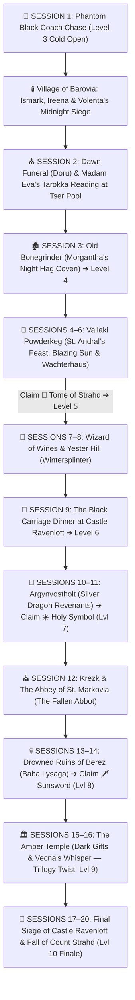

# 🛡️ Master DM Screen & Campaign Cheat Sheet — Curse of Strahd (Director's Cut)

> **Quick Glance Reference for the Lead DM**  
> *The 15–20 Session Director's Cut Roadmap, Curated Tarokka Reading, Barovian NPC Directory, Pointy Hat Boss Stat Blocks, World Loot Vault, and Gothic Horror Rules at a glance.*

---

## 🧙‍♂️ SECTION 0: PARTY CHARACTER SHEETS & ESCORT VITALS (LEVEL 3 START)

| Slot | Hero / Companion | Class & Level | HP | AC | Init | Key Passive / Resource |
| :--- | :--- | :--- | :--- | :--- | :--- | :--- |
| **PC 1** | 🎩 **Piper ("The Incomparable")** | Level 3 Wild Magic Sorcerer (Fierna Tiefling) | `16/16` | `12 (15)` | `+2` | ✨ `3/3 SP` • 🃏 `Tides of Chaos` • 🔥 Fire Resist • `DC 14 / +6` |
| **PC 2** | 👑 **Jacomir Yulle ("King of Oakenshire")** | Level 3 Battle Master Fighter (Human • Noble) | `28/28` | `17` | `+0` | ⚔️ `4/4 d8` *(Parry/Riposte/Menacing DC 13)* • 💨 `3/3 SW` • ⚡ `Action Surge` |
| **PC 3** | 🛡️ **Stranger #3** *(TBD)* | Level 3 *[TBD]* | `--/--` | `--` | `+--` | 🤝 Help Tokens: `2 / 2` |
| **PC 4** | 🏹 **Stranger #4** *(TBD)* | Level 3 *[TBD]* | `--/--` | `--` | `+--` | 🤝 Help Tokens: `2 / 2` |
| **Escort** | 🌹 **Ireena Kolyana** | Noble Swordswoman | `28/28` | `15` | `+2` | Silvered Rapier `+5 (1d8+2)` • Parry `+2 AC` |
| **Ally** | 🗡️ **Ismark Indirovich** | Veteran Swordsman *(Act I)* | `58/58` | `17` | `+1` | Multiattack: 2x Longsword `+5 (1d10+3)` |
| **Fated** | ⚔️ **Ezmerelda d'Avenir** | Tarokka Ally *(Act II–IV)* | `82/82` | `17` | `+4` | `+1 Rapier`, `+1 Silver Handaxe`, 4th-Lvl Spells |

---

## 🗺️ SECTION 1: THE 15–20 SESSION DIRECTOR'S CUT ROADMAP & TAROKKA ORACLE

### 🃏 1.1 Curated Madam Eva Tarokka Reading (Session 2 — Tser Pool)
*Read these exact card draws during Session 2 so every treasure drives the core 15–20 session plot without dead-end backtracking:*

1. **📖 First Card — The Tome of Strahd (History of the Devil):**
   * **Card Drawn:** *The Master of Stars (Wizard)*
   * **Madam Eva's Prophecy:** *"I see a walled town where smiles are painted over terror. Look to a noble house of cats and whispers, where a widow sleeps beside the dead and bows to the Devil in secret. In her hidden library lies the truth of Strahd's birth."*
   * **DM Location Key:** **Wachterhaus in Vallaki (Lady Fiona Wachter's Secret Cult Library)** — *Sessions 5–6 (Level 5).*
2. **☀️ Second Card — The Holy Symbol of Ravenkind (Weapon of Faith):**
   * **Card Drawn:** *The Paladin (Justiciar)*
   * **Madam Eva's Prophecy:** *"I see a fallen house of silver wings and broken oaths. Seek the fortress of the dead dragon knight who hates so deeply he refuses to let the Devil die. Light the beacon of the silver wyrm, and the amulet of the sun shall be yours."*
   * **DM Location Key:** **Argynvostholt (Vladimir Horngaard's Sanctum)** — *Sessions 10–11 (Level 7). Directly bridges into Campaign 3's Ancient Dragon Lore!*
3. **🗡️ Third Card — The Sunsword (The Blade of Sunlight):**
   * **Card Drawn:** *The Tempter (Marionette)*
   * **Madam Eva's Prophecy:** *"I see a drowned village in afetid marsh where no bird dares to sing. There, the woman who rocked the Devil's cradle rides in a skull of bone, and her hut walks upon the roots of a dead tree. Slay the mother of witches to claim the blade of dawn."*
   * **DM Location Key:** **Ruins of Berez (Baba Lysaga's Creeping Hut)** — *Sessions 13–14 (Level 8).*
4. **🤝 Fourth Card — Strahd's Enemy (The Fated Ally):**
   * **Card Drawn:** *The Mists (Dancer)*
   * **Madam Eva's Prophecy:** *"Seek a daughter of the Vistani who walks on a leg of polished wood and silver steel. She hunts her mentor's quarry through abbey and tower alike."*
   * **DM Location Key:** **Ezmerelda d'Avenir** (Encountered at Vallaki / Abbey of St. Markovia / Argynvostholt).
5. **👑 Fifth Card — Strahd's Final Location (The Endgame):**
   * **Card Drawn:** *The Darklord / The Broken One*
   * **Madam Eva's Prophecy:** *"He waits in the deep dark, weeping over the white marble tomb of the brother he murdered—where the curse began."*
   * **DM Location Key:** **Sergei's Tomb (Castle Ravenloft Catacombs K85)**, escalating to the **Heart of Sorrow** and the **Overlook**.

---

### 🌑 1.2 The Trilogy Crossover Arc: How the PCs Become Campaign 3's Final Rivals
* **Act I–III (The Erosion of Mercy):** Throughout Barovia, every victory requires moral compromise (Doru's starvation, Vallaki's lesser of two evils, the Abbot's madness, the Dark Powers whispering in dreams whenever a PC hits 0 HP).
* **Act IV (Sessions 15–16 — The Amber Temple Bargains):** Inside the frozen vaults of Mount Ghakis, the party discovers the **Amber Sarcophagi** housing ancient vestiges—including **Vampyr**, **Tenebrous**, and a fractured **Obsidian Sarcophagus of Vecna/Ikor**. To gain the overwhelming power needed to survive Castle Ravenloft (or revive fallen comrades), the PCs are offered **Supreme Dark Gifts** (+2 to stats beyond 20, legendary necrotic/vampiric powers, extra spell slots).
* **Session 20 Finale (The Throne of the Mists):** When the party finally destroys Count Strahd in Castle Ravenloft, the Dark Powers and Vecna's Obsidian Monoliths do not merely free them—**they crown the victorious party as the Dread Vanguard of the Mists**, pulling them across the planes to intercept **Eflein** and **Sylvar Link** in Campaign 3!

---

## 📜 SECTION 2: MASTER BAROVIAN NPC DIRECTORY (5-COLUMN OFFERINGS & PURPOSE FORMAT)

| NPC Name & Condition Tag | Status | Role & Location | Key Offerings, Services, Quests & Advice | 🗣️ Voice & Roleplay Cue |
| :--- | :--- | :--- | :--- | :--- |
| 🧛‍♂️ **Count Strahd von Zarovich** `[Darklord of Barovia]` | `🟢 Met & Active` | Supreme Ruler *Castle Ravenloft / Anywhere* | **Offerings:** Dinner Invitation (Act II), corrupting bargains, psychological tests. **Goal:** Claim Ireena (Tatyana) and test/corrupt the PCs into worthy heirs. | Deep, velvety aristocratic baritone. *"I am the Ancient. I am the Land. Do try to remain interesting."* |
| 🌹 **Ireena Kolyana** `[Twice-Bitten / Tatyana]` | `⚪ Not Met` | Escort Heroine *Barovia Village ➔ Vallaki* | **Offerings:** Fights alongside party (AC 15, 28 HP, Silvered Rapier, Parry +2 AC); guides Barovian lore. **Quest:** Bury father Kolyan at dawn; reach safe haven in Vallaki/Krezk. | Fierce, sleepless noble resolve. *"Strahd may own the dirt of this valley, but he does not own my soul."* |
| 🗡️ **Ismark Indirovich** `[New Burgomaster]` | `⚪ Not Met` | Veteran Ally *Blood on the Vine Tavern* | **Offerings:** Free tavern wine, **Father's Armory Cache** (1 Silvered Weapon, 2 Healing Potions, 2 Holy Waters, 5 GP 40 SP). **Quest:** Defend manor at midnight & escort Ireena. | Exhausted, earnest gravelly baritone. *"They call me the Lesser. Maybe they're right—but I'll die before he takes my sister."* |
| 🎭 **Bride Volenta Popofsky** `[Porcelain Skull-Mask]` | `⚪ Not Met` | Youngest Bride (Act I Boss) *Barovia Village / Ravenloft* | **Threat:** Commands the midnight pack sieging Indirovich Manor (Session 1) and the Church graveyard. **Loot:** *Porcelain Fang Charm*, *Bone-Spiked Dagger (+1)*. | High, playful, unhinged giggling. *"Little sister Ireena! Come out, come out!"* |
| ⛪ **Father Donavich** `[Broken Village Priest]` | `⚪ Not Met` | Priest of Morninglord *Barovia Village Church* | **Offerings:** Performs Kolyan's dawn burial; blesses 2 vials of Holy Water; warns that St. Andral's Church in Vallaki or the Abbey in Krezk is safer. **Dilemma:** Starving vampire son **Doru** locked in cellar. | Hoarse, weeping, frantic prayers. *"He's still my boy! The Morninglord will cure him!"* |
| 🃏 **Madam Eva** `[Ancient Vistani Seer]` | `⚪ Not Met` | Tarokka Oracle *Tser Pool Encampment* | **Offerings:** Performs the **5-Card Tarokka Reading** revealing the 3 Relics, Fated Ally, and Strahd's location; Vistani camp offers safe Long Rest & silvered gear trade. | Cracking, ancient, woodsmoke-thick voice. *"The cards have been waiting for your hands to turn them."* |
| 🥧 **Morgantha ("Granny")** `[Night Hag in Guise]` | `⚪ Not Met` | Pastry Peddler & Coven Leader *Barovia Streets / Bonegrinder* | **Offerings:** Sells *Dream Pastries* (1 GP; induces 8-hr blissful trance + `1d6` Temp HP, but highly addictive & baked from stolen children's bones!). | Sweet, grandmotherly cackle hiding iron malice. *"Just one warm meat pie, dearies, to chase away the gray!"* |
| 🪶 **Urwin & Danika Martikov** `[Secret Wereravens]` | `⚪ Not Met` | Innkeepers & Spymasters *Blue Water Inn (Vallaki)* | **Offerings:** Free room & hot beet soup in Vallaki; raven scouts warn party of ambushes. **Quest:** Clear the **Wizard of Wines Winery** (Session 7). | Warm, observant hospitality. *"A warm bowl of soup and a locked door are the rarest treasures in Vallaki."* |
| ☀️ **Baron Vargas Vallakovich** `[Paranoid Mayor]` | `⚪ Not Met` | Ruler of Vallaki *Burgomaster's Mansion* | **Offerings:** Political shelter (if party smiles and praises his festivals); enforcer **Izek Strazni**. **Threat:** Throws dissenters in the stocks; sparks Vallaki's riot. | Manic, booming, forced cheer. *"ALL WILL BE WELL! Smile, citizen, or face the stocks!"* |
| 📖 **Lady Fiona Wachter** `[Devil-Worshiping Noble]` | `⚪ Not Met` | Cult Leader & Rival *Wachterhaus (Vallaki)* | **Offerings:** Secret alliance to overthrow Baron Vargas; holds 📖 **The Tome of Strahd** in her locked cult library! | Aristocratic, purring pragmatism. *"The Count is a negligent landlord; the Baron is a raving lunatic. Choose wisely."* |
| ⚔️ **Ezmerelda d'Avenir** `[Fated Tarokka Ally]` | `⚪ Not Met` | Monster Hunter *Vallaki / Krezk / Argynvostholt* | **Offerings:** Joins party for major bosses & Ravenloft siege; wagon stocked with Alchemist's Fire, Holy Water, & Silvered weapons. | Sharp, fearless confidence. *"Silver for the wolves, running water for the spawn, and a stake for the Count."* |
| 🎭 **Rudolph van Richten ("Rictavio")** `[Undercover Legend]` | `⚪ Not Met` | Half-Elf Bard / Hunter *Blue Water Inn & Tower* | **Offerings:** *Scroll of Protection from Undead*, monster weaknesses, and his armored **Saber-Toothed Tiger**. | Flamboyant ringmaster facade; weary, calculating old hunter underneath. |
| 🐉 **Vladimir Horngaard** `[Revenant Dragon-Knight]` | `⚪ Not Met` | Commander of the Silver Dragon *Argynvostholt (Act III)* | **Offerings:** Guards ☀️ **The Holy Symbol of Ravenkind** & `+2 Greatsword`; lighting the Dragon Beacon grants the entire party **+1 AC and +1 to all Saving Throws permanently**! | Hollow, echoing, frost-bitten voice of undying hatred. *"Let the Devil rot in the prison he built."* |
| 💀 **Baba Lysaga** `[Mother of Night]` | `⚪ Not Met` | Arch-Hag of the Swamp *Ruins of Berez (Act III)* | **Threat:** CR 11 Boss flying in a giant skull alongside her **Creeping Walking Hut**. **Loot:** Guards 🗡️ **The Sunsword** and a **Winery Life-Gem**! | Croaking, fanatical maternal delusion. *"My sweet baby Strahd... I will feed your bones to the crows!"* |
| 🗡️ **Rahadin** `[Dusk Elf Chamberlain]` | `⚪ Not Met` | Strahd's Executioner *Castle Ravenloft / Amber Temple* | **Threat:** CR 10 Martial Boss with *Deathly Choir* (`3d10` psychic aura). **Loot:** *Rahadin's Dusk-Blade (+2 Scimitar)*, Castle Master Keys. | Quiet, emotionless whisper beneath phantom screams. *"Step aside, or join the choir in my wake."* |

---

## 👹 SECTION 3: MASTER ENEMY FAST REFERENCE & BOSS STAT CARDS

### 📊 3.1 Master Campaign Enemy Table (3–4 Player Party Scaling)

| Act / Region | Enemy Name & Role | CR | Init | HP (3–4 PCs) | AC | Speed | Main Attacks (+Hit, Dmg) | Special Mechanics / Pointy Hat |
| :--- | :--- | :--- | :--- | :--- | :--- | :--- | :--- | :--- |
| **🐎 Act I: Svalich Woods & Barovia** | 🐺 **Svalich Dire Wolf** *(Session 1 Carriage Chase)* | 1 | `+2` | `32–37` | 14 | 50 ft | Bite `+5` (`2d6+3` pierc + DC 13 STR Prone) | **Pack Tactics** (Adv with ally) \| Fears fire/radiant |
| | 🧛 **Feral Strahd Thrall (Mist Claw)** *(Session 1 Roof)* | 1 | `+2` | `26–32` | 12 | 30 ft / Climb 30 | Claws `+4` (`2d4+2` slash + DC 10 CON Paralyze) | **Spider Climb** \| Vulnerable to Silver/Radiant |
| | 🧟 **Strahd Zombie** *(Session 1 Manor Siege)* | 1 | `-2` | `28–34` | 8 | 20 ft | Bite `+3` (`1d4+1`) + 2x Claws `+3` (`1d6+1`) | **Loathsome Limbs:** hits of 5+ sever arms/head that keep crawling & attacking! |
| | 🩸 **Doru / Vampire Spawn Stalker** *(Session 1–2 Mini-Boss)* | 3–5 | `+3` | `55–68` | 15 | 30 ft / Climb 30 | Multiattack: Claws `+6` (`2d4+3` / Grapple DC 13) + Bite `+6` (`1d6+3` + `2d6` Necro) | **Regen 10 HP/turn** (halted by Radiant/Holy Water) \| **Forbiddance** (Cannot enter home uninvited!) |
| | 🎭 **Bride Volenta Popofsky** *(🏆 ACT I BOSS)* | 5 | `+4` | `78–92` | 16 | 35 ft / Climb 35 | 2x Bone-Dagger `+7` (`1d4+4` + `2d6` Necro) + Bite `+7` (`1d6+4` + `3d6` Necro) | **Pointy Hat Boss:** *Corpse-Puppet Strings* & *Blood-Mist Pounce* |
| **🏚️ Act II: Bonegrinder, Vallaki & Yester Hill** | 🥧 **Morgantha, Night Hag Matron** *(🏆 BONEGRINDER BOSS)* | 5 | `+2` | `95–112` | 17 | 30 ft | Claws `+7` (`2d8+4` slash) \| *Magic Missile* / *Ray of Enfeeblement* | **Pointy Hat Boss:** *Flour-Dust Firestorm* & *Phantasmal Nightmare Tether* |
| | 🔥 **Izek Strazni** *(Vallaki Enforcer)* | 5 | `+1` | `90–105` | 14 | 30 ft | 2x Battleaxe `+6` (`1d8+3` + `1d6` Fire) + *Hurl Flame* `+5` (`3d6` Fire) | **Fiendish Demon Arm** \| Obsessed with finding his lost sister (Ireena/PC) |
| | 🌳 **Wintersplinter** *(🏆 YESTER HILL APEX TREE BLIGHT)* | 7 | `-1` | `125–145` | 15 | 30 ft | 2x Branch `+9` (`3d6+6`) + 2x Grasping Root (`Grapple DC 15`) + Bite (`3d8+6`) | **Pointy Hat Boss:** *Blood-Root Eruption* & *Gulthias Spore Cloud* |
| **🐉 Act III: Argynvostholt & Berez** | ⚔️ **Vladimir Horngaard** *(🏆 ARGYNVOSTHOLT BOSS)* | 7 | `+2` | `136–155` | 17 | 30 ft | 2x `+2 Greatsword` `+9` (`4d6+7` slash) | **Regen 10 HP** \| **Pointy Hat Boss:** *Vengeful Phantom Charge* & *Silver Dragon's Grief* |
| | 💀 **Baba Lysaga & Walking Hut** *(🏆 BEREZ BOSS)* | 11 | `+3` | `120` (Baba) / `140` (Hut) | 15 / 16 | Fly 40 (Skull) | 3x Quarterstaff / Spells (*Finger of Death, Fireball*) \| Hut: 3x Roots `+11` (`3d10+7`) | **Pointy Hat Boss:** *Remove the Winery Gem!* (Pulling the glowing green gem from the Hut's floorboards instantly shuts the Hut down!) |
| **🦇 Act IV: Amber Temple & Ravenloft** | 🗡️ **Rahadin, Dusk Elf Executioner** *(🏆 RAVENLOFT BOSS)* | 10 | `+6` | `135–150` | 18 | 35 ft | 3x Scimitar `+10` (`1d6+6` + `1d8` Poison) or 2x Poison Darts | **Deathly Choir** (Bonus Action: 10ft aura, DC 16 WIS save or `3d10` Psychic) \| **Pointy Hat Boss** |
| | 🧛‍♂️ **Count Strahd von Zarovich** *(👑 CAMPAIGN FINAL BOSS)* | 15 | `+4` | `144` *(+50 Heart of Sorrow)* | 16 | 30 ft | 2x Unarmed Strike `+9` (`1d8+4` bludgeon + `4d6` Necro / Grapple) + Bite (`1d6+4` + `3d6` Necro) + 9th-Lvl Spells | **Regen 20 HP** \| **Lair Phase-Shift through Walls** \| **3 Pointy Hat Battlefield Actions** |

---

## 💎 SECTION 4: BAROVIAN WORLD LOOT VAULT & FATED RELICS

### 🏆 4.1 The Three Fated Tarokka Artifacts
1. 📖 **The Tome of Strahd** *(Legendary Lore Relic • No Attunement)*:
   * **Location:** Lady Wachter's Cult Library (Vallaki — Act II).
   * **Mechanics:** Studying the leather-bound journal for 1 hour reveals Strahd's complete origin (his murder of brother Sergei for Tatyana and his pact with **Vampyr** in the Amber Temple). While a party member carries the Tome, **all party members gain Advantage on Wisdom Saving Throws against Strahd's *Charm***, and once per day as an Action, the reader can read a passage aloud to force Strahd (or a Bride) within 30 ft to make a **DC 15 WIS Save** or be **Stunned until the end of their next turn** in furious grief!
2. ☀️ **The Holy Symbol of Ravenkind** *(Legendary Amulet • Requires Attunement by Good/Devout Creature or Cleric/Paladin)*:
   * **Location:** Argynvostholt Beacon Sanctum (Act III).
   * **Mechanics:** Has **10 Charges** (regains `1d6+4` at dawn):
     * **Hold Vampires (1 Charge):** Action; all vampires within 30 ft must make a **DC 15 WIS Save** or be **Paralyzed for 1 minute** (repeat save at end of turns).
     * **Turn Undead Boost (1 Charge):** Grants **Advantage** on Turn Undead / vs Undead saves.
     * **True Sunlight (5 Charges):** Action; emits a **30-foot radius of pure, true Sunlight** for 10 minutes (deals 20 Radiant damage/turn to Strahd & Vampire Spawn and disables their regeneration and mist-form!).
3. 🗡️ **The Sunsword** *(Legendary Sentient Longsword/Finesse • Requires Attunement)*:
   * **Location:** Guarded by Baba Lysaga in Berez (Act III).
   * **Mechanics:** Sentient crystal-hilted blade of Sergei von Zarovich whose blade is made of **pure radiant sunlight**!
     * **Finesse & Versatile:** Can be wielded with **STR or DEX**!
     * **Attack & Damage:** **`+2 Bonus` to attack and damage rolls** (+ **`+1d8` bonus against Undead**). Deals **`1d8` Radiant damage** (`1d10` two-handed) instead of slashing—plus an extra **`1d8` Radiant damage to Undead** (`2d8` Radiant total per hit against vampires/undead!).
     * **Sunlight Aura:** Emits **15-ft bright True Sunlight** (expandable to 30 ft), burning vampires within 15 ft for 20 Radiant damage at the start of their turn!

---

### 🎒 4.2 Barovian Gear, Relics & Consumables Catalog
* 🗡️ **Silvered Weapon (Dagger / Shortsword / Rapier / 10 Bolts)** *(Uncommon • 5 GP)*: Bypasses nonmagical B/P/S resistance of Werewolves, Vampire Thralls, and Night Hags.
* 🧪 **Potion of Healing** *(Common Consumable • 5 GP)*: **Bonus Action** self (`2d6 + 1 HP`) | **Action** administer to downed ally.
* 💧 **Flask of St. Andral's Holy Water** *(Uncommon Consumable • 2 GP 5 SP)*: Ranged attack (20 ft) or splash; deals **`2d6` Radiant damage** to Undead and Fiends and halts Vampire Regeneration for 1 round!
* 🥧 **Morgantha's Dream Pastry** *(Cursed Consumable • 1 GP)*: Eating takes 1 Action; grants **`1d6` Temporary HP**, cures 1 level of Exhaustion, and plunges the eater into 8 hours of blissful dreams of home—followed by a **DC 13 CON Save** next dawn or suffer `-1d4` to Wisdom checks until eating another pie!
* 🍷 **Wizard of Wines — Red Dragon Crush** *(Fine Barovian Wine • 1 GP)*: Drinking a goblet during a Short Rest grants **`+1d4` Temporary HP** and Advantage on the next saving throw against being **Frightened** for 2 hours.
* 🩸 **The Blood Spear of Kavan** *(Rare Magic Spear • Yester Hill)*: `+2 Spear`; whenever you reduce a hostile creature to 0 HP, you gain **`2d6` Temporary HP**.
* 🗿 **Icon of Ravenloft** *(Legendary Silver Statuette • Castle Ravenloft Chapel)*: Grants *Protection from Evil and Good* aura (15 ft), *Augury* 1/day, and heals `3d8+3` HP 1/day.
* 🟣 **Dark Gifts of the Amber Temple (Act IV Trilogy Corruptions):**
  * **Gift of Vampyr (The Undying Hunger):** Max HP increases by +20; melee crits restore HP equal to necrotic damage dealt; *Corruption:* Eyes turn blood-red and soul is bound to the Mists.
  * **Gift of the Whispering Hand (Vecna's Monolith Shard):** Gain +2 to Primary Spellcasting/Attack stat (up to 22) and 1 free 5th-level spell slot per Long Rest; *Corruption:* Binds the character to Vecna's Obsidian Monoliths for **Campaign 3**!

---

## ⚖️ SECTION 5: DM RULES, BAROVIAN LAWS & QUICK REFERENCE

### 🦇 5.1 The Four Sacred Laws of Barovia
1. **The Law of Forbiddance (Invitation Rule):** Neither Count Strahd nor any Vampire Spawn can cross the threshold of a private home/residence unless **explicitly invited inside by a living occupant**. *(Public taverns, shops, churches, and Castle Ravenloft do not count as private homes.)*
2. **The Law of the Overcast Sky:** Barovia's natural daytime light is filtered through perpetual storm clouds and mist—it **never** triggers Vampire *Sunlight Hypersensitivity*. Only magical true sunlight (*Sunsword*, *Holy Symbol of Ravenkind*, *Dawn*) burns vampires.
3. **The Law of Running Water:** Vampires taking a turn in running river water (such as the Ivlis River or Tser Falls) take **20 Acid damage** at the end of their turn and cannot regenerate.
4. **The Law of the Mists (Death Save Whisper):** Under our **2-Strike / 1-Success Death Save Rule**, if a character fails 2 Death Saves in Act I–II (Levels 3–5), time freezes for a split second and a voice in the Mists offers to breathe life back into their lungs at **1 HP**—in exchange for accepting a **Dark Power Touched Mark** (stepping one rung closer to the Campaign 3 corruption!).

### 🎲 5.2 Standard Table House Rules
* **Brutal Critical Hits:** `Max Base Die + 1 Rolled Die + Modifier`.
* **Combat Ability Checks:** Perception, Insight, Investigation, or Arcana checks in combat require **1 Action**.
* **Cover:** Partial Cover = **`+2 AC`** | Total Cover = Untargetable.
* **2-Coin Economy:** `10 Silver Pieces (SP) = 1 Gold Piece (GP)`.
