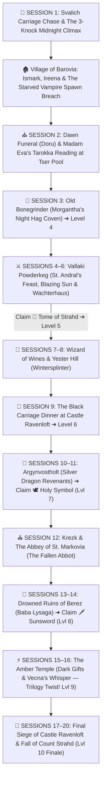

# 🏰 Master DM Screen & Campaign Cheat Sheet — Curse of Strahd (Director's Cut)

> **Quick Glance Reference for the Lead DM**  
> *The 15–20 Session Director's Cut Roadmap, Curated Tarokka Reading, Barovian NPC Directory, Pointy Hat Boss Stat Blocks, World Loot Vault, and Gothic Horror Rules at a glance.*

---

## 🛡️ SECTION 0: PARTY CHARACTER SHEETS & ESCORT VITALS (LEVEL 3 START)

| Slot | Hero / Companion | Class & Level | HP | AC | Init | Key Passive / Resource |
| :--- | :--- | :--- | :--- | :--- | :--- | :--- |
| **PC 1** | 🎭 **Piper ("The Incomparable")** | Level 3 Wild Magic Sorcerer (Fierna Tiefling • Native) | `17/17` | `12 (15)` | `+2` | ✨ `3/3 SP` • 🎲 `Tides` • 🌲 `Native Acumen (Nature +3, Survival +2)` • 🔥 `Fire Resist` • 💛 `2/2 Help` |
| **PC 2** | 👑 **Jacomir Yulle ("King of Oakenshire")** | Level 3 Battle Master Fighter (Human • Noble) | `31/31` | `17` | `+0` | ⚔️ `4/4 d8` *(Parry/Riposte/Menacing DC 13)* • ☕ `3/3 SW` • ⚡ `Action Surge` • 💛 `2/2 Help` |
| **PC 3** | 🎯 **Eclipsa "Yvaine" the First** | Level 3 Monster Slayer Ranger (Human • Gunner) | `28/28` | `16` | `+6` | 🔫 *Lament* `+8 (1d12+4)` • 💥 *Mercy & Less* `+8 (1d6+4)` • 👁️ *Hunter's Sense 2/2* • 🎯 *Slayer's Prey (+1d6)* • ⚡ *Alert (+6 Init)* • 💛 `2/2 Help` |
| **PC 4** | 👤 **Stranger #4** *(TBD)* | Level 3 *[TBD]* | `--/--` | `--` | `+--` | 💛 Help Tokens: `2 / 2` • ☕ Short Rest: 25% Max HP (2/day) |
| **Companion** | 🌟 **Caelum Jude ("Cael")** | Level 3 Circle of the Stars Druid (Main Companion & Primary Healer) | `38/38` | `14` | `+2` | ✨ Chalice Dual Heals (`1d8+3`) • 🏹 Archer Form (`1d8+3` Rad) • ⚡ Guiding Bolt (`2/2`) • 🐈 Black Cat • 🛡️ *Vow of Dark Powers (Stabilizes at 1 HP)* |
| **Escort** | 🌹 **Ireena Kolyana** | Noble Swordswoman (Tatyana Reborn) | `28/28` | `15` | `+2` | ⚔️ Silvered Rapier `+5 (1d8+2)` • 🛡️ Parry `+2 AC` |
| **Ally** | 🗡️ **Ismark Indirovich** | Veteran Swordsman *(Act I)* | `58/58` | `17` | `+1` | Multiattack: 2x Longsword `+5 (1d10+3)` • ☕ Second Wind |
| **Fated** | ⚔️ **Ezmerelda d'Avenir** | Tarokka Ally *(Act II–IV)* | `82/82` | `17` | `+4` | `+1 Rapier` (`+8, 1d8+5`), 4th-Lvl Wizard Spells, Silvered Prosthetic |

---

## 📜 SECTION 1: THE 15–20 SESSION DIRECTOR'S CUT ROADMAP & TAROKKA ORACLE

### 🔮 1.1 Curated Madam Eva Tarokka Reading (Session 2 — Tser Pool)
*Read these exact card draws during Session 2 so every treasure drives the core 15–20 session plot without dead-end backtracking:*

1. **📜 First Card — The Tome of Strahd (History of the Devil):**
   * **Card Drawn:** *The Master of Stars (Wizard)*
   * **Madam Eva's Prophecy:** *"I see a walled town where smiles are painted over terror. Look to a noble house of cats and whispers, where a widow sleeps beside the dead and bows to the Devil in secret. In her hidden library lies the truth of Strahd's birth."*
   * **DM Location Key:** **Wachterhaus in Vallaki (Lady Fiona Wachter's Secret Cult Library)** — *Sessions 5–6 (Level 5).*
2. **🕊️ Second Card — The Holy Symbol of Ravenkind (Weapon of Faith):**
   * **Card Drawn:** *The Paladin (Justiciar)*
   * **Madam Eva's Prophecy:** *"I see a fallen house of silver wings and broken oaths. Seek the fortress of the dead dragon knight who hates so deeply he refuses to let the Devil die. Light the beacon of the silver wyrm, and the amulet of the sun shall be yours."*
   * **DM Location Key:** **Argynvostholt (Vladimir Horngaard's Sanctum)** — *Sessions 10–11 (Level 7). Directly bridges into Campaign 3's Ancient Dragon Lore!*
3. **🗡️ Third Card — The Sunsword (The Blade of Sunlight):**
   * **Card Drawn:** *The Tempter (Marionette)*
   * **Madam Eva's Prophecy:** *"I see a drowned village in a fetid marsh where no bird dare sing. A rotting hut crawls upon ancient roots, guarded by an old woman who cradles an illusion of youth in a dragon skull. The blade of pure light lies buried in her mire."*
   * **DM Location Key:** **Ruins of Berez (Baba Lysaga's Creeping Hut)** — *Sessions 13–14 (Level 8).*
4. **⚔️ Fourth Card — The Fated Ally (The Swashbuckling Hunter):**
   * **Card Drawn:** *The Mists (Element)*
   * **Madam Eva's Prophecy:** *"A child of our own blood who has walked away from the wagons. She carries the scars of the hunt upon her flesh and steel where bone was shattered. A woman of flashing rapiers and black powder—she waits in the mists to strike at the throat of the beast."*
   * **DM Location Key:** **Ezmerelda d'Avenir** — *Fated Ally joined in Vallaki / Abbey (Act II–III).*
5. **🏰 Fifth Card — The Final Battlefield (Where Strahd Must Die):**
   * **Card Drawn:** *The Executioner (High Deck)*
   * **Madam Eva's Prophecy:** *"I see the spire of black stone piercing a blood-moon. He waits where his brother's blood first touched the stones, beneath the high chapel where stained glass portrays saints with blind eyes. Face him beneath the gaze of the dead saints, and the master shall fall."*
   * **DM Location Key:** **Castle Ravenloft — The Chapel of Saint Andral / Sergei's Crypt** — *Session 19–20.*

---

## 👥 SECTION 2: MASTER BAROVIAN NPC DIRECTORY (5-COLUMN FORMAT)

| NPC Name & Condition | Live Status | Role & Location | Key Offerings, Services, Quests & Advice | 🎭 Voice & Roleplay Cue |
| :--- | :--- | :--- | :--- | :--- |
| 🌟 **Caelum Jude ("Cael")** `[Main Party Companion]` | 🟢 Met & Active | Primary Healer & Companion • Barovia | **Starry Chalice dual-heals 1d8+3**, free Guiding Bolts, Goodberries, scout. *Stabilizes at 1 HP (Plot Armor).* | Earnest, self-deprecating Percy Jackson warmth: *"I don't want to die out here alone. Let me walk with you."* |
| 👑 **Count Strahd von Zarovich** `[Darklord of Barovia]` | 🟢 Active Overlord | Supreme Ruler • Castle Ravenloft | **Dinner Invitation (Act II)**, psychological trials, corrupting bargains. Seeks Ireena & worthy heirs. | Deep aristocratic velvet baritone: *"I am the Ancient. I am the Land."* |
| 🌹 **Ireena Kolyana** `[Twice-Bitten / Tatyana]` | 🟡 Unmet | Escort Heroine • Barovia Manor | Fights alongside party (**AC 15, 28 HP**, Silvered Rapier `+5`, Parry `+2 AC`). Refuses to cower. | Fierce sleepless noble resolve: *"Give me a blade and tell me where to stand."* |
| 🗡️ **Ismark 'The Lesser' Indirovich** `[New Burgomaster]` | 🟡 Unmet | Frontline Defender • Tavern & Barricades | **Father's Armory Cache** (Silvered Weapon, 2 Potions, 2 Holy Waters, 5 GP 40 SP). AC 17, 58 HP. | Exhausted gravelly baritone: *"They call me the Lesser... but I will die holding the line."* |
| ⛪ **Father Donavich & Doru** `[Broken Priest & Vampire Son]` | 🟡 Unmet | Village Priest • Barovia Church | Performs Kolyan's funeral; blesses 2 Holy Waters; points party to Vallaki/Krezk. Doru in cellar. | Hoarse weeping prayers trying to drown out Doru's screaming from the cellar. |
| 🔮 **Madam Eva** `[Ancient Vistani Seer]` | 🟡 Unmet | Tarokka Oracle • Tser Pool Camp | **5-Card Tarokka Reading**; safe Long Rest camp; Vistani silver weapon trade. | Ancient woodsmoke-thick voice: *"The cards have waited centuries for your hands."* |
| 🎭 **Bride Volenta Popofsky** `[Porcelain Skull-Mask]` | 🟡 Active Hunter | Youngest Bride • Castle Ravenloft | Stalks Ireena; drops Bone Dagger +1 & Porcelain Skull-Mask Charm (False Life). | High-pitched unhinged giggling: *"Little sister Ireena! Come out and play!"* |
| 🥧 **Morgantha ('Granny')** `[Night Hag Matron]` | 🟡 Unmet | Coven Leader • Old Bonegrinder | Sells Dream Pastries (1 GP: 1d6 Temp HP + 8hr trance, ground from children's bones). | Sweet grandmotherly cackle hiding iron malice: *"Just one warm pie, dearies!"* |
| 🦅 **Urwin & Danika Martikov** `[Keepers of the Feather]` | 🟡 Unmet | Wereraven Innkeepers • Blue Water Inn | Free room & warm stew in Vallaki; raven scouts warn of ambushes; Winery quest. | Warm observant hospitality: *"A warm bowl of soup and a locked door..."* |
| ☀️ **Baron Vargas Vallakovich** `[Paranoid Mayor]` | 🟡 Unmet | Burgomaster • Vallaki | Town authority & shelter if party praises his festivals; enforcer Izek Strazni. | Manic booming forced cheer: *"ALL WILL BE WELL!"* |
| 🕯️ **Lady Fiona Wachter** `[Cult Leader]` | 🟡 Unmet | Strahd Loyalist • Wachterhaus | Shelters **The Tome of Strahd**; seeks to overthrow the Baron; cultists. | Cold calculating aristocratic poise: *"Strahd is not a monster. He is a lord."* |
| ⚔️ **Ezmerelda d'Avenir** `[Fated Ally]` | 🟡 Unmet | Vistani Vampire Hunter • Act II–IV | Swashbuckling hunter (AC 17, HP 82, Rapier +8, 4th-level Wizard spells). | Swashbuckling confidence: *"I don't need a prophecy to tell me how to kill a vampire."* |
| 📜 **Rudolph van Richten** `[Monster Scholar / "Rictavio"]` | 🟡 Unmet | Disguised Bard • Blue Water Inn | Legendary vampire hunter; Saber-Toothed Tiger; expert monster tactics. | Scholarly dry wit under a colorful bard disguise. |
| 🐉 **Vladimir Horngaard** `[Revenant Commander]` | 🟡 Unmet | Dragon Knight Leader • Argynvostholt | Guards **The Holy Symbol of Ravenkind**; undead dragon knight order. | Hateful hollow spectral rasp: *"Strahd must suffer eternally in his cage."* |
| 💀 **Baba Lysaga** `[Swamp Witch]` | 🟡 Unmet | Mother of Night • Ruins of Berez | Guards **The Sunsword**; pilots the Creeping Walking Hut; 8th-level spells. | Screeching maternal madness claiming Strahd as her stolen infant son. |

---

## 💀 SECTION 3: MASTER ENEMY FAST REFERENCE & BOSS STAT CARDS

### 🐺 3.1 Master Campaign Enemy Table (Scaled for 3 Level 3 Characters)

| Act / Region | Enemy Name & Role | CR | Init | HP (3 Level 3 PCs) | AC | Speed | Main Attacks (+Hit, Dmg) | Special Mechanics / Pointy Hat |
| :--- | :--- | :--- | :--- | :--- | :--- | :--- | :--- | :--- |
| **🌲 Act I: Svalich Woods & Chase** | 🐺 **Svalich Dire Wolf** *(Chase Flanker)* | 1 | `+2` | **`42`** | 14 | 50 ft | Bite `+5` (`2d6+3` pierc + DC 13 STR Prone) | **Pack Tactics** (Adv with ally) • **Drag Down** (`+1d6` vs Prone) • Fears fire |
| | 🐺 **Svalich Alpha Dire Wolf** *(Roof Breacher)* | 2 | `+2` | **`58`** | 15 | 50 ft | Bite `+6` (`2d6+4`) + Roof Claws `+6` (`2d4+4`) | **Roof Breach:** rips timber ceiling (DC 13 Dex or `1d6` slash) • **Howl** (DC 13 Wis) |
| **🩸 Act I Climax: Indirovich Manor** | 🩸 **The Starved Vampire Spawn** *(3 AM Climax Solo Boss)* | **5** | `+3` | **`82`** | 15 | 35 ft / Climb 35 | 2x Talons `+6` (`2d6+4` / Grapple DC 14) + Throat-Bite `+6` (`2d6+4` + `4d6` Necro) | **Spider Climb** • **Regen 10 HP** • **Apex Drain reduces Max HP** • **3 Pointy Hat Actions** |
| **⛪ Act I–II: Churchyard & Road** | 🧟 **Strahd Zombie** *(Cemetery Hazard)* | 1 | `-2` | **`34`** | 8 | 20 ft | Bite `+3` (`1d4+1`) + 2x Claws `+3` (`1d6+1`) | **Loathsome Limbs:** hits of 5+ sever limbs that attack independently! |
| | 🩸 **Doru (The Starving Son)** *(Church Undercroft Boss)* | 5 | `+3` | **`85`** | 15 | 30 ft / Climb 30 | 2x Claws `+6` (`2d6+4`) + Bite `+6` (`2d6+4` + `4d6` Necro) | **Regen 10 HP** • Cellar Chain Whip • Father's Weeping Agony |
| **🏰 Act II: Bonegrinder & Vallaki** | 🎭 **Bride Volenta Popofsky** *(Porcelain Bride)* | 5 | `+4` | **`95`** | 16 | 35 ft / Climb 35 | 2x Bone-Dagger `+7` (`1d4+4` + `2d6` Necro) + Bite `+7` (`1d6+4` + `3d6` Necro) | **Pointy Hat Boss:** *Corpse-Puppet Strings* & *Skull-Mask Shriek* |
| | 🥧 **Morgantha, Night Hag Matron** *(Old Bonegrinder Boss)* | 5 | `+2` | **`112`** | 17 | 30 ft | Talons `+7` (`2d8+4` magic slash) • *Magic Missile* / *Ray* | **Pointy Hat Boss:** *Bone-Flour Combustion Cloud* • Magic Resistance |
| | 👑 **Count Strahd von Zarovich** *(Campaign Apex Darklord)* | 15 | `+4` | **`144`** *(+50 Heart)* | 16 | 30 ft / Fly 30 | 2x Strike `+9` (`1d8+4` + `4d6` Necro / Grapple) + Bite `+9` + 5th-Lvl Spells | **Pointy Hat Boss:** *Wrath of Land* • Lair Wall-Phase • **Regen 20 HP** |

---

### 🩸 3.2 The Starved Vampire Spawn — Apex Solo Boss Dossier (Indirovich Manor 3:00 AM)

* **CR:** `5 (1,800 XP)` | **Init:** `+3` | **AC:** `15 (Supernatural Agility)` | **Speed:** `35 ft, Climb 35 ft (Spider Climb)`
* **HP:** **`82 HP`** *(Scaled specifically to challenge 3 Level 3 PCs including Jacomir with 31 HP! 3 PCs: 76–82 HP, 4 PCs: 94 HP)*
* **Saving Throws:** `DEX +6, CON +6, WIS +3` | **Senses:** `Darkvision 60 ft, Passive Perception 13`
* **Damage Resistances:** `Necrotic; Bludgeoning, Piercing, and Slashing from Non-Silvered / Non-Magical Attacks` *(Bypassed by Silver, Fire, Holy Water, Radiant)*
* **Core Traits:**
  * **Supernatural Regeneration:** Regains **10 HP** at the start of its turn unless it took Fire, Radiant, or Holy Water damage since its last turn.
  * **Spider Climb:** Moves effortlessly across walls and wooden ceiling rafters without needing an ability check.
  * **Sunlight & Running Water Hypersensitivity:** Takes 20 Radiant in true sunlight; 20 Acid in running water.
* **Combat Actions:**
  * **Multiattack:** Makes **Three Attacks**: Two with its **Ripping Talons** and one with its **Exsanguinating Throat-Bite**!
  * **Ripping Talons:** `+6 to hit`, reach 5 ft. *Hit:* 11 (`2d6 + 4`) slashing damage. If target is Medium or smaller, it is **Grappled** (Escape DC 14) and **Restrained**! Has two claws, can hold two victims.
  * **Exsanguinating Throat-Bite:** `+6 to hit`, reach 5 ft., against a grappled, incapacitated, or restrained creature. *Hit:* 11 (`2d6 + 4`) piercing PLUS 14 (`4d6`) necrotic damage (**Avg 25 damage**!).
    * **Vampiric Drain:** The target's **Max HP is reduced by the necrotic damage dealt** (lasts until a Long Rest or *Greater Restoration*), and the Spawn **regains HP equal to the necrotic damage dealt**!
    * *Brutal Crit (Nat 20):* 16 (max die) + 1d6 + 4 piercing + 24 (max necrotic) + 4d6 necrotic = **Avg 58 damage**! Instant down!
  * **Ceiling Pounce (Recharge 5-6):** Drops from ceiling rafters; target makes DC 14 STR save or takes 14 (`3d6 + 4`) bludgeoning, slammed Prone, and pinned.
* **Pointy Hat Battlefield Actions (Tell ➔ Counterplay ➔ Resolve):**
  1. **Action 1: Rushing Ceiling Exsanguination (Pin & Drain):**
     * **📢 TELL (End of Turn):** The Spawn scrambles up parlor drapes onto rafters above a hero, foaming with black bile dripping onto their armor, locking onto their jugular!
     * **🛡️ COUNTERPLAY (The Round):** Target moves 15+ ft away, ally uses Action to tackle/shove them out of the drop zone (DC 13 Athletics), or party deals 16+ damage (or Fire/Radiant) to knock Spawn off ceiling!
     * **💥 RESOLUTION (Start of Next Turn):** Plummets onto target: 17 (`3d8 + 4`) bludgeoning, knocked Prone, Spawn gets immediate free Throat-Bite with Advantage!
  2. **Action 2: Frenzied Blood-Mist Leap (Horror Shroud):**
     * **📢 TELL (End of Turn):** Slashes own forearms, exhaling thick black blood-mist that snuffs lamps/hearth, plunging parlor into supernatural darkness!
     * **🛡️ COUNTERPLAY (The Round):** Relight torch/lamp (Action + DC 12 Sleight of Hand), cast Light / Dancing Lights / Faerie Fire / Bonfire, or DC 13 Perception check to track talons!
     * **💥 RESOLUTION (Start of Next Turn):** Blinks behind two closest heroes, raking eyes: DC 14 DEX save or 15 (`3d6 + 4`) slashing + Blinded until end of next turn!
  3. **Action 3: Sanguine Death Rattle (Starvation Frenzy):**
     * *Trigger:* Reduced below 30 HP.
     * **📢 TELL (End of Turn):** With broken fangs and bleeding eyes, lets out a horrific shriek shattering windows, black veins bulging as fresh blood scent drives it berserk!
     * **🛡️ COUNTERPLAY (The Round):** Deal 20+ damage to execute before its turn, cast Calm Emotions / Tasha's Laughter, or hit with Radiant / Holy Water!
     * **💥 RESOLUTION (Start of Next Turn):** Surges: gains **+2 AC (AC 17)**, speed 50 ft, makes 3 Claw attacks with Advantage targeting nearest hero or whoever dealt radiant/fire!

---

## 🎒 SECTION 4: BAROVIAN WORLD LOOT VAULT & FATED RELICS

### 📜 4.1 The Three Fated Tarokka Artifacts
1. 📜 **The Tome of Strahd** *(Legendary Lore Relic • No Attunement)*:
   * **Location:** Lady Wachter's Cult Library (Vallaki — Act II).
   * **Mechanics:** While carried, **all allies within 30 ft gain Advantage on saves against Strahd's Charm**. Once per day as an Action, read aloud Strahd's confession of murdering Sergei: Strahd or any Bride within 30 ft must pass a **DC 15 WIS Save or be Stunned until the end of their next turn** in furious grief!
2. 🕊️ **The Holy Symbol of Ravenkind** *(Legendary Amulet • Attunement by Good/Cleric/Paladin)*:
   * **Location:** Argynvostholt Beacon Sanctum (Act III).
   * **Mechanics:** Has **10 Charges** (regains `1d6+4` at dawn):
     * **Hold Vampires (1 Charge):** Action; vampires within 30 ft make DC 15 WIS Save or are **Paralyzed for 1 minute**.
     * **Turn Undead Boost (1 Charge):** Advantage on Turn Undead / saves against Undead.
     * **True Sunlight (5 Charges):** Action; emits **30-foot True Sunlight** for 10 minutes (deals 20 Radiant damage/turn to vampires and suppresses regeneration and mist-form!).
3. 🗡️ **The Sunsword** *(Legendary Sentient Blade • Attunement)*:
   * **Location:** Guarded by Baba Lysaga in Berez (Act III).
   * **Mechanics:** Sentient crystal-hilted blade of pure radiant sunlight!
     * **Finesse & Versatile:** Can be wielded with **STR or DEX** (`+2 to hit and damage`).
     * **Damage:** Deals **`1d8` Radiant damage** (`1d10` two-handed) + **extra `1d8` Radiant against Undead** (`2d8` Radiant total per hit against vampires!).
     * **Sunlight Aura:** Emits **15-ft True Sunlight** burning vampires within 15 ft for 20 Radiant damage at start of turn!

---

### ⚔️ 4.2 Barovian Gear, Relics & Consumables Catalog
* ⚔️ **Silvered Weapon (Rapier / Dagger / Shortsword / 10 Bolts)** *(Uncommon • 5 GP)*: Bypasses nonmagical B/P/S resistance of Werewolves, Vampire Thralls, and Night Hags.
* 🧪 **Potion of Healing** *(Common Consumable • 5 GP)*: **Bonus Action** self (`2d6 + 1 HP`) | **Action** administer to downed ally.
* 💧 **Flask of St. Andral's Holy Water** *(Uncommon Consumable • 2 GP 5 SP)*: Ranged attack (20 ft) or splash; deals **`2d6` Radiant damage** to Undead/Fiends and **halts Vampire Regeneration for 1 round**!
* 🥧 **Morgantha's Dream Pastry** *(Cursed Consumable • 1 GP)*: Eating takes 1 Action; grants **`1d6` Temporary HP**, cures 1 level of Exhaustion, and causes 8 hours of blissful sleep. DC 13 CON Save at dawn or suffer `-1d4` to Wisdom checks until eating another pie!
* 🍷 **Wizard of Wines — Red Dragon Crush** *(Fine Barovian Wine • 1 GP)*: Drinking a goblet during a Short Rest grants **`+1d4` Temporary HP** and Advantage on the next saving throw against being **Frightened** for 2 hours.
* 🩸 **The Blood Spear of Kavan** *(Rare Magic Spear • Yester Hill)*: `+2 Spear`; whenever you reduce a hostile creature to 0 HP, you gain **`2d6` Temporary HP**.
* 🏰 **Icon of Ravenloft** *(Legendary Silver Statuette • Castle Ravenloft Chapel)*: Grants *Protection from Evil and Good* aura (15 ft), *Augury* 1/day, and heals `3d8+3` HP 1/day.
* ⚡ **Dark Gifts of the Amber Temple (Act IV Trilogy Corruptions):**
  * **Gift of Vampyr (The Undying Hunger):** Max HP increases by +20; melee crits restore HP equal to necrotic damage dealt; *Corruption:* Eyes turn blood-red and soul is bound to the Mists.
  * **Gift of the Whispering Hand (Vecna's Monolith Shard):** Gain +2 to Primary Spellcasting/Attack stat (up to 22) and 1 free 5th-level spell slot per Long Rest; *Corruption:* Binds the character to Vecna's Obsidian Monoliths for **Campaign 3**!

---

## ⚖️ SECTION 5: DM RULES, BAROVIAN LAWS & QUICK REFERENCE

### 📜 5.1 The Four Sacred Laws of Barovia
1. **The Law of Forbiddance (Invitation Rule):** Neither Count Strahd nor any Vampire Spawn can cross the threshold of a private home/residence unless **explicitly invited inside by a living occupant**. *(Public taverns, shops, churches, and ruined manors do not count as private homes.)*
2. **The Law of the Overcast Sky:** Barovia's natural daytime light is filtered through perpetual storm clouds and mist—it **never** triggers Vampire *Sunlight Hypersensitivity*. Only magical true sunlight (*Sunsword*, *Holy Symbol of Ravenkind*, *Dawn*) burns vampires.
3. **The Law of Running Water:** Vampires taking a turn in running river water (such as the Ivlis River or Tser Falls) take **20 Acid damage** at the end of their turn and cannot regenerate.
4. **The Law of the Mists (Death Save Whisper):** Under our **2-Strike / 1-Success Death Save Rule**, if a character fails 2 Death Saves in Act I–II (Levels 3–5), time freezes for a split second and a voice in the Mists offers to breathe life back into their lungs at **1 HP**—in exchange for accepting a **Dark Power Touched Mark** (stepping one rung closer to the Campaign 3 corruption!).

### 🎲 5.2 Standard Table House Rules
* **Brutal Critical Hits:** `Max Base Die + 1 Rolled Die + Modifier`.
* **Combat Ability Checks:** Perception, Insight, Investigation, or Arcana checks in combat require **1 Action**.
* **Cover:** Partial Cover = **`+2 AC`** | Total Cover = Untargetable.
* **2-Coin Economy:** `10 Silver Pieces (SP) = 1 Gold Piece (GP)`.
